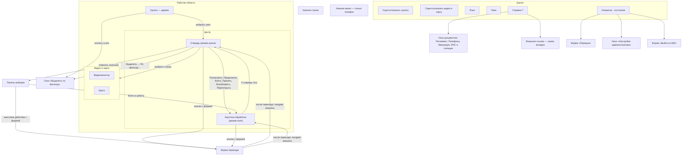
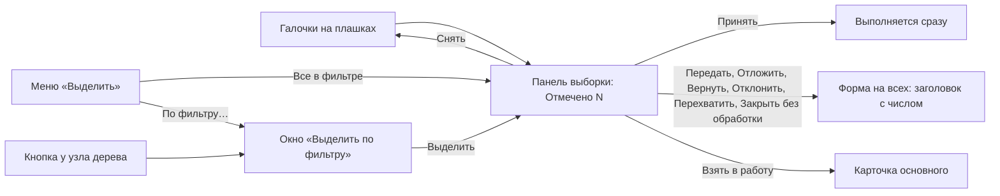
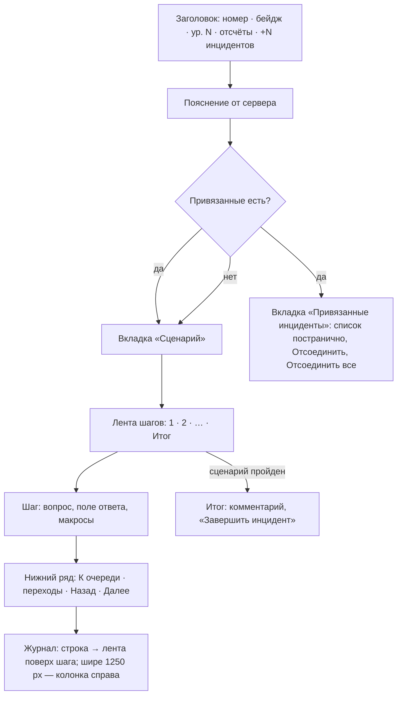
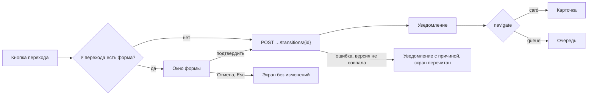
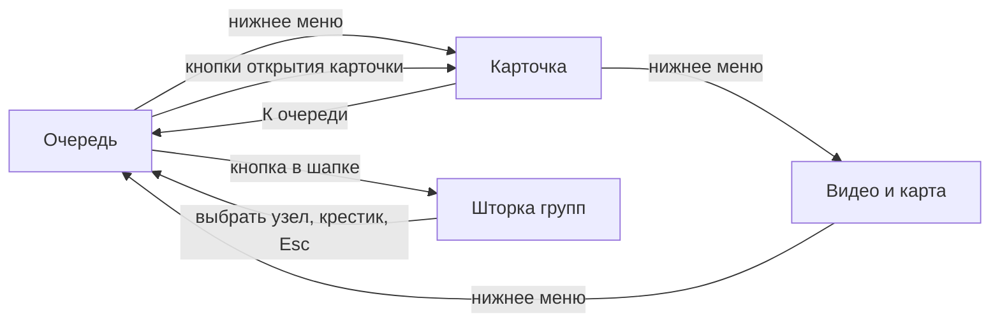

# Карта экранов и форм рабочего места оператора

Из чего состоит интерфейс оператора и как одно открывает другое: области экрана, режимы, меню, окна, формы переходов. Оформление — [DESIGN_SYSTEM.md](DESIGN_SYSTEM.md). Что видит оператор словами — [руководство оператора](../Operator%20guide.md). Если карта и прототип расходятся, верен прототип ([`index.html`](../../prototype/index.html), [`app.js`](../../prototype/app.js)), а за правилами — [правила](../State_rules/States%20rules%20IM.md) и машина.

Рабочее место — **одна страница без адресов разделов**. «Карта сайта» здесь — это карта областей, режимов и окон одной страницы.

## 1. Точки входа

| Адрес | Что открывается |
|---|---|
| `prototype/index.html` | рабочее место со встроенным сервером |
| `prototype/index.html?api=https://…` | то же, но запросы идут на настоящий бэкенд |
| `prototype/index.html?selftest` | рабочее место и самопроверка с отчётом в углу |
| `tests/api.html`, `tests/scenario.html` | тесты API и исполнителя сценариев, не интерфейс оператора |

Что помнит браузер (`localStorage`): тема `im-theme`, язык `im-lang`, ширины панелей `im-layout`. Порядок очереди, если оператору его разрешили менять, хранит сервер (`PATCH /operator/session/preferences`).

## 2. Общая схема

## 3. Каркас экрана

Разметка — [`index.html`](../../prototype/index.html), в скобках — `id` элемента.

| Область | Что в ней | Заметки |
|---|---|---|
| **Шапка** (`.topbar`) | знак и название приложения; кнопки панелей групп и видео (`toggleGroups`, `toggleMedia`); язык (`langSelect`); тема (`themeToggle`); меню справки (`helpMenu`); меню оператора (`userMenu`) с состоянием «Готов / Занят / Перерыв / Вышел»; часы | на телефоне часы, подпись и кнопка видео скрыты |
| **Плашки режима** | «Перерыв» (`breakBanner`) с «Вернуться с перерыва»; «Вы вышли из МИ» (`signedOutBanner`) с «Войти» | под шапкой, пока режим действует |
| **Группы** (`panelGroups`) | поиск по дереву с числом найденного и стрелками; дерево групп и устройств с числами открытых инцидентов; «Свернуть все» | ≤ 900 px — шторка слева поверх; скрыта в карточке |
| **Очередь** (`panelEvents`) | заголовок с числом; «Выделить» (меню) и «Снять»; панель выборки (`selBar`); поиск; фильтр состояния; фильтры по типу устройства и события; порядок очереди (если разрешён); список плашек; страницы | видна в режиме `queue` |
| **Карточка** (`panelScenario`) | заголовок, пояснение, вкладки, лента шагов, шаг, нижний ряд кнопок, журнал | видна в режиме `work`; раздел 6 |
| **Видео и карта** (`panelMedia`) | «Видеомонитор»: «Архив / Online», камеры, развернуть; «Карта»: план с отметкой источника, развернуть | показывает выбранный инцидент |
| **Разделители** | `splitGroups`, `splitMedia`, `splitVideo` | > 1240 px; ширины помнятся |
| **Нижняя строка** (`.statusbar`) | выбранный инцидент, шаги, норматив, счётчики очереди | |
| **Нижнее меню** (`mobileNav`) | «Очередь N · Карточка · Видео и карта» | только ≤ 600 px; «Карточка» доступна, когда карточка открыта |
| **Уведомления** (`toasts`) | итог действия, ошибки, причины недоступности | справа снизу |

## 4. Режимы и состояния экрана

Атрибуты `#workspace` задают, что видно.

| Атрибут | Значения | Что меняет |
|---|---|---|
| `data-mode` | `queue` / `work` | в центре очередь или карточка; в `work` дерево групп скрыто |
| `data-groups` | `on` / `off` | панель групп (кнопка в шапке; ≤ 900 px — шторка) |
| `data-mediapanel` | `on` / `off` | панель видео и карты |
| `data-view` | `queue` / `card` / `media` | раздел на телефоне (нижнее меню) |
| развёрнуто | видео или карта на всю рабочую область | кнопка в углу панели или Esc |

Режимы оператора (сессия, правила §12) меняют не раскладку, а доступность:

| Состояние | Как попасть | Что на экране |
|---|---|---|
| Готов / Занят | вход; «Занят» — пока в работе свой инцидент | всё доступно по правам |
| Перерыв | меню оператора → «Уйти на перерыв» → форма с причиной | плашка «Перерыв», только просмотр; переданное ждёт в «Мне на принятие» |
| Вышел | меню оператора → «Выйти» → подтверждение | плашка «Вы вышли из МИ», только просмотр, кнопка «Войти» |

## 5. Очередь

### 5.1. Что выбирает содержимое

| Элемент | Значения | Откуда |
|---|---|---|
| Узел дерева групп | «Все инциденты» или группа, устройство | `GET /operator/reference/source-groups` |
| Фильтр состояния | Открытые · Мне на принятие · Мои · Чужие · Завершённые · Все | `queueFilters` машины |
| Типы устройств и событий | несколько сразу | справочники `device-types`, `event-types` |
| Поиск | площадка, тип, номер; находит и привязанный — строкой основного | |
| Порядок | приоритет и старые выше · приоритет и новые · по времени · по сроку реакции | `queueSort` машины, если `operatorMayChange` |

Всё вместе — запрос `GET /operator/incidents`.

### 5.2. Плашка инцидента

Нажатие на строку **выбирает** инцидент: видео и карта переключаются на него, в дереве подсвечивается путь до его группы. Карточку открывают только кнопки.

| Элемент плашки | Что делает |
|---|---|
| Галочка | отмечает для выборки (раздел 5.3) |
| Глаз и название — «Посмотреть» | открывает карточку, ничего не меняя |
| «+N инцидентов» | открывает карточку на вкладке «Привязанные инциденты» |
| Кнопки справа | переходы и навигация, которые прислал сервер для этого инцидента (раздел 7) |

### 5.3. Выборка

- На панели — только действия с `bulk.allowed`, которые подходят отмеченным. Недоступное кому-то — бледное, причина с номером инцидента.
- Кнопки плашек всегда действуют на свой инцидент, не на выборку.
- «Взять в работу» объединяет отмеченные: основной — у оператора, остальные — его привязанные (`POST /operator/incidents/merge`).
- Окно «Выделить по фильтру» (`modalGrouping`): узел дерева, условия через «ИЛИ» — тип устройства, типы событий, устройства; кнопка «ИЛИ» добавляет условие; сколько подходит считает сервер (`POST /operator/incidents/filter`).

## 6. Карточка обработки

Открывается кнопками очереди и панели выборки (раздел 7). Закрывается «К очереди» или Esc — инцидент остаётся у оператора.

| Часть | Что внутри | Запросы |
|---|---|---|
| Заголовок | номер, бейдж, уровень эскалации, отсчёты нормативов, «+N инцидентов» | `GET …/incidents/{guid}` |
| Пояснение | готовый текст по правилам `cardNotes` машины | поле `note` карточки |
| Вкладки | «Сценарий» и «Привязанные инциденты» — только если привязанные есть | `GET …/linked` |
| Лента шагов | пройденные шаги нажимаются (вернуться к шагу), впереди — бледные, «может измениться от ответов»; замок — не переотвечается; последний — «Итог» | `PUT …/scenario/cursor` |
| Шаг | один из семи типов: Message, Checkbox, RadioButton, Select, Comment, Datetime, Image; макросы шага — «Запустить макрос» | `POST …/scenario/answer` |
| Итог | «Сценарий пройден до конца…», комментарий, «Завершить инцидент» = переход `close` с результатом «Обработан», без формы | `POST …/transitions/close` |
| Нижний ряд | «К очереди» · переходы карточки · «Назад» · «Далее» | |
| Журнал | последнее событие и число записей; раскрытый — вся история | `GET …/journal` |

Карточка бывает **для работы** (свой инцидент в работе) и **на просмотр** (чужой, новый, закрытый, перерыв, вышел) — тогда поля шагов недоступны, а кнопки — те, что разрешены смотрящему (например, «Перехватить»). Если инцидент увели, пока карточка открыта (событие `incident.card_evicted`), она переходит в просмотр с уведомлением.

## 7. Кнопки, формы и куда они ведут

Источник — переходы машины ([`workflow_schema.v1.json`](../Workflow_machine/workflow_schema.v1.json), поле `ui`) и навигационные действия (`navActions`). Где кнопка видна — `surface`; куда экран переходит после — `navigate`. Подробно по состояниям — [TRANSITIONS.md](../Workflow_machine/TRANSITIONS.md).

### 7.1. Навигация — состояние не меняется

| Кнопка | Где | Когда видна | Куда |
|---|---|---|---|
| Посмотреть (глаз) | очередь | у любого, кроме привязанного | карточка |
| Продолжить | очередь | свой «В работе» | карточка |
| К очереди | карточка | всегда | очередь |
| Запустить макрос | карточка, на шаге | свой «В работе», есть право, оператор готов | остаётся на шаге |

### 7.2. Переходы

| Кнопка | Где | Из состояний | Форма | Поля формы | Куда после |
|---|---|---|---|---|---|
| Взять | очередь, карточка | Новое | — | — | карточка |
| Принять | очередь, карточка, выборка | Ожидает принятия (адресату) | — | — | карточка |
| Возобновить | очередь, карточка | Отложен | — | — | карточка |
| Переоткрыть | очередь, карточка | Закрыто | «Переоткрыть инцидент» | Основание | карточка |
| Перехватить | карточка, выборка | Ожидает принятия, В работе, Отложен (чужой) | «Перехватить инцидент» | — (подтверждение) | карточка |
| Отклонить | очередь, карточка, выборка | Ожидает принятия | «Отклонить передачу» | Причина | очередь |
| Отложить | карточка, выборка | В работе | «Отложить инцидент» | Причина из справочника, Комментарий | очередь |
| Вернуть в очередь | карточка, выборка | В работе, Отложен | «Вернуть в очередь» | Причина | очередь |
| Передать | очередь, карточка, выборка | Новое, Ожидает принятия, В работе, Отложен | «Передать инцидент» | Кому передать, Причина | очередь |
| Закрыть без обработки | очередь, карточка, выборка | Новое, Ожидает принятия, В работе, Отложен | «Закрытие без обработки» | Результат, Причина сбоя (при «Массовый сбой»), Комментарий | очередь |
| Завершить инцидент | карточка, «Итог» | В работе, сценарий пройден | — | комментарий на «Итоге» | очередь |
| Взять в работу | панель выборки | Новое, В работе, Отложен | — | — | карточка основного |
| Отсоединить, Отсоединить все | карточка, вкладка привязанных | Привязан | — | — | остаётся в карточке |

Справочники полей: причины отложения — «Ожидание третьей стороны», «Выезд наряда», «Нет данных, вернуться позже»; результаты закрытия — «Обработан» (только через «Итог»), «Ложная тревога», «Дубликат», «Плановая проверка», «Прервано: обработка невозможна», «Массовый сбой»; причины сбоя — четыре варианта. Состав, значение по умолчанию, видимость и обязательность полей присылает сервер с действием (`fieldOptions`, `fieldRules`).

### 7.3. Одна форма на все переходы

Все формы переходов рисует одно окно `modalDialog`: заголовок, пояснение от сервера, поля по форме машины, «Отмена» и кнопка подтверждения в стиле формы (`primary`, `warn` у передачи, `danger` у перехвата). У массового действия — та же форма с числом в заголовке («Передать 3 инцидента»). В этом же окне — две формы самого интерфейса: «Перерыв» (причина: Обед, Инструктаж, Обход) и «Выйти из МИ» (подтверждение, сколько вернётся в очередь).

Недоступная кнопка остаётся на месте бледной; нажатие показывает причину уведомлением, форма не открывается.

## 8. Окна

| Окно | `id` | Как открыть | Содержимое |
|---|---|---|---|
| Форма перехода, «Перерыв», «Выйти из МИ» | `modalDialog` | разделы 7.3, 4 | поля формы |
| Выделить по фильтру | `modalGrouping` | меню «Выделить» → «По фильтру…», кнопка у узла дерева | условия, сколько подходит |
| Настройки администратора | `modalAdmin` | меню оператора, только с правом `incident:schema:admin` | только просмотр, 12 вкладок: Нормативы · Причины · Автоэскалация и алерты · Лимиты · Связь с оператором · Очередь · Приоритеты · Группы доступа · Дежурные группы · Группы устройств · Справочные ссылки · Связи камер ([SETTINGS.md](../Workflow_machine/SETTINGS.md)) |
| Регламент обработки инцидента | `modalRegulation` | меню справки | демо-документ |
| Телефоны ответственных | `modalContacts` | меню справки | демо-документ |
| Схема эвакуации | `modalEvacuation` | меню справки, у инцидента площадки «Торговый центр» | демо-документ |
| Контакты МЧС и полиции | `modalEmergency` | меню справки | демо-документ |

Меню справки строится из `GET /operator/reference/help-links`: общие ссылки и ссылки площадки открытого инцидента. Ссылка `demo:doc/…` открывает окно прототипа; обычная — новую вкладку. В продукте окон документов нет — только ссылки.

## 9. Меню

| Меню | Пункты |
|---|---|
| Справка (?) | ссылки из справочника; раздел площадки — отдельно, под её названием |
| Оператор | «Уйти на перерыв» / «Вернуться с перерыва» · «Настройки администратора» (по праву) · «Выйти» |
| Выделить (очередь) | «Все в фильтре» · «По фильтру…» |
| Язык | Русский · English |

## 10. Что меняет экран без действий оператора

Поток событий `GET /operator/stream` (SSE):

| Событие | Что происходит |
|---|---|
| `incident.created`, `incident.transitioned`, `incident.updated` | очередь и открытая карточка перечитываются; о чужом переходе — уведомление по `ui.observerNotice` машины (например, «вам передали») |
| `incident.access_lost` | уведомление «больше не доступен»; если карточка этого инцидента открыта — возврат к очереди |
| `incident.alert` | уведомление «Алерт: …» получателю алертов (правила §9) |
| `incident.sibling_closed` | уведомление «INC-1847 того же события закрыт: Ложная тревога» адресату открытого соседа (правила §6.1, «Закрыть»); очередь и карточка перечитываются |
| `session.agent_state_changed` | меняется состояние оператора в шапке и плашка режима |
| `incident.card_evicted` | открытая карточка — в просмотр, уведомление |
| `workflow.schema_published` | схема перечитывается, экран перерисовывается без перезагрузки |
| `reference.priorities_changed` | перечитываются приоритеты и их цвета |
| обрыв связи, `stream.reset` | после переподключения перечитываются очередь, карточка и сессия |

Отсчёты нормативов тикают на клиенте; автоматические переходы (автоэскалация, возврат с перерыва, нет связи) выполняет сервер и присылает событием.

## 11. Телефон (≤ 600 px)

Над очередью две строки; типы и порядок спрятаны под кнопкой «Фильтры» с числом выбранных.

## 12. Чего в прототипе нет

Экран журнала действий оператора, редактор схемы (`/operator/workflow/schemas…`), правка настроек администратора, вход в систему, несколько камер сразу, перестановка панелей — позже, см. [памятку фронтенда](../Workflow_machine/FRONTEND.md), «Что ещё за вами».
