# Правила перехода состояний МИ

Версия: **v10**. Это действующие правила: файл один и правится на месте. Как ведётся журнал изменений и где лежат прошлые версии — в §16.

Жизненный цикл инцидента в менеджере инцидентов (МИ): состояния, переходы, права, нормативы и автоэскалация.

Версия 10 — это v9 с решениями ревью 2026-10-15 — 2026-10-16, после передачи разработчикам:

- **эскалация и реакция:** уровень эскалации меняет только автоэскалация, число передач — отдельное поле; «Передать» и «Отклонить» реакцию не обнуляют, а продолжают; в окне после дедлайна они срабатывание таймера не отменяют, а «Взять в работу одним» нарушение не теряет (§4, §8.3, §10.1);
- **просмотр и перехват:** «Посмотреть» — у каждого инцидента очереди, отдельного права на просмотр нет; «Перехватить» — не адресату (§6, §7);
- **дерево групп:** инцидент относится к группе по устройству-источнику; в группе — все её устройства; дерево с клавиатуры, поиск переходит по найденному (§13, §19.1);
- **карточка:** внизу один ряд — «К очереди», главные действия и меню «Ещё», «Назад» и «Далее»; «Комментарий» — в шапке карточки; `Esc` закрывает карточку (§7, §13).

Правила, которые исполняет прототип, записаны в машине состояний `Specification/Workflow_machine/` — она источник истины. Что изменилось от версии к версии — в [журнале изменений](CHANGELOG.md) (§16).

> Документ описывает целевую модель. Прототип следует её терминам; где он от неё отступает — в §17.

> Правила описывают механику, а значения задаёт машина состояний [`workflow_schema.v1.json`](../Workflow_machine/workflow_schema.v1.json): нормативы (`timers`), лимиты и срок переоткрытия (`limits`), уровни и адресаты эскалации (`escalation`), пороги потери связи (`session`), начала смен (`shift`, §20), причины удержания со сроками, результаты закрытия, причины массового сбоя (`reasonCatalogs`), звук оператора (`sound`, §21). Переходы машины словами, с подставленными значениями, — [`TRANSITIONS.md`](../Workflow_machine/TRANSITIONS.md); строки §6 ссылаются на них колонкой «В машине».

## 1. Словарь и сокращения

### Сокращения

| Сокращение | Расшифровка | Простыми словами |
|---|---|---|
| **МИ** | Менеджер инцидентов | Рабочее место оператора: очередь инцидентов, карточка обработки, видео и карта на одном экране |
| **SLA** | Service Level Agreement — соглашение об уровне сервиса | Отведённое время на работу с инцидентом. В МИ два норматива: время до взятия и время до закрытия (§4) |
| **ЦОД** | Центр обработки данных | Круглосуточный дежурный пост, куда передают то, что не решается силами площадки |
| **ТСО** | Технические средства охраны | Камеры, датчики, детекторы, турникеты — всё оборудование, которое порождает события |
| **СКУД** | Система контроля и управления доступом | Турникеты, шлагбаумы, двери с картами доступа |
| **СИЗ** | Средства индивидуальной защиты | Каска, жилет, очки. Есть детектор, который замечает их отсутствие |
| **PTZ** | Pan-Tilt-Zoom | Управляемая камера: её можно поворачивать, наклонять и приближать |
| **RBAC** | Role-Based Access Control | Права выдаются не человеку, а роли; человек получает права вместе с ролью. Роли ведутся во внешней системе, не в МИ (§5) |
| **AxxonData** | — | Система хранения и аналитики, куда уходит результат закрытого инцидента |
| **ITSM / ITIL** | — | Практики управления заявками и инцидентами, откуда взяты названия состояний (§16) |

### Термины

| Термин | Что это значит |
|---|---|
| **Событие** | То, что прислал источник: сработка детектора, датчика, тревожной кнопки. Событие проходит через правила (§14.5): для каждого сценария подошедших правил МИ создаёт свой инцидент (§6.2, `create`); не подошло ни одно правило со сценарием — инцидента нет. Повтор события с тем же идентификатором ничего не создаёт. Слово «событие» — только о присланном источником: тип события, время события, источник события |
| **Инцидент** | То, с чем работает оператор: очередь, карточка, выборка, передача, закрытие. Одно событие — столько инцидентов, сколько сценариев у подошедших правил, по одному на сценарий (§14.5); привязанные (§11) — тоже инциденты |
| **Правило** | Фильтр событий (§14.5): название, приоритет, сценарии и условия. Условия соединены «или»; в условии — по желанию устройство, тип устройства, группа устройств, тип события, соединённые «и». Правило со сценарием, под которое подошло событие, даёт инцидент своего сценария; приоритет инцидента — правила (§2.5). Правила ведёт администратор; в прототипе — из эталонного набора (§17) |
| **Тревога** | Все инциденты одного события. Номер тревоги — номер первого созданного инцидента события: «тревога INC-1847»; у первого он совпадает с его номером. Своего счётчика у тревоги нет, событие без инцидентов номера тревоги не получает (§14.5) |
| **Соседние инциденты** | Инциденты того же события, кроме самого: другие службы той же тревоги. Это не привязка (§11): их не объединяют и не отсоединяют, у каждого свой владелец, сроки и закрытие |
| **Состояние** | Объективное положение инцидента в жизненном цикле: новое, ожидает принятия, в работе, отложен, привязан, закрыто (§2.1). Одно и то же для всех, кто смотрит |
| **Бейдж** | Подпись состояния в очереди. Вычисляется из состояния и владельца для конкретного смотрящего оператора (§2.4). Не хранится |
| **Владелец** | Оператор, за которым закреплён инцидент. Поле `owner` |
| **Передача** | Ручное действие «Передать»: выбрать адресата и отдать ему инцидент. Своё и чужое — одно действие, разные права (§5) |
| **Результат закрытия** | Чем закончился инцидент: обработан, ложная тревога, дубликат, плановая проверка, прервано, массовый сбой. Выбирается при каждом закрытии (§2.2). Поле `close_result` |
| **Закрытие без обработки** | Закрытие с любым результатом, кроме «Обработан»: сценарий не заполняется. Признак не хранится отдельно, а следует из результата. В интерфейсе — кнопка **Закрыть без обработки**, на любом этапе (§7) |
| **Итог** | Последний пункт в ленте шагов карточки, после финального шага сценария: там инцидент закрывают с результатом «Обработан» кнопкой **Завершить инцидент** (§7). Это не шаг сценария: в формате сценария его нет, в «Шаг N из M» он не входит |
| **Адресат** | Тот, кому передают инцидент: человек или дежурная группа |
| **Дежурная группа** | Группа людей, которой можно адресовать инцидент вместо одного человека; принять может любой её участник с доступом к объекту. Состоит из ролей и, при необходимости, отдельных людей. Ведёт администратор схемы (§8.1) |
| **Очередь** | Список инцидентов, из которого оператор выбирает, чем заняться |
| **Объект** | Устройство: камера, датчик, тревожная кнопка, точка прохода. Событие порождает устройство-источник (§19) |
| **Площадка** | Охраняемая территория или здание: торговый центр, склад, офис. Не путать с объектом — устройством (RULE-09). В МИ площадка задаётся группой устройств (§19.1): отдельного поля площадки у инцидента нет |
| **Адрес** | Где стоит устройство: одна строка до 500 символов, только для показа — частей адреса и координат нет. У устройства два значения: адрес из источника (приходит при сверке устройств) и адрес, введённый в МИ. Действует введённый в МИ, если он задан, иначе — адрес из источника; нет ни того, ни другого — адреса нет (§19.1). У инцидента своего адреса нет: строка и карточка показывают действующий адрес его устройства-источника (§7, §14.5) |
| **Группа** | Набор устройств и других групп. Вложенность не ограничена, одно устройство может входить в несколько групп. Регион и свой список объектов — это группы (§19) |
| **Карточка обработки** | Экран одного инцидента: шаги сценария, видео, карта, журнал |
| **Сценарий** | Пошаговая инструкция под тип события: что подтвердить, как классифицировать, что запустить |
| **Шаг** | Один вопрос или действие сценария. Бывает обязательным для конкретного перехода (§6.1) |
| **Журнал** | Хронология по инциденту: кто что сделал и когда. Заполняется автоматически |
| **Приоритет** | Насколько срочно: число от 0 до 100, больше — срочнее. Уровни с названием, описанием и цветом задаёт администратор (§2.5). Влияет на нормативы и порядок в очереди |
| **Оператор** | Человек за рабочим местом МИ |
| **Старший оператор** | Оператор с расширенными правами: перехват, передача чужих, переоткрытие, «Массовый сбой». В Vision — «старший смены». Особой роли в модели у него нет: права приходят от внешней системы (§5), оповещения — получателю оповещений (§9). Старшим смены его делает право `supervisor:view` (§5): с ним открывается экран «Смена и статистика» (§23) — кто на месте, кто на перерыве, нагрузка и итоги смены — и приходят оповещения о затянувшемся перерыве (§12.2). |
| **Смена** | Отрезок времени поста, от одного начала смены до следующего. Начала смен — настройка поста: от одного до четырёх времён суток и часовой пояс, по умолчанию `08:00` и `20:00` (§20). Смена одна для всех на посту и не зависит от того, кто когда начал работу. От её начала считаются «закрыл за смену» и «медиана реакции за смену» на экране «Смена и статистика» (§23). На переходы, права и состояние оператора смена не влияет; расписания дежурств в МИ нет (§12.1) |
| **Получатель оповещений** | Пользователь или дежурная группа из настроек (`alerts.target`, §9), которым уходят оповещения: нарушения нормативов, потолок эскалации, потеря связи и доступа. Получают только те, кто на месте и с доступом к объекту инцидента |
| **Диспетчер** | Служебная часть системы: ставит новые инциденты в очередь и выполняет автоматические переходы. В журнале такие записи подписаны «Диспетчер» |
| **Детектор** | Модуль, который сам находит событие в видео или звуке |
| **Макрос** | Заранее настроенная команда системе: включить сирену, открыть шлагбаум, оповестить по площадке |
| **Оповещение** | Уведомление получателю оповещений без передачи ответственности и без смены состояния |
| **Норматив реакции** | Время от появления инцидента до взятия в работу |
| **Норматив закрытия** | Время от взятия в работу до закрытия |
| **Уровень эскалации** | На какой ступени цепочки автоэскалации инцидент: 0 — не эскалировался, N — отдан адресату уровня N (§8.3). Поле `escalation_level`. Меняет только автоэскалация; ручная передача — нет (RULE-76) |
| **Число передач** | Сколько раз инцидент передавали вручную. Поле `transfer_count`, для отчётов; на автоэскалацию не влияет (RULE-76) |
| **Причина удержания** | Почему инцидент отложен: ждём наряд, ждём третью сторону и так далее. Поле `hold_reason` |
| **Guard (условие)** | Проверка, без которой переход не выполняется: право, владение, заполненность шагов |
| **Effect (эффект)** | Что переход меняет: владельца, флаги, таймеры, запись в журнал, внешнюю команду |
| **Схема** | Конфигурация: состояния, переходы, условия, эффекты, нормативы. То, что настраивается без программиста |

### Технические имена

Встречаются в таблицах ниже, оператору не видны.

| Имя | Что это | В API |
|---|---|---|
| `new`, `pending_acceptance`, `in_progress`, `on_hold`, `linked`, `closed` | Коды состояний | `state` |
| `owner` | Владелец-человек | `owner` |
| `assignment_group` | Дежурная группа-владелец, пока никто не сделал взятие | `assignmentGroup` |
| `escalation_level` | Ступень автоэскалации, `0` — не эскалирован | `escalationLevel` |
| `transfer_count` | Число ручных передач | `transferCount` |
| `hold_reason` | Причина удержания при `on_hold` | `holdReasonId` |
| `close_result` | Результат закрытия при `closed`; у массового сбоя — вместе с причиной из справочника | `closeResultId`, подпись — `closeResultLabel` |
| `close_cause` | Причина закрытия из справочника причин результата: у «Массового сбоя» — причина сбоя, у «Ложной тревоги» — причина ложной тревоги (§2.2). Рядом — снимок её названия на момент закрытия | `closeCauseId`, снимок названия — `closeCauseLabel` |
| `result` | Комментарий оператора при закрытии. Обязателен для всех результатов, кроме «Обработан» и «Ложной тревоги»; у «Ложной тревоги» — только с причиной «Другое» (§2.2); виден в журнале | `result` (карточка) |
| `closed_by`, `closed_at` | Кто и когда закрыл; есть только у закрытого — «Переоткрыть» их снимает (RULE-103). Нужны для срока переоткрытия (§6.1) | `closedAt`; кто закрыл — в журнале |
| `accepted_at`, `accepted_by` | Когда и кто первым принял инцидент: первый вход в `in_progress` у инцидента, который ещё не закрывался (§2.2). Потом не меняются, «Переоткрыть» их не ставит и не снимает. У закрытого без взятия — пусто навсегда. Для отчётов: реакция оператора — от появления до `accepted_at` (§23) | `acceptedAt`, `acceptedBy` |
| `accepted_group` | Дежурная группа до принятия: последняя группа, которой инцидент адресовали до первого принятия (`last_assigned_group`), а если такой нет — первая дежурная группа принявшего; у закрытого без взятия — так же, по закрывшему. Ставится один раз, вместе с `accepted_at` или `no_reaction`, потом не меняется (§2.2). Для отчётов: дежурная группа в статистике «За период» (§23.3) | `acceptedGroup` |
| `last_assigned_group` | Последняя дежурная группа, которой адресовали инцидент: пишется всякий раз, когда `assignment_group` получает группу, и не стирается, когда `assignment_group` очищают (§2.2). Нужна только для `accepted_group` | нет — данные сервера |
| `no_reaction` | Инцидент закрыли, когда `accepted_at` было пусто: реакции у него нет и уже не будет. Ставит закрытие, не снимает ничто, в том числе «Переоткрыть» (§2.2) | нет — данные сервера |
| `linked_to` | Основной инцидент привязанного инцидента (§11.3). У закрытого вместе с основным остаётся как история | `linkedTo`; сколько привязано к инциденту — `linkedCount` |
| `linked_at` | Когда инцидент привязан к нынешнему основному: при объединении и при переносе к новому основному (§11.3). По нему нарушение группы получают те, кто был в группе в момент срока (§11.4) | нет — данные сервера |
| `left_group` | Из какой группы и когда инцидент вышел: основной, `linked_at` на тот момент, момент выхода. Ставится при отсоединении, потере доступа, переносе к новому основному, переоткрытии. Нарушение по сроку, прошедшему до выхода, достаётся и ему (§11.4) | нет — данные сервера |
| `reaction_due_at`, `resolution_due_at` | Дедлайны нормативов — метки времени, не счётчики | `timer.dueAt` — норматив, который идёт сейчас; срок удержания — `holdTimer` |
| `breaches` | Нарушения нормативов: вид (реакция, закрытие, удержание), когда, чей — владелец в момент нарушения. Не стираются, в том числе при переоткрытии | `breaches` |
| `sla_breached` | Есть хоть одно нарушение в `breaches` — для фильтров и бейджей | `slaBreached` |
| `schema_version` | Версия схемы, на которой инцидент был создан | `schemaVersion` |
| `event_guid` | Событие, по которому создан инцидент (§14.5): идентификатор от источника. У инцидентов одного события — один; пара `event_guid` + сценарий уникальна | `eventGuid` |
| `alarm_number` | Номер тревоги — номер первого созданного инцидента события (§14.5) | `alarmNumber` |
| `rule_guid` | Правило-победитель, по которому создан инцидент: от него приоритет и сценарий (§14.5). Для отчётов | `ruleGuid`; название правила — `ruleName` (карточка) |

## 2. Модель состояний

### 2.1. Объективные состояния

Состояние одно для всех. Оно не зависит от того, кто открыл очередь. Новый инцидент появляется в состоянии «Новое» — это начальное состояние машины (`initial`).

| Состояние | Код | Категория | Владелец | Терминальное |
|---|---|---|---|---|
| Новое | `new` | pending | нет | нет |
| Ожидает принятия | `pending_acceptance` | pending | адресат передачи | нет |
| В работе | `in_progress` | active | оператор | нет |
| Отложен | `on_hold` | active | оператор | нет |
| Привязан | `linked` | linked | нет | нет |
| Закрыто | `closed` | done | кто закрыл | да |

Пояснения к выбору:

- **`pending_acceptance` вместо `escalated`.** Из имени видно, что состояние ждёт действия адресата, а значит нужен переход «Принять». В первой версии такого перехода не было, и адресат мог войти в инцидент только через «Перехватить».
- **`on_hold` — отдельное состояние, а не флаг.** Так работают категории (§2.3) и настройки автоэскалации: правило «эскалировать просроченные в работе, но не трогать отложенные» становится обычным перечислением состояний, а не разбором флагов.
- **`linked` — отдельное состояние привязанного инцидента (§11).** Инцидент, взятый в работу вместе с другими как один, ведётся основным: своего владельца у него нет, в списках его нет. Свой норматив закрытия на паузе: идёт срок группы — срок основного (§11.4). Выход — «Отсоединить» (снова `new`) или закрытие вместе с основным.
- **Закрытие — одним действием.** Отдельного «выполнено» с проверкой старшим нет: это проще для смены. Проверить работу старший может по закрытым и при необходимости переоткрыть.
- **Одно конечное состояние `closed` и обязательный результат.** Так устроено в Jira: статус Done и поле Resolution. Ложная тревога, дубликат и проверка — значения результата, а не отдельное состояние. До v5 было два конечных состояния, «Закрыто» и «Отменено», и одна и та же ложная тревога попадала то в одно, то в другое (RULE-02). Отчёты строятся по результату.

### 2.2. Флаги и поля

Поля инцидента, влияющие на переходы: `owner`, `assignment_group`, `escalation_level`, `hold_reason`, `close_result`, `linked_to`, `linked_at`, `left_group`, `priority` (§2.5), `priority_manual` (§2.5, ТЗ-13), `maintenance_window_id` и `close_maintenance_window_id` (§14.12, ТЗ-21), `reaction_due_at`, `resolution_due_at`, `breaches`, `sla_breached`. Поля появления (§14.5) — `event_guid`, `alarm_number`, `rule_guid`: ставятся при создании инцидента и потом не меняются; на переходы не влияют.

**Первое принятие** — поля `accepted_at` и `accepted_by` (решение 2026-11-17, план 90): когда и кто первым взял инцидент в работу. Их ставит эффект машины при входе в `in_progress`, если `accepted_at` пусто и нет пометки `no_reaction`. Повторный вход в работу поля не перезаписывает: «Вернуть в очередь», передача, перехват в работе оставляют первое принятие как было. На переходы поля не влияют — они для отчётов: реакция оператора — от появления до `accepted_at` (§23); передача и переоткрытие новой реакции не открывают. Норматив реакции (§4) от них не зависит: он идёт по своим правилам.

Какие переходы ставят первое принятие: «Взять», «Принять», «Перехватить» из «Ожидает принятия», «Взять в работу» на выборке (основной), «Возобновить» — если до этого поле не поставлено. «Переоткрыть» не ставит никогда.

**Закрытый без взятия реакции не имеет** (решение пользователя 2026-11-17). Закрытие инцидента с пустым `accepted_at` — «Массовым сбоем» из очереди или привязанного вместе с основным — ставит пометку `no_reaction`. Её ничто не снимает: после «Переоткрыть», возврата в очередь и нового взятия поле `accepted_at` остаётся пустым, инцидент в реакцию не входит. Так машина проверяет «ни разу не закрывался» по полю инцидента, а не по журналу. Привязанный (§11) — поле как было до объединения: объединение его не ставит и не снимает; в медиану реакции привязанный не идёт (§23.2).

**Дежурная группа до принятия** — поле `accepted_group` (решение 16 плана 90 и решение пользователя 2026-11-18): к какой дежурной группе относится инцидент в отчётах. По нему — «дежурная группа» в статистике «За период» (§23.3, §23.4). `assignment_group` для этого не годится: «Принять», «Перехватить», «Отклонить» и «Закрыть» его очищают (§8.1), у закрытого он всегда пуст, а у инцидента, взятого из «Новых», его не было вовсе.

- **Последняя группа-адресат** — поле `last_assigned_group`, данные сервера. Всякий раз, когда `assignment_group` получает группу — адресация из правила, передача группе, автоэскалация на группу, уход адресата в его группу (§8.1, §8.3), — то же значение пишется в `last_assigned_group`. Когда `assignment_group` очищают («Принять», «Перехватить», «Отклонить», «Закрыть», уход в общую очередь), `last_assigned_group` остаётся: отклонившая группа — всё равно последняя, кому инцидент адресовали. Отдельное поле проще, чем искать группу в журнале при каждом принятии.
- **Первое принятие** — тот же момент, что `accepted_at`: `accepted_group` = `last_assigned_group`. Пусто — инцидент ни одной группе не адресовали — первая по порядку дежурная группа принявшего (§8.1) на момент принятия; принявший ни в одной группе не состоит — пусто.
- **Закрытие без взятия** — тот же момент, когда ставится `no_reaction`: `last_assigned_group`, иначе первая по порядку дежурная группа закрывшего; нет и её — пусто.
- **Значение берётся до перехода.** «Перехватить» и «Закрыть» очищают `assignment_group` раньше, чем ставится первое принятие или `no_reaction`, поэтому эффект читает `last_assigned_group`, а не `assignment_group` после перехода.
- **Ставится один раз** — вместе с `accepted_at` или `no_reaction`, что раньше, — и потом не меняется: переоткрытие, повторное принятие, передача, возврат в очередь его не трогают. Условие — как у `accepted_at`: `accepted_at` пусто и нет `no_reaction`. Пустое `accepted_group` не значит «ещё не ставилось»: группы могло не быть. Объединение поле не ставит и не снимает, как `accepted_at`.
- **Старые инциденты** (до поля) получают его из журнала инцидента: последняя группа, которой инцидент адресовали до первого принятия или закрытия без взятия. Журнал её не называет — первая по порядку дежурная группа принявшего (`accepted_by`), а у закрытого без взятия — закрывшего (`closed_by`), как у новых; по нынешнему составу групп: состав на прошлый момент не восстановить (решения контролёра 2026-11-18). Он ни в одной группе не состоит — пусто, в статистике «Без группы». Заполняет миграция сервера; она же заполняет из журнала `last_assigned_group` — последнюю группу-адресат — у всех старых инцидентов, в том числе открытых: иначе ждущий принятия группой при первом принятии получил бы группу принявшего.

На переходы поле не влияет.

**Справочники причин — без предопределённых пунктов** (решение 2026-11-15). Машина задаёт только устройство справочника причин удержания, массового сбоя и ложной тревоги: поле, обязательность, системные причины. Причины оператора заводит администратор поста на вкладке «Причины» настроек: название, у причины удержания — предельный срок, у причины ложной тревоги — нужен ли комментарий. Пока у результата справочник причин пуст, причина при закрытии не нужна и поля «Причина» в форме нет; заведена хоть одна — причина обязательна. Так же у группового закрытия «Массовым сбоем». Без причин удержания оператора «Отложить» недоступно: срок удержания берётся из причины, а удержания без срока нет (§4, правило 7). Новый пост не пуст: при разворачивании он получает стартовый набор причин — прежние пункты машины (§20).

**Списки причин — по алфавиту** (решение 2026-11-15). Любой список причин — удержания, массового сбоя, ложной тревоги, перерыва и любого другого справочника `reasonCatalogs` — показывается по названию на языке интерфейса: без учёта регистра и «ё», числа в названии — по значению («Пункт 9» раньше «Пункт 10»), равные названия — по id. Исключений нет: «Другое» стоит на своём месте по букве, системные причины — среди остальных. Так и в формах оператора («Отложить», закрытие с причиной, «Массовым сбоем», перерыв), и на вкладке «Причины» настроек поста. Порядок пунктов в настройках поста на показ не влияет и не хранится как смысловой. В правке вкладки «Причины» строка, пока её набирают, не переставляется: новая стоит в конце, список упорядочивается заново при следующем открытии.

**Причины удержания** (`hold_reason`, обязательна при переходе в `on_hold`). Системные — в машине; причины оператора — из настроек поста, например «Ожидание третьей стороны», «Выезд наряда», «Нет данных, вернуться позже»:

| Причина | Когда выбирают | Кто ставит |
|---|---|---|
| Перерыв оператора | Оператор ушёл на перерыв с открытой карточкой | система |
| Нет связи с оператором | Сессия оператора не отвечает (§12.3); срок — порог возврата минус порог удержания: по нему или по порогу молчания инцидент уходит в очередь без нарушения (§4, правило 7) | система |

**Результаты закрытия** (`close_result`, обязателен при переходе в `closed`; комментарий обязателен для всех, кроме «Обработан»):

| Результат | Когда выбирают | Сценарий | Право | Откуда |
|---|---|---|---|---|
| Обработан | Событие было и разобрано по регламенту | пройден до конца — набор «закрытие» (§14.5) | `incident:close` | свой `in_progress` |
| Ложная тревога | Детектор ошибся, события не было. Причина — из справочника причин ложной тревоги | не нужен | `incident:close` | свой `in_progress` |
| Дубликат | Та же тревога уже разбирается в другом инциденте; инцидент того же события другой службы — не дубликат: при соседях форма предупреждает, закрыть можно | не нужен | `incident:close` | свой `in_progress` |
| Плановая проверка | Тест системы, учения, плановые работы. Необязательное поле «окно работ» — выбор из окон, пересекающихся с инцидентом (§14.12): ссылка хранится в инциденте (`close_maintenance_window_id`) и в журнале; работы бывают и без окна | не нужен | `incident:close` | свой `in_progress` |
| Прервано: обработка невозможна | Площадка недоступна, данных нет, разобрать по регламенту нельзя | не нужен | `incident:close` | свой `in_progress` |
| Массовый сбой | Отключение электричества, потеря связи: причина известна, событий много. Причина — из справочника массовых сбоев | не нужен | `incident:close:unprocessed` | `new`, `pending_acceptance`, свой `in_progress` и `on_hold` |

Прав на закрытие два: `incident:close` — для результатов из своей карточки, `incident:close:unprocessed` — для «Массового сбоя», который закрывают из очереди без взятия в работу. Остальные результаты требуют открыть карточку, поэтому из очереди недоступны.

**Закрытие после обработки и закрытие без обработки — разные действия интерфейса** одного перехода «Закрыть» (§7). «Обработан» ставит кнопка **Завершить инцидент** на шаге «Итог» карточки: он открывается, когда сценарий пройден до конца — набор «закрытие» выполнен (§14.5); выбирать результат там не нужно. Остальные результаты — кнопка **Закрыть без обработки**, на любом этапе: в её форме «Обработан» нет.

**Результат в форме «Закрыть без обработки» выбирает оператор.** Поле пустое, и закрыть без выбора нельзя: случайное нажатие не должно записать в отчёт «Ложную тревогу», которую оператор не выбирал. Если доступен единственный результат — например, «Массовый сбой» в очереди, — он выбран сразу. Так же пусты, пока оператор не выберет сам, причина у «Массового сбоя» и «Ложной тревоги» — она уходит в отчёт — и причина удержания в форме «Отложить»: от неё зависит срок удержания (§4, правило 7; RULE-110).

**Причина ложной тревоги.** Закрывая «Ложной тревогой», оператор выбирает причину из справочника `false_alarm_cause`. Пункты заводит администратор поста, например: животные, насекомые; погода, природные явления; неисправность устройства; другое. Справочник не пуст — без причины не закрыть; пуст — поля причины нет. Комментарий нужен только с причиной, у которой он отмечен обязательным (например, «Другое»): код причины идёт в отчёт, текст нужен, когда кода нет. Причина пишется в то же поле `close_cause`, что причина сбоя: у закрытия одна причина, а справочник выбирает результат. Причина не из справочника выбранного результата — отказ: сменили результат с «Ложной тревоги» на «Массовый сбой» — причина ложной тревоги в инцидент не попадёт. Вместе с кодом в инциденте и записи журнала закрытия хранится снимок названия причины (`closeCauseLabel`) — **текст названия на языке закрывшего в момент закрытия**, а не ключ справочника. Машина говорит, что писать (ключ подписи причины), а текст снимает сервер в той же транзакции (`labelSnapshots` машины). Пока причина есть в справочнике результата, карточка и журнал показывают её название на языке читающего; причину удалили — показывают снимок, отчёт за прошлый период не теряет причину. Так же — подпись закрытого «Массовым сбоем». Снимок живёт и удаляется вместе с инцидентом (§14.11): отдельного срока хранения у него нет. «Переоткрыть» снимает причину и снимок вместе с результатом. Справочник правится на вкладке «Причины» настроек; правка — запись журнала настроек, как у любой настройки (§12.4). Право — прежнее `incident:close`.

Ответы сценария — пометки оператора. На результат и на выбор перехода они не влияют: вариант «Ложная» в сценарии не закрывает инцидент как ложную тревогу. Итог инцидента — только результат закрытия.

### 2.3. Категории состояний

У каждого состояния обязательна категория: `pending` — ждёт реакции, никто не работает; `active` — есть владелец, идёт работа; `done` — завершено; `linked` — привязано к основному инциденту (§11): не считается открытым и в списках не показывается. Три из них — `pending`, `active`, `done` — как категории статусов в Jira: To Do, In Progress, Done. От категории зависят группировка очереди, цвет бейджа, счётчики и отнесение в отчётах. Новое состояние, добавленное в схему, получает категорию и сразу попадает во все фильтры и сводки — без доработки интерфейса.

### 2.4. Слой представления: моё, чужое, бейджи

`mine` и `foreign` — не состояния. Это результат сравнения `owner` с текущим оператором, и в модели данных их нет. Бейдж в очереди вычисляется так:

| Состояние | Владелец относительно смотрящего | Бейдж |
|---|---|---|
| `new` | — | Новое |
| `pending_acceptance` | я | Вам на принятие |
| `pending_acceptance` | моя дежурная группа | Вашей группе · «группа» — принять может любой из группы |
| `pending_acceptance` | другой | Ожидает принятия · «адресат» |
| `in_progress` | я | В работе |
| `in_progress` | другой | «ФИО оператора» |
| `on_hold` | я | Отложен · «причина» |
| `on_hold` | другой | Отложен · «ФИО оператора» |
| `linked` | любой | Привязан — в очереди не показывается: виден на вкладке **Привязанные инциденты** основного и в поиске (§11.4) |
| `closed`, результат «Обработан» | любой | Закрыто |
| `closed`, другой результат | любой | Закрыто · «результат» |

### 2.5. Приоритеты

| Правило | Поведение |
|---|---|
| Что это | Целое число от 0 до 100, больше — срочнее. Список уровней — справочник МИ, общий для всех схем (§14.4). Его ведёт администратор с правом `incident:schema:admin`; меняется без публикации схемы |
| Уровень | Число; название и описание на каждом языке интерфейса (без перевода — русское, §14.9); цвет полоски в очереди — один из палитры: красный, янтарный, синий, серый. У двух уровней может быть один цвет — их различают по названию |
| Показ | На строке очереди, в строке блока «Мне на принятие» (§7) и в карточке — название уровня его цветом, а не «ур. N». Слово «уровень» для приоритета на экране не используется: уровни — у эскалации (§8.3). Приоритет нигде не различается только цветом: рядом всегда название или буква — красный и янтарный путают люди с нарушением цветового зрения (решение 2026-11-15, [87](../../research/integration/87-notifications.md)) |
| В поставке | Критический 100, Высокий 75, Средний 50, Низкий 25 |
| Число | Уникально. У используемого уровня не меняется: оно хранится в инцидентах и нормативах. Новый уровень встаёт в промежуток, например 90 — между 75 и 100 |
| У инцидента | Одно из чисел справочника. Приоритет задаёт правило, по которому создан инцидент (§14.5): у правила — число справочника. Число приводится к уровню при переоткрытии и при подмене приоритета на тестовом стенде: число из справочника — как есть; не из справочника — ближайший уровень не выше (83 → 75); ниже самого низкого — самый низкий. Инцидент не должен казаться срочнее, чем по настройке |
| Ручная смена | Действие «Сменить приоритет» (`change_priority`, §6.3) с правом `incident:priority`: уровень из справочника и обязательная причина. Ставит флаг `priority_manual` — «замок»: автоматика приоритет инцидента больше не меняет; переоткрытие сохраняет ручной приоритет, а не возвращает приоритет правила; приведение к уровню (строка «У инцидента») действует как прежде. Сроки — по §4, правило 8 (ТЗ-13) |
| Самый срочный | Уровень с наибольшим числом: его инциденты подсвечивают красным счётчик в дереве групп. Отдельной настройки нет — добавят уровень выше, самым срочным станет он |
| Новый уровень | Сразу виден в очереди и сортируется. Норматив — по умолчанию (§4, правило 2), пока в схеме не задан свой |
| Правка | Название, описание и цвет меняются сразу; открытые экраны получают событие «справочник приоритетов изменился» и перечитывают его |
| Удаление | Нельзя, пока на уровень ссылается норматив схемы или правило (§14.5) или его носят открытые инциденты. У закрытых число остаётся; при переоткрытии оно приводится по правилу «У инцидента» |

## 3. Схема переходов

Условия переходов на диаграмме не показаны, чтобы она оставалась читаемой: полный список с правами — в §6.

```mermaid
stateDiagram-v2
    [*] --> new: Появился (правило без группы или группа не может принять)
    [*] --> pending_acceptance: Появился у группы правила (create_to_group)
    new --> in_progress: Взять
    new --> pending_acceptance: Передать
    new --> pending_acceptance: Автоэскалация по нормативу
    new --> closed: Закрыть (массовый сбой)
    pending_acceptance --> in_progress: Принять
    pending_acceptance --> new: Отклонить
    pending_acceptance --> closed: Закрыть (массовый сбой)
    pending_acceptance --> pending_acceptance: Автоэскалация на следующий уровень
    pending_acceptance --> pending_acceptance: Передать дальше
    pending_acceptance --> in_progress: Перехватить
    in_progress --> on_hold: Отложить
    on_hold --> in_progress: Возобновить
    in_progress --> pending_acceptance: Передать
    on_hold --> pending_acceptance: Передать
    on_hold --> closed: Закрыть (массовый сбой)
    in_progress --> in_progress: Перехватить
    on_hold --> in_progress: Перехватить
    in_progress --> new: Вернуть в очередь
    in_progress --> pending_acceptance: Эскалация по нормативу закрытия (если включена)
    on_hold --> new: Вернуть в очередь
    in_progress --> closed: Закрыть (любой результат)
    closed --> in_progress: Переоткрыть
    in_progress --> on_hold: Перерыв или потеря связи (система)
    on_hold --> new: Долгое молчание оператора (система)
    in_progress --> new: Оператор вышел (система)
    on_hold --> new: Оператор вышел (система)
    pending_acceptance --> pending_acceptance: Адресат вышел — его группе (система)
    pending_acceptance --> new: Адресат вышел, группы нет (система)
    pending_acceptance --> new: Потеря доступа или права принять (система)
    in_progress --> new: Потеря доступа (система)
    on_hold --> new: Потеря доступа (система)
    new --> linked: Взять в работу одним инцидентом (привязано к основному)
    in_progress --> linked: Взять в работу одним инцидентом
    on_hold --> linked: Взять в работу одним инцидентом
    linked --> new: Отсоединить
    linked --> new: Нет доступа у адресата основного (система)
    linked --> closed: Закрыт основной (система)
    closed --> [*]
```



## 4. Нормативы и таймеры

Один общий «норматив» первой версии разделён на два: он одновременно означал время до реакции и продолжал тикать у оператора, который как раз реагирует.

| Таймер | Смысл | Запускается | Останавливается | Удержание |
|---|---|---|---|---|
| `reaction` | Время до взятия в работу | вход в `new` или `pending_acceptance`; при появлении — от появления в МИ, а не от времени события у источника (при автоэскалации — заново, по нормативу уровня; при ручной передаче из `new` и `pending_acceptance` продолжается — передачами её не продлить, из `in_progress` и `on_hold` запускается по нормативу текущего уровня, RULE-76; при «Отклонить» продолжается, RULE-82; при «Вернуть в очередь» и когда владелец закончил работу — с остатка на момент взятия, срок к взятию прошёл — заново, RULE-104, RULE-121; при «Отсоединить» — с остатка на момент объединения, RULE-128; остаток запоминает взятие (`claim`, `accept`, «Перехватить» из «Ожидает принятия») и объединение, «Перехватить» в работе его не стирает, «Закрыть» и «Переоткрыть» забывают, RULE-120; если реакция уже остановлена потолком эскалации или нарушением, «Передать» запускает её по нормативу текущего уровня — новый адресат получает срок, а «Отклонить» не запускает: отклонённый ждёт человека, как после потолка, RULE-84); кроме ухода адресата — реакция продолжается, уход не даёт лишнего времени (§8.1) | вход в `in_progress`, `closed`, `linked` | не применимо |
| `resolution` | Время до закрытия | первый вход в `in_progress`, один раз за жизнь инцидента | не останавливается, только приостанавливается | приостанавливается при любом выходе из `in_progress`: удержание, передача, возврат в очередь, закрытие, объединение (у привязанного идёт срок группы, §11.4). Продолжается с остатка при каждом возврате в `in_progress`, кроме переоткрытия: тогда запускается заново (правило 6) |
| `hold` | Предельный срок удержания | вход в `on_hold`; срок — по причине удержания (§2.2) | выход из `on_hold` | — |

Правила:

1. Дедлайны хранятся метками времени (`reaction_due_at`, `resolution_due_at`), а не убывающими счётчиками. Обратный отсчёт рисует клиент. Значение можно пересчитать после перезапуска сервиса и посчитать запросом в отчёте.
2. Нормативы задаются на тип события, приоритет (по числу уровня, §2.5), группу устройств и сценарий. В строке уточнения — до четырёх условий и срок. Подходит строка, у которой все заданные условия совпали с инцидентом; из подошедших важнее та, у которой условий больше, при равном числе — та, где задан сценарий, иначе — первая по порядку. Значение по умолчанию — на схему; его же получает уровень приоритета, для которого в схеме нет своего норматива.
3. Истечение `reaction` — основной триггер автоэскалации (§9). Если автоэскалация выключена, истечение `reaction` — нарушение реакции (`breaches`) и оповещение получателю оповещений, без передачи: просрочка реакции видна всегда.
4. Истечение `resolution` по умолчанию не меняет состояние: пишется запись в журнал, записывается нарушение закрытия (`breaches`), уходит оповещение получателю оповещений. Настройкой можно включить эскалацию и по этому таймеру (`on_resolution_overdue`, §9): тогда инцидент в работе передаётся адресату следующего уровня, как при автоэскалации по реакции, а на потолке — нарушение и оповещение получателю оповещений (§6.2). Истёкший норматив закрытия срабатывает один раз: возврат в работу — «Возобновить», «Взять», «Принять», «Перехватить» — не даёт нового срока, нарушения и оповещения, и эскалация не уводит инцидент у принявшего. Новый норматив — только при переоткрытии (правило 6).
5. **Нормативы считаются в календарных минутах**, а не по расписанию смены: это проще и предсказуемо в отчётах, а охрана обычно работает круглосуточно.
6. **Норматив закрытия не перезапускается при передаче и возврате.** Передача, возврат в очередь и удержание его приостанавливают, взятие и принятие продолжают с остатка. Иначе просрочку можно скрыть: передать инцидент коллеге или вернуть в очередь и взять снова — и норматив начнётся с начала. Время, пока инцидент ждёт взятия или принятия, в норматив закрытия не идёт: его покрывает норматив реакции. **Переоткрытие запускает норматив закрытия заново**: по нормативу переоткрытия, если он задан в схеме, иначе по обычному. Лазейки «спрятать просрочку» это не открывает: нарушения, записанные до закрытия, остаются (`breaches`). Новое нарушение после переоткрытия записывается на того, кто переоткрыл (RULE-11). У привязанного свой норматив закрытия на паузе: идёт срок группы (§11.4).
7. Удержание в `on_hold` не бесконечно: по каждой причине задаётся максимальный срок, после которого уходит оповещение и записывается нарушение удержания (`breaches`). Исключение — системная причина «Нет связи с оператором»: по её сроку инцидент уходит в очередь без нарушения (`no_link_hold_release`). Срок — порог возврата в очередь минус порог удержания (§12.3): оператор молчит дальше — инцидент вернёт порог молчания, связь вернулась, а инцидент не возобновлён — срок причины. Нарушение за обрыв связи не нужно никому (RULE-116), а без срока инцидент после короткого обрыва лежал бы у оператора отложенным бесконечно (RULE-118).
8. **Ручная смена приоритета** (§2.5, ТЗ-13) пересчитывает только ещё не наступившие сроки, по нормативу нового уровня от прежней точки отсчёта: срок сдвигается на разницу нормативов нового и прежнего уровня. Идущий срок реакции (уровень эскалации 0; у эскалированного норматив — уровня, от приоритета он не зависит) и срок закрытия — идущий или на паузе (тогда меняется остаток). Пример: новый «Критический» (реакция 240 с) появился в 10:00, срок 10:04; в 10:01 его понизили до «Низкого» (1800 с) — срок 10:30, а не 10:31. Если по новому нормативу срок уже прошёл, он наступает сейчас (у отложенного срок, прошедший на паузе, — нарушение при возобновлении): нарушение и эскалация — как обычно. Выполненный норматив (реакция у взятого — остаток для «Вернуть в очередь» тоже не меняется) и нарушенный не трогаются: отсчёт заново дал бы отложить нарушение сменой приоритета, переписанное прошлое исказило бы отчёт. Срок удержания от приоритета не зависит. После переоткрытия с нормативом переоткрытия (`limits.reopenResolutionSec`) сдвиг всё равно считается по разнице обычных нормативов уровней. В окне после дедлайна смена приоритета срабатывание не отменяет (`continuesOn`). У привязанного приоритет не меняют: у группы один срок, его ведёт основной (§11.4). Исключение из пересчёта: у основного с привязанными ненаступивший срок пересчитывается, но не продлевается — берётся меньший из пересчитанного и прежнего; это касается и срока закрытия (у остатка на паузе — так же), и срока реакции. Прежний срок уже учитывает паузы группы и самого строгого участника (§11.4). Срок, прошедший по новому нормативу у отложенного, — нарушение при возобновлении.

## 5. Права доступа

МИ не знает, что разрешают роли: бэкенд МИ публикует каталог своих прав — таблицу ниже — в облаке, куда встроен МИ, а облако привязывает права к ролям, роли — к людям. Роль в этих правилах — группа пользователей облака. Состав групп у каждого заказчика свой. МИ проверяет права пользователя. Права и группы вошедшего пользователя МИ получает от облака — группы нужны, чтобы применить группы доступа (ниже) и собрать дежурные группы (§8.1). Права и группы МИ нужны не только вошедшего пользователя, но и всех остальных: передать можно только тому, кто может принять (§8.1). Их МИ берёт из облака служебными запросами и периодически сверяет: события об изменении прав и групп облако не присылает, поэтому смену у других пользователей МИ замечает при очередной сверке.

Ключ — из двух или трёх частей через двоеточие: `ресурс:действие` (`incident:claim`) и, если нужно, третья часть. Она бывает двух видов: область — `own` или `any` — различает своё и чужое (`incident:transfer:own` — свои и ничьи инциденты, `incident:transfer:any` — включая занятые другим оператором); уточнение выделяет часть действия в отдельное право (`incident:close:unprocessed` — закрыть «Массовым сбоем» без сценария, `incident:schema:admin` — править схему). Проверка «есть ли у пользователя хоть какое-то право на действие» выполняется по маске `incident:transfer:*`.

Имя права в облаке — колонка «Право в облаке». Облако знает только свои действия (`take`, `close`, `assign` и другие); где своего действия нет, имя — ресурс плюс `use` (`incident_manager.incidents.release.use`). Право не включает других: `incident:schema:admin` (в облаке `incident_manager.manage`) операторских прав не даёт — администратору, который работает и оператором, нужны и они. Прав `incident_manager.incidents.filter.edit` и `incident_manager.incidents.track` из прежнего каталога сервера МИ нет: таких действий в машине нет.

| Право | Что разрешает | Право в облаке |
|---|---|---|
| `incident:claim` | Взять новое, возобновить свой отложенный, **Взять в работу** на выборке, если основной новый (§11.3); перехватить и переоткрыть — вместе с их правами. Без него в работу попадает только «Принять» — по `incident:accept` (§10.3) | `incident_manager.incidents.take.own` |
| `incident:accept` | Принять передачу, адресованную мне или моей дежурной группе | `incident_manager.incidents.process` |
| `incident:hold` | Отложить свой инцидент с указанием причины | `incident_manager.incidents.suspend` |
| `incident:release` | Вернуть свой инцидент в очередь; отклонить адресованную передачу | `incident_manager.incidents.release.use` |
| `incident:close` | Закрыть свой инцидент с результатом: «Обработан» — когда сценарий пройден до конца; «Ложная тревога», «Дубликат», «Плановая проверка», «Прервано» — без сценария | `incident_manager.incidents.close` |
| `incident:close:unprocessed` | Закрыть с результатом «Массовый сбой» без сценария, в том числе не беря в работу | `incident_manager.incidents.unprocessed.close` |
| `incident:reopen` | Вернуть в работу закрытый инцидент | `incident_manager.incidents.reopen.use` |
| `incident:transfer:own` | Передать своё, ничьё (новое) или адресованное мне | `incident_manager.incidents.assign.own` |
| `incident:transfer:any` | Передать инцидент, занятый другим оператором или ожидающий принятия у другого | `incident_manager.incidents.assign.any` |
| `incident:reassign` | Перехватить инцидент у работающего оператора | `incident_manager.incidents.take.any` |
| `incident:bulk` | Обработать несколько инцидентов как один | `incident_manager.incidents.bulk.use` |
| `incident:run_action` | Запускать макросы и команды из карточки | `incident_manager.incidents.actions.run` |
| `incident:comment` | Оставить комментарий с файлами в карточке любого видимого инцидента, в том числе чужого и закрытого (§6.3) | `incident_manager.incidents.comment.use` |
| `incident:priority` | Сменить приоритет любого видимого незакрытого инцидента, в том числе чужого, кроме привязанного (§2.5, §6.3) | `incident_manager.incidents.priority.use` |
| `incident:schema:admin` | Менять схему, нормативы и настройки автоэскалации | `incident_manager.manage` |
| `maintenance:edit` | Создавать, править, удалять и досрочно завершать окна плановых работ (§14.12). У администратора и старшего смены: старший сам ставит окно, когда подрядчик пришёл без предупреждения. Смотреть окна могут все, кто видит настройки или карточку | `incident_manager.maintenance.edit` |
| `supervisor:view` | Смотреть экран старшего смены «Смена и статистика» (§23) целиком, с выгрузкой инцидентов в CSV, и получать оповещения о затянувшемся перерыве операторов (§12.2). Не право перехода: его проверяют запросы экрана и адресация событий потока | `incident_manager.supervisor.view` |
| `audit:actions:view` | Смотреть журнал действий (§12.4): кто что делал по инцидентам и на посту — все действия своей организации. Не право перехода: его проверяют запросы аудита | `incident_manager.audit.view` |
| `audit:export` | Выгружать в файл журнал аудита, который можно смотреть (§12.4). Не право перехода: его проверяют запросы выгрузки аудита | `incident_manager.audit.export` |
| `agent:set_not_ready` | Переводить себя в перерыв | `incident_manager.agent.not_ready.use` |

Права на аудит (§12.4) — смотреть журнал действий, смотреть журнал изменений настроек, выгружать. У журнала действий и выгрузки свои права в облаке — `audit:actions:view` и `audit:export` в таблице выше: их можно дать старшему смены и без права администратора. `incident:schema:admin` их не даёт: администратору, который смотрит журнал действий или выгружает аудит, нужны и они. Журнал изменений настроек — в таблице ниже, его даёт право администратора `incident_manager.manage`. Оператор, как и раньше, видит журнал своих инцидентов (журнал в карточке) — для этого права аудита не нужны. Обратное тоже верно: `audit:actions:view` и `audit:export` — не права оператора, очередь, карточки и справочники оператора они не открывают. Права оператора — все строки таблицы выше, кроме этих двух: у кого из них есть хоть одно, тот видит инциденты по группам доступа; у кого из прав МИ только права аудита, у того очередь, дерево устройств и справочники пусты, карточки не найдены.

| Право аудита | Что разрешает | В первой версии |
|---|---|---|
| `im.audit.settings.view` | Смотреть журнал изменений настроек | `incident_manager.manage` |
| `im.system.view` | Смотреть раздел «Состояние системы» (§20): база, хранение, работа сервера — только чтение | `incident_manager.manage` |

Состояние системы — тоже отдельное право, а не часть `incident:schema:admin`: смотреть цифры не значит менять настройки, позже его можно дать дежурному инженеру без права на схему. В первой версии, как журнал настроек, его даёт `incident_manager.manage` — своего имени в облаке пока нет (решение 2026-11-15).

Отдельно от прав:

- **С какими объектами работает оператор** — группы доступа. Они настраиваются в самом МИ администратором с правом `incident:schema:admin`: для роли задаётся, какие группы устройств (§19) или отдельные устройства ей доступны. Оператору видны только инциденты, устройство-источник которых доступно хотя бы одной из его ролей. Почему роль видит или не видит устройство, администратор узнаёт проверкой доступа в настройках МИ: для роли, устройства и, если нужно, типа события МИ показывает, какие группы доступа открывают устройство и через какие группы устройств, а у остальных — какое условие не подошло. Проверку можно задать и по человеку — тогда учитываются все роли, в которых он состоит, и у каждого правила видно, от какой оно роли. Там же два обратных вопроса: что видит роль или человек — список доступных устройств с итогом «доступ есть» или «зависит от типа события», и отдельно типы событий, которые правило даёт с любого устройства; кто видит устройство — роли и люди в них. Все три ответа считают доступ так же, как сервер, когда решает, что показать оператору. Вне них инцидент не виден никак — ни в очереди, ни карточкой, ни в потоке событий, даже если он его или адресован ему. Связанные камеры без доступа в карточке не показываются. Когда группы доступа или роли меняются, сервер проверяет открытые инциденты — как только узнаёт об изменении: группы доступа ведёт сам МИ, о смене ролей он узнаёт при обращении пользователя или при сверке (выше): если у владельца или адресата больше нет доступа к объекту, инцидент возвращается в очередь (§6.2), а прежний владелец или адресат — у группы её участники — получает уведомление «INC-N вам больше не доступен: изменились группы доступа». Только номер: данных инцидента он уже не видит. Привязанный инцидент (§11.4), к объекту которого у адресата основного нет доступа, отсоединяется и возвращается в очередь новым (`linked_lost_access`). Если доступ у адресата остался, но принять он больше не может — у него отняли право `incident:accept`, — не принятый инцидент тоже возвращается в очередь (§8.1).
- **Источник и адрес** (§1, §7) — тоже только тем, кому виден инцидент: адрес устройства-источника и ссылки его групп (меню справки, §7) приходят вместе с инцидентом, в том числе строкой потока событий, и вне видимости не отдаются. Ссылки групп и «не назначена» без инцидента видит только администратор схемы (`incident:schema:admin`) — во вкладке администрирования. В журнал инцидента адрес не пишется: он свойство устройства, а не события.
- **Дежурная группа правила** (§8.1, §14.5) — поле правила создания; своего права у него нет: задаёт и меняет тот, кто правит правила (`incident:schema:admin`). Видимость оно не меняет: инцидент у группы видят все, кому видно устройство-источник.
- **Соседние инциденты** (§1) — тоже только видимые: соседи в карточке, их число «событие: ещё N» в очереди и статус тревоги считаются по инцидентам, видимым оператору. Невидимый сосед не показывается ни номером, ни строкой, ни в числе и на статус тревоги не влияет: тревога, где видимые закрыты, для оператора закрыта. Номер тревоги — поле самого инцидента, он виден всегда. Сейчас соседи стоят на одном устройстве-источнике, и видимость у них одна; правило — на случай доступа по правилу или службе (§15). В отчётах бэкенда статус тревоги — по всем инцидентам события.
- **Настройки рабочего места** (раскладка панелей, тема, язык) права не требуют: они не меняют данные инцидента.
- **Отсоединить** привязанный инцидент (§11.4) отдельного права не требует: может тот, кто ведёт основной, или любой, пока основной новый. Он возвращается в очередь новым, норматив реакции — с остатка на момент объединения (RULE-128).

## 6. Переходы

### 6.1. Ручные переходы

Общее правило для всех строк: переход выполняется сервером атомарно, на перерыве и после выхода недоступен (§10), передача на себя запрещена (§10).

Здесь — суть каждого перехода и почему он так устроен. Полный перечень условий и эффектов с числами — в [TRANSITIONS.md](../Workflow_machine/TRANSITIONS.md), собранном из машины: ищите по идентификатору из колонки «В машине».

| Действие | В машине | Откуда | Куда | Право | Главное условие | Суть |
|---|---|---|---|---|---|---|
| **Взять** | `claim` | `new` | `in_progress` | `incident:claim` | лимит активных | Владелец — я. Норматив реакции снят; норматив закрытия запускается при первом взятии, иначе продолжается с остатка (§4). Карточка открывается с первого незаполненного шага |
| **Принять** | `accept` | `pending_acceptance` | `in_progress` | `incident:accept` | адресат — я или моя дежурная группа; лимит активных | Владелец — я, адресация группе снимается (§8.1). Нормативы — как при «Взять». Прогресс сценария сохраняется |
| **Отклонить** | `reject` | `pending_acceptance` | `new` | `incident:release` | адресат — я или моя группа; указана причина | Инцидент снова ничей, в общей очереди. Уровень эскалации сохраняется — отклонением цепочку не обнулить. Реакция продолжается, а не начинается заново: цикл «передал — отклонил» не оттягивает эскалацию (RULE-82). После потолка эскалации или нарушения реакция остановлена и не запускается — отклонённый ждёт человека (RULE-84) |
| **Отложить** | `hold` | `in_progress` | `on_hold` | `incident:hold` | я владелец; у поста заведены причины удержания оператора (§2.2), выбрана причина; лимит отложенных (§10.2) | Норматив закрытия на паузе, идёт срок удержания по причине (§4, правило 7). Шаг, ответы и журнал сохраняются |
| **Возобновить** | `resume` | `on_hold` | `in_progress` | `incident:claim` | я владелец; лимит активных | Норматив закрытия продолжается с того же остатка |
| **Вернуть в очередь** | `release` | `in_progress`, `on_hold` | `new` | `incident:release` | я владелец; указана причина | Инцидент ничей. Норматив закрытия на паузе, реакция продолжается с остатка на момент взятия, а если её срок к взятию уже прошёл — заново: время в работе в реакцию не идёт, но цикл «взял — вернул» эскалацию не откладывает (RULE-104, §4, правило 6). Прогресс сохраняется |
| **Передать** | `transfer` | `new`, `pending_acceptance`, `in_progress`, `on_hold` | `pending_acceptance` | `incident:transfer:own` / `:any` | адресат может принять, не я и не моя группа (§8.1); указана причина | Владелец — адресат, а если адресат — группа, то она (§8.1). Уровень эскалации не меняется, число передач +1 (§8.3). Норматив закрытия на паузе. Реакция: из «Новое» и «Ожидает принятия» продолжается — передачей её не продлить; из «В работе» и «Отложен» запускается по нормативу текущего уровня; если реакция уже остановлена потолком или нарушением — тоже запускается (RULE-84). Прогресс сохраняется. Уведомление адресату; если инцидент был чужой — и прежнему владельцу, его карточка переходит в просмотр |
| **Перехватить** | `takeover` | `in_progress`, `on_hold`, `pending_acceptance` | `in_progress` | `incident:reassign` + `incident:claim` | я не владелец и не адресат — адресованное мне или моей группе принимают, а не перехватывают; лимит активных | Владелец — я. Норматив закрытия продолжается с остатка. Прогресс сохраняется. Прежний владелец получает уведомление, его карточка переходит в просмотр |
| **Закрыть** | `close` | по результату (§2.2): `in_progress`; «Массовый сбой» — ещё `new`, `pending_acceptance`, `on_hold` | `closed` | по результату: `incident:close` или `incident:close:unprocessed` | выбран результат; «Обработан» — когда сценарий пройден до конца, остальные — с комментарием; в работе и отложенный — только свой. В интерфейсе — две кнопки: **Завершить инцидент** на шаге «Итог» («Обработан») и **Закрыть без обработки** (остальные результаты, §7). «Дубликат» при соседях (§1) — только предупреждение в форме, не запрет (§7) | Результат записывается, владелец — я. Нормативы останавливаются; при переоткрытии норматив закрытия запускается заново (§4, правило 6). Результат уходит в AxxonData (§14.2). Закрыт «Ложной тревогой» — каждому открытому соседу (§1) запись в журнал «INC-1847 того же события закрыт: Ложная тревога» и уведомление его адресату (§8.1): владельцу, адресату передачи или участникам дежурной группы на месте с доступом к объекту (§9). У соседа, привязанного к другому основному (§11.4), своего адресата нет: его ведёт тот, кто ведёт основной, — уведомление адресату основного, по тем же правилам. У нового соседа адресата нет — только запись; закрывшему не уведомляется, даже если он в дежурной группе-адресате, — тогда получают остальные её участники; закрытым соседям — ничего. То же — у привязанных, закрытых вместе с основным «Ложной тревогой» (`close_linked`, §11.4). Соседи не закрываются: ложное для одной службы не значит ложное для другой. Запись в журнале соседа — новое событие соседа (§14.1): закрытие соседа, начатое до неё, останавливается — «Пришло новое событие — проверьте»; остальные действия она не останавливает |
| **Переоткрыть** | `reopen` | `closed` | `in_progress` | `incident:reopen` + `incident:claim` | не истёк срок переоткрытия; лимит активных | Владелец — я, закрытие снято целиком: результат, причина сбоя, время, кто закрыл и комментарий закрытия — прежнее закрытие остаётся в журнале (RULE-103). Норматив закрытия — заново, по нормативу переоткрытия (§4, правило 6). Нарушения не стираются. Прохождение сценария сохраняется, карточка — на его текущем шаге (§14.5) |
| **Взять в работу** на выборке (§11.3) | `merge` | `new`, `in_progress`, `on_hold` | `linked` | `incident:bulk` | ничей или мой; основной — новый или мой в работе, того же сценария | Становится привязанным к основному: без владельца; реакция снята, свой норматив закрытия на паузе. Срок основного — самый ранний из сроков объединённых, приоритет не меняется (§11.4); заполненные шаги — в его незаполненные, свои открытые привязанные — к нему. Основной новый берётся в работу тем же действием («Взять»). Всё или ничего |
| **Отсоединить** | `detach` | `linked` | `new` | не требуется | я веду основной, или основной новый | Инцидент снова ничей, в общей очереди, реакция — с остатка на момент объединения, а если её срок к объединению уже прошёл — заново (RULE-128): цикл «взять в работу вместе — отсоединить» эскалацию не откладывает; норматив закрытия — на паузе с остатком срока группы. Срок основного к прежнему не возвращается. **Отсоединить все** — тот же переход ко всем привязанным, всё или ничего |

### 6.2. Автоматические переходы

Выполняются диспетчером. Права оператора в них не участвуют. Полный перечень — в [TRANSITIONS.md](../Workflow_machine/TRANSITIONS.md).

| Триггер | В машине | Откуда | Куда | Условие | Суть |
|---|---|---|---|---|---|
| Источник прислал событие | `create` | — | `new` | у правила нет дежурной группы (`ruleAddressing` = `none`, §8.1) | Появился инцидент: без владельца и адресата, уровень эскалации 0, норматив реакции — от появления в МИ (время события у источника хранится отдельно, `occurredAt`), по правилу (§14.5): приоритет и сценарий — правила-победителя; все инциденты события — одной транзакцией с отметкой события, запись в журнал, событие потока `incident.created` всем, кому инцидент виден (§5). Без исходного состояния (RULE-61) — как и два других перехода появления (`intake.create`): из трёх выполняется ровно один, по адресации правила-победителя |
| Источник прислал событие, у группы правила есть кому принять | `create_to_group` | — | `pending_acceptance` | у правила-победителя есть дежурная группа, и в ней хотя бы один участник начал работу (§12.1), видит устройство-источник и имеет право `incident:accept` (`ruleAddressing` = `group`, §8.1) | Появился сразу у группы правила: владельца нет, адресат — группа (`assignment_group`), уровень эскалации 0, число передач 0, норматив реакции — от появления в МИ, как у `create`; приоритет, сценарий и транзакция события — как у `create`. Запись в журнал «Появился — адресован группе «…»», событие потока `incident.created`; уведомление группе — как при передаче (§8.1) |
| Источник прислал событие, у группы правила принять некому | `rule_group_cannot_accept` | — | `new` | у правила-победителя есть дежурная группа, но в ней никто не может принять сейчас — или группы уже нет (`ruleAddressing` = `queue`, §8.1) | Как `create`: «Новое» в общей очереди, без владельца и адресата. Запись в журнал «Появился — группа «…» не может принять, поставлен в очередь». Оповещение получателю оповещений с номером инцидента и названием группы: в пустой группе инцидент не ждёт |
| Истёк `reaction` | `auto_escalate` | `new`, `pending_acceptance` | `pending_acceptance` | автоэскалация включена; есть следующий уровень, адресат которого может принять (§8.3) | Инцидент уходит адресату ближайшего такого уровня, уровень эскалации — номер этого уровня. Реакция — по нормативу уровня. Уведомление адресату |
| Истёк `reaction`, достигнут потолок или принять некому | `escalation_ceiling` | `new`, `pending_acceptance` | не меняется | автоэскалация включена; до потолка нет уровня, адресат которого может принять (§8.3) | Никому не передаётся, остаётся у последнего адресата. Нарушение реакции, оповещение получателю оповещений |
| Истёк `reaction`, автоэскалация выключена | `reaction_overdue` | `new`, `pending_acceptance` | не меняется | автоэскалация выключена (§9) | Нарушение реакции, оповещение получателю оповещений. Никому не передаётся |
| Истёк `resolution` | `resolution_overdue` | `in_progress` | не меняется | `on_resolution_overdue` = оповещение (по умолчанию, §9) | Нарушение закрытия, оповещение получателю оповещений |
| Истёк `resolution`, включена эскалация | `resolution_escalate` | `in_progress` | `pending_acceptance` | `on_resolution_overdue` = эскалация; есть следующий уровень, адресат которого может принять (§8.3) | Нарушение закрытия и передача адресату ближайшего такого уровня, как при автоэскалации. Прежний владелец получает уведомление |
| Истёк `resolution`, включена эскалация, достигнут потолок или принять некому | `resolution_ceiling` | `in_progress` | не меняется | `on_resolution_overdue` = эскалация; до потолка нет уровня, адресат которого может принять | Нарушение закрытия, оповещение получателю оповещений |
| Истёк предельный срок удержания | `hold_overdue` | `on_hold` | не меняется | срок причины удержания задан в справочнике (§2.2, §4, правило 7); причина — не «Перерыв оператора» и не «Нет связи с оператором» | Нарушение удержания, оповещение получателю оповещений. Инцидент остаётся отложенным: возобновить или вернуть его должен человек |
| Оператор ушёл на перерыв | `system_hold_break` | `in_progress` | `on_hold` | инцидент у оператора в работе — откладываются все его инциденты «В работе» | Причина — «перерыв оператора»; право `incident:hold` не требуется (§12.2) |
| Сессия оператора не отвечает | `system_hold_idle` | `in_progress` | `on_hold` | таймаут неактивности (§12.3) | Причина — «нет связи с оператором», оповещение получателю оповещений |
| Сессия не отвечает дольше порога | `system_release_idle` | `on_hold` | `new` | причина удержания системная | Инцидент ничей, реакция — заново |
| Нет связи дольше срока | `no_link_hold_release` | `on_hold` | `new` | истёк срок причины «Нет связи с оператором»: связь вернулась, а инцидент не возобновлён | Инцидент ничей, реакция — заново; нарушения удержания нет — обрыв связи не вина оператора (RULE-118). Если оператор так и молчит, в тот же момент срабатывает «Сессия не отвечает дольше порога» |
| Перерыв дольше срока | `break_hold_release` | `on_hold` | `new` | истёк срок причины «Перерыв оператора» | Инцидент ничей, реакция — заново; нарушения удержания нет — перерыв по правилам, а инцидент не висит у человека на обеде (RULE-106) |
| Оператор вышел из МИ | `owner_signed_out` | `in_progress`, `on_hold` | `new` | инцидент оператора; оператор вышел (§12.1) | Как «Вернуть в очередь»: инцидент ничей, причина удержания снята, норматив закрытия на паузе, реакция — с остатка на момент взятия, срок к взятию прошёл — заново (RULE-121), прогресс сохраняется. Отложенные — с любой причиной: оператора больше нет |
| Адресат вышел, не приняв | `addressee_signed_out_to_group` | `pending_acceptance` | `pending_acceptance` | адресован лично; адресат вышел и состоит в дежурной группе | Инцидент уходит дежурной группе адресата. Уровень не меняется, реакция продолжается — уход адресата не даёт лишнего времени |
| Адресат вышел, не приняв, а группы у него нет | `addressee_signed_out_to_queue` | `pending_acceptance` | `new` | адресован лично; адресат вышел; группы у него нет | Инцидент снова ничей, в общей очереди; реакция продолжается |
| Владелец или адресат потерял доступ к объекту | `addressee_lost_access` | `pending_acceptance`, `in_progress`, `on_hold` | `new` | у владельца или адресата больше нет доступа к объекту (§5); группе хватает одного участника с доступом | Инцидент ничей, в общей очереди. Норматив закрытия на паузе, реакция — заново. Уровень и прогресс сценария сохраняются. Оповещение получателю оповещений |
| Адресат больше не может принять | `addressee_cannot_accept` | `pending_acceptance` | `new` | доступ к объекту есть, а права `incident:accept` у адресата больше нет; у группы — ни у одного участника нет того и другого (§8.1) | Инцидент ничей, в общей очереди, реакция — заново, оповещение получателю оповещений. Иначе он ждал бы адресата, который не может принять, до истечения норматива реакции |
| Закрыт основной инцидент | `close_linked` | `linked` | `closed` | основной закрыт | Результат, причина, комментарий и закрывший — от основного; владелец — тот, кто закрыл основной (§2.1); запись в журнал, результат в AxxonData (§14.2). Результат — «Ложная тревога»: открытым соседям привязанного — запись и уведомление, как при **Закрыть** (§6.1). Переоткрытие основного привязанные не возвращает |
| У адресата основного нет доступа к привязанному | `linked_lost_access` | `linked` | `new` | основной открыт, у его владельца или адресата нет доступа к объекту привязанного (§5) — после эскалации, ухода адресата в группу, смены ролей или групп доступа; группе хватает одного участника с доступом | Привязанный отсоединяется и возвращается в очередь новым: реакция — заново, норматив закрытия — на паузе с остатком срока группы. Запись в журнал привязанного и основного, оповещение получателю оповещений. Ручная передача такому адресату и так запрещена (§11.4) |

### 6.3. Действия без смены состояния

Первая версия описывала их как переходы, из-за чего таблица переходов смешивала изменение данных с навигацией.

| Действие | В машине | Когда доступно | Право | Что делает |
|---|---|---|---|---|
| **Посмотреть** — значок «глаз» | `view` | любой инцидент очереди: новый, переданный, свой, чужой, закрытый | — | открывает карточку, ничего не меняя: состояние, владелец и нормативы остаются как были. Свой в работе — для работы, как «Продолжить», остальное — на просмотр. Что можно сделать с инцидентом — кнопки карточки (§7): у нового — «Взять», у переданного мне — «Принять», «Отклонить», у своего отложенного — «Возобновить» |
| **Продолжить** | `open_card` | мой `in_progress` | — | открывает карточку для работы |
| **К очереди** | `back_to_queue` | открыта карточка просмотра | — | закрывает карточку; ничего не меняет. То же — `Esc`, если поверх карточки ничего не открыто (§13) |
| **Комментарий** | `comment` | любой видимый инцидент в любом состоянии, в том числе чужой и закрытый; владельцем быть не нужно; не на перерыве | `incident:comment` | запись в журнале инцидента: автор, время, текст и файлы (ТЗ-18, 19). Состояние, владелец, результат, нормативы и срок переоткрытия не меняются. Нужен текст или хотя бы один файл. Пределы — `limits`: длина текста `commentMaxLength` (2000 знаков), файлов на комментарий `commentMaxFiles` (5), размер файла `attachmentMaxBytes` (10 МБ) и типы `attachmentTypes` (JPEG, PNG, PDF) — сверх предела отказ с кодом, а не обрезка. Длина считается в символах, а не в байтах. Правки и удаления нет: ошибку поправляют новым комментарием. Комментарий — только запись в журнал (решение ТЗ-18, 2026-11-14): версия инцидента и момент последнего перехода не меняются, сверять ему нечего (§14.1). Чужой комментарий действиям владельца не мешает, кроме закрытия: для закрытия это новое событие, и оно останавливается — «Пришло новое событие — проверьте» (§14.1). Действием с инцидентом в окне после дедлайна (§10.1, правило 5) он не считается: эскалация, нарушение и уход по сроку срабатывают как без него (`continuesOn` таймеров). В машине это ручной переход без смены состояния (`to: null`) — так у него форма, условия и эффекты, как у переходов |
| **Сменить приоритет** | `change_priority` | любой видимый незакрытый инцидент: новый, ожидающий принятия, в работе, отложенный; привязанный — нет, приоритет группы у основного (§11.4); владельцем быть не нужно; не на перерыве | `incident:priority` | новый уровень из справочника и обязательная причина (ТЗ-13). Тот же уровень — отказ `PRIORITY_UNCHANGED` без записи в журнал. Ставит `priority_manual` (§2.5), пересчитывает ненаступившие сроки (§4, правило 8), очередь сортируется по новому приоритету. Журнал: было → стало, кто, причина. Повышает версию инцидента; сверяет, как и другие ручные переходы, состояние и адресата, которых видел оператор (§14.1). Состояние и адресата смена приоритета не меняет — действию владельца она не мешает, а его закрытие остановит как новое событие |
| **Запустить макрос** | `run_macro` | я владелец, состояние `in_progress` | `incident:run_action` | команда агенту объекта инцидента по `uid` макрокоманды, срок 120 с; итог пишется в журнал (§14.2, §14.5) |

Отдельного права на просмотр нет (RULE-81): кто видит инцидент в очереди, тот может открыть и его карточку. Кого оператор видит, ограничивают группы доступа по объектам (§5). Новый тоже можно посмотреть, не беря (RULE-80): например, узнать из журнала, почему он снова в очереди. Отсчёт реакции при этом идёт, автоэскалация срабатывает как обычно.

## 7. Кнопки: очередь и карточка

Кнопка показывается, если соответствующий переход доступен: есть право, выполнены условия, состояние подходит. Права нет — кнопки нет.

### В очереди

| Бейдж | Основная кнопка | Дополнительно |
|---|---|---|
| Новое | **Взять** | **Передать**, **Закрыть без обработки** — если есть `incident:close:unprocessed` |
| Вам на принятие / Вашей группе | **Принять** | **Отклонить**, **Передать**, **Закрыть без обработки** — по тому же праву |
| В работе (моё) | **Продолжить** | **Передать**, **Закрыть без обработки** с результатом «Массовый сбой» — по праву `incident:close:unprocessed` |
| Отложен (моё) | **Возобновить** | **Передать**, **Закрыть без обработки** с результатом «Массовый сбой» — по тому же праву |
| «ФИО оператора» / Ожидает принятия | — | **Передать** — если есть `incident:transfer:any`; **Закрыть без обработки** — если есть `incident:close:unprocessed` и состояние `pending_acceptance` |
| Закрыто | **Переоткрыть** — по праву | — |

«Продолжить» и «Возобновить» — разные кнопки: возобновлять активный инцидент нечего, для него это просто возврат в карточку. В первой версии обе строки предлагали «Возобновить», и соответствующего перехода в таблице не было.

**Тревога в строке очереди** (§14.5). После номера инцидента — «тревога INC-1847», только если номер тревоги не его собственный: у первого инцидента события номер тревоги совпадает с номером и не повторяется. Если у инцидента есть незакрытые соседи (§1), видимые оператору (§5), — пометка «событие: ещё N»: N — сколько их. Это не привязка (§11): пометка своя, не «+N инцидентов», и не нажимается; в подсказке — номера, службы (сценарии) и состояния этих соседей. Поиск очереди находит инцидент и по номеру тревоги: «INC-1847» — сам INC-1847 и все видимые инциденты его тревоги.

**Источник в строке очереди** (§1, §14.5). Под типом события — «название устройства · адрес»: устройство-источник и его действующий адрес. Нет адреса — только название устройства. Длинный адрес обрезается многоточием, полный — во всплывающей подсказке. Устройство удалено — «устройство удалено», адреса нет, как в карточке. То же — в строках блока «Мне на принятие».

**Поиск очереди** находит инцидент по номеру, номеру тревоги, типу события, названию устройства-источника и его действующему адресу. Площадки и места в поиске больше нет: у инцидента нет этих полей (§1). У удалённого устройства не ищутся ни название, ни адрес: адрес не показывается, вместо названия — «устройство удалено».

### Фильтры очереди

Фильтр выбирает, что видно в очереди по состоянию и отношению ко мне. Он работает вместе с выбранной группой и фильтрами по типам (§19) и поиском. Записан в машине (`queueFilters`), прототип берёт его оттуда.

| Фильтр | Что попадает |
|---|---|
| Открытые | всё, что не завершено: категории `pending` и `active` (§2.3) |
| Мне на принятие | `pending_acceptance`, адресованные мне или моей дежурной группе |
| Мои | мои `in_progress` и `on_hold`. Свои закрытые сюда не входят — они в «Завершённых» |
| Чужие | `pending_acceptance`, `in_progress`, `on_hold`, закреплённые за другими |
| Завершённые | `closed` |
| Все | без ограничений, в нём и завершённые. Узел дерева групп называется «Все устройства» (§19.1), чтобы название не путали с этим фильтром |

Счётчики фильтров (`GET /operator/incidents/counters`) есть только у фильтров без завершённых: у «Завершённых» и «Всех» счётчика нет, в машине у них `counted: false`. Завершённых за срок хранения — сотни тысяч: пересчитывать их на каждое изменение очереди дорого, а на экране это число не нужно. Сколько их на самом деле, видно в списке фильтра — «1–100 из N».

**Шапка очереди** (решение 2026-11-15, [87, вариант Б](../../research/integration/87-notifications.md)). Над списком — две группы кнопок, под ними — как прежде: поиск, тип устройства, тип события, сценарий, порядок.

- **Кнопки состояний** — фильтры машины `queueFilters` кнопками, а не выпадающим списком: «Открытые 14 · Мне на принятие 3 · Мои 1 · Чужие 3 · Завершённые · Все». Это переключатель: выбрана всегда одна, по умолчанию «Открытые». Число на «Мне на принятие» выделено, когда оно больше нуля.
- **Кнопки приоритетов** — уровни справочника приоритетов (§2.5), названия и цвета оттуда: кнопок столько, сколько уровней. Можно выбрать несколько: выбранная — рамка своего цвета и галочка, повторный щелчок снимает; ни одна не выбрана — все приоритеты. Уровень, у которого 0, — бледный, но на месте: шапка не прыгает. Так приоритеты и на вид, и по поведению отличаются от переключателя состояний.
- Все условия складываются: узел дерева, состояние, приоритеты, типы (§19.2), сценарий, поиск.
- **Числа на кнопках** считаются по тем же условиям, что и список, но без своей группы кнопок: числа состояний — без выбранного состояния, числа приоритетов — без выбранных приоритетов. Так после выбора «Критический» у остальных приоритетов не стоит 0. Строки блока «Мне на принятие» входят в число, если подходят под эти условия: блок фильтрами не прячется, а числа считаются по фильтрам. Без других фильтров «Открытые 14» — это блок плюс список. У фильтра с `counted: false` чисел нет ни на его кнопке, ни на кнопках приоритетов, пока он выбран.
- **Пусто после фильтров** — в списке «По фильтрам ничего нет · Сбросить фильтры», а не пустое место. «Сбросить фильтры» возвращает «Открытые», снимает приоритеты, типы, сценарий и поиск; узел дерева не меняется: это выбор зоны, а не фильтр. Пусто только из-за узла — выбраны «Открытые», других фильтров нет — «Ничего нет», без кнопки «Сбросить фильтры»: сбрасывать нечего. Переход к звучащему скрытому инциденту — щелчок по звенящему значку звука в шапке (§22.3) — узел меняет: он ведёт к конкретному инциденту.
- **Выделить → Все в фильтре** (§11.1) отмечает то, что видно в списке: с выбранными приоритетами, без строк блока «Мне на принятие», когда блок показан (в списке их нет).
- Звучащий инцидент скрыт фильтром — щелчок по звенящему значку звука ведёт к нему (§22.3). На кнопках состояний и приоритетов — только числа, меток «+N» нет.
- «Снять» (отметки) не показывается, пока ничего не отмечено.

**Ширина окна.** Шапка во всю строку помещается от 1560 px. Уже — убирается то, что нужно реже; «Мне на принятие» с числом и числа приоритетов видны всегда.

| Окно | Что меняется |
|---|---|
| от 1560 px | всё подписано |
| 1280–1559 | «Чужие», «Завершённые», «Все» — в меню «Ещё ▾»; приоритеты — с полными названиями; «Выделить» — только значок; дерево групп уже |
| 1024–1279 | состояние — список «Открытые 14 ▾», «Мне на принятие 3» — отдельной кнопкой рядом; приоритеты — буквы и число («К 2 · В 5 · С 7 · Н 0»): первая буква, а если у двух уровней первые буквы совпали — столько букв, сколько нужно, чтобы их различить; типы, сценарий и порядок — под «⚙ Фильтры» |
| меньше 1024 | как на телефоне: состояния — выпадающим списком, приоритеты — буквами, при нехватке места переносятся на следующую строку: кнопки не уходят за край экрана |

**Блок «Мне на принятие».** Сверху очереди — всё, что ждёт моего «Принять»: передано мне, передано моей группе, эскалация на меня, адресовано моей группе правилом (§8.1). По машине это одно — «Ожидает принятия», адресат я или моя группа, — поэтому и название одно с кнопкой состояния; отдельного понятия «просьба о передаче» нет.

- Что в блоке — фильтр машины `display.inboxBlock.filter` (в поставке — «Мне на принятие»). Не больше `display.inboxBlock.maxRows` строк (в поставке 3); дальше — «ещё N → показать все в «Мне на принятие»»: переключает состояние на этот фильтр.
- Блок всегда на месте: пусто — одна строка «Мне на принятие: ничего нет».
- **Строка блока:** ярлык-причина («Эскалация: норматив нарушен», «Передал Иванов», «Группе «Смена А»»), номер, тип, источник (как в строке очереди, выше), приоритет (§2.5), сколько осталось до конца норматива реакции (меньше минуты — красным), **Принять** и **Отклонить**.
- **Порядок** — по приоритету, внутри — у кого раньше кончится норматив реакции; без идущего норматива реакции — после них, по времени появления (`display.inboxBlock.sort`). Порядок блока — свой, от порядка очереди (`queueSort`) не зависит.
- **Фильтры очереди блок не прячут** — ни приоритеты, ни типы, ни сценарий, ни поиск: то, что оператор обязан сделать, фильтром не скрывается (решение 1 плана 87). Блока нет, когда выбран фильтр из `display.inboxBlock.hiddenWith` — в поставке «Мне на принятие» (список и есть эти инциденты), «Завершённые», «Все».
- В общем списке инциденты блока не повторяются. Строка уходит, когда кто-то ответил; остаётся запись в колокольчике (§22.5).
- Пока курсор над очередью, высота блока не меняется: новая строка блока ждёт, звук «лично вам» (§21) и число на кнопке — сразу. Курсор ушёл с очереди — блок перестраивается (§22.1).

### Порядок очереди

Порядок — политика поста: его задаёт администратор схемы (`queueSort`, вкладка настроек «Очередь»). Он же решает, может ли оператор выбрать себе другой порядок из того же списка; по умолчанию — может, а если администратор запретит, весь пост видит одну очередь. Если может — в шапке очереди появляется список порядков; выбор сохраняется в настройках оператора (`preferences.queueSort`) и действует, пока администратор не снимет разрешение. Порядок одинаков во всех фильтрах.

| Порядок | Как |
|---|---|
| Приоритет, внутри — старые выше (по умолчанию) | по числу приоритета, большее выше (§2.5); внутри приоритета — кто появился раньше, тот выше |
| Приоритет, внутри — новые выше | то же, внутри приоритета — новые выше |
| По времени появления | старые выше, без учёта приоритета |
| По времени до нарушения норматива реакции | у кого меньше осталось, тот выше; кто без идущего норматива реакции — взят в работу, отложен, на потолке эскалации, нормативы выключены — после них, по времени появления |

При равенстве — по номеру инцидента: порядок всегда однозначен. Время появления — время события (`occurredAt`).

### В карточке

Внизу карточки один ряд кнопок, без переноса во второй: слева **К очереди**, справа рядом **Назад** и **Далее** (акцентная — только «Далее»), между ними — главные действия с инцидентом и кнопка-меню **Ещё** с остальными. Где кнопка, задаёт машина — `ui.placement` перехода: `primary` — в ряду (сейчас «Взять», «Принять», «Продолжить», «Возобновить», «Перехватить», «Переоткрыть», «Передать»; в карточке своего «В работе» из них только «Передать»), `menu` — в меню «Ещё» (нет поля — тоже `menu`), `header` — в шапке карточки, рядом с названием инцидента. Опасное действие (`ui.danger`, сейчас «Закрыть без обработки») — в меню последним, после разделителя. Недоступное по условиям машины действие не показывается вовсе (`onFail: hide`), а показанное, но заблокированное — серое, с причиной. Меню открывается щелчком, `Enter`, пробелом или стрелкой; стрелки, `Home` и `End` ходят по пунктам, `Esc` закрывает меню и возвращает фокус на «Ещё», щелчок мимо — закрывает. На узкой карточке ряд не переносится: главные действия тоже уходят в меню «Ещё», у «К очереди» остаётся значок. **Комментарий** (`placement: header`) — в шапке карточки, и в закрытой тоже. «Назад» и «Далее» всегда на своих местах и с теми же названиями, в том числе в карточке на просмотр и на вкладке привязанных: недоступная кнопка серая, а не исчезает (RULE-89). «Далее» отправляет ответ на текущий шаг сценария или ведёт по пройденным, с последнего шага пройденного сценария — на «Итог»; она недоступна, пока на текущем обязательном шаге нет ответа, и на «Итоге». Шаг-кнопку сценария проходят её нажатием. Если сценарий задаёт значение по умолчанию, поле шага открывается заполненным; ответом оно становится только по «Далее». Пройденный шаг можно переответить, если сценарий это разрешает; если от нового ответа путь пойдёт по другой ветке, ответы на шаги дальше по прежней ветке уходят из прохождения и остаются только в его истории — карточка об этом не предупреждает (RULE-94). После пройденных шагов карточка показывает серым шаги впереди — кратчайший путь до конца сценария (§14.5); перейти на них нельзя, от ответов они могут измениться, а вместе с пройденными их столько, сколько M в «Шаг N из M» (RULE-95). Последний пункт ленты шагов — **Итог**, без номера: в «Шаг N из M» он не входит. Пока сценарий не пройден, «Итог» серый и на него не перейти. Ответ, которым сценарий пройден до конца, ведёт карточку на «Итог», форма не открывается; инцидент сам не закрывается (§2.2). На «Итоге» — результат «Обработан», необязательный комментарий на всю свободную высоту и под ним **Завершить инцидент**: закрыть с «Обработан». «Назад» с «Итога» — на последний шаг. Если завершить нельзя — инцидент не мой, отложен, оператор на перерыве, — кнопка серая, и сказано почему. Карточка, открытая на пройденном сценарии, — сразу на «Итоге»; у закрытого «Итог» показывает результат и комментарий. Закрыть другим результатом — **Закрыть без обработки** в ряду действий, на любом этапе и после пройденного сценария тоже: форма с результатами без «Обработан» и обязательным комментарием; в пояснении — сколько шагов заполнено и что сценарий останется незавершённым, а если он пройден — что инцидент закроется выбранным результатом, а не «Обработан». Если у инцидента есть открытые соседи (§1), видимые оператору (§5), — при выбранном «Дубликате» под списком результатов предупреждение: «У этого события есть ещё инциденты (N) — это другие службы той же тревоги, а не дубликаты. Закрыть можно, их это не закроет»; N — открытые видимые соседи, как в пометке «событие: ещё N». Открытых нет, а закрытые видимые есть — «У этого события были инциденты других служб (N), они уже закрыты — это не дубликаты»; N — закрытые. Закрыть предупреждение не мешает, соседей закрытие не трогает. Видимых соседей нет — предупреждения нет.

Над карточкой — одна строка заголовка: номер инцидента, состояние, уровень эскалации, «+N инцидентов» и, справа, нормативы. В самой карточке — название и блок «Источник», номер и состояние не повторяются. Блок «Источник» — устройство-источник, тип устройства и действующий адрес (§1) на момент открытия, а не на момент события (§14.5). Нет адреса — только устройство и тип. Устройство удалено — «устройство удалено», адреса нет. Журнал инцидента — строкой под кнопками: последнее событие и сколько всего записей. По нажатию — весь журнал лентой поверх шага, новые записи снизу: время — своей колонкой, кто — после события; свернуть — тем же нажатием, `Esc` или щелчком мимо (§13). Если карточка шире шага и журнала рядом — на широком экране, — журнал стоит колонкой справа во всю высоту, строки под кнопками нет. Новая запись на миг подсвечивается. Видео и карта по умолчанию занимают 28% ширины экрана, от 420 до 720 пикселей; ширину меняет разделитель, и она запоминается (§13).

**По этому событию.** Если у инцидента есть соседи, видимые оператору (§5), — над шагами сценария блок «По этому событию»: «Тревога INC-1847 · открыта» (закрыта — когда закрыты он и все видимые соседи; ложная — когда все они закрыты «Ложной тревогой») и строки соседей, и закрытых, по номеру: номер, служба, состояние, владелец, результат закрытия — «INC-1853 — Медпомощь при пожаре, Новое». Кнопок действий у строк нет: соседом занимается его служба. Номер — **Посмотреть**: карточка соседа на просмотр, как значок в очереди. Соседей нет — блока нет. Статус тревоги вычисляется, не хранится: нового состояния у машины нет.

| Ситуация | Кнопки |
|---|---|
| Мой, `in_progress` | **Назад / Далее** по шагам, **Отложить**, **Передать**, **Вернуть в очередь**, **Закрыть без обработки** — форма с результатом без «Обработан»; на «Итоге» пройденного сценария — **Завершить инцидент** |
| Новый, `new` | **Взять**, **Передать**, **Закрыть без обработки** с результатом «Массовый сбой» — по праву |
| Мой, `on_hold` | **Возобновить**, **Передать**, **Вернуть в очередь**, **Закрыть без обработки** с результатом «Массовый сбой» — по праву |
| Адресован мне или моей группе, `pending_acceptance` | Принимать, чтобы посмотреть, не нужно: карточка открывается значком **Посмотреть**. **Принять**, **Отклонить**, **Передать** — отдать дальше, не принимая; **Закрыть без обработки** с результатом «Массовый сбой» — по праву |
| Чужой | **Перехватить**, **Передать** — по правам; иначе только просмотр |
| `closed` | **Переоткрыть** — по праву; иначе только просмотр |

**Перехватить** — из карточки: оператор должен сначала увидеть, что уже сделано. В строке очереди его нет. Несколько отмеченных можно перехватить панелью выборки (§11.1), каждый — по своим правам и лимиту активных.

Цвета: обычная работа с инцидентом — основной цвет интерфейса; **Передать** — один акцент передачи ответственности; **Закрыть без обработки** — нейтральная кнопка, не красная; **Завершить инцидент** — основной цвет; перехват — красный.

У каждого инцидента очереди слева от названия — значок **Посмотреть** («глаз»): открыть карточку, ничего не меняя. Глаз и название — одна кнопка: нажать можно на любой из них, при наведении подсвечиваются оба, название подчёркнуто — так значок читается как действие, а не как метка. Глаз стоит в своей колонке, название, номер и метка состояния — на одной линии. Это не кнопка колонки, в таблице выше она не повторяется; подпись — в подсказке и для экранного диктора. Кнопки в очереди стоят **справа колонкой** одной ширины и **видны всегда**. Скрывать их до наведения нельзя: очередь должна работать на телефоне, там нет hover. Чекбокс выбора есть на каждом инциденте и тоже всегда виден. На узком экране колонка переезжает под текст, но кнопки остаются одной ширины — не растягиваются в ряд разной длины. Над очередью на телефоне — две строки: заголовок с **Выделить** и **Снять**, затем поиск, фильтр и кнопка **Фильтры**: под ней типы устройств и событий и порядок очереди, на кнопке — сколько типов выбрано. Так на список остаётся место.

Двух кнопок «Эскалация» и «Перенаправить» нет. Оператор не должен решать, «вверх» он отдаёт или «вбок»: он выбирает адресата. Иерархия — в справочнике адресатов и в цепочке автоэскалации, не в названии кнопки.

**Закрыть без обработки** в очереди — это закрытие с результатом «Массовый сбой». Остальные результаты — только из карточки своего инцидента в работе, «Обработан» — только **Завершить инцидент** на «Итоге», когда сценарий пройден до конца.

### Меню вспомогательных ссылок

Меню справки в шапке: регламент, телефоны ответственных, схемы, контакты служб — файлы и веб-страницы. Список ведёт администратор схемы (`incident:schema:admin`) как справочник: общие ссылки и ссылки группы устройств (§19.1) — площадка в МИ задаётся группой (§1). Ссылка группы показывается, когда открыт инцидент, устройство-источник которого входит в эту группу или во вложенную в неё: клиент запрашивает справочник с инцидентом (`GET /operator/reference/help-links?incidentGuid=…`), сервер отдаёт общие ссылки и ссылки групп источника. Без открытого инцидента — только общие; инцидент не найден или не виден оператору (§5) — тоже только общие. Ссылка «не назначена» — прежняя ссылка площадки, у которой ещё не выбрана группа, — не показывается никому: общей она не становится, иначе контакты одной площадки увидят все. Конфигуратор помечает её «выберите группу» и подсказывает прежнюю площадку. При удалении группы её ссылки тоже становятся «не назначена». Весь справочник — все области, со ссылками групп и «не назначена» — отдаётся только администратору схемы (`incident:schema:admin`) для вкладки администрирования; без этого права запрос без инцидента даёт только общие ссылки. Название ссылки вводит администратор — не переводится (§14.9). Оператор список не настраивает: важные контакты у всех операторов одинаковые и не теряются при смене рабочего места.

## 8. Передача: адресаты и уровни

### 8.1. Кто может быть адресатом

| Правило | Поведение |
|---|---|
| Список адресатов | люди и дежурные группы, разрешённые схемой |
| Дежурные группы | создаёт и меняет администратор схемы (`incident:schema:admin`). Группа задаётся группами пользователей облака (ролями, §5) и, при необходимости, отдельными людьми: участники — все, кто входит в одну из её групп пользователей, плюс названные люди. Людей и их группы МИ получает от облака (§5). Порядок групп задаёт администратор: если человек состоит в нескольких дежурных группах, «его дежурная группа» — первая по порядку. У группы — название: его видит оператор в списке адресатов, на бейдже и в журнале; названия не переводятся (§14.9) |
| Назначение на группу | инцидент принадлежит группе (`assignment_group`), пока кто-то из неё не выполнит «Принять»: всё это время `owner` пуст. После «Принять» `owner` — принявший человек, `assignment_group` очищается. «Отклонить» тоже очищает `assignment_group`: инцидент снова ничей и в общей очереди. «Перехватить» и «Закрыть» очищают его, иначе после «Переоткрыть» инцидент оказался бы в работе у человека и одновременно у группы. Группа в `owner` не записывается никогда |
| Исключение себя | текущий оператор и дежурные группы, в которые он входит, из списка исключены всегда. Иначе оператор с правами передачи и принятия, но без права взятия, мог бы взять новый инцидент в работу в обход `incident:claim` |
| Исключение владельца | при передаче чужого из списка исключён текущий владелец |
| Адресат может принять | передать можно только тому, кто может принять: у него есть право `incident:accept` и доступ к объекту инцидента — ему доступно устройство-источник (§5). Дежурной группе — если хотя бы у одного её участника есть и то, и другое. Остальные в списке адресатов не показываются: иначе передача повисла бы в «Ожидает принятия» до истечения норматива реакции. Если адресат перестал мочь принять уже после передачи — отняли право или доступ, — инцидент возвращается в очередь (§6.2). Принять из группы может только участник с доступом: остальным инцидент не виден |
| Передать некому | если в списке не осталось ни одного адресата — ни у кого, кроме оператора, нет права `incident:accept` и доступа к объекту, — «Передать» недоступна с причиной «Передать некому», а не открывает пустую форму (BUG-85) |
| Доступность | поле «Кому передать» — с поиском по подстроке имени и роли. Список в два раздела: «На месте», затем «Нет на месте»; в каждом сначала люди, потом дежурные группы. У отсутствующих — почему: «перерыв: Обед» — с причиной, которую он выбрал (§12.1), название причины — как в справочнике, «оффлайн» — закончил работу или ещё не начинал; у группы — «никого нет на месте». Передачу отсутствие не запрещает. Группа на месте, если на месте хотя бы один её участник |
| Адресат вышел | если адресат закончил работу, не приняв адресованный ему лично инцидент, инцидент уходит его дежурной группе — первой по порядку, если их несколько, — а если группы нет, в общую очередь (§6.2). Норматив реакции при этом продолжается. Если адресат уже вышел в момент передачи — так же: инцидент сразу уходит его дежурной группе или в очередь. При автоэскалации — по §8.3: его группе, если в ней кто-то на месте может принять, иначе уровень пропускается (RULE-134). Ждать вышедшего незачем, а группа может принять (RULE-47) |
| Уведомление адресату | в МИ: строка в блоке «Мне на принятие» (§7), число на кнопке «Мне на принятие» и звук «лично вам» (§21); всплывающего уведомления нет (решение 2026-11-15, §22). Строка уходит, когда кто-то ответил, — остаётся запись в колокольчике. Передано группе и двое нажали «Принять» одновременно — опоздавшему короткое «Уже принял Петров», уходит само: это не ошибка оператора; группе — всем её участникам на месте. Так же уведомляется группа, которой инцидент адресовало правило (ниже, «Адресация из правила»), и адресат автоэскалации (§8.3). Отдельного подтверждения прочтения нет: ответ адресата — «Принять» или «Отклонить», а молчание страхуют норматив реакции и автоэскалация. Возможное расширение — внешний канал (почта, мессенджер, SMS) для вышедшего адресата: МИ отправляет то же событие `notify`, канал настраивается во внешней системе |

**Адресация из правила (решение М1, 2026-11-15; [план 88](../../research/integration/88-rule-addressing.md)).** У правила создания инцидентов (§14.5) появляется необязательное поле «Дежурная группа». Задано — инцидент при создании сразу «Ожидает принятия» с адресатом-группой: принять может любой из группы, норматив реакции идёт с появления, как у нового, уровень эскалации — 0. Пусто — как сейчас: «Новое» в общей очереди. Если принять некому — в группе нет ни одного человека, который начал работу (§12.1), видит устройство-источник (§5) и имеет право `incident:accept`, — инцидент создаётся «Новым» в общей очереди, а получателю оповещений уходит оповещение «группа правила не может принять»: в пустой группе инцидент не ждёт. Дальше — по действующим правилам, новых переходов нет: «Принять» — любой участник группы; «Отклонить» возвращает в общую очередь, уровень эскалации сохраняется; потеря доступа или права принять — как у переданного группе (§6.2); автоэскалация — по уровням (§9). Если после создания из группы вышли все, инцидент остаётся у группы и ждёт норматива реакции и автоэскалации (§9) — как при ручной передаче группе: уход в общую очередь при выходе адресата (`addressee_signed_out_to_queue`) — только для лично адресованного инцидента. Видимость не меняется: инцидент видят все, кому видно устройство; адресация решает, кто должен принять, а не кто может видеть. «Почему?» в журнале событий (§12.5) показывает адресацию: «правило → дежурная группа» или «группа не может принять → общая очередь». Так распределяются инциденты по типу события: правила отбираются по типу события, поэтому «пожарные тревоги — дежурной группе „Пожарный пост“» — одно правило.

В машине адресацию решает определение `ruleAddressing` по полю инцидента `ruleDutyGroup` — дежурной группе правила-победителя на момент приёма: `none` — у правила нет группы, переход `create`; `group` — в группе кто-то может принять сейчас (`canAcceptNow`, как у уровня автоэскалации, §8.3), переход `create_to_group`; `queue` — принять некому или группы уже нет, переход `rule_group_cannot_accept`. Проверка — при приёме события, в той же транзакции (§14.5). Право на поле правила — то же, что на правку правил (§5); изменение поля — запись журнала настроек по правилу (§12.4). Удалить дежурную группу, на которую ссылается правило, нельзя: отказ `409` со списком правил — сначала уберите группу из правил.

### 8.2. Два разных значения по умолчанию

В первой версии одно и то же значение использовалось и как персональная настройка, и как системный параметр автоэскалации. Для ничьего инцидента это неопределимо: в зале десять операторов с разными значениями.

| Настройка | Кто задаёт | Право | Где применяется |
|---|---|---|---|
| Адресат в форме передачи | никто: сервер запоминает, кому этот оператор передавал в прошлый раз | — | только подставляет значение в поле «Кому передать» ручной передачи, если этому адресату можно передать инцидент. Иначе поле пустое, с подсказкой «Выберите адресата»: адресата выбирает оператор. Набранный в поле текст — только поиск, не выбор: набор снимает выбор, адресат — вариант, выбранный щелчком или Enter; «Передать» без адресата не выполняется. Настройки нет |
| Адресаты уровней автоэскалации | администратор схемы | `incident:schema:admin` | автоэскалация; на ручную форму не влияет |

### 8.3. Уровни

Однократный флаг «автоэскалация уже была» заменён счётчиком: иначе цепочка «старшие операторы → ЦОД» невозможна, а не принятый инцидент лежит без движения.

| Уровень | Название в поставке | Адресат по умолчанию | Норматив реакции |
|---|---|---|---|
| 0 | — | нет, инцидент в общей очереди | норматив типа события |
| 1 | «Старшие операторы» | старший оператор или группа «Старшие операторы» | сокращённый |
| 2 | «Дежурный ЦОД» | дежурный ЦОД | сокращённый |
| потолок | — | дальше не передаётся | оповещение и нарушение реакции |

Потолок и состав уровней настраиваются. Адресат уровня — пользователь или дежурная группа; задаёт его администратор схемы (§8.2). Удобнее группа: её состав задают роли (§8.1), поэтому при смене людей схему менять не нужно, а принять может любой участник на месте; инцидент при этом ждёт в `assignment_group`, как при ручной передаче группе. Если адресат уровня — человек и он вышел, инцидент сразу уходит его дежурной группе (§8.1), но только если в ней кто-то не вышел и может принять; иначе уровень пропускается, как ниже. Так же пропускается уровень, адресат которого — группа, где вышли все, кто может принять: иначе норматив уровня прошёл бы в очереди или у пустой группы, и эскалация на следующий уровень опоздала бы на него (RULE-100). Адресат на перерыве инцидент получает (§12.1). Если адресат уровня не может принять — у него нет права `incident:accept` или доступа к объекту инцидента (§8.1; у группы — ни у одного участника нет того и другого), уровень пропускается: инцидент уходит ближайшему следующему адресату, который может принять, а `escalation_level` становится номером этого уровня. Так же пропускается уровень, на котором принять может только тот, у кого инцидент уже есть: адресат уровня — его текущий адресат, человек или группа, или группа, где принять может только этот человек. Это то же «Исключение владельца», что у ручной передачи (§8.1): иначе эскалация вернула бы инцидент ему же — просрочка закрытия не дошла бы до старшего, а не принявший вовремя получил бы новый срок реакции без нарушения (RULE-93). Если такого адресата нет до потолка, инцидент никому не передаётся: записывается нарушение реакции (при эскалации по нормативу закрытия — нарушение закрытия) и уходит оповещение получателю оповещений. Ручная передача `escalation_level` не меняет (RULE-76): иначе обычная передача коллеге расходовала бы ступени цепочки — пропускала старшего или отключала автоэскалацию совсем. Затянуть эскалацию передачами нельзя иначе: реакция при передаче из «Новое» и «Ожидает принятия» не начинается заново, а продолжается. Число передач — отдельное поле `transfer_count`, для отчётов. Автоэскалация — тот же эффект передачи, но без кнопки: её запускает таймер, адресата берёт схема, не оператор.

**Название уровня** (решение пользователя 2026-11-16). У уровня — необязательное название (`name`): строка до 60 символов, пробелы по краям обрезаются; пусто — «Уровень N». Это название шага цепочки для оператора — «Старшие операторы», «Дежурный ЦОД». Задаёт его администратор схемы вместе с адресатом. Это текст организации, а не ключ каталога строк, и он не переводится (§14.9) — как название дежурной группы. Номер уровня остаётся порядком шагов: название его не заменяет, и при проверке схемы сервер смотрит только тип и длину названия.

- **На экране — название уровня, а не имя адресата:** адресат уровня меняется, шаг цепочки — нет; кто адресат, и так видно в строке («Вам на принятие», «Ожидает принятия · …»).
- **Где.** У эскалированного инцидента (`escalation_level` больше 0) в строке очереди, в строке блока «Мне на принятие» (§7) и в заголовке карточки — метка «Эскалация: <название уровня>», полностью, без сокращений. Подсказка метки — «Автоэскалация, шаг N из M», где M — потолок (`max_level`); со второго шага — ещё «— не взят вовремя на шаге «<название уровня ниже>»». Уровень 0 — метки нет.
- **Откуда клиент берёт название** — из машины по `escalation_level`: машина у клиента есть (`GET /operator/workflow/active`), отдельного поля в инциденте нет. Уровня с таким номером в машине нет (схему поменяли после эскалации) — «Уровень N».
- **Журнал.** Запись об автоэскалации называет уровень: подстановка `{escalationLevelName}` (README машины, подстановки `appendLog`).

## 9. Автоэскалация: настройки

Автоэскалацию выполняет система, поэтому права оператора её не ограничивают. Настройки — под правом `incident:schema:admin`.

| Параметр | Назначение | Значение по умолчанию | В машине |
|---|---|---|---|
| `enabled` | Включить или выключить автоэскалацию по нормативу реакции. Выключена — истёкшая реакция только записывается нарушением и уходит оповещением, без передачи (§4, правило 3). Эскалацию по нормативу закрытия она не выключает: это отдельная настройка `on_resolution_overdue` (RULE-115) | включена | `escalation.enabled` |
| `levels[]` | Адресат — пользователь или дежурная группа, — норматив и название (§8.3) на каждом уровне | «Старшие операторы» — старший оператор, затем «Дежурный ЦОД» — дежурный ЦОД | `escalation.levels`, название — `name` |
| `max_level` | Потолок цепочки | 2 | `escalation.maxLevel` |
| `on_resolution_overdue` | Что делать при истечении норматива закрытия: оповещение без смены состояния или эскалация адресату следующего уровня (§6.2) | оповещение | `escalation.onResolutionOverdue`: `alert` или `escalate` |
| `reason_key` | Запись в журнале — ключ каталога строк (§14.9), текст — по языкам | «Автоэскалация: превышен норматив реакции» | `escalation.reasonKey` |
| `alerts.target` | Получатель оповещений — нарушения нормативов, потолок эскалации, потеря связи и доступа: пользователь или дежурная группа; группе — её участникам на месте. Получают только те, у кого есть доступ к объекту инцидента (§5). Если таких нет, нарушение и запись перехода остаются, а в журнал пишется «Оповещение не отправлено: получателя на месте с доступом к объекту нет». Оповещение не передаёт инцидент и не меняет владельца | группа «Старшие операторы» | `alerts.target`, `alerts.noRecipientLog` |

Автоэскалация срабатывает по нормативу реакции, а он идёт только в «Новое» и «Ожидает принятия» (§4): после взятия реакция уже состоялась, и эскалировать оператора «за отсутствие реакции» в момент, когда он реагирует, бессмысленно. Поэтому перечня состояний и выбора таймера в настройках нет — их задаёт переход `auto_escalate`. Просроченные в работе эскалируются по нормативу закрытия: `on_resolution_overdue` = эскалация.

### Порядок срабатывания

1. Планировщик на сервере ведёт дедлайны. Клиент только рисует обратный отсчёт.
2. При наступлении `reaction_due_at`, если инцидент в «Новое» или «Ожидает принятия» и до `max_level` есть уровень, адресат которого может принять и у которого инцидента ещё нет (§8.3): состояние → `pending_acceptance`, `owner` → адресат ближайшего такого уровня, `escalation_level` = его номер, `reaction` перезапускается по нормативу уровня, в журнал пишется запись от диспетчера с названием уровня.
3. Если оператор в этот момент держал карточку открытой, карточка переводится в режим просмотра с уведомлением.
4. При достигнутом потолке или если до потолка принять некому, состояние не меняется: записывается нарушение реакции и уходит оповещение.
5. Дедлайны, наступившие во время простоя сервиса, обрабатываются при старте (§14.3).

## 10. Ограничения и защита от тупиков

### 10.1. Инварианты

1. **Переход атомарен и выполняется сервером.** Клиент присылает идентификатор перехода вместе с ожидаемым состоянием и версией записи; при рассинхроне сервер отклоняет запрос и возвращает актуальное состояние.
2. **На перерыве и после «Закончить работу» доступен только просмотр.** Любое действие, меняющее состояние инцидента, недоступно. Это одно правило вместо выборочной пометки «не на перерыве» у части переходов: какие состояния оператора такие, задаёт машина (`session.states[].readOnly`).
3. **Передача на себя запрещена.** «Себя» — это и сам оператор, и дежурные группы, в которые он входит: передача своей группе вернулась бы ему же на принятие, поставив норматив закрытия на паузу. По той же причине в форме «Передать» нет вышедшего коллеги, чья дежурная группа — моя: выйдя, он отдаёт адресованное ему лично своей группе (§6.2), и инцидент вернулся бы ко мне (RULE-107). Вышедшего из чужой группы и коллегу на перерыве форма предлагает как прежде.
4. **Терминальные состояния меняются только через «Переоткрыть».** Право `incident:reopen` — единственное исключение из правила «закрытый инцидент не меняется».
5. **Ручное действие выигрывает у таймера.** Переход по таймеру выполняется не в момент дедлайна, а через окно после него (`invariants.manualWinsOverTimer.graceSec`, по умолчанию 3 с, настройка администратора). Действие оператора в это окно применяется, а срабатывание таймера отменяется: в журнал — запись об отмене, нарушение, которое записал бы отменённый переход, записывается на момент дедлайна — просрочку не скрыть (§4). Нарушение, записанное переходом после окна, тоже датируется дедлайном. Действие, после которого таймер продолжается, — «Передать» и «Отклонить» до взятия, реакция идёт дальше (§4), — срабатывание не отменяет: переход по таймеру выполняется по окончании окна, уже из нового состояния. Передал через секунду после дедлайна — автоэскалация, как при передаче за секунду до него; иначе передача в окне оставила бы инцидент без эскалации, нарушения и оповещения (RULE-83). Окно ждёт только действия человека: если в окне готов системный переход — оператор вышел или ушёл на перерыв, нет связи, потерян доступ или право принимать, — сначала выполняется переход по таймеру, как без окна, потом системный; иначе системный переход увёл бы инцидент из состояния, и нарушение пропало бы (RULE-67). Окно одинаково для всех таймеров, поэтому исход не зависит от того, как часто работает планировщик (§14.3). Без нормативов окна нет.

### 10.2. Лимит одновременных инцидентов

| Параметр | Значение по умолчанию | Смысл | В машине |
|---|---|---|---|
| `max_active` | без ограничения | сколько инцидентов может быть в `in_progress` у одного оператора | `limits.maxActive` |
| `max_on_hold` | 5 | сколько отложенных он может держать | `limits.maxOnHold` |

Значение каждого лимита — целое число от 1 или «без ограничения» (в машине — пустое значение `null`; поле без значения понимается так же). Без ограничения `max_active` оператор может набрать себе сколько угодно инцидентов: пока они у него, другие их не берут, а нормативы закрытия идут. По умолчанию лимита нет: оператор ведёт несколько инцидентов параллельно. Если на посту принято вести по одному, администратор задаёт 1. Без ограничения `max_on_hold` ручное «Отложить» доступно всегда.

Инцидент, взятый в работу вместе с другими (§11.3), — одна единица: привязанные инциденты владельца не имеют и в лимиты не входят. Отсоединённое возвращается в очередь новым и тоже не занимает лимит.

`max_on_hold` ограничивает только ручное «Отложить». Системные удержания — перерыв оператора и потеря связи с ним — откладывают инцидент всегда, даже сверх лимита: иначе оператор с пятью отложенными не смог бы уйти на перерыв, а инцидент при потере связи остался бы «в работе» у недоступного человека.

При попытке взять инцидент сверх лимита кнопка заблокирована с подсказкой, какой инцидент нужно завершить или отложить.

### 10.3. Гарантия выхода из карточки

Первая версия допускала тупик: без права откладывать, без права эскалировать и с незаполняемыми обязательными шагами выхода из карточки не существовало.

Выходов теперь три, и хотя бы один доступен всегда:

1. **Отложить** — `incident:hold`.
2. **Вернуть в очередь** — `incident:release`.
3. **Закрыть без обработки** с результатом «Прервано: обработка невозможна» — `incident:close`, набор «закрытие» при этом не проверяется, но комментарий обязателен.

В работу инцидент попадает только по праву взятия `incident:claim` или принятия `incident:accept`: «Перехватить» и «Переоткрыть» требуют и `incident:claim` (§6.1).

Требование к набору прав: если есть `incident:claim` или `incident:accept`, должен быть хотя бы один из `incident:hold`, `incident:release`, `incident:close`. Если в схеме задан лимит отложенных (`limits.maxOnHold`, §10.2), «Отложить» выходом не считается: лимит может его закрыть — например, его занял инцидент, который система отложила сама («Нет связи»), — и взятый следом инцидент нельзя было бы ни отложить, ни вернуть, ни закрыть. Тогда нужен `incident:release` или `incident:close` (RULE-136). Роли собираются во внешней системе, поэтому МИ не может проверить это при сохранении схемы. Требование передаётся внешней системе вместе с каталогом прав как правило настройки ролей. МИ проверяет набор прав пользователя при входе: если выхода нет, `incident:claim` и `incident:accept` не действуют — взять или принять инцидент нельзя, передать такому пользователю тоже (§8.1), а администратору уходит предупреждение.

### 10.4. Запреты

| Ситуация | Запрещено |
|---|---|
| Нет права `incident:claim` | Взять, Возобновить, Перехватить, Переоткрыть; **Взять в работу** на выборке, если основной — новый (§11.3) |
| Нет права `incident:accept` | Принять; передать такому пользователю тоже нельзя (§8.1) |
| Нет права `incident:reassign` | Перехватить; остаётся просмотр |
| Нет права `incident:transfer:own` | Передать своё, новое или адресованное мне |
| Нет права `incident:transfer:any` | Передать чужой или ожидающий принятия у другого |
| Нет права `incident:close:unprocessed` | Закрыть с результатом «Массовый сбой»; остальные результаты — по `incident:close` |
| Оператор на перерыве или вышел | любые действия, меняющие состояние; правки сценария и макросы |
| Инцидент не мой | правка шагов, макросы, закрытие, **Отсоединить** привязанные — только после перехвата. Исключение: **Закрыть без обработки** с результатом «Массовый сбой» для `new` и `pending_acceptance` — по праву, без взятия в работу |
| Сценарий не пройден до конца — набор «закрытие» не выполнен (§14.5) | результат «Обработан» (остальные результаты — можно, каждый по своему праву) |
| Достигнут потолок уровней | дальнейшая автоэскалация |
| Лимит активных исчерпан | Взять, Принять, Возобновить, Перехватить, Переоткрыть; **Взять в работу** на выборке, если основной — новый (§11.3) |

## 11. Групповая обработка

Групп сценария нет. Много инцидентов обрабатываются выборкой: одно действие на всех отмеченных. «Взять в работу» на выборке объединяет отмеченные в один: основной и привязанные к нему.

### 11.1. Выборка

| Вопрос | Правило |
|---|---|
| Как набирать | чекбокс на каждом инциденте; в шапке очереди — меню **Выделить**: **Все в фильтре** (то, что видно в списке, со всех страниц: текущий фильтр очереди с выбранными приоритетами, типами, сценарием и поиском, без строк блока «Мне на принятие», когда блок показан, — §7) и **По фильтру…** (§11.2, для выбранного узла дерева), рядом — **Снять**. У узла дерева и у «Все устройства» — та же **Выделить по фильтру**. Отмеченное живёт в своём списке: листание страниц и порядок его не снимают, а другой узел дерева, фильтр очереди, типы или поиск — снимают. **Выделить по фильтру** переводит очередь на свой узел без типов и поиска: на экране тот список, где отмечено |
| Сколько | от 1 до `limits.maxBulk`; `null` — без ограничения, выбор считает сервер. `limits.maxBulk` — не меньше 2: массовые действия начинаются с двух отмеченных, и с лимитом 1 групповой обработки не было бы вовсе (RULE-117) |
| Кто действует на выборку | только панель выборки над очередью. Кнопки строки и карточки всегда действуют на свой инцидент, даже если он отмечен |
| Какие действия на панели | переходы машины с `bulk.allowed`. Действие активно, если доступно каждому отмеченному. Если кому-то недоступно — бледное, в подсказке и по щелчку причина с номером инцидента, сначала того, к кому действие относится, но не проходит. Действие, которое не относится ни к одному отмеченному, не показывается |
| Формы | **Передать**, **Закрыть без обработки**, **Отложить** — одна форма на всех. Закрыть можно только результатом, доступным каждому. При передаче, может ли адресат принять, проверяется для каждого (§8.1). **Закрыть без обработки** на выборке закрывает только инциденты сценария основного. Основной берётся только из отмеченных, которые вы можете закрыть: среди них — основной по §11.3; нет такого — самый срочный из них, затем появившийся раньше; закрыть нечего — действие недоступно. Ваш инцидент «В работе», которого закрыть нельзя, основным не становится: массовый сбой одной службы не закрывает инциденты другой. Доступность и форма — по ним же; если отмечены и другие сценарии, форма называет, сколько закроется и сколько останется открытыми: «Закроются инциденты сценария «Пожарная тревога»: 2 из 3. Других сценариев — 1: они останутся открытыми, чтобы закрытие по одной службе не задело тревоги другой. Их можно закрыть отдельно — отметьте по фильтру сценария» |
| Результат | каждый инцидент — своим переходом, со своей записью в журнале. Не прошедшие перечислены в уведомлении с причиной. Пропущенные инциденты другого сценария (**Закрыть без обработки**) не меняются и названы в уведомлении числом и причиной, номера — если их до пяти, иначе два первых и «и ещё N»: «Закрыто: 2. Не закрыты: 1 — другой сценарий: INC-1853» (§22.6); сервер пропускает их сам, а не только панель. Если после отметки изменился хоть один отмеченный, **Закрыть без обработки** на выборке не выполняется целиком: основной мог смениться, и закрылся бы не тот сценарий, что назвала форма; оператор видит причину и открывает форму заново. После действия выборка сбрасывается |

### 11.2. Выделить по фильтру

| Вопрос | Правило |
|---|---|
| Откуда | кнопка у узла дерева или у «Все устройства», или **По фильтру…** в меню **Выделить** — для выбранного узла; в пределах фильтра над очередью («Открытые», «Мои» и т. д.). Отмечаются подходящие инциденты со всех страниц |
| Условия | одно или несколько, через «ИЛИ». В условии через «И»: тип устройства (один или любой), типы событий, устройства; пустое — любые. Варианты каскадом: типы событий — у устройств выбранного типа, устройства — выбранного типа и с выбранными типами событий; у каждого — сколько подходит |
| Одинаковый сценарий | необязательная галочка, первая в окне. Остаются только инциденты одного сценария, которые можно взять в работу одним инцидентом (условия перехода объединения): чужие и ожидающие принятия не включаются, сколько их — видно в окне. Сценарий выбирается из списка; у каждого — сколько можно взять. По умолчанию — тот, где таких больше всего. Сценарий, где взять нечего, не выбрать; варианты условий — только из выбранного сценария, поэтому любой выбор оставляет что выделить |

### 11.3. Взять в работу одним инцидентом

| Вопрос | Правило |
|---|---|
| Когда можно | у всех отмеченных один сценарий; каждый — новый, ваш в работе или ваш отложенный. Одно отмеченное — обычное **Взять** |
| Основной | ваш **В работе** среди отмеченных, а если их несколько — самый срочный из них, при равенстве — самый старый; иначе самый срочный новый, при равенстве — самый старый. Если отмечены только ваши отложенные, основного нет: **Взять в работу** недоступно с причиной (RULE-78). Основной новый берётся в работу тем же действием (`grouping.takeWith`). Для **Закрыть без обработки** на выборке (§11.1) то же правило берёт основного только среди тех, кого вы можете закрыть |
| Остальные | становятся привязанными: состояние `linked` (категория без счёта в открытых), без владельца, ссылка на основной; реакция снята, свой норматив закрытия — на паузе. Срок у группы один: срок закрытия основного становится самым ранним из сроков объединённых (§11.4). Приоритет основного не меняется |
| Ответы сценария | заполненные шаги привязанного переносятся в незаполненные шаги основного — только по его пути, начиная с текущего шага и пока у привязанного есть подходящий ответ (BUG-87); заполненное в основном не перезаписывается. В журнале основного — «Перенесены ответы из …». У привязанного ответы остаются как история |
| Основной со своими привязанными | если среди отмеченных другой основной, его открытые привязанные переходят к новому основному: привязанного у привязанного не бывает. Закрытые вместе с прежним основным остаются при нём как история |
| Всё или ничего | не проходит хоть одно отмеченное — не меняется ничего, панель называет, кто мешает |
| Лимит активных | основной — одна единица (§10.2), привязанные не считаются |
| После | открывается карточка основного на его текущем шаге сценария. В журнале основного — «Присоединены инциденты: …» (до пяти номеров и «и ещё N»), у каждого привязанного — «Объединено с …» |

### 11.4. Привязанные инциденты

| Вопрос | Правило |
|---|---|
| Где видны | не в очереди. У основного — пометка «+N инцидентов»; в карточке — вкладка **Привязанные инциденты** рядом со **Сценарием**, постранично. Поиск очереди находит и привязанные: строкой основного с «Найдено в привязанных: …»; карточка из неё открывается на этой вкладке, на странице найденного |
| Отсоединить | **Отсоединить** у каждого и **Отсоединить все** (всё или ничего). Может тот, кто ведёт основной — он ваш, в работе или отложен, — или любой, пока основной новый. У основного «Ожидает принятия» — только после **Принять**: до этого его никто не ведёт; одинаково для адресата-человека и группы (RULE-78). Инцидент возвращается в очередь новым: норматив реакции — с остатка на момент объединения, срок к объединению прошёл — заново (RULE-128), норматив закрытия — на паузе с остатком срока группы. Срок основного к прежнему не возвращается |
| Закрытие основного | привязанные закрываются автоматически с тем же результатом, причиной и комментарием. Результат — «Ложная тревога»: открытые соседи (§1) каждого привязанного получают ту же запись в журнал и то же уведомление, что при **Закрыть** (§6.1) |
| Передача основного | вручную — только адресату с доступом к объектам всех привязанных (§5). Если основной без такого доступа ушёл автоматически — эскалацией или уходом адресата в дежурную группу — или у адресата изменились роли, привязанные без доступа отсоединяются и возвращаются в очередь новыми (`linked_lost_access`, §6.2). Ни один инцидент не остаётся у человека без доступа |
| Прочие действия с основным | **Принять**, **Отклонить**, **Перехватить**, **Отложить**, **Возобновить**, **Вернуть в очередь** — привязанные остаются привязанными. **Переоткрыть** основной — закрытые с ним остаются закрытыми |
| Переоткрыть привязанный | инцидент, закрытый вместе с основным, переоткрывается отдельно: он в работе сам по себе, связь снимается, у основного его больше нет. В журнале привязанного — «Переоткрыто отдельно от …», основного — «… переоткрыто отдельно и больше не привязано» |
| Нормативы | срок у группы один — срок закрытия основного. При объединении он становится самым ранним из сроков объединённых, дальше идёт и встаёт на паузу по правилам основного (§4, правило 6). Смена приоритета основного срок группы не продлевает, только сокращает; у привязанного приоритет не меняют (§4, правило 8, ТЗ-13). Объединением не выиграть время и не скрыть близкую просрочку: объединяют обдуманно. Для нового инцидента взять в работу вместе с другими — и есть реакция. Нарушение основного записывается каждому, кто был привязан к нему в момент срока, — и тому, кого отсоединили в миг срока или после него, пока нарушение ещё не записано (окно после дедлайна, §10.1); присоединённому после срока оно не достаётся. Отсоединённый после наступившего срока группы получает его отработанным: второго нарушения — своего, на того, кто возьмёт его потом, — нет. Запись — на того же, на кого у основного: работа с группой — работа с каждым. В журнал каждого, кому нарушение записано так, — «Нарушен срок группы …» с номером основного; срок основного стал раньше при объединении — в журнал основного «Срок закрытия — по …» с номером того, чей срок теперь срок группы. Привязанный, у которого норматив закрытия уже нарушен, срок группы не сжимает: его нарушение уже записано. Срок виден в заголовке основного |

## 12. Состояние оператора

Состояние оператора — отдельная машина состояний. В первой версии «перерыв» лежал в общем списке прав и условий переходов инцидента, хотя к инциденту не относится.

### 12.1. Состояния

| Состояние | Смысл |
|---|---|
| Готов | начал работу, готов принимать инциденты |
| Занят | работает с инцидентом: у него есть свои инциденты в работе. Это не отдельное состояние, а «Готов» с инцидентами: МИ его не хранит, а показывает; на перерыв и выход занятый уходит, как из «Готов» |
| Перерыв (с причиной, если она заведена) | причины перерыва заводит администратор поста, например «Обед», «Инструктаж», «Обход»; в машине их нет (решение 2026-11-15). Доступен только просмотр (§10.1) |
| Вышел | оператор закончил работу или ещё не начинал — с этого состояния оператор начинает. Закончив работу, он сразу возвращает в очередь свои инциденты в работе и отложенные, а адресованные ему лично и не принятые отдаёт дежурной группе или в очередь (§8.1, §6.2). Доступен только просмотр (§10.1) |

Автоназначения в МИ нет: операторы берут инциденты из общей очереди (RULE-77). К конкретному человеку инцидент попадает только передачей (§8.1) и автоэскалацией (§8.3), и обе на перерыв не смотрят: отправитель видит адресата в разделе «Нет на месте» и решает сам, а автоэскалация отдаёт инцидент адресату уровня, даже если он на перерыве, — инцидент ждёт его норматив уровня. Переданное на перерыве оператор увидит в «Мне на принятие», когда вернётся. Вышедшему не передаётся ничего: переданное ему сразу уходит его дежурной группе или в очередь (§8.1). Автоэскалация отдаёт вышедшему, только если в его дежурной группе кто-то не вышел и может принять, — тогда инцидент сразу у группы; иначе уровень пропускается (§8.3, RULE-100).

Расписания дежурств в модели нет: МИ знает только, работает оператор или нет, и не знает, кто когда должен работать. Так устроены операторские пульты и пульты охраны; график дежурств, если понадобится, ведёт отдельная система. Смена в МИ есть, но только как отрезок времени поста для отчётов старшего (§1, §20, §23): начала смен задаёт администратор. На состояние оператора, переходы и права смена не влияет: «Начать работу» не начинает смену, «Закончить работу» её не кончает, на границе смены с оператором ничего не происходит. «Закончить работу» — явное действие оператора с подтверждением: интерфейс показывает, сколько инцидентов вернётся в очередь. Ждать потери связи (§12.3) при осознанном уходе незачем — она остаётся для аварий: закрытая вкладка, пропавшая сеть. Доступность адресата в списке передачи (§8.1) — это его состояние.

**«Начать работу» и «Закончить работу»** — действия оператора в меню состояния в шапке (§22.8). «Начать работу» переводит из «Вышел» в «Готов», «Закончить работу» — из «Готов» или «Перерыв» в «Вышел». Это не вход в систему и не выход из неё: человек остаётся в облаке тем же пользователем, пароль не нужен, вход в облако не меняется. Кто он, МИ берёт из входа в облако (§5), и сменить пользователя в МИ нельзя: для этого выходят из облака в шапке облака и входят другим. Кто вышел из облака или закрыл вкладку, не закончив работу, остаётся в своём состоянии, пока МИ не заметит, что связи нет (§12.3). Где правила говорят «начал работу», «закончил работу», «вышел», — речь о состоянии оператора, а не о входе в облако. Начал работу — значит не в «Вышел»: «Готов», «Занят» или «Перерыв».

### 12.2. Переход в перерыв

Право `agent:set_not_ready`. При уходе на перерыв все инциденты оператора в работе автоматически переводятся в `on_hold` с причиной «перерыв оператора» — системным действием, право `incident:hold` для этого не нужно. Иначе оператор без права откладывать не смог бы уйти на перерыв.

Причина перерыва. У поста заведена хоть одна причина — оператор выбирает её, без причины на перерыв не уйти. Причин нет — кнопка «Перерыв» доступна, поля причины нет, оператор уходит на перерыв без причины (решение 2026-11-15). Сменить причину, не вернувшись с перерыва, нельзя: другая причина — это возврат и новый перерыв. Новый пост получает «Обед», «Инструктаж», «Обход» стартовым набором настроек (§20).

**Срок перерыва** (решения 2026-11-17, план 90, часть В). У причины перерыва может быть срок — сколько минут длится такой перерыв: целое от 1 до 480 (`maxMinutes` у пункта `session.breakReasons`). Срок необязателен: пустое поле — срока нет (поля `maxMinutes` нет), у такой причины и у перерыва без причины перерыв не затягивается, сколько бы он ни длился. Срок задаёт администратор поста в списке причин перерыва; `0`, дробное число и больше 480 — отказ при сохранении. Стартовый набор (§20): «Обед» — 60 мин, «Инструктаж» — 30, «Обход» — 20.

- **Срок берётся в момент начала перерыва.** Администратор поменял срок или удалил причину, пока перерыв идёт, — у идущего перерыва остаётся срок, который был при его начале; новый срок — со следующего перерыва.
- **Перерыв затянулся** — с начала перерыва прошло `maxMinutes` минут, а оператор всё ещё на перерыве. Тогда сервер шлёт оповещение «перерыв затянулся» (событие потока `supervisor.break_overdue`: кто, причина, с какого времени, срок, §14.10) всем людям своей организации с правом `supervisor:view` (§5), без отбора по дежурным группам и группам доступа (решение 9 плана 90). Оповещение — только о людях из строк блока «Сейчас» (§23.2: с правом `incident:accept`). Сервер шлёт его не позже одного такта своего планировщика (§14.3) после срока. Срок вышел, пока сервер стоял, — оповещение уходит сразу после старта, при догоне пропущенного (§14.3).
- **О своём перерыве старший не видит ничего.** Самому оператору оповещение не приходит, даже если у него есть право `supervisor:view`: ни строки состояния поста, ни звука, ни записи в колокольчике — в том числе после перезагрузки. Своя строка в таблице «Сейчас» при этом может быть красной (§23.2): это таблица, а не оповещение.
- **Где видно.** Старший видит оповещение на любом экране операторской части — очередь, карточка, «Смена и статистика», — не только на экране старшего: строка состояния поста, пока перерыв затянут (§22.4), и звук «оповещение» (§21.1). В «Журналах» (§12.4) и других разделах конфигуратора для администратора оповещения нет: они поток не держат. Звук старший слышит в любом своём состоянии — готов, занят, на перерыве, вышел — и при «Только важном» (§21.3). Звук общий с оповещением §9 (`sound.alert`): если администратор выбрал для него «без звука», оповещение показывается без звука — это выбор администратора.
- **Подписи.** Имя человека — из справочника людей, того же, что у передачи (§8.1); человека в справочнике нет — «Оператор», не id. Причина — по `reasonId` из текущих настроек поста: переименовали причину — новое название; причины в настройках уже нет — подпись без причины, как у перерыва без причины: в строке состояния поста — «Перерыв затянулся: Иванов И.» (§22.4), в колокольчике — «Иванов И.: перерыв закончился» (§22.5), столбец «Причина» блока «Сейчас» пуст (§23.2).
- **Одно на перерыв.** Сервер запоминает, что по этому перерыву оповещение ушло, и второй раз за тот же перерыв его не шлёт — в том числе после своего перезапуска. Тот же перерыв — от ухода на перерыв до возврата или выхода: потеря связи на перерыве (§12.3) его не прерывает, а сменить причину, не вернувшись, нельзя (выше).
- **Снимается**, когда кончился перерыв, у которого срок по времени вышел: оператор вернулся или закончил работу. Сервер шлёт `supervisor.break_overdue_cleared` всем, у кого сейчас право `supervisor:view`, кроме самого человека, — без проверки права `incident:accept` у человека: если это право забрали во время перерыва, пункт у старшего иначе не снялся бы; лишнее снятие ничего не меняет. Снятие уходит и тогда, когда `supervisor.break_overdue` по этому перерыву уйти ещё не успел (срок вышел, такт планировщика не наступил): клиент, который восстановил строку по «Сейчас», её снимет, а лишнее снятие ничего не меняет. Строка состояния поста уходит, в колокольчике — запись «перерыв закончился» (§22.5), но только если у клиента был пункт об этом перерыве: снятие перерыва, который старший не видел затянувшимся, записи не даёт. Новый перерыв — свой срок и, если затянется, новое оповещение.
- **Перезагрузка и переподключение.** Что перерыв затянут, клиент старшего берёт из блока «Сейчас» — столбец «Срок перерыва вышел» (`GET /operator/supervisor/now`, §23.2), кроме своей строки: при открытии страницы, после перезагрузки, после любого переподключения потока и после `stream.reset`. Строка состояния поста восстанавливается без звука. События, досланные потоком после переподключения, применяются тоже без звука: одиночные звуки задним числом не играют (§21.1).

Срок перерыва — про человека, а не про инциденты. Инциденты, отложенные при уходе на перерыв, ведёт свой срок — причина удержания «перерыв оператора» (`break`, 30 мин, RULE-106): истёк — инцидент возвращается в очередь (`break_hold_release`, §6.2), затянулся перерыв или нет. Срок причины перерыва этот срок не меняет, и наоборот.

### 12.3. Отвал оператора

Сессия оператора присылает признак активности; любой запрос оператора, кроме чтения, — тоже признак активности, даже если он ничего не изменил: отказанный переход, подсчёт выборки. Кто действует, тот не молчит. При его пропаже:

| Порог | Действие | В машине |
|---|---|---|
| `idle_hold` (по умолчанию 5 минут) | все инциденты оператора в работе → `on_hold`, причина «нет связи с оператором», оповещение получателю оповещений | `session.idleHoldSec`, секунды |
| `idle_release` (по умолчанию 20 минут) | отложенные по системной причине → `new`, владелец очищается. Связь вернулась раньше — отложенный «нет связи» вернёт в очередь срок причины (§4, правило 7, RULE-118) | `session.idleReleaseSec`, секунды |

Без этого инцидент, брошенный вместе с закрытым браузером, может отобрать только обладатель права перехвата, и до этого он никак не помечен как проблемный.

### 12.4. Журнал действий оператора и журнал настроек (аудит)

Сервер ведёт общий журнал действий оператора: кто, когда и что сделал (Vision). В него попадают:

- каждый переход инцидента — тот же, что пишется в журнал инцидента, с автором и временем;
- передача — кому (человек или дежурная группа), перенаправление — куда;
- объединение и отвязка (§11.4);
- эскалация — ручная и по таймеру (§8, §9);
- действия системы по инциденту — автор записи «система»: возврат в очередь, автоматическое закрытие, эскалация по таймеру и другие;
- комментарий в карточке (§6.3): автор, время, длина текста и число файлов; сам текст и файлы — в журнале инцидента, неизменяемой записью `workflow.journal.comment` с вложениями. Правке и удалению комментарий не подлежит;
- ответы на шаги сценария: шаг, автор, время и выбранный вариант. Свободный текст в журнал не пишется — только признак «был текст» и его длина; сам текст хранится с инцидентом (§14.11). Пропуск шага отмечается отдельно и не путается с пустым ответом;
- вход и выход оператора — «Начать работу» и «Закончить работу» (§12.1);
- уход на перерыв с причиной и возврат с перерыва;
- потеря связи и её восстановление (§12.3);
- выгрузка аудита и выгрузка статистики старшего смены (§23.4) — кто, когда, с какими фильтрами и сколько строк выгружено;
- отметка о пропуске записей — когда записать не удалось (нет места, §14.11): с какого по какое время записей нет.

Второй журнал — журнал изменений настроек: кто, когда, какой объект (схема, сценарий, настройки поста, правило, группа доступа, справочник), какое действие (создал, изменил, опубликовал, удалил) и что изменилось. У объектов с версиями — пара версий «было → стало», разницу экран строит по двум версиям; у объектов без версий — значение до и после целиком. Сохранение черновика — запись «изменил» с автором и временем, без копии; кроме черновика настроек поста: его сохранения журнал не пишет (экран без режима правки сохраняет черновик сам, план 91, §20), пишутся только «создал», «опубликовал» и «удалил». Резервная копия настроек — тоже записи этого журнала: сохранение в файл — кто сохранил, когда и в какой файл; восстановление из файла — кто, когда, из какого файла и что изменилось. Окна плановых работ входят в копию, пока не закончились (§14.12). Включение и выключение правила (флаг «активно», §14.5) — запись «изменил» по правилу: значение до и после целиком, в нём `active`. Так же — смена дежурной группы правила (§8.1): запись «изменил» по правилу (`incident_rule/update`), в значении до и после — `dutyGroupId`. Окно плановых работ (§14.12) — объект журнала «окно работ»: создание, правка (значение до и после целиком), удаление и досрочное завершение — запись «изменил» с новым концом. Адреса (§19.1) — объекты журнала «устройство» и «группа устройств», все записи — «изменил»: правка адреса устройства, введённого в МИ, и возврат к адресу источника — у устройства, значение до и после; правка адреса группы — у группы, значение до и после; подстановка адреса по группе — одной записью у группы, а не по записи на устройство: группа, адрес, «и тем, у кого уже есть» и число изменённых устройств. Адрес из источника, пришедший при сверке устройств, журнал настроек не пишет: это не правка администратора.

Оба журнала смотрят постранично, сначала новые; на первой странице — точное общее число строк фильтра (у списка по инцидентам — инцидентов), без предела: на 1–2 млн строк это доли секунды.

Оба журнала только дополняются, правке не подлежат; удаляются только по сроку хранения (§14.11). Данные — в первой версии: без них не разобрать спорный случай. Смотрят их в разделе «Журналы» конфигуратора, каждый журнал — по своему праву (§5); без права — `403`:

- **журнал действий** — право `audit:actions:view` (в облаке `incident_manager.audit.view`): список действий, список по инцидентам, лента одного инцидента, подсказка инцидентов для поля «Инцидент» фильтра (`/audit/incidents`), список людей для фильтра журнала действий. Видны все действия своей организации, без отбора по группам доступа: аудит — инструмент доверенной роли, старшего смены или администратора;
- **журнал изменений настроек** — право `im.audit.settings.view` (`incident_manager.manage`): список изменений, одно изменение, объекты и список людей для фильтра журнала настроек;
- **выгрузка** — право `audit:export` (`incident_manager.audit.export`) вместе с правом смотреть тот журнал, который выгружается: журнал действий — с `audit:actions:view`, журнал настроек — с `im.audit.settings.view`.

Пользователь без прав оператора (§5: все строки основной таблицы, кроме `audit:actions:view` и `audit:export`) и без `incident_manager.manage`, у которого из прав МИ есть только права журнала действий и выгрузки, входит в конфигуратор сразу в журнал действий; другие разделы, в том числе журнал событий (§12.5), ему не видны; очередь, карточки и справочники оператора права аудита не открывают. Старший смены с правами оператора входит как оператор — на рабочее место оператора — и открывает «Журналы» из меню.

Выгрузка — файл CSV. Время в нём — в поясе компьютера, который передаёт браузер, в виде `ГГГГ-ММ-ДД ЧЧ:ММ:СС ±ЧЧ:ММ` (§14.9). Ячейку, которая начинается с `=`, `+`, `-`, `@` (после пробелов) или с табуляции и перевода строки, сервер пишет с `'` впереди, чтобы Excel не принял её за формулу.

### 12.5. Журнал событий

Журнал событий — раздел конфигуратора: какие события пришли в организацию и что из них вышло. Строка — одно событие: время прихода, объект (устройство-источник), тип события и инциденты, созданные по нему (§14.5; у одного события их может быть несколько), или «—», если не создано ни одного. Событие ещё не обработано — так и показано.

- Фильтры: период (без него — последние 7 суток), объект, типы события (несколько — событие любого из них), «с инцидентом / без инцидента». Сначала новые.
- Постраничный вывод и точное общее число строк — как в аудите (§12.4).
- Право — то же, что у настроек и журнала изменений настроек: `incident:schema:admin` (в облаке `incident_manager.manage`), без него — `403`. Видны только события своей организации; чужое событие — как несуществующее, `404`. Удалённые события в журнале не показываются.
- Выгрузка — файл CSV или PDF с теми же фильтрами; её даёт то же право `incident:schema:admin` (`incident_manager.manage`), право выгрузки аудита `audit:export` для неё не нужно. Пределы, вид времени и защита ячеек — как у выгрузки аудита (§12.4). Выгрузка пишется в журнал действий, как выгрузка аудита.
- Журнал только читает: ничего не меняет ни в событиях, ни в инцидентах.

У строки — кнопка **Почему?**: какое правило сработало на событии, какое нет и почему (§14.5, «Объяснение отбора»). Там же — адресация каждого инцидента по дежурной группе правила (§8.1): «Правило «…» → дежурная группа «…»» или «Группа «…» не может принять → общая очередь».

## 13. Горячие клавиши

Горячих клавиш нет: действия с инцидентом выполняются только кнопками, у которых видны условия и причина недоступности. Настроек клавиш нет ни у администратора, ни у оператора. Клавиатура работает как в обычном веб-интерфейсе: `Tab` между элементами, `Enter` и пробел на кнопке, стрелки — у разделителей панелей, в раскрытом списке и в дереве групп, `Esc` закрывает то, что сверху, по одному за нажатие: открытое меню, форму или окно; развёрнутые на всю рабочую область видео или карту — сворачивает; панель групп, выдвинутую поверх узкого экрана, — закрывает, фокус — на кнопку панели (RULE-91); раскрытый журнал карточки — сворачивает (§7). Если ничего из этого не открыто — закрывает карточку инцидента, как **К очереди**: ничего не меняет, инцидент остаётся, где был (RULE-87). Больше `Esc` ничего не делает.

Дерево групп — обычный элемент «дерево» (WAI-ARIA): `↑` `↓` — по видимым узлам, `Home` и `End` — первый и последний, `→` — раскрыть группу или перейти к первому вложенному, `←` — свернуть или перейти к родителю, `Enter` и пробел — выбрать группу или устройство. Поиск в дереве — фильтр: остаются найденные узлы и путь к ним, совпавшая часть названия выделена. Группа, найденная только по своему названию, свёрнута, как обычно: раскрытая — `→` или стрелкой рядом — показывает всё, что в ней, а `←` её сворачивает (BUG-67). Под полем поиска — «Найдено: N» и номер текущего найденного, «2 / 5». Кнопки ▲ ▼ рядом, `Enter` и `Shift+Enter` в поле переходят только по найденным, по кругу: текущее выделено рамкой, дерево прокручивается к нему, выбор группы не меняется. `↓` из поля поиска — в дерево, на текущее найденное; `Esc` в поле — очистить поиск (RULE-88).

## 14. Требования к реализации

Пункты, без которых схема остаётся картинкой. Настраивать её будет можно, а работать под нагрузкой она не будет.

### 14.1. Конкурентность

Оптимистичная блокировка (RULE-142): клиент присылает то, на чём основано решение оператора, — состояние и адресата (владелец, а пока группа не приняла — сама группа), которых он видел; у закрытия — ещё номер последней записи журнала, которую он видел. Сервер сверяет их под блокировкой, в той же транзакции, что и запись, и затем проверяет, доступен ли переход этому оператору. Совпало — действие выполняется, что бы ещё ни менялось: эскалация без смены адресата, запись о нарушении, запись о соседе, чужой комментарий действию не мешают. Номер версии записи не сверяется: он растёт от любого изменения, и сверка по нему давала ложный отказ «Инцидент уже изменён». Что сверяет каждый переход — в машине (`concurrency.expects`): все ручные — состояние и адресата, комментарий и «Отсоединить» — ничего, закрытие — ещё новые события. Смена приоритета (§2.5) — состояние и уровень, который видел оператор, а не адресата (RULE-143): владельцем для неё быть не нужно, взятие коллегой ей не мешает, а две смены наперегонки не затирают друг друга — вторая получает отказ «Приоритет уже изменён: {уровень}».

Новые события при закрытии: записи журнала после той, что видел оператор, — чужой комментарий, «сосед закрыт», смена приоритета. Не считаются свои записи, записи таймеров и системы (нарушение, потолок эскалации) и итог макроса или команды, кто бы его ни записал (RULE-144): состояние и адресата они не меняют, а то, что меняет, поймает сверка. Ответ на шаг тоже не новое событие: на шаги отвечает сам владелец, он же и закрывает. Пришло новое — закрытие останавливается: «Пришло новое событие — проверьте», карточка показывает журнал. Записи считаются по порядковому номеру, а не по времени: запись задним числом (догон таймеров, нарушение на момент дедлайна) встаёт в середину журнала по времени.

Не совпало — отказ с тем, что изменилось, и актуальной карточкой, она обновляется сама (§22.6). Закрытый теперь — всегда отказ про состояние: закрывший коллега сменил и адресата, но оператору важно, что инцидент закрыт, — «Инцидент уже в состоянии «Закрыт»», а не «взял». Тексты: «Инцидент уже ведёт {имя}» — его взял или принял другой оператор (клиент показывает мягкое «Уже взял / принял {имя}»), «Инцидент уже передан: {имя или группа}» — передан, но ещё не принят, «Инцидент уже вернулся в общую очередь», «Инцидент уже в состоянии «…»», «Приоритет уже изменён: {уровень}», «Пришло новое событие — проверьте». Клиент не сказал, что видел, — отказ «не прислано». Массовые действия и объединение сверяют то же у каждого отмеченного на момент отметки: изменившийся не трогается, остальные выполняются (у объединения — всё или ничего). У закрытия выборки (§11.1) клиент присылает ещё сценарий основного, который назвала форма: основной сменился — не выполняется целиком, «Основной выборки сменился — проверьте форму». Ответ на шаг сценария сверяет владельца и ответ этого шага, каким его видел оператор: владелец другой — «Инцидент уже ведёт {имя}»; шаг уже ответили после показа (другая вкладка, второе место, двойное нажатие) — «Шаг «…» уже ответил {имя} — проверьте», ответ не записывается.

Типовые гонки, которые обязаны разрешаться предсказуемо: двое одновременно берут один инцидент; автоэскалация срабатывает в момент взятия; перенаправление уводит карточку, в которой оператор заполняет шаг. Правило разрешения — ручное действие выигрывает у таймера в окне после дедлайна (§10.1, правило 5).

### 14.2. Эффекты переходов

Эффекты делятся на два класса:

| Класс | Примеры | Поведение при отказе |
|---|---|---|
| Транзакционные | смена состояния и владельца, флаги, таймеры, запись в журнал | выполняются в одной транзакции с переходом; при отказе переход не применяется |
| Внешние | макросы ТСО, шлагбаум, вызов наряда, запись результата в AxxonData | через очередь исходящих сообщений с повторами и идемпотентными ключами; переход не откатывается, в журнал пишется неуспех, инцидент получает признак «команда не доставлена». Макрос сценария — команда агенту объекта инцидента (агенту устройства, от которого пришло событие) по `uid` макрокоманды, срок 120 с. Не ставится, если у агента нет живой макрокоманды с этим `uid` или агент не умеет макрокоманды (`macros`): в журнал — «не доставлено: у агента объекта нет макрокоманды», признак «команда не доставлена». Итог команды — отдельной строкой журнала: выполнено, отказ (с причиной), просрочено, прервано, нет такой макрокоманды; все, кроме «выполнено», дают признак «команда не доставлена» |

### 14.3. Таймеры

Единый серверный планировщик. Дедлайны — метки времени. При старте сервиса выполняется догон срабатываний, пропущенных во время простоя. Часы клиента на срабатывание не влияют. Каждый дедлайн срабатывает один раз; новый дедлайн того же таймера — новое срабатывание. Нормативы считаются в календарных минутах (§4).

Порядок: если готовы сразу несколько автоматических переходов, первым выполняется тот, чьё условие наступило раньше: таймер — по дедлайну, потеря связи — последний признак активности плюс порог, но не раньше последнего перехода инцидента, остальное — в момент проверки; при равенстве — по порядку в машине. Окно после дедлайна (§10.1, правило 5) порядка не меняет: переход по таймеру ждёт в нём только действия человека, а готовый системный переход выполняется после него. Переход, который стал возможен после другого, наступает не раньше него, а переход без таймера — сразу после него (RULE-48). Эффекты считают время от этого момента, после каждого перехода выбор делается заново. Порядок общий для всех инцидентов, а не по инцидентам по очереди: переход одного инцидента может открыть переход другого — основной ушёл по эскалации адресату без доступа к привязанному, и привязанный отсоединяется в тот же момент (ARCH-13). Так результат не зависит от того, как часто работает планировщик, и догон после простоя даёт то же, что проверка каждую секунду. Пример: оператор взял инцидент и пропал, а сервис работает. Через 5 минут инцидент отложен по потере связи, и норматив закрытия встаёт на паузу — эскалации по закрытию не будет, даже если планировщик проверяет время редко и догоняет всё разом. Если же лежал сам сервис, молчание оператора считается заново от старта (ниже, RULE-113): догон инцидент не отложит, а норматив закрытия, который шёл весь простой, сработает (RULE-119). Упрощение: условия без времени — доступ, права, состояние оператора — при догоне берутся на текущий момент, а не на момент наступления; если роли поменялись во время простоя, результат будет «как сейчас».

Признак активности после простоя. Пока сервис лежал, признаки активности до него не доходили, но молчанием операторов это не считается: при старте сервиса признак активности всех вошедших операторов считается полученным в момент старта (RULE-113). Иначе короткий сбой сервиса отложил бы инциденты всех, кто был на месте, с причиной «нет связи», вернул их в очередь и запустил автоэскалацию. Кто действительно ушёл, тот замолчит уже после старта, и сработает обычный порог (§12.3).

Автоматические переходы и действие оператора. Перед запросом оператора, который что-то меняет, сервер выполняет все наступившие переходы по таймеру и системные — так, будто планировщик проверил время в этот миг. Иначе действие между проверками планировщика стёрло бы нарушение: «Взять» через секунду после окна — и нарушения реакции нет (§10.1, правило 5). Окно после дедлайна по-прежнему ждёт человека. После ручного перехода сервер в том же запросе выполняет системные переходы, которые стали возможны: передали вышедшему — инцидент сразу у его группы (§8.1), закрыли основной — закрыты привязанные (§11.4). Оператор получает ответ и события уже после них.

### 14.4. Область применения схемы

Схема привязывается к типу события, группе устройств и приоритету. Все три — справочники МИ вне схемы: схема ссылается на них, а не задаёт свои. Поэтому приоритет известен до выбора схемы и во всех схемах значит одно и то же (§2.5). Есть схема по умолчанию и детерминированное правило разрешения конфликтов — по специфичности условия. Пожар, проникновение и отказ оборудования могут иметь разные состояния, нормативы и цепочки адресатов.

### 14.5. Связь со сценарием обработки

Сценарии обработки ведёт отдельная машина состояний — [машина сценариев](../Scenario_machine/README.md): своя конфигурация, свои версии, публикация и права. Формат сценария — тот, что сохраняет редактор сценариев продукта (спецификация и схема формата сценария v1, приведённые к нему); формат прохождения задаёт МИ. Машина инцидента её не заменяет и в неё не встраивается: две машины соприкасаются только в местах ниже. Так правка инструкции не требует новой версии схемы, а схема не может сломать сценарий. Как МИ исполняет сценарий там, где формат молчит, — профиль МИ в README машины сценариев.

У каждого инцидента своё прохождение сценария: сценарий, его версия, ответы и текущий шаг. Оно создаётся, когда инцидент появляется, — на последней версии сценария. Сценарий привязан к инциденту с момента создания. Сценарий ветвится: какие шаги пройдены к текущему (путь), решают ответы.

**Как событие становится инцидентами** (решения 2026-10-28; раздел `intake` машины):

1. Событие с тем же идентификатором уже есть — ничего не создаётся, ответ — прежние инциденты. Если правила поменяли между доставками, повтор ничего не досоздаёт.
2. Правила без сценария и выключенные (флаг «активно», ниже) отбрасываются. Подошедшие — правила, у которых подошло хоть одно условие.
3. Для каждого сценария подошедших правил — один инцидент: ключ уникальности — событие + сценарий. Правило с двумя сценариями даёт два инцидента, два правила одного сценария — один. Правило-победитель среди правил с этим сценарием — по ранжированию ниже; от него приоритет (§2.5), `rule_guid` и дежурная группа (§8.1, «Адресация из правила»).
4. Все инциденты события и отметка, что событие обработано, — одной транзакцией: не создался один — не создаётся ничего. Каждый инцидент проходит один из переходов появления (`intake.create`, §6.2): `create`, `create_to_group` или `rule_group_cannot_accept` — по адресации своего правила-победителя (§8.1). У соседей она может быть разной: один инцидент уходит группе, другой — в общую очередь. Порядок создания и номеров: чей победитель старше по ранжированию — раньше, сценарии одного правила — по порядку его списка. Номер тревоги — номер первого созданного инцидента. Он может принадлежать не самой срочной службе: первым идёт точнее условие, а не выше приоритет.
5. Не осталось ни одного сценария — инцидентов нет, событие отмечено обработанным, номера тревоги нет.
6. Окна плановых работ (§14.12) проверяются после выбора правил-победителей: есть хоть один победитель и устройство-источник в окне на время события — по режиму окна инцидентов нет («плановые работы») или они создаются с пометкой окна и низшим приоритетом. В режиме «пометить» адресация — как обычно (§8.1): инцидент с окном и низшим приоритетом всё равно уходит группе правила; в режиме «не создавать» адресовать нечего. Событие, которое и без окна не дало бы инцидент, остаётся «не сработало»: окно подавило именно то, что дало бы инцидент.

**Флаг «активно»** (ТЗ-2а). У правила есть признак «активно»: выключенное правило сохраняется со всеми условиями и сценариями, но в выборе не участвует — событию оно не подходит, инцидентов не создаёт и не мешает включённым: в ранжировании его нет, перекрыть другое правило оно не может, как бы точно ни было его условие. У нового правила признак включён; у правил, созданных до появления признака, — тоже. Включают и выключают правило в списке и в форме правила. Это изменение правила: запись журнала настроек (§12.4) с видом объекта «правило» и действием «изменил», значение до и после целиком — в нём `active`. Инциденты, уже созданные выключенным правилом, не меняются: их `rule_guid` и приоритет остаются.

**Условие правила.** Поля условия: устройство, тип устройства, группа устройств, тип события. Хотя бы одно — обязательно. Тип события — только вместе с устройством или типом устройства: события привязаны к типу устройства, у каждого типа свои (одноимённые события разных типов — разные события). Условие только с событием или с группой и событием не говорит, от какого типа событие, — такое условие не допускается. Сервер такое условие не сохраняет (`400`), форма не даёт выбрать событие, пока не выбраны устройство или тип (решение 2026-11-12). Старые условия только с типом события или с группой и типом события продолжают работать как раньше.

**Ранжирование правил.** Точность условия — по самому точному его полю: устройство — 3000, тип устройства — 2000, группа устройств — 1000 плюс глубина группы в дереве (у верхней — 0: вложенная точнее родителя, и две любые группы сравнимы); тип события точности не добавляет. Условие только с типом события новые правила не допускают; у старого такого условия точность 0. Точность правила для события — наибольшая из подошедших условий. Правило старше другого, если его точность выше; при равной точности — если выше приоритет; при равном приоритете — если создано раньше; при полном равенстве — у кого меньше идентификатор (`guid`): порядок строк в базе не задан, поэтому порядок списка правил задаёт машина (`intake.ruleOrder`). Смысл — определения машины `conditionRank`, `ruleRank`, `ruleBeats`, `ruleFor`; бэкенд исполняет те же.

**Объяснение отбора** (кнопка **Почему?** журнала событий, §12.5; решение 2026-11-09). Отвечает, что сделали бы с событием правила организации, действующие сейчас. Отбор считает тот же код машины, что и приём событий (`intake`), второй копии логики нет. В базу ничего не пишется, событие и инциденты не меняются. Объяснение показывает:

- событие: тип, объект, время;
- итог при приёме — инциденты, созданные по событию, или «инцидент не создан»;
- адресация при приёме (§8.1) — по каждому инциденту, у правила-победителя которого есть дежурная группа: «Правило «…» → дежурная группа «…»» или «Группа «…» не может принять → общая очередь». Берётся из итога, сохранённого с событием при приёме, как итог окна работ, и не пересчитывается: название группы — на момент приёма;
- итог по действующим правилам: какие инциденты создались бы, по какому правилу и сценарию. Если он расходится с итогом при приёме, это видно: «правила изменились после приёма». Если сейчас событие не было бы принято (у сценария победителя нет версии, RULE-137), так и сказано;
- все правила организации, каждое с отметкой:
  - **✓ сработало** — правило-победитель хотя бы одного инцидента события (п. 3, после ключа уникальности);
  - **– перекрыто** — правило подошло, но ни по одному его сценарию не победило; названо правило, которое его перекрыло, — победитель первого его сценария;
  - **⏸ выключено** — правило выключено (флаг «активно»), в отборе не участвовало; условия не проверяются, причины нет, перекрывшего нет. Вердикт `disabled`.
  - **🛠 плановые работы** — правило победило бы, но событие пришло в окно работ в режиме «не создавать» (п. 6): инцидента нет, названо окно. Вердикт `maintenance`. В режиме «пометить» правило — «сработало», окно тоже названо.
  - **✗ не сработало** — правило не подошло; причина одной строкой. Нет сценария — «нет сценария»; нет условий — «нет условий». Иначе берётся условие, у которого совпало больше всего полей (при равенстве — первое по списку), и называется первое несовпавшее поле по порядку «тип события, устройство, тип устройства, группа», с тем, что нужно: «другой тип события: нужно „Протечка“», «другое устройство: нужно „Датчик 3“», «другой тип устройства: нужно „Камера“», «объект не в группе „Здание Б“». Поля — определения машины `conditionEventTypeFits`, `conditionDeviceFits`, `conditionDeviceTypeFits`, `conditionGroupFits`; `conditionMatches` — их «и».

Порядок списка: сработавшие — по порядку создания их инцидентов (п. 4), потом перекрытые, потом подавленные окном работ (в порядке, в каком создались бы их инциденты), потом не сработавшие, потом выключенные; остальные группы — по названию. Внизу — «Проверено по правилам, действующим сейчас». Право и видимость — как у журнала событий: чужое и удалённое событие — `404`.

Инциденты одного события — соседи (§1): у каждого свой сценарий, владелец, сроки и закрытие. В прототипе правила — из эталонного набора (§17), событие присылает тестовый стенд (`POST /test/events`).

**Источник и адрес не снимаются в момент события** (решение 2026-11-15). Инцидент хранит ссылку на устройство-источник, а не копию его названия и адреса. Сводка инцидента — строка очереди, карточка, строка потока событий — показывает устройство и его действующий адрес (§1) на момент чтения: поправил администратор адрес — старые инциденты показывают новый. Устройство удалено — сводка пишет «устройство удалено», адреса нет. Площадки и места у инцидента нет: площадка — группа устройств (§19.1).

Что машина инцидента берёт у машины сценариев:

| Что | Где используется |
|---|---|
| Выполнен ли набор обязательных шагов (`stepSets`): «закрытие» — прохождение дошло до конца сценария (отвечен финальный шаг, `finish`), обязательные шаги пути при этом отвечены; «без шагов» — всегда. Других наборов формат сценария не задаёт | результат «Обработан» (§2.2) и шаг «Итог» карточки с **Завершить инцидент** (§7) |
| Прогресс «N из M»: N — пройденные шаги пути, вместе с пропущенными, M — N плюс кратчайший остаток до конца сценария; при ветвлении M меняется. Номер текущего шага. Шаги впереди — кратчайший путь от текущего шага до конца | журнал, подписи форм, строка состояния карточки — «Шаг N из M»; в строке очереди — название сценария (BUG-41); шаги впереди — в карточке серым (§7). На телефоне строки «Шаг N из M» нет: номер текущего шага и шаги впереди видны в ленте шагов (DOC-62) |
| Курсор на первый незаполненный шаг — текущий шаг прохождения; если сценарий пройден — последний шаг пути | при взятии, принятии, возобновлении, перехвате и переоткрытии — эффект `setCursor` |
| Ответы привязанного инцидента (`shareAnswers`) | «Взять в работу» одним инцидентом (§11.3): ответы привязанного — в неотвеченные шаги основного, только по его пути: текущий шаг основного получает ответ на тот же шаг того же типа, если он подходит к версии сценария основного, и прохождение идёт дальше; у следующего шага пути ответа нет — перенос кончается. Шаг вне пути или впереди разрыва не заполняется: «N из M» и набор «закрытие» — по пройденному (BUG-87). Пропущенные не переносятся |

Что машина инцидента отдаёт машине сценариев:

| Что | Правило |
|---|---|
| Можно ли сейчас отвечать на шаги | `scenarioEdit`: инцидент «В работе», смотрящий — владелец, не на перерыве и не вышел (§10.4). Иначе сценарий открыт на просмотр |

Данных инцидента — состояния, владельца, приоритета — в условиях сценария нет: условие перехода видит только ответ своего шага.

Ответы сценария — пометки оператора: на переходы они не влияют, итог инцидента задаёт только результат закрытия (§2.2). Поэтому сценарий исполняется так: макрос на исходе ответа запускается по условиям «Запустить макрос» (`run_macro`) — командой агенту объекта инцидента по `uid` макрокоманды (§14.2); макрос без `uid` (старые сценарии) не исполняется, в журнал — «макрос не привязан к макрокоманде агента»; ответ на финальный шаг завершает прохождение, а не инцидент; эскалации, назначения и сроков в сценарии нет — их ведёт машина инцидента. Пройденный шаг можно переответить, если сценарий это разрешает (`revisitable`); если путь пошёл по другой ветке, ответы выпавших шагов остаются только в истории прохождения. Запрет переответа (`revisitable: false`) действует, пока шаг на пути: если переответ более раннего шага увёл путь мимо него, а следующий переответ вернул обратно, шаг отвечается заново. Прежний ответ — в истории, макрос, выполненный по нему, не отменяется; новый ответ может запустить свой. Так задумано (RULE-108): запрет защищает ответ от правки, а не путь от смены — смену пути решает ранний шаг, который переответить можно. Прохождение переживает все переходы инцидента — паузу, передачу, возврат в очередь, закрытие и переоткрытие; закрытый и привязанный инцидент — на просмотр. Открытый инцидент доигрывает на тех версиях обеих машин, с которыми начат, в том числе после переоткрытия.

### 14.6. Публикация и версионирование

Идентификаторы состояний и переходов стабильны, названия — отдельные переводимые лейблы: переименование состояния не должно быть миграцией данных. При публикации новой версии задаётся сопоставление старых состояний новым, ведётся аудит изменений с автором и временем, доступен откат.

### 14.7. Валидация и симуляция

Валидатор при сохранении схемы ловит: не ровно одно начальное состояние; недостижимые из него состояния; нетерминальные состояния без исходящих переходов; состояния без входящих переходов; комбинации «набор прав + состояние» без единого доступного перехода; состояния, из которых адресат с типовым набором прав не может выйти; ссылки на несуществующие права и права, не используемые ни одним переходом; незаданные настройки, без которых истёкший норматив не оставит следа: включена ли автоэскалация, что делать при просрочке закрытия, получатель оповещений (§9).

Что разрешают роли, МИ не знает, поэтому проверки, зависящие от прав, идут на типовых наборах прав. Их задаёт схема как примеры для проверки, например «оператор» и «старший оператор». Это не роли: настоящие роли собираются во внешней системе.

Симулятор отвечает на вопрос «набор прав, состояние и флаги — какие кнопки видны и что произойдёт» и позволяет прогнать схему по историческим инцидентам перед публикацией.

### 14.8. Как строка таблицы переходов выглядит в схеме

Каждая строка §6.1 — это запись конфигурации. Условия и эффекты берутся из фиксированного реестра с параметрами, а не пишутся скриптом: тогда редактор — это выпадающие списки, схему можно статически проверить, а каталог прав, который МИ отдаёт внешней системе для настройки ролей, собирается из схемы автоматически. Ниже — переход «Принять», которого не было в первой версии.

```json
{
  "id": "accept",
  "labelKey": "workflow.transition.accept",
  "hintKey": "workflow.transition.accept.hint",
  "from": ["pending_acceptance"],
  "to": "in_progress",
  "trigger": "manual",
  "concurrency": { "expects": ["state", "addressee"], "onTimerConflict": "manual_wins" },
  "form": null,
  "requiredStepSet": "none",
  "guards": [
    { "fn": "hasPermission", "args": ["incident:accept"] },
    { "fn": "isTarget" },
    { "fn": "agentReady" },
    { "fn": "withinActiveLimit" }
  ],
  "effects": [
    { "kind": "transactional", "fn": "setOwner", "args": ["actor"] },
    { "kind": "transactional", "fn": "setAssignmentGroup", "args": ["''"] },
    { "kind": "transactional", "fn": "stopTimer", "args": ["reaction"] },
    { "kind": "transactional", "fn": "resumeTimer", "args": ["resolution"] },
    { "kind": "transactional", "fn": "setCursor", "args": ["firstOpenStep"] },
    { "kind": "transactional", "fn": "markAccepted" },
    { "kind": "transactional", "fn": "appendLog", "args": ["workflow.journal.accept"] }
  ],
  "bulk": { "allowed": true, "mode": "each_allowed", "minItems": 2 },
  "ui": { "bulkDoneKey": "workflow.transition.accept.bulk.done", "surface": ["queue", "card"], "placement": "primary", "style": "primary", "navigate": "card" }
}
```

Смысл каждого условия и эффекта реестра записан в самой машине — выражениями CEL ([язык выражений машины](../Workflow_machine/CEL.md)): у условия — `expr`, у эффекта — `do`. По ним работают и исполнитель, и формальная модель. Аргументы эффектов в переходе — тоже выражения: `actor` — тот, кто выполняет, `''` — очистить поле.

Реестр условий: `hasPermission(key)`, `isOwner`, `isTarget`, `agentReady`, `withinActiveLimit`, `requiredStepsFilled(set)`, `timerExpired(id)`, `settingEnabled(key)`.

`closeResultAllowed` проверяет строку справочника результатов закрытия (§2.2): право, исходное состояние, владение, набор обязательных шагов. Так у одного перехода «Закрыть» условия зависят от выбранного результата.

`evictOpenCard` переводит открытую у человека карточку в режим просмотра с уведомлением о причине: передача, перехват, автоэскалация, эскалация по нормативу закрытия, перерыв дольше срока, нет связи дольше срока, потеря доступа к объекту, адресат не может принять. Карточка не исчезает: оператор видит, что произошло, и не теряет, на что смотрел. Свой перерыв и свой выход карточку не уводят: оператор сменил состояние сам, уведомления нет (BUG-105, BUG-117). Если о переходе всем, кто видит инцидент, уже сообщает своё уведомление (автоэскалация), второго нет.

`resumeTimer` продолжает таймер с остатка, а ещё не запускавшийся — запускает с полного норматива. Так «Взять», «Принять», «Возобновить» и «Перехватить» используют один эффект, и норматив закрытия не перезапускается (§4, правило 6). «Переоткрыть» запускает норматив заново другим эффектом — `restartTimer` (функция сверх базового реестра).

Реестр эффектов: `setOwner`, `setAssignmentGroup`, `setHoldReason`, `clearHoldReason`, `startTimer`, `stopTimer`, `pauseTimer`, `resumeTimer`, `increment(field)`, `setFlag(field)`, `appendLog(template)`, `returnToQueue`, `evictOpenCard`, `notify(target)`, `externalCommand(id)`.

Границу расширяемости стоит зафиксировать сразу: продуктовая команда меняет схему — состояния, переходы, условия из реестра, нормативы, привязки; разработчики расширяют сам реестр условий и эффектов.

Оба списка выше — базовые. Действующий реестр ведёт сама машина, в разделе `registries`: функции сверх базового списка помечены там `extendsBaseRegistry`, их бэкенду тоже нужно реализовать. Среди них и `closeResultAllowed`, описанный выше.

### 14.9. Языки интерфейса

МИ встраивается в стороннее облако. Список языков не ограничен и настраивается снаружи, в облаке. Каталог строк МИ с переводами хранится в бэкенде МИ, а не в облаке.

**Ключи.** Каждый системный текст — подпись состояния, перехода, формы, бейджа, справочника, настройки, причина недоступности, текст ошибки, запись журнала — задаётся постоянным ключом вида `workflow.<область>.<id>[.<поле>]`: `workflow.state.new`, `workflow.transition.claim.hint`, `workflow.journal.claim`, `workflow.guard.active_limit`, `workflow.error.version_conflict`. Ключ записан в машине; сам текст — в каталоге, на каждом языке, русский — такой же язык, как остальные. Переименование подписи меняет строку каталога, а не ключ, и не требует миграции данных (§14.6).

**Каталог** — файл на язык: ключ → строка в формате ICU MessageFormat — с подстановками `{name}` и формами после чисел: `{n, plural, one {# инцидент} few {# инцидента} other {# инцидентов}}`. В каждом языке есть все ключи; подстановки строки совпадают с объявленными у ключа.

**Что хранится.** Запись журнала хранит ключ и подстановки, а не текст: тогда она переводится на любой язык и после правки текста. Подстановка, которая сама переводится (название состояния, результат закрытия), хранится ключом; имена людей, названия групп, площадок и устройств — как введены, без перевода.

**Язык оператора** — `preferences.locale`. Клиент получает каталог своего языка и переводит ключи сам; поля с готовым текстом (`label`, `message`, `reason`, `text`) сервер отдаёт на языке оператора — для простых клиентов. Нет строки на языке оператора — русская.

**Время на экранах** — в часовом поясе компьютера, за которым работает человек (кроме экрана старшего смены, ниже): у оператора — часы, журнал карточки, время шагов сценария; в настройках — время правки в списках, даты версий и черновика, аудит, а также кнопки периода «Час … Год» и поля «С» / «По». Пояс из профиля в облаке (`timezone` в `/me`) не используется: у большинства людей там пояс по умолчанию (UTC), и время на экране расходилось бы с часами на компьютере. Значение, которое человек ввёл сам в поле «Дата и время» шага сценария, показывается как введено (план 71, решение 2026-11-08). Сервер хранит и отдаёт время в UTC, пересчитывает экран. Выгрузки аудита — тоже в поясе компьютера: браузер передаёт его имя (`tz`, например `Asia/Almaty`), без него — UTC (§12.4).

Исключение — экран старшего смены «Смена и статистика» и его выгрузка в CSV (§23): время там — в поясе смены (§20, §23.1). Смена — общая для поста, её границы, периоды статистики и ряды по часам и дням одни для всех, кто смотрит.

Русский и английский в прототипе — только для показа; новый язык — файл каталога `strings/<язык>.json` и раздел словаря интерфейса. Названия, которые вводят люди, — устройств, площадок, дежурных групп, — не переводятся: показываются так, как введены.

### 14.10. Поток событий

Что случилось помимо действий самого оператора — чужие действия, автоматические переходы, оповещения, — сервер сообщает потоком событий, а не ответами на опрос. Каждый переход — одно событие `incident.transitioned`: какой переход, чем вызван (кнопка, таймер, система, появление) и что было → стало — состояние, владелец, адресат, записанное нарушение. Что показать об этом наблюдателям, задаёт машина у перехода (`ui.observerNotice`: ключ текста и кому — всем, кто видит инцидент, или новому адресату); клиент не знает переходы по именам. События получают только те, кому инцидент виден (§5). Сосед закрыт «Ложной тревогой» (§6.1, «Закрыть»), вручную или вместе со своим основным (§11.4), — адресату открытого соседа (у привязанного к другому основному — адресату основного), кроме закрывшего, событие `incident.sibling_closed`: в событии инцидент соседа, номер закрытого соседа и результат; клиент показывает уведомление. Опубликована новая схема — событие `workflow.schema_published`: клиент перечитывает схему и перерисовывает экран без перезагрузки — подписи, кнопки, фильтры и порядок очереди сразу по ней. Перерыв оператора затянулся (§12.2) — событие `supervisor.break_overdue` (`personId`, `reasonId`, `since` — начало перерыва, `maxMinutes` — срок на начало перерыва), перерыв кончился — `supervisor.break_overdue_cleared` (`personId`); оба — только людям своей организации с правом `supervisor:view` (§5), кроме самого оператора, без отбора по группам доступа: инцидента в них нет. Полный перечень — когда, кому и что в событии — таблица у `IncidentStreamEvent` в контракте (RULE-60).

### 14.11. Хранение данных

Закрытые инциденты не копятся вечно. Срок хранения задаёт администратор во вкладке «Хранение» настроек поста (`retention.closedIncidentsDays`), по умолчанию — 90 дней. Срок есть всегда: хранить без срока нельзя. Сервер раз в час удаляет:

- закрытый инцидент, закрытый раньше срока, вместе с его журналом (и файлами комментариев, §6.3), историей и событием, по которому он появился. Объединённый инцидент удаляется только целиком: основной и все привязанные закрыты раньше срока (§11.4);
- событие, по которому инцидент не появился, — когда ему исполнится срок;
- записи потока событий (§14.10) старше срока.

Аудит — журнал действий операторов и журнал изменений настроек (§12.4) — хранится дольше инцидентов: по нему разбирают, кто что делал. Срок — `retention.auditDays` в той же вкладке, один для обоих журналов: по умолчанию 1095 дней (3 года), `0` — бессрочно, иначе от 365 до 36500 (100 лет). Раз в час сервер удаляет пачками записи аудита старше срока; другого способа удалить или изменить запись нет. Версия настроек, на которую ссылается запись аудита, не удаляется, пока жива эта запись. Если записать в аудит не удаётся — кончилось место, — пост продолжает работать, а когда запись снова возможна, в журнал пишется отметка о пропуске записей (§12.4).

Файлы комментариев (§6.3) и вложения шага «Вложение» — часть инцидента: одно хранилище и срок — как у инцидента, своего срока у них нет. Пределы размера и типа (`limits.attachmentMaxBytes`, `limits.attachmentTypes`) пока действуют только на файлы комментария.

Пункты справочников причин (§2.2) — данные поста, не машины: их заводит и удаляет администратор, срока хранения у них нет; первые пункты пост получает стартовым набором (§20). Удалённая причина в закрытых инцидентах живёт снимком названия (`closeCauseLabel`) до удаления инцидента.

Окна плановых работ (§14.12) — по сроку аудита `retention.auditDays` от их конца: окно объясняет, почему событие не дало инцидент, пока жива запись журнала. Идущие и будущие окна сроком не удаляются.

Статистика старшего смены «За период» (§23.3) — в пределах срока хранения закрытых: инцидентов старше в базе нет, своих итогов за прошлое статистика не хранит.

Открытый инцидент и всё, на что он ссылается, не удаляются никогда. Срок не может быть короче окна переоткрытия (`limits.reopenWindowMin`, §6.1): иначе инцидент пропал бы раньше, чем его можно переоткрыть. Номера инцидентов после удаления не переиспользуются. Удаляется пачками, чтобы не держать базу; результат закрытия уже передан в AxxonData при закрытии, удаление в МИ его не трогает.

Вкладка «Хранение» — только настройки: сроки хранения и пределы файлов; среди вкладок настроек поста она последняя, после «Плановых работ» (решение 2026-11-15). Статистики на ней нет, есть ссылка «Посмотреть состояние» — на раздел «Состояние системы» (§20). Решение 2026-11-15: наблюдение отделено от настроек, чтобы вкладку настроек не открывали ради цифр и не путали «посмотреть» с «поменять». Прежний запрос статистики (`GET /operator/admin/database-stats`) устарел и остаётся, пока конфигуратор не перешёл на новый.

### 14.12. Окна плановых работ

ТЗ-21. На время работ на устройстве или группе устройств события не дают поток ложных инцидентов: либо не создают инцидент, либо создают помеченный «плановые работы» с низким приоритетом. Так «maintenance windows» в PagerDuty и Opsgenie и «тестовый режим объекта» на пультах охраны.

**Окно** — устройство или группа устройств (вместе с вложенными группами), начало, конец, описание, автор, часовой пояс (IANA; необязательный, не задан — UTC; конфигуратор подставляет пояс браузера администратора и подписывает им поля времени) и необязательный повтор. Время окна — полуинтервал [начало, конец): событие ровно в конец уже вне окна. Окно видно и действует только в своей организации.

**Повтор** — нет или еженедельно: дни недели и время суток начала и конца. Ежедневно — это все семь дней; месячного и произвольного нет. Начало и конец окна у повтора — рамка серии: интервалы дней повтора действуют только внутри неё.

**Как повтор разворачивается в интервалы** (сервер, перед отбором; машина получает готовые интервалы — `MaintenanceWindow` в `intake.windows`):

1. Местная дата события в поясе окна — D. Кандидаты — дни D−1 и D: интервал вчерашнего дня может идти через полночь.
2. День d подходит, если его день недели (ISO: понедельник — 1, воскресенье — 7) есть в повторе. Интервал дня — [d + время начала, d + время конца) в поясе окна; конец не позже начала — интервал идёт через полночь и кончается на следующий день (d + 1 + время конца).
3. Местное время переводится в момент по правилам пояса на эту дату. Несуществующее (перевод часов вперёд) сдвигается вперёд на величину перевода, двузначное (перевод назад) — первое из двух: как в `Temporal` (`disambiguation: "compatible"`).
4. Интервал обрезается рамкой серии [начало, конец); пустой отбрасывается.

Примеры (пояс `Europe/Moscow`, UTC+3, без перевода часов): повтор «пн–пт, 22:00–02:00». Событие во вторник в 23:30 — день D (вторник) даёт [вт 22:00, ср 02:00) — в окне. Событие в среду в 01:30 — день D−1 (вторник) даёт [вт 22:00, ср 02:00) — в окне. Событие в субботу в 01:30 — D−1 — пятница, [пт 22:00, сб 02:00) — в окне; в воскресенье в 01:30 — суббота не в повторе — вне окна. Событие ровно в среду 02:00 — вне окна. Пояс с переводом (`Europe/Berlin`, последнее воскресенье марта, 02:00 → 03:00): повтор «вс, 02:30–04:00» — 02:30 нет, начало сдвигается на 03:30 местного; интервал [03:30, 04:00).

**Что делает окно** — настройка поста `maintenance.mode` (вкладка «Плановые работы»):

- **не создавать** (`suppress`, по умолчанию) — событие в окне инцидента не создаёт, событие отмечено обработанным; в журнале событий «Почему?» — «плановые работы» со ссылкой на окно (§14.5, вердикт `maintenance`);
- **пометить** (`mark`) — инцидент создаётся со ссылкой на окно (`maintenance_window_id`) и низшим уровнем справочника приоритетов (§2.5) вместо приоритета правила. Это приоритет автоматики: `priority_manual` не ставится, старший смены может поднять (§6.3) — решение человека сильнее окна.

Окно проверяется после выбора правила-победителя (§14.5, п. 6). Накрыли событие несколько окон — ссылка на первое по началу интервала (при равенстве — по идентификатору окна). Уже открытые инциденты окно не трогает: повтор события (тот же идентификатор) отвечает прежними инцидентами до проверки окон (§14.5, п. 1) — окно касается только создания новых. Итог окна (режим и окно) сохраняется с событием при приёме; «Почему?» отдаёт его, а не пересчитывает по текущим окнам: окно потом правили или завершили — объяснение то же. Закрывать чужие инциденты автоматикой — скрытая потеря.

**Карточка** показывает окна, пересекающиеся с инцидентом: устройство-источник в окне, время события — в одном из его интервалов. Оператор видит, что идут работы, и закрывает «Плановой проверкой» (§2.2) — поле «окно работ» предлагает эти окна; пересекающихся окон нет — поля нет.

**Состояние окна.** Впереди — до начала первого интервала (у разового — до начала, у серии — до первого интервала дней повтора в рамке); идёт — от него до конца, у серии — и в промежутках между интервалами; закончилось — после конца.

**Правка.** Будущее окно правится и удаляется; начало окна при создании и при переносе — не раньше «сейчас» минус 5 минут (допуск на часы, `maintenance.startSkewSec`), иначе `422 MAINTENANCE_WINDOW_STARTS_IN_PAST`: окно не объясняет задним числом события, уже давшие инциденты. Идущее (и серия между интервалами) — правится только конец (не раньше «сейчас») и описание, начало не меняется; есть «Завершить досрочно»: конец = сейчас, у серии кончается вся серия; удалить нельзя. Закончившееся — только чтение. Иначе задним числом меняется, почему событие не дало инцидент. Всё — в журнал изменений настроек (§12.4). Право — `maintenance:edit` (§5). Отказы: `409 MAINTENANCE_WINDOW_ACTIVE` — у идущего меняют не конец и не описание или удаляют его; `409 MAINTENANCE_WINDOW_ENDED` — окно закончилось; `422` — нет ни устройства, ни группы или заданы оба, конец не позже начала, неизвестный пояс, повтор без дней.

**Хранение** — закончившиеся окна по `retention.auditDays` (§14.11).

**Резервная копия настроек** (проект 75, решение 2026-11-15). Окна входят в файл копии разделом `maintenanceWindows` — те, что на момент сохранения не закончились: идущие и будущие, у серии — пока не кончилась рамка. Закончившиеся — история: на них ссылаются события, «Почему?» и закрытия «Плановой проверкой» (`close_maintenance_window_id`). В копию они не идут и удаляются только сроком хранения. Восстановление — как у других разделов, по GUID:

- окно из файла возвращается с тем же GUID или становится как в файле;
- незакончившееся окно, которого нет в файле, удаляется; если на него уже ссылается событие или инцидент — остаётся («оставлено из-за истории»);
- закончившиеся окна базы восстановление не трогает вовсе: окно файла с GUID закончившегося — «оставлено из-за истории», без правки; окно файла, которое к восстановлению уже закончилось, не возвращается — это уже прошлое.

Ограничения правки (начало не в прошлом, у идущего — только конец) восстановление не проверяет: оно возвращает состояние файла, как у других разделов. Восстановление, изменившее окна, пишет событие потока `maintenance.windows_changed`, как правка окна; в журнал настроек — общая запись восстановления со сводкой по разделу (§12.4). Сброс МИ организации (§20) окна удаляет вместе с остальными объектами, как прежде.

**Что видит оператор** (решение 2026-11-15). Пока идёт хотя бы одно окно, видимое оператору, в строке состояния поста в верхней шапке — «Идут плановые работы» (§19.1, §22.4): очередь ничто не перекрывает и не сдвигает (§22.1). Идёт — интервал окна накрывает «сейчас»: тот же полуинтервал [начало, конец), что при приёме события (определение машины `windowsRunning`); у серии — интервал дня повтора, в промежутке между интервалами пункта в строке поста нет. Видимо — устройство окна в группах доступа оператора, у окна на группу — в группе (с вложенными) есть хоть одно доступное ему устройство (§5); окна другой организации не видны никогда. Пункт строки поста и значки появляются и исчезают сами: в начале и конце интервала (повторы тоже), при создании, правке, удалении и досрочном завершении окна. Список идущих окон — `GET /operator/maintenance-windows/current`, правки — событие потока `maintenance.windows_changed`; начало и конец по времени клиент ловит сам по `nextChangeAt` ответа: так сервер не держит таймер на каждое окно каждого оператора.

## 15. Открытые вопросы

Требуют продуктового решения, в этой версии сознательно не зафиксированы. У каждого вопроса есть владелец и срок, иначе он дойдёт до разработчиков нерешённым (RULE-05). Открытые вопросы Vision ведутся здесь же (DOC-03).

| Вопрос | Варианты | Кто решает | Срок |
|---|---|---|---|
| Как часто МИ сверяет с облаком права и группы пользователей (§5). До сверки смена прав и групп у другого пользователя не видна: снятое право ещё действует для списка адресатов и состава дежурных групп | период в настройках развёртывания / постоянный период на сервере | бэкенд МИ | до описания API бэкенда |
| У облака нет служебного запроса прав и групп пользователя по его id, а МИ берёт права и группы остальных пользователей служебными запросами (§5) | облако добавляет такой запрос / другой способ, который предложит команда облака | команда облака вместе с бэкендом МИ | до описания API бэкенда |
| Номера версии формата сценария нет (§14.5): формат меняется вместе с редактором продукта (имена полей уже менялись), а документ сценария этого не отмечает — исполнитель не отличит документ старой формы от испорченного | номер версии формата в документе / версия формата на строке сценария сервера / оставить как есть | команда продукта вместе с joynickray | до передачи машины сценариев разработчикам |
| Нужна ли цепочка эскалации по службе (сценарию): сейчас она одна на схему (§9), а инциденты одной тревоги идут разным службам | своя цепочка у сценария / одна на схему, как сейчас | joynickray | до этапа 3 встраивания |
| Доступ по правилу или службе: сейчас соседей по тревоге видят все, у кого есть доступ к устройству (§5). Номер тревоги — номер первого инцидента, поэтому оператор, не видящий этот инцидент, всё равно видит «тревога INC-…» и по номеру находит соседа; уведомление о ложной тревоге и запись соседа в журнале показывают номер закрытого инцидента тому, кто его мог не видеть. Пока соседи на одном устройстве, утечки нет; с доступом по правилу или службе она появится. Номера невидимых инцидентов решено решать вместе с доступом по правилу или службе (решение 2026-10-29) | доступ по правилу или службе, номер тревоги и номера соседей скрываются от невидящих / доступ по устройству, как сейчас | joynickray | до этапа 3 встраивания |
| Повторная тревога с новым `event_guid` снова даёт столько же инцидентов (§14.5) | подавление повтора по устройству и времени / без подавления | joynickray | до этапа 3 встраивания |
| Координатор тревоги целиком и общий итог по ней | координатор и итог на тревоге / каждый сценарий закрывается сам, как сейчас | joynickray | до этапа 3 встраивания |
| Предупреждение при сохранении правила: его сценарий уже есть у правила с пересекающимся условием (§14.5) | предупреждать в редакторе правил / не предупреждать | joynickray | до этапа 3 встраивания |

Решённые вопросы — что решено и где это записано:

| Вопрос | Решение | Где |
|---|---|---|
| Vision: нужны ли дашборды | да: экран старшего смены «Смена и статистика» — блок «Сейчас» и статистика «За период» с выгрузкой инцидентов в CSV (решения 2026-11-17, план 90) | §23 |
| Дежурная группа закрытого инцидента в статистике «За период»: `assignment_group` у закрытого всегда пуст | новое поле инцидента `accepted_group` — последняя группа, которой инцидент адресовали до первого принятия (в том числе отклонившая), иначе первая дежурная группа принявшего; у закрытого без взятия — так же, по закрывшему; ставится один раз (решение 16 плана 90, решения пользователя 2026-11-18) | §2.2, §23.3 |
| Норматив — в календарных минутах или по расписанию смены | в календарных минутах | §4, §14.3 |
| Разделять ли «выполнено» и «закрыто» | нет, закрытие — одним действием | §2.1 |
| Срок, в течение которого закрытый инцидент можно переоткрыть | задаётся в схеме, по умолчанию 24 часа | §6.1 |
| Vision: место инцидента на карте — автоматически или по запросу | автоматически | прототип |
| Уведомления адресату: канал и подтверждение прочтения | в МИ, без отдельного подтверждения; внешний канал — возможное расширение | §8.1 |
| Кто настраивает сценарии обработки и как они соотносятся со схемой | отдельная машина состояний сценариев — `Specification/Scenario_machine/`, подключена к прототипу; стык двух машин — в §14.5 | §14.5 |
| Формат сценария в продукте: редактор сохраняет свой формат, не DSL v1 | машина сценариев переходит на формат редактора: что сохраняет редактор, то и исполняет; формат прохождения задаёт МИ (решение 2026-10-19) | §14.5, `Scenario_machine/CHANGELOG.md` |
| Vision: где настраивать связи камер | отдельный объект «Связи»: название, устройства и камеры с порядком показа, многие-ко-многим | §19.1 |
| Нужно ли расписание смен | нет: МИ знает только, работает оператор или нет; график дежурств, если понадобится, — в отдельной системе (RULE-37) | §12.1 |
| Права на результаты закрытия и из каких состояний доступен каждый | два права: `incident:close` — из своего «В работе», `incident:close:unprocessed` — «Массовый сбой» из очереди и своих «В работе» и «Отложен» | §2.2 |
| Как МИ получает права и роли пользователей — вошедшего и всех остальных (для состава дежурных групп и списка адресатов) | роль — группа пользователей облака; права и группы вошедшего — от облака; остальных — служебными запросами к облаку с периодической сверкой: события об изменении прав и групп у облака нет (решение 2026-10-28) | §5, §8.1 |
| Сколько инцидентов даёт событие, подошедшее под несколько правил или под правило с несколькими сценариями | по инциденту на каждый сценарий подошедших правил, ключ — событие + сценарий; правило-победитель сценария — по ранжированию; правила без сценария не участвуют; все инциденты события — одной транзакцией; номер тревоги — номер первого инцидента (решение 2026-10-28, `research/integration/41-multi-service.md`; было — один инцидент на событие) | §14.5 |
| Как ранжируется условие правила и правило | правило: условие — по самому точному полю (устройство, тип устройства, группа с глубиной в дереве; старое условие только с типом события — ниже всех, новые не допускаются, решение 2026-11-12), правило — по самому точному из подошедших условий, затем приоритет, затем раньше созданное, при полном равенстве — меньший `guid` (`intake.ruleOrder`) | §14.5, решение 2026-10-28 |
| Откуда берётся приоритет инцидента | правило, по которому создан инцидент; число источника не используется | §14.5, §2.5, решение 2026-10-28 |
| Уведомлять ли соседей привязанных, закрытых вместе с основным «Ложной тревогой» (`close_linked`) | да: открытые соседи каждого привязанного получают ту же запись и то же уведомление, что при **Закрыть** (решение 2026-10-29) | §6.1, §6.2, §11.4 |
| Получает ли уведомление о ложной тревоге закрывший, если он в дежурной группе — адресате соседа | нет: закрывшему о своём действии не уведомляется, остальные участники группы получают (решение 2026-10-29) | §6.1, §14.10 |
| Кому уведомление о ложной тревоге, если сосед привязан к другому основному и своего адресата у него нет (RULE-138) | адресату основного: привязанного ведёт тот, кто ведёт основной; по тем же правилам — не закрывшему, на месте и с доступом к соседу (решение 2026-10-29) | §6.1, §11.4, §14.10 |
| Основной выборки для **Закрыть без обработки**, если основного по §11.3 закрыть нельзя (RULE-140) | одно правило: основной — только среди отмеченных, которых оператор может закрыть; среди них основной по §11.3, иначе самый срочный (решение 2026-10-29) | §11.1, §11.3 |
| RULE-137: одно несоздаваемое правило гасит всё событие | оставлено как есть: событие «всё или ничего», без отдельного сообщения (решение 2026-10-29) | §14.5 |
| Адресация инцидента дежурной группе правила (М1) и случай «в группе никто не может принять» | у правила — необязательная дежурная группа: инцидент при создании «Ожидает принятия» у неё; принять некому — «Новое» в общей очереди и оповещение получателю оповещений; новых переходов после создания нет (решение 2026-11-15, план 88) | §8.1, §6.2, §14.5 |

## 16. Журнал изменений

Правила ведутся одним файлом. Как вносить изменение:

1. Правка делается прямо в этом файле.
2. В журнал [CHANGELOG.md](CHANGELOG.md) добавляется строка в «Изменения после v10»: что изменилось и по какому пункту ревью или решению. Номер пункта — в начале сообщения коммита, как договорено в [reviews/README.md](../../reviews/README.md).
3. Смысловые изменения копятся в следующей версии. Когда версия готова, номер в шапке растёт, а коммит отмечается тегом `rules-vN`. Ссылка на любую прошлую версию — по тегу или по коммиту.

Прошлые версии заморожены в [archive/](archive/) и не правятся. Там же история рассуждений:

| Версия | Файл | Главное |
|---|---|---|
| v1 | [001 States rules IM.md](archive/001%20States%20rules%20IM.md) | Первая версия |
| — | [States rules IM - analisys.md](archive/States%20rules%20IM%20-%20analisys.md) | Разбор v1: противоречия и логические дыры |
| v2 | [002 States rules IM.md](archive/002%20States%20rules%20IM.md) | Объективные состояния, два норматива, уровни эскалации. Разбор v1 → v2 — в её §16 |
| v3 | [003 States rules IM.md](archive/003%20States%20rules%20IM.md) | Одна операция **Передать**. Разбор v2 → v3 — в её §16 |
| v4 | [004 States rules IM.md](archive/004%20States%20rules%20IM.md) | Копия v4 на момент перехода к одному файлу |
| v5 | тег `rules-v5` | Одно «Закрыть» с результатом, роли вне МИ, нарушения — записи, группы и фильтры очереди, машина состояний — источник истины. Изменения — в [CHANGELOG.md](CHANGELOG.md), «v5: что изменилось относительно v4» |
| v6 | тег `rules-v6` | Владелец — только человек, передача своей группе запрещена, лимит отложенных — только ручной. Изменения — в [CHANGELOG.md](CHANGELOG.md), «v6: что изменилось относительно v5» |
| v7 | тег `rules-v7` | Результат закрытия выбирает оператор, клавиши без сочетаний браузера, бейдж передачи группе, решения открытых вопросов, сценарии — отдельной машиной. Изменения — в [CHANGELOG.md](CHANGELOG.md), «v7: что изменилось относительно v6» |
| v8 | тег `rules-v8` | Группы доступа и видимость, дежурные группы по ролям, эскалация по закрытию, конец смены, смены без расписания, §6 — суть, перечень — в [TRANSITIONS.md](../Workflow_machine/TRANSITIONS.md). Изменения — в [CHANGELOG.md](CHANGELOG.md), «v8: что изменилось относительно v7» |
| v9 | тег `rules-v9` | Право «Принять», приоритеты — справочник чисел, выборка и привязанные инциденты вместо групп сценария, поле «Кому передать», окно после дедлайна, лимиты «без ограничения», без горячих клавиш, ключи каталога строк, «инцидент» и «событие». Изменения — в [CHANGELOG.md](CHANGELOG.md), «v9: что изменилось относительно v8» |
| v10 | этот файл, тег `rules-v10` | Эскалация и реакция без обнуления передачами, окно после дедлайна для передачи, отклонения и объединения, «Посмотреть» без права, дерево групп по устройству-источнику — с клавиатурой и поиском, нижний ряд кнопок карточки. Изменения — в [CHANGELOG.md](CHANGELOG.md), «v10: что изменилось относительно v9» |

Что именно менялось, на основании чего и каким коммитом — в [CHANGELOG.md](CHANGELOG.md): по версиям, от свежих к старым.

## 17. Соответствие прототипу

Прототип устроен как продукт: интерфейс разговаривает только запросами из `Specification/Workflow_machine/openapi.json`, а отвечает ему встроенный сервер в той же вкладке (`prototype/server.js`), который исполняет машину состояний (`workflow_schema.v1.json`) через `prototype/engine.js`. Доступность кнопок, переходы, формы, бейджи, нормативы, автоматические переходы по таймерам берутся из машины, ответы сервера самопроверка сверяет со схемами контракта. Своей таблицы переходов у прототипа нет. Полного соответствия правилам всё же нет: ниже — где прототип отступает. Кто согласует правила по прототипу, сверяется с этим списком (RULE-06).

### Отступления

| Правило | В прототипе |
|---|---|
| §5, §10.3: права приходят из внешней системы, набор без выхода из карточки проверяется при входе | входа нет: у оператора стенда все права, если тест не задал другие; права коллег — по их ролям из каталога ролей эталонного набора (`roles`), состояние — из набора (`agentState`): вышедший коллега ничего не берёт, а переданное ему сразу уходит его группе. Набор без выхода при входе не проверяется |
| §8.1: уведомление группе всем участникам на месте | уведомлений группе нет — в прототипе один оператор |
| §21: у оператора открыто несколько вкладок — звучит одна, ведущая; «Тихо», «Только важное» и громкость из любой вкладки действуют во всех | звук в прототипе — только в одной вкладке, ведущей не выбирают: у каждой вкладки свой встроенный сервер и свой оператор, общих инцидентов между вкладками нет, выбирать ведущую не из чего. Выбор ведущей вкладки проверит только настоящий клиент с бэкендом |
| §12.4: сервер ведёт журнал действий оператора и журнал изменений настроек, хранит их по сроку `retention.auditDays` (§14.11) | журнал действий встроенный сервер ведёт в памяти, до перезагрузки страницы: переходы, передачи, ответы сценария, вход и выход, перерывы, выгрузки. Потери связи и пропусков записей в нём нет — связь и место в прототипе не теряются, место всегда «ok». Журнал настроек пуст: редактора настроек в прототипе нет |
| §14.5: снимок с камеры и карты в шаге сценария; вложения хранит сервер | снимок — заглушка: вложение без содержимого. Файл оператора хранится в самом прохождении (`dataBase64`), как в демо-runner машины сценариев. Редактора и публикации сценариев нет: версии сценариев — в эталонном наборе |
| §2.5: администратор правит справочник приоритетов, открытые экраны перечитывают его | справочник приоритетов — только для чтения, из эталонного набора: правки нет, события «справочник приоритетов изменился» встроенный сервер не шлёт |
| §14.2: внешние эффекты — через очередь исходящих с повторами; неуспех пишется в журнал, инцидент получает признак «команда не доставлена» | агента нет: макрос с `uid` сразу «выполнен» (две строки журнала — запущен и выполнен), без `uid` — запись «не привязан», результат закрытия в AxxonData не уходит, переход отвечает внешними эффектами в статусе «в очереди». Неуспеха и признака «команда не доставлена» в прототипе не бывает |
| §20: стартовый набор настроек поста — версия настроек от системы, запись в журнале настроек, пересчёт черновика; сброс МИ организации публикует набор заново | версий настроек и черновиков в прототипе нет, сброса МИ организации (`POST /operator/admin/reset`) тоже — его делает сервер МИ. Пост стенда после загрузки и сброса стенда (`POST /test/reset`) — новый пост, стартовый набор `post-defaults.json` накладывается на машину (`prototype/post-settings.js`, `withDefaults`), записи в журнале настроек нет. Правило для поста, который уже работает, и для черновика проверяет шаг самопроверки на той же функции. Экрана правки настроек поста (вкладки, автосохранение, полоса, общий черновик, §20) в прототипе нет: настройки там только просмотр |
| §14.6, §14.7: редактор схемы, валидатор, симулятор и публикация версий | их нет: прототип исполняет одну машину `workflow_schema.v1.json`. Целостность машины проверяет `tools/check_machine.py`, а не валидатор схемы |
| §19.1, §12.4: администратор правит адрес устройства и группы, подставляет адрес по группе | правки адресов в прототипе нет — она в конфигураторе: адреса устройств — из эталонного набора, только для показа в строке, карточке и поиске |
| §22.4: в строке состояния поста администратор видит «Мало места на диске» (`disk`) | пункта нет: в контракте нет признака «мало места», а встроенный сервер не считает диск. Остальные пункты есть: «Нет связи с агентом» — не дошёл признак активности или оборвался поток событий |
| §22.5: журнал колокольчика — отдельно для каждого оператора каждой организации | сессия не называет организацию (она в токене): ключ журнала в браузере — оператор и параметр страницы `?customer=`, без него — адрес сервера (`?api=`) или `local` |
| §14.5: правила ведёт администратор, события присылают источники | редактора правил нет: правила — из эталонного набора (`rules`). Дежурная группа правила (§8.1) тоже задаётся набором; самопроверка задаёт её через `fixturePatch`. Событие присылает тестовый стенд — `POST /test/events`; `POST /test/incidents` — один инцидент в обход выбора правил |
| §14.1: сервер общий для всех операторов, данные хранятся | встроенный сервер живёт в одной вкладке: один оператор, данные — до перезагрузки страницы. Одновременные действия нескольких операторов, перезапуск и хранение проверит только настоящий бэкенд |
| поиск в очереди на языке интерфейса | встроенный сервер ищет по номеру и русским названиям: словари перевода — у клиента. Как искать на языке оператора, решает бэкенд |
| §14.9: названия, введённые людьми, не переводятся | прототип переводит названия из эталонного набора — устройств, площадок, групп — словарём `i18n-data.js`, чтобы демо выглядело цельно на русском и английском |
| `index.html?api=https://…` — работа с настоящим бэкендом | бэкенда ещё нет. Сетевой путь клиента (`fetch`, заголовки, поток событий SSE) проверен тестами API через петлю — встроенный сервер за Service Worker (`tools/check_loopback.py`). CORS и вход проверит только настоящий бэкенд |

## 18. Очередь-плашки — что взято из внешнего макета

Это решения по оформлению прототипа, а не правила: они перенесены в [README прототипа](../../prototype/README.md), раздел «Очередь-плашки: что взято из внешнего макета».

## 19. Группы и фильтры очереди

Vision требует группировать события по региону, по типу события, по типу объекта и по своему списку объектов. Четыре режима покрываются двумя механизмами: группами и фильтрами (RULE-03).

### 19.1. Объекты и группы

- **Объект** — устройство: камера, датчик, тревожная кнопка, точка прохода. У события одно устройство-источник, остальные устройства события — связанные, например камеры рядом.
- **Связи** — отдельный объект, как в Интеллекте. У связи есть название, список устройств и список камер в порядке показа. Связь многие-ко-многим: устройство может входить в несколько связей, камера — тоже, а одна связь покрывает все устройства зоны. Камеры инцидента — камеры всех связей, где есть его устройство-источник, без повторов: связи берутся в порядке списка, камеры — в порядке связи, первая — главная. Остальные устройства события связей не добавляют. Устройство, которого нет ни в одной связи, — без камер. Пустых связей нет: в связи хотя бы одно устройство и одна камера. Связь — свойство места, а не события: работает для любого типа события. У самого инцидента своего списка камер нет. Какие панели показать — видео, план или оба — говорит поле инцидента `mediaKinds`: если камеры есть, видео показывается всегда — по нему подтверждают событие; план — если он есть; карту можно не показывать, если по плану событию нечего показать. Связи ведёт администратор схемы, читаются запросом `GET /operator/admin/camera-links`. Камеры от сценария — возможное расширение.
- **Группа** — отдельная сущность. В группу входят устройства и другие группы, вложенность не ограничена. Одно устройство может входить в несколько групп.
- **Регион** — группа с вложенными группами территорий: площадка → здание → этаж → помещение.
- **Свой список** — любая группа, собранная вручную, например «Все кассы» или «Периметр».

Отдельных режимов «по региону» и «свой список» нет: это разные группы в одном дереве. Панель групп показывает дерево. Выбранная группа ограничивает очередь инцидентами, источник которых — её устройство, включая вложенные группы. Так же считаются счётчики дерева: открытый инцидент — у его устройства-источника и групп, где оно стоит. Счётчики дерева и фильтров очереди считают инциденты, а не тревоги: тревога с пожаром и медпунктом — два открытых инцидента (§14.5). Камеры рядом и другие устройства события тревогой не считаются: тревогу подняло устройство-источник, камеры — чтобы её посмотреть (RULE-85). В группе дерево показывает её подгруппы и все её устройства, доступные оператору; у устройства с открытыми инцидентами — счётчик, как у группы, красный — если среди них есть самый срочный (§2.5). Устройство без тревоги — без счётчика (RULE-86). Порядок подгрупп и устройств — порядок группы. Узел без открытых инцидентов — группа или устройство — приглушён, путь к тревоге — обычным цветом: тревога видна сразу, а места в дереве не прыгают (RULE-92).

**Плановые работы в очереди и дереве** (§14.12, ТЗ-21, решение 2026-11-15):

- Работы — пункт строки состояния поста в верхней шапке (§22.4), а не полоса над очередью: не модальный (`role=status`), очередь не перекрывает, его не закрыть — он про текущее состояние поста. Одно окно — «Идут плановые работы: <объект> — «<описание>», до <конец>. Тревоги с этих устройств не создаются.» Несколько — «Идут плановые работы: N окон, ближайшее закончится в ЧЧ:ММ»; список окон — в панели колокольчика на вкладке «Система»: её открывает щелчок по строке поста (§22.4). Конец сегодня — часы и минуты, другой день — дата и время. В режиме `maintenance.mode = mark` вместо «не создаются» — «Тревоги с этих устройств приходят с пометкой и низшим приоритетом».
- Значок работ в дереве групп — у устройства окна; у группы окна — у неё, всех её подгрупп и устройств. Родителям группы окна значка нет: работы идут не во всей их зоне. Подсказка значка — описание окна и до когда.

**Кто ведёт группы.** Группы хранит МИ. Создаёт, переименовывает и меняет их состав администратор схемы с правом `incident:schema:admin`. Оператор группы не правит: он выбирает группу в дереве. Группы устройств только группируют устройства для очереди. Что доступно оператору, задают группы доступа (§5).

**Адрес устройства** (§1, решение 2026-11-15). У устройства два значения: адрес из источника и адрес, введённый в МИ; действует введённый в МИ, иначе — из источника. Сверка устройств (`/sync/sources`) обновляет только адрес из источника: нет поля — он не меняется, пустая строка — стирается. Адрес, введённый в МИ, сверка не затирает никогда. Конфигуратор у устройства показывает оба значения; если введённый в МИ отличается от адреса источника — пометка «отличается от источника». Кнопка **Вернуть адрес из источника** стирает адрес, введённый в МИ: снова действует адрес источника. Адрес — одна строка, пробелы по краям обрезаются, пустой — адреса нет, больше 500 символов не сохраняется.

**Адрес группы** — заготовка, без наследования: устройство может входить в несколько групп, и чей адрес действует, было бы неясно. Сам по себе адрес группы на устройства не влияет. Действие **Подставить адрес устройствам группы** записывает адрес группы как введённый в МИ её устройствам и вложенным подгруппам (на любой глубине). По умолчанию — только устройствам без действующего адреса и подгруппам без своего адреса (пустой или из одних пробелов). Флажок «и тем, у кого адрес уже есть» перезаписывает и их — после подтверждения, где показано число устройств и число подгрупп, которые изменятся («Изменятся: устройства — 12, подгруппы — 2»; подгрупп нет — только устройства). Сама группа, с которой подставляют, не меняется. Адрес подгруппы — тоже только заготовка, без наследования: на устройства подгруппы он не влияет. Удалённые устройства и подгруппы подстановка не трогает. Каждое действие с адресом — запись журнала настроек (§12.4): одна запись на действие, в ней адрес, флажок и числа устройств и подгрупп.

Правку адресов устройств и групп делает тот же администратор схемы, что ведёт группы, — право `incident:schema:admin`; отдельного права нет.

**Свой список «как единый».** Vision требует, чтобы события своего списка можно было обработать как одно. Это групповая обработка §11: у группы в дереве **Выделить по фильтру** отмечает её инциденты — при необходимости только одного сценария (§11.2), и **Взять в работу** на панели выборки берёт их одним инцидентом (§11.3).

### 19.2. Фильтры по типам и сценарию

Тип события, тип устройства и сценарий — свойства, а не группы. Тип события есть у события, тип устройства — у устройства-источника. Через группы их не выразить: одна камера даёт и «Проникновение», и «Саботаж».

Сценарий — свой у каждого инцидента. Соседи по событию (§1) совпадают во всём, кроме сценария: у них одно устройство-источник, группа, тип события и тип устройства. Службы — пожарная и медицинская — различаются только сценарием, поэтому фильтр «Сценарий» разделяет очередь по службам. Список сценариев — сценарии правил и открытых инцидентов, по названию. «Выбрать все» (§11) берёт только инциденты выбранного сценария.

Поэтому это фильтры очереди поверх выбранной группы: «Склад №1» + «Пожарная тревога» + «Пожарный извещатель» + «Медпомощь при пожаре». В каждом можно выбрать несколько значений, список отбирается набором текста. Фильтры сочетаются между собой, с фильтром по состоянию («Открытые», «Мои» и другие) и с поиском.

Групповая обработка (§11) — другое: это действие над несколькими инцидентами, а не способ разложить очередь.

## 20. Настройки администратора

Настройка — значение, которое администратор с правом `incident:schema:admin` подстраивает под площадку, не меняя логику переходов: нормативы, причины, автоэскалация и получатель оповещений, лимиты, пороги связи, группы доступа, дежурные группы, группы устройств, адреса устройств и групп, справочные ссылки, связи камер, начала смен. Переходы, состояния, формы и бейджи — модель, а не настройки.

Полный перечень по вкладкам будущей админки, с текущими значениями, — [SETTINGS.md](../Workflow_machine/SETTINGS.md). Он собран из раздела `adminSettings` машины, и `check_machine.py` следит, чтобы ни одна настройка схемы не выпала. Часть настроек — схема (машина), часть — данные МИ (группы доступа, дежурные группы, ссылки, связи, адреса устройств и групп): их бэкенд хранит отдельно и отдаёт своими запросами. В прототипе перечень можно посмотреть: меню пользователя → «Настройки администратора», только просмотр.

**Экран настроек поста** (план 91, решения 2026-11-19). Правка идёт сразу, без режима «Изменить». Разделы — вкладками сверху, как на других страницах конфигуратора; у вкладки с правками метка с числом изменённых настроек («Причины · 1»). Администратор меняет поле — настройка подсвечивается, под ней «было: <значение>» (значение действующей версии). Через секунду после последней правки черновик сохраняется сам; на нижней полосе — «Изменено N настроек в разделах «…» · черновик сохранён ЧЧ:ММ» (время — в поясе компьютера) и кнопки «Отменить изменения» и «Опубликовать…». «Опубликовать…» открывает диалог с комментарием: сначала дописывается черновик, если сохранение ещё ждёт, затем версия публикуется, а сервер проверяет весь набор; при отказе на полосе ошибка и, если известна настройка, переход на её вкладку. «Отменить изменения» удаляет черновик целиком — в подтверждении сказано, что вместе с правками других администраторов. Значение, не прошедшее проверку поля, в черновик не уходит: оно ждёт на экране, на полосе «Есть ошибка в поле», «Опубликовать…» недоступна. Если после правок разницы с действующей версией не осталось (поменял и вернул как было), черновик удаляется сам и полоса исчезает. «Версии» (список версий и откат) и «История изменений» (журнал настроек, объект «настройки поста») — кнопки в шапке страницы над вкладками, справа от заголовка. Вкладки с данными МИ (справочные ссылки, резервная копия) сохраняются своими запросами, как раньше, в счёт правок и в полосу не входят. Без права `incident:schema:admin` экран только показывает значения: полей для правки, полосы и кнопок нет.

Черновик у поста один и общий: если двое правят одновременно, правки обоих лежат в одном черновике. Когда сервер отказывает, потому что черновик успел изменить другой администратор, конфигуратор берёт свежий черновик, накладывает поверх него свои изменённые настройки и сохраняет снова. Если оба меняли одну и ту же настройку, экран предупреждает («Другой администратор тоже изменил «…»: у него <значение>, сохранено ваше <значение>») и показывает оба значения. Если черновик заменил другой администратор (начал новый), экран открывает этот новый черновик и накладывает свои правки на него. Если черновика уже нет — его опубликовали или удалили, — создаётся новый от действующей версии и свои правки накладываются на него так же; если и тогда не вышло, на полосе ошибка с кнопкой «Повторить». Уход со страницы отправляет ждущее сохранение сразу; предупреждение об уходе — только пока сохранение идёт или в поле ошибка. Чужие правки экран сам не подтягивает: они видны после повторного входа или при следующем своём сохранении. Сервер хранит у черновика список правивших — человек и время его последнего сохранения (создание черновика тоже сохранение, один человек — одна запись); у опубликованных версий списка нет. Экран показывает его на полосе: «В черновике есть правки: Иванов И. (19:52), …» — полоса видна и без своих правок, если у черновика есть разница с действующей версией. Подтверждение «Отменить изменения» и диалог публикации говорят, что удалятся или опубликуются и правки этих администраторов. Сохранения черновика настроек поста журнал настроек не пишет (§12.4): пишутся «создал», «опубликовал» (с парой версий) и «удалил».

**Вкладка «Звук»** (§21) — после вкладки «Работа оператора»: звук и повтор по уровням приоритета (`sound.byPriority`), звук «лично вам» (`sound.personal`) и оповещения (`sound.alert`), что слышит «Занят» (`sound.busyHears`), срок «Только важное» (`sound.muteMinutes`) и нижний порог громкости (`sound.volumeFloor`). Звук выбирается из встроенного набора; сам набор (`sound.patterns`) — модель, а не настройка: звуки строятся в браузере, их рецепты — в коде клиента. Строки уровней — числа справочника приоритетов (§2.5), как у нормативов; уровень без своей строки звучит как ближайший ниже. Значения по умолчанию — в §21. Тело сохранения — целая машина; настройки поста хранятся разницей с общей машиной. Уровень `sound.byPriority`, которого нет в присланной машине, — удаление строки этого уровня у поста (только здесь: в остальных разделах отсутствующий ключ — «без изменений»).

- **Кнопка «Выключить звук»** (решение пользователя 2026-11-16) — удобство редактора, а не настройка: в черновике она ставит повтор «без звука» (`repeat: none`) всем строкам «Звук по приоритету», «Лично вам» и «Оповещение». Своего поля в машине у неё нет, она ничего не хранит, «выключенного» состояния нет: итог виден в таблице и правится точечно, вернуть — правкой строк или отменой черновика. Перед заполнением — подтверждение: «Все звуки поста станут «без звука», в том числе критические и «лично вам». Применить?». Опубликует администратор обычной публикацией. Все строки уже «без звука» — кнопка недоступна, подсказка «Звук уже выключен во всех строках». Прототип настройки только показывает (выше), кнопки в нём нет.
- **Нижний порог громкости** (`sound.volumeFloor`) в редакторе — ползунок 0…100 с шагом 5 и текущим значением рядом («30 %»); клавиатура — стрелки ±5, PageUp и PageDown ±10, Home и End. Под ползунком — пояснение: ниже порога оператор громкость не убавит. Значение не кратное 5 показывается и сохраняется как есть, пока ползунок не сдвинули. Вид редактора — дело редактора, в машине его нет.

**Смена** (решения 2026-11-17, план 90) — настройка поста на вкладке «Работа оператора», рядом с порогами связи (§12.3). По ней экран «Смена и статистика» считает текущую смену (§23.1):

- **Начала смен** (`shift.starts`) — от одного до четырёх времён суток `ЧЧ:ММ`, по возрастанию, без повторов; иначе — отказ при сохранении. Одно время — смена длится сутки. По умолчанию — `08:00` и `20:00` (машина).
- **Часовой пояс смены** (`shift.timeZone`) — пояс IANA, например `Europe/Moscow` или `America/Los_Angeles`; неизвестный пояс — отказ при сохранении. В нём понимаются начала смен и показывается время на экране «Смена и статистика». Конфигуратор пояс сам не подставляет (решение 2026-11-18): поле показывает текущий пояс поста, им подписаны поля времени. Если он отличается от пояса компьютера администратора, рядом кнопка «Взять пояс этого компьютера (<пояс>)»; администратор может выбрать и любой другой.
- **Пояс по умолчанию** — пояс развёртывания, переменная сервера `IM_SHIFT_TIME_ZONE` (пояс IANA), если она задана и верна; иначе — пояс из машины, `Europe/Moscow`. Переменную задают при установке, она действует на все посты инсталляции; неверное значение сервер пишет в свой журнал при старте. Пост хранит свой пояс, только если он отличается от этого значения по умолчанию: разница настроек поста считается от него, а не от машины. Пояса и языка у организации в облаке нет, поэтому значение по умолчанию — от развёртывания, а не от организации.
- Стартовый набор (ниже) смену не содержит и не меняется: новый пост работает со значениями по умолчанию, пока администратор их не поменяет. Правка смены — запись журнала настроек (§12.4), как у любой настройки поста.

**Стартовый набор настроек поста** (решение 2026-11-15). Пунктов причин в машине нет (§2.2, §12.2), но пост не начинает с пустых списков: при разворачивании в настройки поста один раз записывается стартовый набор — файл [post-defaults.json](../Workflow_machine/post-defaults.json) рядом с машиной. Это прежние пункты машины с теми же id и ключами строк: причины удержания оператора (`reasonCatalogs.hold.items`), массового сбоя (`reasonCatalogs.mass_fault.items`), ложной тревоги (`reasonCatalogs.false_alarm_cause.items`) и перерыва (`session.breakReasons`, со сроками перерыва §12.2: «Обед» — 60 мин, «Инструктаж» — 30, «Обход» — 20). Формат файла — патч настроек поста, тот же, что у версии настроек. Дальше это обычные настройки: администратор меняет и удаляет пункты, сам набор их больше не возвращает.

- **Новый пост** — у организации нет ни одной версии настроек: весь набор публикуется версией 1.
- **Сброс МИ организации** (кнопка «Сбросить» рядом с резервной копией, `POST /operator/admin/reset`, план 83) делает пост новым: вместо прежних настроек публикуется весь стартовый набор — версия от системы, как у нового поста. Отметка о том, что разовый шаг развёртывания на посту уже выполнен, этому не мешает: после сброса причины есть всегда (решение 2026-11-15).
- **Пост, который уже работает**, — разовый шаг развёртывания: ложатся только списки, которых в опубликованных настройках поста нет — их ни разу не задавали. Заданный список не трогается, пустой тоже: очищенный администратором (`[]`) остаётся пустым. Все списки заданы — новой версии нет. «Не задавали» — у списка нет ключа в патче опубликованной версии: до этого решения пункты были в общей машине, и список, который администратор менял или очищал, попадал в патч. Шаг выполняется на посту один раз и не повторяется — в том числе когда администратор позже очистит список. Поэтому сроки перерыва (план 90, часть В) на работающий пост сами не лягут: список причин перерыва там уже задан, и срок причинам задаёт администратор в настройках поста.
- **Запись** — новая опубликованная версия настроек от имени системы (автор `system`, «Система») с комментарием, какие списки добавлены. В журнал настроек (§12.4) — запись «опубликовал» по настройкам поста с парой версий «было → стало» (у нового поста «было» нет). Это обычная публикация: машина поста меняется сразу, клиенты получают `workflow.schema_published`.
- **Черновик администратора** не удаляется. Черновик — полный патч настроек: при публикации он заменяет действующую версию целиком, а не сливается с ней. Поэтому тот же шаг пересчитывает черновик от новой версии: списки, которые в неё добавлены и которых в черновике нет, вписываются в черновик; заданные в черновике, и пустые тоже, остаются. Опубликует администратор черновик — стартовый набор не пропадёт. Черновик изменился, поэтому у открытого редактора следующее сохранение получит конфликт версии и перечитает черновик.

**Состояние системы** — отдельный раздел админки, только чтение, не настройка (решение 2026-11-15; название «Статистика» оставлено будущим отчётам о работе операторов). Право — `im.system.view` (§5). Три блока:

1. **База** — размер, прирост за сутки и за неделю, свободно на диске и прогноз «хватит на N дней» при приросте последней недели; крупнейшие части: события, инциденты, журналы, файлы комментариев, окна плановых работ, остальное. База одна на сервер, по организациям размер не делится, поэтому блок помечен «общий для сервера»: организация видит общий итог, но не данные других организаций. Отдельного «платформенного администратора» в МИ нет — потому пометка, а не скрытие. Чего сервер МИ не знает (свободное место, если база на другой машине; прирост до первого суточного снимка), — «нет данных».
2. **Хранение** (§14.11) — последняя очистка по сроку: когда и сколько удалено инцидентов, событий, записей потока; следующая очистка; самые старые событие, инцидент и запись аудита своей организации.
3. **Работа сервера** — приём событий по минутам за последний час, операторы на связи (признак активности не старше `session.idleHoldSec`, §12.3), версии сервера и машины (§14.6), число идущих окон плановых работ со ссылкой на них (§14.12).

Резервной копии в разделе нет (решение 2026-11-15): сведения о сохранении настроек в файл и восстановлении — в журнале настроек (§12.4), копию базы делает площадка.

Данные — только своей организации (кроме блока «База»); организация берётся из входа, запросить чужую нельзя. Раздел перечитывается при открытии, кнопкой «Обновить» и раз в минуту, пока открыт. Контракт — `GET /operator/admin/system-status`.

## 21. Звук

Решение пользователя 2026-11-15 ([87, «Звук» и «Решения по звуку»](../../research/integration/87-notifications.md)). Звук — только у того, что требует действия оператора, и у высших приоритетов: звук по любому поводу оператор перестаёт слышать. Приоритет различается ритмом, а не только высотой тона — как в медицинских тревогах (IEC 60601-1-8): ритм различим в шумном зале и людьми с плохим слухом на высоких частотах. «Тихо» и «обработать» — разные действия, как на пультах: «Тихо» убирает звук, а инцидент остаётся непринятым, его ведут норматив реакции и автоэскалация (§4, §9).

Звучать или нет, решает клиент по событиям потока (§14.10), настройкам схемы, состоянию оператора (§12) и «Только важному». Сервер про звук не решает: он только проверяет раздел `sound` при публикации схемы. Звуки — встроенный набор, синтез в браузере: «Сирена» (качание тона, серия), «Тревога» (серия коротких высоких), «Двойной сигнал», «Колокол» (затухающий), «Мягкий» (один низкий). Файлов нет: ни администратор, ни оператор звук не загружают, администратор выбирает звук из набора. Свой звук отложен.

### 21.1. Когда звучит

| Событие | Звук | Событие потока |
|---|---|---|
| Новый инцидент, который я могу взять: виден мне (§5), «Новое», без адресата | по приоритету (§21.2) | `incident.created` |
| Инцидент снова в очереди: отклонён, адресат или владелец вышел (§12.1) или потерял связь (§12.3), у адресата пропал доступ, переоткрыт — переход из другого состояния в «Новое» без адресата | как новый, по приоритету | `incident.transitioned` |
| Лично вам: передано мне или моей дежурной группе, автоэскалация на меня или мою группу, правило сразу адресовало инцидент моей группе (§8.1, «Адресация из правила») | «лично вам» — при любом приоритете | `incident.transitioned` с `addressedToMe`; `incident.created`, адресованный моей группе |
| Оповещение получателю оповещений (§9): нарушение норматива, потолок эскалации, потеря связи, «группа правила не может принять» | «оповещение», один раз | `incident.alert` |
| Перерыв затянулся (§12.2): оператор не вернулся с перерыва в срок причины — старшему смены, у кого право `supervisor:view` | «оповещение», один раз на перерыв | `supervisor.break_overdue` |

Не звучит:

- итоги моих действий — событие, автор которого я: отклонил — инцидент вернулся в очередь, а у меня не звучит;
- чужие переходы, после которых инцидент не ждёт взятия или моего ответа; смена приоритета в «Новом» — состояние не меняется, нового звука нет;
- повтор события в открытый инцидент («×N»);
- инцидент окна плановых работ (§14.12, режим «пометить») и привязанный инцидент (§11.4);
- состояние поста, кроме «перерыв затянулся» у старшего (выше); потеря связи доходит только оповещением §9;
- закрытие соседа «Ложной тревогой» (`incident.sibling_closed`) — только уведомление;
- конец затянувшегося перерыва (`supervisor.break_overdue_cleared`) — только запись в колокольчике (§22.5).

После переподключения потока, после его сброса и после перезагрузки страницы клиент перечитывает очередь. Повторы непринятых инцидентов возобновляются: повторяющиеся до взятия по приоритету (по умолчанию «Критический») в «Новом» без адресата и «лично вам», которые всё ещё ждут, — в том числе созданные, пока поток был разорван. Залпом они не играют: первый сигнал — по обычному расписанию повтора, повторяется один — самый важный (§21.2). Одиночные звуки («один раз») задним числом не играют.

### 21.2. Звук по приоритету

Значения по умолчанию на новой схеме:

| Приоритет (§2.5) | Звук | Повтор |
|---|---|---|
| Критический (100) | «Сирена» | каждые 15 с, пока инцидент ждёт в очереди: пока его кто угодно не взял, не передал, не закрыл, или пока оператор не нажал «Тихо» |
| Высокий (75) | «Двойной сигнал» | один раз |
| Средний (50), Низкий (25) | без звука | — (счётчик и подсветка строки) |
| Лично вам | «Колокол» | каждые 30 с, пока инцидент ждёт моего ответа: пока я не принял, не отклонил, или инцидент не ушёл от меня (передан, эскалирован дальше, перехвачен, закрыт), или пока я не нажал «Тихо» |
| Оповещение (§9), перерыв затянулся (§12.2) | «Колокол» | один раз |

- **По числу уровня.** Справочник приоритетов правится без публикации схемы (§2.5), поэтому звук задаётся по числу уровня, как нормативы: уровень без своей строки звучит как ближайший уровень ниже (новый 90 — как Высокий 75); ниже самой низкой строки — без звука. Строки «Средний» и «Низкий» заданы явно — «без звука»: новый уровень 60 тоже молчит, пока администратор не задаст ему звук.
- **Повтор** — один из трёх: «не звучит», «один раз», «пока не взят» с шагом повтора. У оповещения повтора до взятия нет: инцидент оповещения получатель не берёт.
- **Повтор снимается**, как только инцидент перестал ждать: по приоритету — инцидент уже не «Новое» или у него появился адресат; «лично вам» — инцидент уже не ждёт принятия от меня или моей группы. Снимает повтор и потеря доступа к инциденту. Снимает и моё действие: я взял — у меня звук прекратился.
- **Несколько сразу.** Повторяется один — самый важный: с наибольшим приоритетом, при равном — «лично вам» раньше, дальше — кто раньше зазвучал. Остальные ждут, пока он не снимется. Одиночный звук («один раз») играет сразу, поверх повтора.

### 21.3. Кто слышит

| Состояние оператора (§12.1) | Слышит |
|---|---|
| Готов | всё по §21.1 |
| Занят — есть инциденты в работе | по умолчанию только «Критический» и «лично вам» (`sound.busyHears`, настройка схемы): не отвлекать от текущего инцидента |
| Перерыв, Вышел | ничего — инциденты ведут нормативы и автоэскалация. Переданное на перерыве оператор увидит в «Мне на принятие», когда вернётся (§12.1) |

- **Исключение — «перерыв затянулся»** (§12.2, решение 14 плана 90). Это оповещение старший смены слышит в любом своём состоянии: готов, занят — что бы ни было в `sound.busyHears`, на перерыве, вышел. Старший может смотреть экран, не начиная работу как оператор, — тогда он в состоянии «Вышел», — а о затянувшемся перерыве должен узнать и так. Исключение — только для этого события: «Только важное» (§21.4) его тоже не глушит. «Тихо» глушит то, что звучит сейчас, а повторов у этого звука нет. О своём перерыве старший ничего не слышит (§12.2).
- Новый инцидент в общей очереди слышат все, кто его видит: в зале он может звучать на нескольких местах сразу. Это допустимо: кто первый взял — у остальных повтор прекращается сам.
- Старший смены при автоэскалации слышит тот же «лично вам»: эскалация на него и есть «лично вам». Отдельного звука эскалации нет.
- Группе — всем её участникам на месте, по их состоянию.
- Перерыв, выход и «Занят» звук только приостанавливают. Вернулся в «Готов» — повторы непринятых возобновляются без залпа, как после перезагрузки (§21.1): клиент перечитывает очередь, первый сигнал — по расписанию повтора. Так же после публикации новой схемы и смены справочника приоритетов: звук и шаг повтора — по новым.

### 21.4. «Тихо», «Только важное», громкость

- **Звенящий значок** (решение пользователя 2026-11-16). Пока что-то звучит у этого оператора, значок звука в шапке, рядом с колокольчиком, — красный и пульсирует, рядом кнопка «Тихо». Ни номера, ни числа: что звучит, видно в самой очереди (§22.3). Щелчок по звенящему значку — к самому важному звучащему инциденту (§21.2, «Несколько сразу»): прокрутка к его строке, а если строка скрыта фильтром — переход к ней (§22.3). Строки «Звучит: …» в шапке нет. Если в системе выбрано «меньше движения» (`prefers-reduced-motion`), значок не пульсирует — только цвет. На телефоне значок и «Тихо» — в первой строке шапки.
- **«Тихо»** глушит всё, что звучит сейчас. Новое событие зазвучит снова. Инцидент от «Тихо» не меняется: остаётся непринятым, его ведут норматив реакции и автоэскалация. **«Тихо» в журнал не пишется** (§12.4): инцидент не меняется, реакцию меряет норматив. Отдельной кнопки «Слышу» нет: одной на всё достаточно, а принятие и так прекращает повтор.
- **Значок звука** в шапке: включён, «Только важное», не включён; звенит (выше). Щелчок по незвенящему значку — меню: громкость, «Проверить звук», «Только важное — 5 мин», разрешение уведомлений браузера.
- **«Только важное»** — на срок из настройки схемы (`sound.muteMinutes`, по умолчанию 5 мин): звучат только повторяющиеся до взятия приоритеты, «лично вам» и «перерыв затянулся» у старшего смены (§21.3), остальное молчит. Пока включено — в шапке «Только важное до 14:16 · Вернуть» (пункт строки состояния поста, §22.4); срок кончился — звук возвращается сам. Название честное, не «приглушить»: оператор не удивится, что Критический всё равно звучит.
- **Громкость** выбирает оператор, но не ниже порога схемы (`sound.volumeFloor`, по умолчанию 30%). Громкость системы и колонок МИ не видит — поэтому проверочный сигнал при включении и «Проверить звук»; проверочный сигнал — «Двойной сигнал». Громкость и «Только важное» помнит браузер рабочего места, а не сервер: колонки — у рабочего места.
- **Выключить звук совсем оператор не может** — правило схемы сильнее.

### 21.5. Включение звука

Браузер не играет звук, пока на странице ничего не нажато. После входа в шапке — «Звук не включён» с кнопкой «Включить звук» (пункт строки состояния поста, §22.4): нажатие включает звук и сразу играет короткий проверочный сигнал — оператор каждую смену слышит, что колонки работают. Любое другое нажатие на странице тоже включает звук, но без проверки; строка уходит.

Что накопилось до включения, залпом не играет: одиночные звуки пропадают, повторяющийся продолжается со следующего повтора (так же, как после перезагрузки, §21.1).

### 21.6. Вкладки, заголовок, уведомление браузера

- **Несколько вкладок** одного оператора — звучит одна, ведущая, без эха. Ведущую закрыли — ведущей становится другая. «Тихо», «Только важное» и громкость из любой вкладки действуют во всех. Если браузер не поддерживает выбор ведущей вкладки, звучит каждая — лучше эхо, чем тишина.
- **Заголовок вкладки** — «(N) …»: N — число непринятых инцидентов, которые повторяются до взятия, и «лично вам», — по очереди, перечитанной при загрузке и переподключении; значок вкладки мигает, пока они есть. «Тихо» число не сбрасывает: оно уходит, когда инцидент взят или ответ дан.
- **Уведомление браузера**, когда вкладка не в фокусе: «Пожарная тревога — Склад-2, Критический»; щелчок открывает инцидент. Разрешение — кнопкой в меню звука, не при входе. Уведомление шлёт только ведущая вкладка.
- **Свёрнутая вкладка** звучит, как открытая: повтор держится и в свёрнутом окне.
- **Телефон** — звук только при открытой вкладке; фоновый звук на телефоне не обещаем.

### 21.7. В машине

Раздел машины `sound`, отдельно от `alerts` (там получатель оповещений §9):

| Поле | Что задаёт | По умолчанию |
|---|---|---|
| `patterns` | каталог встроенных звуков: id и ключ подписи. Модель, а не настройка: рецепты звуков — в коде клиента под тем же id | пять звуков §21 |
| `byPriority` | звук и повтор по числу уровня: ключ — целое 0…100, значение — звук, повтор (`none`, `once`, `until_taken`) и шаг повтора 5…300 с | §21.2 |
| `personal` | «лично вам» | «Колокол», каждые 30 с |
| `alert` | оповещение §9 и «перерыв затянулся» (§12.2); повтор — только `none` или `once` | «Колокол», один раз |
| `busyHears` | что слышит «Занят»: порог приоритета (или никакой), «лично вам», оповещение. «Перерыв затянулся» от него не зависит — его старший слышит всегда (§21.3) | 100, да, нет |
| `muteMinutes` | срок «Только важного», 1…60 мин | 5 |
| `volumeFloor` | нижний порог громкости, 0…100% | 30 |

Что звучит, клиент узнаёт только по полям события и инцидента из контракта — категория состояния, принадлежность, адресат, окно работ, «было → стало», «адресовано мне», — а не по именам переходов (§14.10). Решение — одна функция клиента от события, настроек, состояния оператора и «Только важного»; её проверяют векторы, как CEL. Сам звук проверяется на слух на стенде.

## 22. Раскладка экрана оператора и оповещения

Решение пользователя 2026-11-15 ([87, вариант Б](../../research/integration/87-notifications.md)). Что требует действия или длится — на экране, на своём постоянном месте; когда закончилось — запись в колокольчике. Всплывающих сообщений поверх очереди о чужих и автоматических событиях нет: они закрывают то, во что оператор целится, и пропадают раньше, чем их прочли.

### 22.1. Правило раскладки

- Ничего не перекрывает очередь и карточку. Исключение — окно возврата с тёмной пеленой в «Перерыве» и «Вышел» (§22.9): оператор и так не принимает инциденты. В «Вышел» окно сворачивается, на перерыве — нет.
- Ничего не сдвигает то, во что оператор целится: пока курсор над очередью, ничто выше него не меняет высоту — ни блок «Мне на принятие» (§7), ни новые строки (§22.3). Звук (§21) и числа на кнопках меняются сразу: они место строк не двигают.
- **Ушедшая строка.** Строка выше курсора, которая ушла из списка или блока (закрыли, приняли, объединили, фильтр её больше не пропускает), остаётся на месте бледной и без кнопок, пока курсор над очередью. Вместо состояния, меток эскалации и таймеров на ней — почему ушла: «Закрыт вами», «Закрыт — <имя>», «Закрыт» (автоматически), «Объединён с INC-…», «Принят вами», «Принят — <имя>» (у инцидента новый владелец), «Передан — <кому>» (новый адресат, не вы), у строки блока — «Ушёл из блока» (блок фильтрами не сужается, строка могла уйти ниже, в список), у строки списка — «Скрыт фильтром». Причину клиент берёт из данных, а не из имён переходов: строка, какой она была на экране, последняя известная строка инцидента и кто сделал последний переход (событие потока или ответ на своё действие; опоздавший ответ более новое не затирает). Не знает — «Ушёл из списка».
- Курсор ушёл с очереди — блок и список перестраиваются.

### 22.2. Классы оповещений

| Класс | Пример | Где |
|---|---|---|
| **Нужно действие** | новый инцидент; передано мне или моей группе; эскалация на меня; адресовано моей группе правилом | очередь: блок «Мне на принятие» сверху, кнопки состояний и приоритетов с числами (§7); звук (§21) |
| **Состояние поста** | нет связи с агентом, мало места на диске, звук не включён, перерыв оператора затянулся (у старшего смены), идут работы, «Только важное» | одна строка в середине верхней шапки (§22.4) |
| **Итог моего действия** | «Передано», «Обработано: 5», «Не сохранено» | плашка в верхней шапке справа от строки состояния поста (§22.6) |
| **Прошлое и сведения** | закончившиеся состояния, разрешившиеся задачи, чужие переходы с моими инцидентами, оповещения получателю (§9), всё за смену | колокольчик — журнал оповещений (§22.5) |

Где правила говорят, что кто-то «получает уведомление» о чужом или автоматическом событии — перехват (§6.1), закрытие соседа «Ложной тревогой» (§6.1), потеря доступа (§5), оповещение получателю (§9), — это запись в колокольчике, а если нужно действие — строка в блоке «Мне на принятие». Уведомление о том, что мою открытую карточку увели, — полоса в самой карточке (§22.7).

### 22.3. Новые строки и скрытое фильтром

- **Новые строки.** Пока курсор над списком, новые строки не вставляются выше него: над списком и блоком «Мне на принятие» (§7) — компактная кнопка по центру «↑ N новых выше — показать». У кнопки своя полоса, место за ней закреплено и без кнопки: строк она не закрывает, а её появление ничего не сдвигает (§22.1). Список, остановленный курсором на его строке, держится и пока курсор над блоком «Мне на принятие» или над полосой кнопки — иначе до кнопки над блоком не дотянуться. Щелчок по кнопке или курсор ушёл с очереди — строки встают на место. Звук и числа на кнопках — сразу.
- **Подсветка новой строки** — `display.freshRowSec` секунд (в поставке 5) с того момента, как строка появилась в видимой части списка, а не с прихода события: строку, пришедшую за прокруткой, оператор тоже увидит подсвеченной.
- **Звучащая строка.** У звучащего инцидента в очереди и в блоке «Мне на принятие» (§7) — маленький пульсирующий значок динамика слева от названия; подсказка — «Звучит — лично вам» или «Звучит — <приоритет>», например «Звучит — Критический». При «меньше движения» — без пульсации. Значок уходит вместе со звуком: взяли, приняли, «Тихо».
- **Фильтр скрыл то, что звучит.** Щелчок по звенящему значку звука в шапке (§21.4) ведёт к самому важному звучащему инциденту: переключает состояние на «Открытые», а если «Открытыми» он не виден — на фильтр, где виден («Все»); снимает мешающие приоритеты, типы, сценарий и поиск; если инцидент вне выбранного узла дерева — выбирает «Все устройства»; затем прокручивает к его строке. В отличие от «Сбросить фильтры» (§7), этот переход меняет и узел дерева. Меток «+N» на кнопках состояний и приоритетов нет — только числа. Забытый фильтр не прячет звенящий инцидент.

### 22.4. Строка состояния поста

- Одна строка в середине верхней шапки. Пункты — из машины, `display.postStatus`, по убыванию серьёзности: нет связи с агентом (`connection`) → мало места на диске (`disk`) → звук не включён (`sound_off`, §21.5) → перерыв затянулся (`break_overdue`, §12.2) → идут плановые работы (`maintenance`, §14.12) → «Только важное» (`only_important`, §21.4).
- Видно самое серьёзное из того, что длится, и «и ещё N». Карусели нет: она прячет всё, кроме первого.
- **«Мало места на диске» видит только администратор** (`adminOnly`): оператор с этим ничего не сделает. У оператора этого пункта нет, и в «и ещё N» он не входит.
- **«Перерыв затянулся» видит только старший смены** — у кого право `supervisor:view` (§5); у остальных пункта нет, и в «и ещё N» он не входит. О своём перерыве старший пункта не видит (§12.2). Пункт один на всех затянувших: один человек — «Перерыв затянулся: Иванов И. — Обед», несколько — «Перерыв затянулся: 3»; в панели колокольчика — каждый, с причиной и с какого времени: часы и минуты в поясе компьютера, как всё время на экранах (§14.9), не сегодняшнее — с датой. Имя — из справочника людей, причина — по `reasonId` из текущих настроек поста; причины там уже нет — «Перерыв затянулся: Иванов И.», без причины (§12.2). Пункт держится, пока затянут хоть один перерыв: каждый уходит по `supervisor.break_overdue_cleared`. Перезагрузка и переподключение — по блоку «Сейчас», кроме своей строки (§12.2, §23.2).
- Строку нельзя закрыть, пока состояние длится; уходит сама, когда оно закончилось, — тогда в колокольчике запись («связь восстановлена», «работы закончились»).
- Щелчок — панель колокольчика на вкладке «Система»: сверху — идущие состояния поста полностью (у работ — список окон, §19.1), ниже — записи журнала.
- Кнопки пункта остаются в нём: «Включить звук» (§21.5), «Вернуть» у «Только важного» (§21.4).

### 22.5. Колокольчик — журнал оповещений

Колокольчик — журнал, а не место, куда приходит важное: если его не открыть, оператор не пропустит срочного — только историю.

- **Что в нём:** закончившиеся состояния поста, в том числе затянувшийся перерыв у старшего — одна запись «Иванов И.: перерыв закончился (Обед)», вернулся он или закончил работу (событие этого не различает), — только если у клиента был пункт об этом перерыве в строке поста (§22.4, §12.2); причина — как в строке поста (§22.4); разрешившиеся задачи («INC-2187 взял Петров — было передано вам»); сведения без действия («ваш инцидент перехватил Петров», «INC-1847 того же события закрыт: Ложная тревога», «INC-N вам больше не доступен»); оповещения получателю оповещений (§9).
- **Вкладки** — «Все / Нужно действие / Система». Панель — справа, очередь не закрывает.
- **Счётчик** — непрочитанные; кружок серо-синий, не красный: красный — только для того, что требует действия.
- **Прочитано** — открыл панель: всё, что в ней видно, становится прочитанным. Кнопки «отметить всё прочитанным» нет. Непрочитанные до открытия выделены, пока панель открыта.
- **Сколько хранится** — `display.noticeKeepHours` часов (в поставке 12 — примерно смена), а не до конца сессии: после перезагрузки страницы оператор видит, что было. Журнал хранит браузер рабочего места, отдельно для каждого оператора каждой организации: двое за одним браузером не видят записей друг друга. Испорченная запись в браузере — пустой журнал, а не ошибка экрана.

### 22.6. Всплывающие сообщения — куда переходят

| Что всплывало | Куда |
|---|---|
| Чужие и автоматические переходы с моими инцидентами: `observerNotice`, `incident.alert`, `incident.sibling_closed`, `incident.access_lost` (§14.10) | не всплывает: нужно действие — строка в блоке «Мне на принятие» (§7), нет — запись в колокольчике (§22.5) |
| Мою открытую карточку увели (`incident.card_evicted`, §14.8) | не всплывает: полоса в самой карточке (§22.7) |
| Итог моего действия: «Обработано: 5», «Взято как одно», «Передано» | остаётся: зелёная плашка в шапке, уходит сама — оператор сам нажал и ждёт ответа. Новый итог заменяет прежний; итоги никуда не сохраняются. Кнопки «Отменить» нет: отмены действий в машине нет |
| Ошибка, отказ: «действие недоступно», ошибка сервера | остаётся: красная плашка в шапке, пока её не закрыли «✕». Новая ошибка заменяет прежнюю, на плашке «ещё N»; нажатие на плашку — под ней список прежних ошибок; «✕» убирает все. Итог при висящей ошибке встаёт поверх неё, пока живёт итог (около 3 с), затем ошибка возвращается |
| Опоздал: инцидент уже взял или принял другой | мягкая плашка «Уже принял Петров», уходит сама, как итог (§8.1); карточка обновляется сама (§14.1) |
| Отказ: изменилось то, что видел оператор | что изменилось: «Инцидент уже передан: {группа}», «Инцидент уже вернулся в общую очередь», «Инцидент уже в состоянии «…»», «Пришло новое событие — проверьте» (§14.1); карточка обновляется сама; красная плашка в шапке, висит до «✕» |
| «Заполните поле …» | не всплывает: подсказка у самого поля |

**Плашка итога.** Одна за раз, в верхней шапке справа от строки состояния поста (§22.4; строка остаётся, где была); пунктов строки поста нет — плашка по центру шапки. Высотой она с пункт строки поста и шапку не меняет (§22.1). Места мало — обе сокращаются с многоточием: у строки поста остаются значок и начало текста, у плашки — значок, начало текста, «ещё N» и «✕»; полный текст — по наведению и по нажатию. «✕» плашки и значок строки поста не прячутся никогда. Узкое окно и телефон — плашка сразу под шапкой во всю ширину, поверх содержимого: ничего не сдвигает. Итоги и ошибки своих действий в колокольчик не идут, его число от них не растёт. Текст короткий: у действия с выборкой — числа и причина («Закрыто: 120. Не закрыты: 450 — другой сценарий: INC-…, INC-… и ещё 448»), номера — только если их до пяти.

Оповещениями не считаются и остаются: окна действий (передать, закрыть с причиной) — их открывает сам оператор; уведомление браузера при вкладке не в фокусе (§21.6).

### 22.7. Карточку увели

Мою открытую карточку увели — по причинам `evictOpenCard` (§14.8): перехват, передача, автоэскалация, потеря доступа и другие. В самой карточке сверху полоса с причиной — «Перехватил Петров — только просмотр», — карточка переходит в просмотр. Оператор видит, что произошло, и не теряет, на что смотрел; запись — и в колокольчике.

### 22.8. Шапка рабочего места: кто работает и в каком он состоянии

Решения 2026-11-19, [план 95](../../research/integration/95-header-identity.md).

- **Кто вошёл — только из облака.** В шапке — имя пользователя облака, под которым открыт МИ (`operator.name` сессии, §5). Почты и логина в шапке нет. Техническое имя группы пользователей облака (роли, §5) в шапке не показывается — оно в меню пользователя строкой «Группа в облаке». Сменить пользователя в МИ нельзя: пунктов «сменить пользователя», «войти как», выбора роли или группы нет. Другой пользователь — только выходом из облака (меню профиля в шапке облака) и новым входом; своего выхода из облака в МИ нет.
- **Состояние — отдельный переключатель** слева от значков: точка и название, «● Готов ▾». Точка: зелёная — «Готов», синяя — «Занят», жёлтая — «Перерыв», красная — перерыв дольше срока своей причины (§12.2), серая — «Вышел». Время — только на перерыве: сколько идёт и срок, «● Перерыв · 12 / 15 мин»; у перерыва без срока — только сколько идёт. Начало перерыва — из сессии (`agentStateSince`). Меню переключателя — переходы состояния оператора (§12.1), доступные сейчас: «Готов» (вернуться с перерыва), «Перерыв» с причиной, «Закончить работу»; в «Вышел» — «Начать работу». Пароля переключатель не спрашивает: это приём инцидентов тем же человеком. «Закончить работу» — с подтверждением, сколько инцидентов вернётся в очередь (§12.1).
- **Меню пользователя ничего не переключает.** В нём имя, группа в облаке и дежурные группы оператора (§8.1) — названиями; дежурных групп нет — строки нет. Ниже — язык и тема, только в прототипе: на рабочем месте под облаком язык берётся у облака.
- **Порядок справа:** состояние │ «Тихо», значок звука, колокольчик, справка, настройки │ пользователь │ часы. Настройки (шестерёнка) — только с правом `incident:schema:admin`.

### 22.9. Вне приёма инцидентов рабочая область притушена

Решение 2026-11-19, [план 95](../../research/integration/95-header-identity.md). В «Перерыве» и «Вышел» — состояниях только для просмотра (§10.1, в машине `session.states[].readOnly`) — вся рабочая область серая и бледная: группы, очередь, карточка инцидента, видео и карта. Шапка остаётся яркой и работает: звук, колокольчик, переключатель состояния, меню (§22.8).

- **Пока окно открыто, рабочая область под тёмной пеленой и недоступна** — как под модальным окном: пелена забирает щелчки, листать и открывать инциденты нельзя. Щелчок по пелене окно не сворачивает.
- **Окно свёрнуто — читать можно** (только в «Вышел»). Пелены нет, область серая: листать, искать, открывать карточку инцидента на просмотр — как обычно; недоступны только действия (§10.1).
- **Окно посередине рабочей области, поверх неё** — одно окно по центру по вертикали и горизонтали. На перерыве — «Вы на перерыве · 12 мин из 15» (у перерыва без срока — сколько идёт), сколько ждёт в «Мне на принятие» (§7) и кнопка «Вернуться с перерыва». В «Вышел» — «Вы не принимаете инциденты» и кнопка «Начать работу». Отдельных полос над очередью о перерыве и о «Вышел» нет — об этом говорит окно.
- **На перерыве окно не сворачивается** (решение пользователя 2026-11-20): ✕ нет, Esc ничего не делает. Пелена и недоступность области — щелчки и клавиатура — держатся всё время перерыва, пока оператор не нажмёт «Вернуться с перерыва»; полосы на перерыве не бывает. Шапка работает как прежде: из неё можно и закончить работу.
- **В «Вышел» окно сворачивается** (✕ или Esc) в узкую полосу под шапкой с той же кнопкой; тогда пелены нет, область серая и доступна для просмотра. Серость остаётся, пока оператор не начнёт работу. Свёрнутость — на одно состояние: начал перерыв и снова закончил работу — окно открыто снова.
- **Сила разная.** На перерыве пелена темнее и область притушена сильнее: перерыв ограничен, это напоминание. В «Вышел» — слабее: старший смены или администратор может смотреть так долго, и это законно.
- **Экран «Смена и статистика» (§23) не притушивается никогда:** это рабочий экран старшего, он смотрит его и в «Вышел».

## 23. Экран «Смена и статистика»

Решения 2026-11-17, [план 90](../../research/integration/90-shift-dashboard.md). Экран старшего смены: кто сейчас на месте и чем занят, и как работали за период. Это вкладка операторской части рядом с очередью, а не раздел админки: старший работает в смене, прав администратора у него нет. Раздел «Состояние системы» (§20) остаётся про сервер и базу.

Право — `supervisor:view` (§5): без него вкладки нет, а запросы экрана отвечают `403`. Данные — только своей организации: организация берётся из входа, чужую запросить нельзя. Время на экране — в поясе смены (§20). На экране два блока:

- **«Сейчас»** (§23.2) — кто на месте, кто на перерыве и без связи, сколько у каждого инцидентов, итоги текущей смены;
- **«За период»** (§23.3) — статистика по инцидентам с фильтрами и выгрузкой в CSV (§23.4).

Экран можно напечатать — кнопка «Печать» или Ctrl+P (§23.5).

### 23.1. Текущая смена

Начала смен и пояс — настройка поста (§20). Каждое начало — время суток в поясе смены.

- **Текущая смена** — от последнего наступившего начала до следующего, начало входит в смену, а следующее начало — уже нет: ровно в момент начала идёт новая смена.
- **Через полночь.** При `08:00` и `20:00` ночная смена идёт с 20:00 до 08:00 следующего дня: в 03:00 текущая смена — та, что началась накануне в 20:00. Одно начало — смена длится сутки, до того же времени завтра.
- **Перевод часов.** Время суток переводится в момент по правилам пояса на эту дату — как у окон работ (§14.12, п. 3): несуществующее (перевод вперёд) сдвигается вперёд на величину перевода, двузначное (перевод назад) — первое из двух (`Temporal`, `disambiguation: "compatible"`). В день перевода смена короче или длиннее на величину перевода.
- **Пример** (`Europe/Moscow`, `08:00` и `20:00`): в 19:59 текущая смена — 08:00–20:00 того же дня; в 20:01 — 20:00–08:00, и «закрыл за смену» и медиана реакции считаются заново, от 20:00.
- **Одна для всех.** Смена — общая для поста: от неё не зависит, кто когда начал или закончил работу, и «Начать работу» её не начинает. Администратор поменял начала или пояс — смена считается по новым значениям со следующего обновления блока.

### 23.2. Блок «Сейчас»

Над таблицей — текущая смена («смена 08:00–20:00») и время последнего обновления. Блок обновляется сам — опросом раз в 30 секунд, пока экран открыт (период — `refreshSec` в машине, рядом с настройкой смены). Событий потока о смене состояния других операторов нет: оператору приходит только своё, поэтому опрос, как у раздела «Состояние системы» (§20). Запрос — `GET /operator/supervisor/now`.

**Чьи строки.** Люди организации с правом `incident:accept` — те же, кто может быть адресатом передачи (§8.1): людей и их права МИ берёт из облака (§5). Старший видит всех операторов организации, без отбора по дежурным группам и группам доступа (решение 9 плана 90); сам старший с правом `incident:accept` — тоже строка.

**Состояние** — одно на строку:

| Состояние | Когда | «С какого времени» |
|---|---|---|
| Готов, Занят — **на месте** | начал работу (§12.1), признак активности не старше `session.idleHoldSec` (§12.3). «Занят» — есть свои инциденты в работе | начало работы, возврат с перерыва или восстановление связи — что позже |
| Перерыв — **на перерыве** | на перерыве (§12.1); причина — в столбце «Причина» | начало перерыва и сколько он длится |
| **Нет связи** | начал работу, не на перерыве, а признак активности старше `session.idleHoldSec` — тот же порог, по которому его инциденты уходят в «Отложен» (§12.3), и тот же признак, что «операторы на связи» в §20 | последний признак активности и сколько прошло |
| **Вышел** | закончил работу или ещё не начинал (§12.1) | конец работы; не начинал — «—» |

«На месте, но без связи» в «на месте» не входит: это состояние «нет связи» и своя строка сводки. Перерыв без связи остаётся перерывом: оператор и так не на месте, его инциденты уже отложены (§12.2). Время «с какого» берётся из журнала действий оператора (§12.4) — вход, перерыв, возврат, выход, восстановление связи (§12.3); у «нет связи» — время последнего признака активности.

**Сводка** — числа над таблицей:

- **на месте, на перерыве, нет связи, вышли** — сколько строк в каждом состоянии; вместе — все строки таблицы;
- **ничьих в очереди** — новые (`new`) и «Ожидает принятия», адресованные дежурной группе (`assignment_group`); адресованные лично человеку — не ничьи: они ждут его;
- **просрочено всего** — открытые инциденты (`new`, `pending_acceptance`, `in_progress`, `on_hold`) с нарушением норматива: `sla_breached` или непустой `breaches` (§2.2, §4).

«Ничьих в очереди» и «просрочено всего» — по инцидентам, видимым старшему, как в очереди (§5).

**Таблица операторов:**

| Столбец | Что показывает |
|---|---|
| Оператор | имя, как в списке адресатов передачи (§8.1) |
| Состояние | Готов, Занят, Перерыв, Нет связи, Вышел |
| Причина | у перерыва — причина: название по `reasonId` из текущих настроек поста (§12.1) — переименовали, пока перерыв идёт, — новое название; причины в настройках уже нет — пусто, как у перерыва без причины (§12.2). У остальных пусто |
| С какого времени | см. таблицу состояний выше |
| Срок перерыва вышел | «да» — оператор на перерыве, у перерыва есть срок (§12.2, срок на начало перерыва) и с начала перерыва прошло не меньше этого срока; та же граница, что у оповещения «перерыв затянулся». Иначе «нет»: не на перерыве, перерыв без срока или срок ещё не вышел. Строка оператора с «да» — красная, в том числе своя строка старшего: это таблица, а не оповещение. По этому столбцу клиент старшего восстанавливает строку состояния поста при открытии, после перезагрузки и переподключения (§22.4) — по всем строкам, кроме своей: о своём перерыве оповещения нет (§12.2) |
| Дежурные группы | дежурные группы, в которые он входит (§8.1), в порядке групп |
| В работе | сколько его инцидентов в `in_progress` |
| Отложено | сколько его инцидентов в `on_hold` |
| Просрочено | сколько его инцидентов в работе и отложенных с нарушением: `sla_breached` или непустой `breaches` |
| Закрыл за смену | сколько инцидентов он закрыл (`closed_by`) с `closed_at` не раньше начала текущей смены. Переоткрытый после этого не считается — он уже не закрыт; привязанные, закрытые вместе с основным, — один раз, по основному |
| Медиана реакции за смену | медиана реакции по инцидентам, которые он принял первым (`accepted_by` — он, §2.2) с `accepted_at` не раньше начала смены; реакция — от появления в МИ (§4) до `accepted_at`. Привязанные не считаются; закрытые без взятия (`no_reaction`) реакции не имеют (§2.2). Нет таких инцидентов — «—» |

Числа в строке — по всем инцидентам оператора, а не только по видимым старшему (решение 9 плана 90): это числа, а не инциденты, номеров и содержания экран не показывает, к инцидентам по строке не перейти.

- **Сортировка.** Все столбцы сортируются: щелчок по заголовку — по этому столбцу, повторный — в обратном порядке. По умолчанию — по столбцу «С какого времени», по убыванию: сверху те, чьё состояние сменилось позже всех (как на макете плана 90). Имена — по алфавиту без учёта регистра и «ё», как списки причин (§2.2). Пустое значение («—») — в конце при любом направлении.
- **Вышедшие** по умолчанию свёрнуты в одну строку в конце таблицы — последней строкой последней страницы: «Лебедев О. и ещё 2», «закрыл за смену» — сумма; щелчок раскрывает их строками, они сортируются тем же порядком и остаются в конце — на последних страницах.
- **Фильтр по дежурной группе** — «Все» или одна группа: остаются строки её участников, числа «на месте», «на перерыве», «нет связи», «вышли» считаются по оставшимся строкам. «Ничьих в очереди» и «просрочено всего» фильтр не меняет. Такой дежурной группы нет (удалили, пока экран открыт) — строк нет, без ошибки.
- **Страницы.** 10 строк на странице, выбора размера нет. Страницы делит браузер: ответ `GET /operator/supervisor/now` по-прежнему со всеми строками, сервер о страницах не знает.
  - **Переключатель** — как у очереди: «1–10 из 40» (какие строки порядка на странице и сколько их всего), стрелки «Предыдущая страница» и «Следующая страница», между ними номера страниц — первая, последняя, текущая и соседние, пропуски — «…». Строк не больше 10 — переключателя нет. Строк нет — одна пустая страница.
  - **Порядок.** Сортировка, фильтр по дежурной группе и сводка — по всем строкам фильтра, со всех страниц, а не по странице: строки отбираются фильтром, выстраиваются в один порядок (вышедшие — в конце), и уже этот порядок делится на страницы. Свёрнутая «Вышли» — одна строка порядка.
  - **Свернуть вышедших.** У раскрытых «Вышли» после последней строки вышедших — строка «Свернуть вышедших». В 10 строк она не входит и всегда стоит в конце последней страницы. Щелчок по ней сворачивает вышедших обратно в одну строку.
  - **Какая страница.** При открытии экрана — первая; возврат из журнала действий — тоже открытие экрана. Смена сортировки (другой столбец или направление) и смена фильтра — на первую страницу. Раскрыли «Вышли» — та же страница. Обновление раз в 30 секунд страницу не меняет. Если после обновления или сворачивания «Вышли» текущей страницы больше нет — показывается последняя.
  - **Строка состояния поста** (§22.4): клиент восстанавливает её по всем строкам ответа — не по странице на экране и не по фильтру.
- **Щелчок по оператору** — журнал действий (§12.4) с отбором по этому человеку за текущую смену. Только у кого есть право `audit:actions:view`; без него строка не нажимается.

### 23.3. Блок «За период»

Решения 3, 4, 5, 7, 8, 10 и 16 плана 90. Статистика по инцидентам за выбранный период: фильтры, плитки, график, результаты и причины ложных, устройства, дежурные группы, нарушения по видам — как на макете плана 90 — и выгрузка в CSV (§23.4). Запрос — `GET /operator/supervisor/stats`.

**Какие инциденты считаются:**

- **закрытые в периоде** — в состоянии `closed`, `closed_at` в периоде. Открытые в числа периода не входят: для них плитка «Открыто сейчас». Переоткрытый не считается, пока его снова не закроют; закрыли — считается по новому `closed_at`;
- **только видимые старшему** — как в очереди, по правилам видимости §5 целиком (решение 3), на момент подсчёта. Этим блок отличается от чисел строк «Сейчас», которые считаются по всем инцидентам оператора (§23.2);
- **объединённые — один раз, по основному**: привязанный (`linked_to` не пуст, в том числе закрытый вместе с основным) не считается нигде — ни в числах, ни в выгрузке; основной — один раз, со своими временами;
- **в окне работ — по умолчанию нет.** «В окне работ» — инцидент создан со ссылкой на окно, `maintenance_window_id` (режим «пометить», §14.12). Закрытие «Плановой проверкой» со ссылкой на окно (`close_maintenance_window_id`) инцидент в окно работ не ставит: окно выбрал оператор, а не приём события. Включает их фильтр «Окна работ»;
- **в пределах срока хранения закрытых** (`retention.closedIncidentsDays`, §14.11, по умолчанию 90 дней; решение 5): старше в базе нет. Начало хранения — «сейчас» минус срок; в ответе срок — `retentionDays`. Экран пишет его рядом с периодом — «11–17 ноября · хранится 90 дней».

**Время** (решение 4):

- **реакция** — от появления в МИ (`created_at`, §4) до первого принятия (`accepted_at`, §2.2). Передача, возврат в очередь, перехват и переоткрытие новой реакции не открывают. Закрытый без взятия (`no_reaction`) реакции не имеет и в реакцию не входит;
- **закрытие** — от появления в МИ до `closed_at`; у переоткрытого и снова закрытого — до последнего закрытия;
- показываются **медиана, среднее и 90 %**: у времени длинный хвост, одно среднее вводит в заблуждение. Медиана и 90 % считаются как `percentile_cont` в PostgreSQL: значения по возрастанию, место (n − 1) × p от нуля, между соседними — по прямой; медиана — p = 0,5 (при чётном числе — среднее двух средних, как медиана реакции в §23.2), 90 % — p = 0,9. Значений нет — «—».

**Как экран пишет числа.** Время — «м:сс», от часа — «ч:мм:сс», целые секунды, доли отбрасываются (как в CSV, §23.4). Доли — в процентах с одним знаком после запятой («7,4 %»), как на макете; изменение к прошлому периоду — в целых процентах у «Инцидентов» и в целых процентных пунктах у «Ложных тревог», тоже как на макете. Доли и изменения округляются до ближайшего, половина — от нуля; время не округляется — доли секунды отбрасываются. Изменение в процентных пунктах считается по неокруглённым долям, а не по показанным.

**Период** — кнопки «Смена», «Сегодня», «7 дней», «30 дней», «Свой…»; по умолчанию — «7 дней», как на макете. Границы — в поясе смены (§20, §23.1), период кончается «сейчас»:

- **Смена** — от начала текущей смены (§23.1, решение 8);
- **Сегодня** — от 00:00 сегодня;
- **7 дней** — сегодня и шесть дней перед ним, от 00:00 первого; **30 дней** — сегодня и 29 дней перед ним;
- **Свой…** — даты «с» и «по», обе включительно: от 00:00 первой до 00:00 дня после последней; если последняя — сегодня, до «сейчас». Первый день, который можно выбрать, — первый полный день в пределах хранения: первые сутки, которые начинаются не раньше начала хранения.

Полночь и час переводятся в момент по правилам пояса на эту дату, как начала смен (§23.1): в день перевода часов сутки короче или длиннее на величину перевода.

**Период в запросе** — `period` (`shift`, `today`, `7d`, `30d`) или `from` и `to` — моменты времени, полуинтервал [`from`, `to`); без периода — `7d`. Те же правила — у `stats.csv` (§23.4):

- `from` раньше начала хранения — период начинается с начала хранения, это не ошибка. Так же у `30d`, если срок хранения короче. Экран подписывает такой период «Данные с <дата и время>»;
- `to` позже «сейчас» — период кончается «сейчас»;
- самый длинный период — срок хранения;
- `400` — только неверный запрос: неизвестный `period` или `maintenance`, время не по ISO 8601, `from` без `to` или `to` без `from`, `period` вместе с `from`/`to`, `from` позже `to`. `from`, равный `to`, — пустой период, без ошибки. «`from` позже `to`» проверяется у запроса, до обрезки; после обрезки `from` не раньше `to` — оба момента в будущем или оба раньше начала хранения — тоже пустой период, без ошибки.

В ответе — границы периода после обрезки (`from`, `to`), подтянуто ли начало к началу хранения (`fromClipped` — для подписи «Данные с …») и время подсчёта (`computedAt`).

**Прошлый период** — того же размера сразу перед текущим: [начало − длина, начало), длина — от начала текущего до его конца после обрезки. У «Смены» длина — сколько прошло от начала смены, а не длина прошлой смены: смены бывают неравными. Фильтры — те же. Начало прошлого периода раньше начала хранения — сравнения нет (`null`): за часть прошлого периода данных уже нет.

**Фильтры** — над плитками. В каждом «все» или одно значение; фильтры действуют вместе (все сразу) на всё в блоке, кроме плитки «Открыто сейчас», и на выгрузку:

| Фильтр | Что отбирает | Параметр |
|---|---|---|
| Дежурная группа | дежурная группа до принятия (`accepted_group`, §2.2); «Без группы» — инциденты, у которых она пуста | `dutyGroup`; «Без группы» — `none` |
| Группа устройств | устройство-источник в группе, вместе с вложенными группами, как в дереве (§19.1) | `sourceGroup` |
| Устройство | устройство-источник | `source` |
| Тип события | тип события инцидента (§19.2) | `eventType` |
| Оператор | кто закрыл (`closed_by`, решение 10) | `operator` |
| Результат | результат закрытия (`close_result`, §2.2) | `result` |
| Окна работ | «не считать» (по умолчанию) — без инцидентов в окне работ; «считать» — вместе с ними | `maintenance` = `exclude` / `include` |

Что в списках фильтров: устройства и группы устройств — доступные старшему (§5); дежурные группы — нынешние дежурные группы поста по порядку групп (§8.1), в том числе группы самого старшего (не адресаты передачи), — их отдаёт сервер полем ответа `postDutyGroups`, а последним пунктом экран добавляет «Без группы»; операторы — люди, которые закрыли хоть один инцидент периода из видимых старшему (по `closed_by`, без учёта остальных фильтров), по имени — а не справочник адресатов передачи: закрыть мог и тот, у кого нет `incident:accept`, и тот, кто уже ушёл; этот список строит сервер — поле ответа `operators`; результаты — §2.2. Выбранного значения больше нет (удалили, пока экран открыт) — инцидентов нет, без ошибки.

**Списки с поиском** (решение пользователя 2026-11-20). Каждый фильтр, как и список дежурных групп блока «Сейчас» (§23.2), — поле с поиском, как списки над очередью (§19.2): щелчок открывает список, набранный текст оставляет варианты, в названии которых он есть (часть названия, без учёта регистра). Совпадений больше 50 — видны первые 50 и строка «Уточните запрос — найдено N»: устройств у поста бывают десятки тысяч. Ищет браузер по уже загруженному — дереву устройств и групп, справочникам и ответу блока, — отдельного запроса к серверу нет. Выбор — одно значение, пустое — «все» (у «Окон работ» — «не считать»). Все списки экрана выглядят одинаково: та же высота, рамка, стрелка, отступы и шрифт.

**Плитки:**

| Плитка | Что показывает |
|---|---|
| Инцидентов | сколько инцидентов посчитано; изменение к прошлому периоду в процентах — «▲ 6 % к прошлым 7 дням». В прошлом периоде инцидентов не было или сравнения нет — «—» |
| Ложных тревог | доля инцидентов с результатом «Ложная тревога» и их число; изменение к прошлому периоду — в процентных пунктах. В прошлом периоде инцидентов не было или сравнения нет — «—» |
| Реакция, медиана | медиана реакции; под ней среднее и 90 % |
| Закрытие, медиана | медиана закрытия; под ней среднее и 90 % |
| С нарушениями | доля и число инцидентов с нарушением норматива: `sla_breached` или непустой `breaches` (§2.2, §4); нарушения не стираются и после переоткрытия |
| Открыто сейчас | открытые сейчас инциденты (`new`, `pending_acceptance`, `in_progress`, `on_hold`), видимые старшему, и «из них просрочено» — по тому же определению, что «просрочено всего» в «Сейчас» (§23.2). От периода и фильтров не зависит. Блоки обновляются в разные моменты, поэтому числа могут на время расходиться |

У плиток периода (все, кроме «Открыто сейчас») ответ даёт и значения прошлого периода; экран показывает изменение у «Инцидентов» и «Ложных тревог», как на макете. Инцидентов нет — доли и время «—».

**График «Инцидентов по дням»** — столбики по времени закрытия: в столбике не ложные (все результаты, кроме «Ложной тревоги») и ложные, рядом — с нарушениями. Легенда — «Не ложные», «Ложные», «С нарушениями».

- **По часам или по дням.** По часам — если период не длиннее двух суток по календарю пояса смены: конец не позже того же местного времени через два дня после начала. Это «Смена», «Сегодня», «Свой…» на один или два дня. Иначе — по дням. Заголовок — «по часам» или «по дням».
- **Столбики по часам** — по целым часам пояса смены: первый — от начала периода до ближайшего целого часа (у смены с `08:30` — с 08:30 до 09:00, неполный), последний — до конца периода. Часы — настоящие: в день перевода часов двое суток — 47 или 49 столбиков; в ночь перевода назад подпись часа повторяется, при переводе вперёд пропущенного часа нет.
- **Столбики по дням** — по суткам пояса смены, первый и последний могут быть неполными.
- Столбики — с первого по последний час или день периода; без инцидентов — нулевой столбик.

**Результаты закрытия** — сколько закрыто каждым результатом (§2.2), по убыванию числа, при равенстве — по названию; результата без инцидентов нет в списке. **Причины ложных** — у «Ложной тревоги» сколько по каждой причине (`close_cause`), так же по убыванию. Название — из справочника на языке интерфейса; причины в справочнике уже нет — снимок названия (`closeCauseLabel`, §2.2). Закрытые без причины (справочник был пуст) — строка «Без причины».

**Устройства** — 10 устройств-источников с наибольшим числом инцидентов за период, при равенстве — по названию. Столбцы: устройство, группа (группы устройств, в которые оно сейчас входит напрямую, через запятую, по названию), инцидентов, доля ложных, сколько с нарушениями, медиана реакции. Щелчок по строке ставит фильтр «Устройство» на это устройство, блок пересчитывается (решение 7).

**Дежурные группы** — по дежурной группе до принятия (`accepted_group`, §2.2): группа, инцидентов, доля ложных, медиана реакции, медиана закрытия, сколько с нарушениями. Название — нынешнее (переименовали — новое); группу удалили — «Удалённая группа», своя строка у каждой удалённой. Инциденты с пустым `accepted_group` — строка «Без группы».

**Нарушения по видам** — реакция, закрытие, удержание (`breaches`, §4): сколько инцидентов с нарушением этого вида; у инцидента с двумя видами — в обеих строках.

Таблицы «Устройства» и «Дежурные группы» сортируются по любому столбцу, как таблица «Сейчас» (§23.2); по умолчанию — по числу инцидентов, по убыванию. Строка «Без группы» — последняя при любой сортировке. Под блоком — подпись: «Объединённые инциденты считаются один раз, по основному. Время — от появления до первого принятия и до закрытия».

**Обновление.** Сам блок не обновляется: подсчёт за 30–90 дней тяжелее, чем «Сейчас», его не повторяют каждые 30 секунд. Пересчёт — при смене периода или фильтра и кнопкой «Обновить». Сервер может отдать посчитанное до минуты назад: тот же запрос того же человека в течение минуты заново не считается. Поэтому над блоком — «посчитано в ЧЧ:ММ» по `computedAt`: видно, что «Обновить» вернуло прежний подсчёт. Время подсчёта у сервера ограничено: не уложился — ответ `503` с кодом `SUPERVISOR_STATS_TIMEOUT` и ключом текста `workflow.error.supervisor_stats_timeout`; экран пишет «Подсчёт занял слишком долго — сузьте период или фильтры» и оставляет кнопку «Обновить». Выгрузка CSV этим пределом не ограничена: она идёт потоком (§23.4).

### 23.4. Выгрузка в CSV

«Выгрузить CSV» — инциденты построчно (решение 10 плана 90): те же, что посчитаны в блоке «За период» (§23.3), — тот же период и фильтры, только видимые старшему, без привязанных, окна работ — по фильтру. Запрос — `GET /operator/supervisor/stats.csv`, параметры и их обрезка по сроку хранения — как у блока (§23.3). Право — `supervisor:view` (§5); права аудита не нужны.

- **Строки** — по времени закрытия, от ранних к поздним, при равенстве — по номеру. Предела строк нет: всё в пределах срока хранения (§14.11). Сервер отдаёт файл потоком, не собирая его в памяти. Имя файла — в заголовке `Content-Disposition`: `supervisor-stats-<с>_<по>.csv`, даты `ГГГГ-ММ-ДД` в поясе смены — день начала периода и его последний день (конец периода не входит).
- **Файл** — UTF-8 с BOM, разделитель `;` (Excel в русской локали), конец строки — CRLF, как у выгрузки аудита. Первая строка — названия столбцов. Ячейка с `;`, кавычкой или переводом строки — в кавычках, кавычка внутри удваивается. Ячейку, которая начинается с `=`, `+`, `-`, `@` (после пробелов) или с табуляции и перевода строки, сервер пишет с `'` впереди — как у выгрузки аудита (§12.4), чтобы Excel не принял её за формулу.
- **Язык** — выгружающего (`preferences.locale`, §14.9); нет строки на его языке — русская. На этом языке — названия столбцов, результаты, виды нарушений, «да» и «нет», «Удалённая группа»; тексты — из каталога строк машины (`workflow.supervisor.csv.*`, §14.9). Названия, которые вводят люди, — как введены.
- **Время** — ISO 8601 до секунды с поясом смены (§20, §14.9): `2026-11-17T14:32:05+03:00`. Это не формат выгрузки аудита (§12.4: пояс компьютера, `ГГГГ-ММ-ДД ЧЧ:ММ:СС ±ЧЧ:ММ`) — так решено: всё на экране старшего — в поясе смены.

Столбцы — в этом порядке:

| Столбец | Значение |
|---|---|
| Номер | номер инцидента (`INC-1847`) |
| Появился | время появления в МИ (`created_at`) |
| Принят | первое принятие (`accepted_at`); закрыт без взятия — пусто |
| Закрыт | `closed_at` |
| Устройство | название устройства-источника |
| Группа устройств | группы устройств, в которые устройство сейчас входит напрямую, через запятую, по названию |
| Тип события | название типа события |
| Дежурная группа | дежурная группа до принятия (`accepted_group`, §2.2) — нынешнее название; удалена — «Удалённая группа»; пусто — пусто |
| Оператор | кто закрыл (`closed_by`) — имя, как в журнале действий (§12.4) |
| Результат | название результата закрытия |
| Причина | причина закрытия — как в «Причинах ложных» (§23.3): название из справочника, нет в справочнике — снимок; причины нет — пусто |
| Реакция, с | целые секунды от появления до первого принятия, доли отбрасываются; первого принятия нет — пусто |
| Закрытие, с | целые секунды от появления до закрытия, доли отбрасываются |
| Нарушения | виды нарушений через запятую в порядке «реакция, закрытие, удержание», каждый вид один раз; нет — пусто |
| В окне работ | «да», если у инцидента есть `maintenance_window_id`, иначе «нет» |

**Запись в журнал действий** — `audit_export` (§12.4), как у выгрузки аудита: кто, когда, период (`from`, `to` после обрезки), фильтры и сколько строк отдано; журнал в записи (`details.journal`) — `supervisor_stats`. Запись делается в конце выгрузки, когда число строк известно. Выгрузка оборвалась — клиент закрыл соединение или сервер не дописал файл, — запись всё равно делается, с пометкой «прервана» (`details.interrupted` = `true`) и числом уже отданных строк. Упал сам процесс сервера — записи нет: делать её некому. Запрос отклонён до начала выгрузки (`400`, `403`) — записи нет.

### 23.5. Печать

Кнопка «Печать» рядом с «Выгрузить CSV» печатает экран браузером (решение пользователя 2026-11-20); Ctrl+P на экране — то же самое. Лист — A4 альбомом, цвета светлые и в тёмной теме. На листе — только экран: без шапки облака и шапки МИ, без кнопок, раскрытых списков и переключателя страниц. Сверху — строка заголовка: название экрана, текущая смена, период блока «За период» и время снимка в поясе смены (название поста в данных МИ нет — его нет и на листе). Дальше — оба блока, как на экране, с выбранными фильтрами; таблица операторов «Сейчас» — целиком: все строки всех страниц, вышедшие раскрыты. Плитка, график и строка таблицы не разрываются между страницами. Печать запросов к серверу не делает и в журнал действий не пишется — печатается то, что уже на экране.
