# Правила перехода состояний МИ

Версия: **v10**. Это действующие правила: файл один и правится на месте. Как ведётся журнал изменений и где лежат прошлые версии — в §16.

Жизненный цикл инцидента в менеджере инцидентов (МИ): состояния, переходы, права, нормативы и автоэскалация.

Версия 10 — это v9 с решениями ревью 2026-10-15 — 2026-10-16, после передачи разработчикам:

- **эскалация и реакция:** уровень эскалации меняет только автоэскалация, число передач — отдельное поле; «Передать» и «Отклонить» реакцию не обнуляют, а продолжают; в окне после дедлайна они срабатывание таймера не отменяют, а «Взять в работу одним» нарушение не теряет (§4, §8.3, §10.1);
- **просмотр и перехват:** «Посмотреть» — у каждого инцидента очереди, отдельного права на просмотр нет; «Перехватить» — не адресату (§6, §7);
- **дерево групп:** инцидент относится к группе по устройству-источнику; в группе — все её устройства; дерево с клавиатуры, поиск переходит по найденному (§13, §19.1);
- **карточка:** внизу один ряд — «К очереди», действия, «Назад» и «Далее»; кнопки не исчезают; `Esc` закрывает карточку (§7, §13).

Правила, которые исполняет прототип, записаны в машине состояний `Specification/State_machine/` — она источник истины. Что изменилось от версии к версии — в [журнале изменений](CHANGELOG.md) (§16).

> Документ описывает целевую модель. Прототип следует её терминам; где он от неё отступает — в §17.

> Правила описывают механику, а значения задаёт машина состояний [`workflow.v4.json`](../State_machine/workflow.v4.json): нормативы (`timers`), лимиты и срок переоткрытия (`limits`), уровни и адресаты эскалации (`escalation`), пороги потери связи (`session`), причины удержания со сроками, результаты закрытия, причины массового сбоя (`reasonCatalogs`). Переходы машины словами, с подставленными значениями, — [`TRANSITIONS.md`](../State_machine/TRANSITIONS.md); строки §6 ссылаются на них колонкой «В машине».

## 1. Словарь и сокращения

### Сокращения

| Сокращение | Расшифровка | Простыми словами |
|---|---|---|
| **МИ** | Менеджер инцидентов | Рабочее место оператора: очередь инцидентов, карточка обработки, видео и карта на одном экране |
| **SLA** | Service Level Agreement — соглашение об уровне сервиса | Отведённое время на работу с инцидентом. В МИ два норматива: время до взятия и время до закрытия (§4) |
| **ЦОД** | Центр обработки данных | Круглосуточный дежурный пост, куда передают то, что не решается силами площадки |
| **ТСО** | Технические средства охраны | Камеры, датчики, детекторы, турникеты — всё оборудование, которое порождает события |
| **СКУД** | Система контроля и управления доступом | Турникеты, шлагбаумы, двери с картами доступа |
| **СИЗ** | Средства индивидуальной защиты | Каска, жилет, очки. Есть детектор, который замечает их отсутствие |
| **PTZ** | Pan-Tilt-Zoom | Управляемая камера: её можно поворачивать, наклонять и приближать |
| **RBAC** | Role-Based Access Control | Права выдаются не человеку, а роли; человек получает права вместе с ролью. Роли ведутся во внешней системе, не в МИ (§5) |
| **AxxonData** | — | Система хранения и аналитики, куда уходит результат закрытого инцидента |
| **ITSM / ITIL** | — | Практики управления заявками и инцидентами, откуда взяты названия состояний (§16) |

### Термины

| Термин | Что это значит |
|---|---|
| **Событие** | То, что прислал источник: сработка детектора, датчика, тревожной кнопки. Из каждого события МИ создаёт инцидент (§6.2, `create`). Слово «событие» — только о присланном источником: тип события, время события, источник события |
| **Инцидент** | То, с чем работает оператор: очередь, карточка, выборка, передача, закрытие. Одно событие источника — один инцидент; привязанные (§11) — тоже инциденты |
| **Состояние** | Объективное положение инцидента в жизненном цикле: новое, ожидает принятия, в работе, отложен, привязан, закрыто (§2.1). Одно и то же для всех, кто смотрит |
| **Бейдж** | Подпись состояния в очереди. Вычисляется из состояния и владельца для конкретного смотрящего оператора (§2.4). Не хранится |
| **Владелец** | Оператор, за которым закреплён инцидент. Поле `owner` |
| **Передача** | Ручное действие «Передать»: выбрать адресата и отдать ему инцидент. Своё и чужое — одно действие, разные права (§5) |
| **Результат закрытия** | Чем закончился инцидент: обработан, ложная тревога, дубликат, плановая проверка, прервано, массовый сбой. Выбирается при каждом закрытии (§2.2). Поле `close_result` |
| **Закрытие без обработки** | Закрытие с любым результатом, кроме «Обработан»: сценарий не заполняется. Признак не хранится отдельно, а следует из результата |
| **Адресат** | Тот, кому передают инцидент: человек или дежурная группа |
| **Дежурная группа** | Группа людей, которой можно адресовать инцидент вместо одного человека; принять может любой её участник с доступом к объекту. Состоит из ролей и, при необходимости, отдельных людей. Ведёт администратор схемы (§8.1) |
| **Очередь** | Список инцидентов, из которого оператор выбирает, чем заняться |
| **Объект** | Устройство: камера, датчик, тревожная кнопка, точка прохода. Событие порождает устройство-источник (§19) |
| **Площадка** | Охраняемая территория или здание: торговый центр, склад, офис. Не путать с объектом — устройством (RULE-09) |
| **Группа** | Набор устройств и других групп. Вложенность не ограничена, одно устройство может входить в несколько групп. Регион и свой список объектов — это группы (§19) |
| **Карточка обработки** | Экран одного инцидента: шаги сценария, видео, карта, журнал |
| **Сценарий** | Пошаговая инструкция под тип события: что подтвердить, как классифицировать, что запустить |
| **Шаг** | Один вопрос или действие сценария. Бывает обязательным для конкретного перехода (§6.1) |
| **Журнал** | Хронология по инциденту: кто что сделал и когда. Заполняется автоматически |
| **Приоритет** | Насколько срочно: число от 0 до 100, больше — срочнее. Уровни с названием, описанием и цветом задаёт администратор (§2.5). Влияет на нормативы и порядок в очереди |
| **Оператор** | Человек за рабочим местом МИ |
| **Старший оператор** | Оператор с расширенными правами: перехват, передача чужих, переоткрытие, «Массовый сбой». В Vision — «старший смены». Особой роли в модели у него нет: права приходят от внешней системы (§5), алерты — получателю алертов (§9) |
| **Получатель алертов** | Пользователь или дежурная группа из настроек (`alerts.target`, §9), которым уходят алерты: нарушения нормативов, потолок эскалации, потеря связи и доступа. Получают только те, кто на месте и с доступом к объекту инцидента |
| **Диспетчер** | Служебная часть системы: ставит новые инциденты в очередь и выполняет автоматические переходы. В журнале такие записи подписаны «Диспетчер» |
| **Детектор** | Модуль, который сам находит событие в видео или звуке |
| **Макрос** | Заранее настроенная команда системе: включить сирену, открыть шлагбаум, оповестить по площадке |
| **Алерт** | Уведомление получателю алертов без передачи ответственности и без смены состояния |
| **Норматив реакции** | Время от появления инцидента до взятия в работу |
| **Норматив закрытия** | Время от взятия в работу до закрытия |
| **Уровень эскалации** | На какой ступени цепочки автоэскалации инцидент: 0 — не эскалировался, N — отдан адресату уровня N (§8.3). Поле `escalation_level`. Меняет только автоэскалация; ручная передача — нет (RULE-76) |
| **Число передач** | Сколько раз инцидент передавали вручную. Поле `transfer_count`, для отчётов; на автоэскалацию не влияет (RULE-76) |
| **Причина удержания** | Почему инцидент отложен: ждём наряд, ждём третью сторону и так далее. Поле `hold_reason` |
| **Guard (условие)** | Проверка, без которой переход не выполняется: право, владение, заполненность шагов |
| **Effect (эффект)** | Что переход меняет: владельца, флаги, таймеры, запись в журнал, внешнюю команду |
| **Схема** | Конфигурация: состояния, переходы, условия, эффекты, нормативы. То, что настраивается без программиста |

### Технические имена

Встречаются в таблицах ниже, оператору не видны.

| Имя | Что это | В API |
|---|---|---|
| `new`, `pending_acceptance`, `in_progress`, `on_hold`, `linked`, `closed` | Коды состояний | `state` |
| `owner` | Владелец-человек | `owner` |
| `assignment_group` | Дежурная группа-владелец, пока никто не сделал взятие | `assignmentGroup` |
| `escalation_level` | Ступень автоэскалации, `0` — не эскалирован | `escalationLevel` |
| `transfer_count` | Число ручных передач | `transferCount` |
| `hold_reason` | Причина удержания при `on_hold` | `holdReasonId` |
| `close_result` | Результат закрытия при `closed`; у массового сбоя — вместе с причиной из справочника | `closeResultId`, подпись — `closeResultLabel` |
| `close_cause` | Причина массового сбоя из справочника — уточнение к результату «Массовый сбой» | `closeCauseId` |
| `result` | Комментарий оператора при закрытии. Обязателен для всех результатов, кроме «Обработан» (§2.2); виден в журнале | `result` (карточка) |
| `closed_by`, `closed_at` | Кто и когда закрыл. Нужны для срока переоткрытия (§6.1) и права открыть закрытый карточкой (§6.3) | `closedAt`; кто закрыл — в журнале |
| `linked_to` | Основной инцидент привязанного инцидента (§11.3). У закрытого вместе с основным остаётся как история | `linkedTo`; сколько привязано к инциденту — `linkedCount` |
| `reaction_due_at`, `resolution_due_at` | Дедлайны нормативов — метки времени, не счётчики | `timer.dueAt` — норматив, который идёт сейчас; срок удержания — `holdTimer` |
| `breaches` | Нарушения нормативов: вид (реакция, закрытие, удержание), когда, чей — владелец в момент нарушения. Не стираются, в том числе при переоткрытии | `breaches` |
| `sla_breached` | Есть хоть одно нарушение в `breaches` — для фильтров и бейджей | `slaBreached` |
| `schema_version` | Версия схемы, на которой инцидент был создан | `schemaVersion` |

## 2. Модель состояний

### 2.1. Объективные состояния

Состояние одно для всех. Оно не зависит от того, кто открыл очередь. Новый инцидент появляется в состоянии «Новое» — это начальное состояние машины (`initial`).

| Состояние | Код | Категория | Владелец | Терминальное |
|---|---|---|---|---|
| Новое | `new` | pending | нет | нет |
| Ожидает принятия | `pending_acceptance` | pending | адресат передачи | нет |
| В работе | `in_progress` | active | оператор | нет |
| Отложен | `on_hold` | active | оператор | нет |
| Привязан | `linked` | linked | нет | нет |
| Закрыто | `closed` | done | кто закрыл | да |

Пояснения к выбору:

- **`pending_acceptance` вместо `escalated`.** Из имени видно, что состояние ждёт действия адресата, а значит нужен переход «Принять». В первой версии такого перехода не было, и адресат мог войти в инцидент только через «Перехватить».
- **`on_hold` — отдельное состояние, а не флаг.** Так работают категории (§2.3) и настройки автоэскалации: правило «эскалировать просроченные в работе, но не трогать отложенные» становится обычным перечислением состояний, а не разбором флагов.
- **`linked` — отдельное состояние привязанного инцидента (§11).** Инцидент, взятый в работу вместе с другими как один, ведётся основным: своего владельца у него нет, в списках его нет. Норматив закрытия, если уже шёл, продолжает идти (§11.4). Выход — «Отсоединить» (снова `new`) или закрытие вместе с основным.
- **Закрытие — одним действием.** Отдельного «выполнено» с проверкой старшим нет: это проще для смены. Проверить работу старший может по закрытым и при необходимости переоткрыть.
- **Одно конечное состояние `closed` и обязательный результат.** Так устроено в Jira: статус Done и поле Resolution. Ложная тревога, дубликат и проверка — значения результата, а не отдельное состояние. До v5 было два конечных состояния, «Закрыто» и «Отменено», и одна и та же ложная тревога попадала то в одно, то в другое (RULE-02). Отчёты строятся по результату.

### 2.2. Флаги и поля

Поля инцидента, влияющие на переходы: `owner`, `assignment_group`, `escalation_level`, `hold_reason`, `close_result`, `linked_to`, `priority` (§2.5), `reaction_due_at`, `resolution_due_at`, `breaches`, `sla_breached`.

**Причины удержания** (`hold_reason`, обязательна при переходе в `on_hold`):

| Причина | Когда выбирают | Кто ставит |
|---|---|---|
| Ожидание третьей стороны | Вызвана внешняя служба, ждём ответа | оператор |
| Выезд наряда | Наряд в пути, обработка продолжится по прибытии | оператор |
| Нет данных, вернуться позже | Нужны сведения, которых сейчас нет | оператор |
| Перерыв оператора | Оператор ушёл на перерыв с открытой карточкой | система |
| Нет связи с оператором | Сессия оператора не отвечает (§12.3) | система |

**Результаты закрытия** (`close_result`, обязателен при переходе в `closed`; комментарий обязателен для всех, кроме «Обработан»):

| Результат | Когда выбирают | Сценарий | Право | Откуда |
|---|---|---|---|---|
| Обработан | Событие было и разобрано по регламенту | пройден до конца — набор «закрытие» (§14.5) | `incident:close` | свой `in_progress` |
| Ложная тревога | Детектор ошибся, события не было | не нужен | `incident:close` | свой `in_progress` |
| Дубликат | То же событие уже разбирается в другом инциденте | не нужен | `incident:close` | свой `in_progress` |
| Плановая проверка | Тест системы, учения | не нужен | `incident:close` | свой `in_progress` |
| Прервано: обработка невозможна | Площадка недоступна, данных нет, разобрать по регламенту нельзя | не нужен | `incident:close` | свой `in_progress` |
| Массовый сбой | Отключение электричества, потеря связи: причина известна, событий много. Причина — из справочника массовых сбоев | не нужен | `incident:close:unprocessed` | `new`, `pending_acceptance`, свой `in_progress` и `on_hold` |

Прав на закрытие два: `incident:close` — для результатов из своей карточки, `incident:close:unprocessed` — для «Массового сбоя», который закрывают из очереди без взятия в работу. Остальные результаты требуют открыть карточку, поэтому из очереди недоступны.

**Результат в форме закрытия выбирает оператор.** Если сценарий пройден до конца — набор «закрытие» выполнен (§14.5), — форма предлагает «Обработан». Иначе поле пустое, и закрыть без выбора нельзя: случайное нажатие не должно записать в отчёт «Ложную тревогу», которую оператор не выбирал. Если доступен единственный результат — например, «Массовый сбой» в очереди, — он выбран сразу.

Ответы сценария — пометки оператора. На результат и на выбор перехода они не влияют: вариант «Ложная» в сценарии не закрывает инцидент как ложную тревогу. Итог инцидента — только результат закрытия.

### 2.3. Категории состояний

У каждого состояния обязательна категория: `pending` — ждёт реакции, никто не работает; `active` — есть владелец, идёт работа; `done` — завершено; `linked` — привязано к основному инциденту (§11): не считается открытым и в списках не показывается. Три из них — `pending`, `active`, `done` — как категории статусов в Jira: To Do, In Progress, Done. От категории зависят группировка очереди, цвет бейджа, счётчики и отнесение в отчётах. Новое состояние, добавленное в схему, получает категорию и сразу попадает во все фильтры и сводки — без доработки интерфейса.

### 2.4. Слой представления: моё, чужое, бейджи

`mine` и `foreign` — не состояния. Это результат сравнения `owner` с текущим оператором, и в модели данных их нет. Бейдж в очереди вычисляется так:

| Состояние | Владелец относительно смотрящего | Бейдж |
|---|---|---|
| `new` | — | Новое |
| `pending_acceptance` | я | Вам на принятие |
| `pending_acceptance` | моя дежурная группа | Вашей группе · «группа» — принять может любой из группы |
| `pending_acceptance` | другой | Ожидает принятия · «адресат» |
| `in_progress` | я | В работе |
| `in_progress` | другой | «ФИО оператора» |
| `on_hold` | я | Отложен · «причина» |
| `on_hold` | другой | Отложен · «ФИО оператора» |
| `linked` | любой | Привязан — в очереди не показывается: виден на вкладке **Привязанные инциденты** основного и в поиске (§11.4) |
| `closed`, результат «Обработан» | любой | Закрыто |
| `closed`, другой результат | любой | Закрыто · «результат» |

### 2.5. Приоритеты

| Правило | Поведение |
|---|---|
| Что это | Целое число от 0 до 100, больше — срочнее. Список уровней — справочник МИ, общий для всех схем (§14.4). Его ведёт администратор с правом `incident:schema:admin`; меняется без публикации схемы |
| Уровень | Число; название и описание на каждом языке интерфейса (без перевода — русское, §14.9); цвет полоски в очереди — один из палитры: красный, янтарный, синий, серый. У двух уровней может быть один цвет — их различают по названию |
| В поставке | Критический 100, Высокий 75, Средний 50, Низкий 25 |
| Число | Уникально. У используемого уровня не меняется: оно хранится в инцидентах и нормативах. Новый уровень встаёт в промежуток, например 90 — между 75 и 100 |
| У инцидента | Одно из чисел справочника. Источник присылает число 0–100: число из справочника берётся как есть; не из справочника — ближайший уровень не выше (83 → 75); ниже самого низкого или без приоритета — самый низкий. Инцидент не должен казаться срочнее, чем по настройке |
| Самый срочный | Уровень с наибольшим числом: его инциденты подсвечивают красным счётчик в дереве групп. Отдельной настройки нет — добавят уровень выше, самым срочным станет он |
| Новый уровень | Сразу виден в очереди и сортируется. Норматив — по умолчанию (§4, правило 2), пока в схеме не задан свой |
| Правка | Название, описание и цвет меняются сразу; открытые экраны получают событие «справочник приоритетов изменился» и перечитывают его |
| Удаление | Нельзя, пока на уровень ссылается норматив схемы или его носят открытые инциденты. У закрытых число остаётся; при переоткрытии оно приводится по правилу «У инцидента» |

## 3. Схема переходов

Условия переходов на диаграмме не показаны, чтобы она оставалась читаемой: полный список с правами — в §6.

```mermaid
stateDiagram-v2
    [*] --> new: Появился (create)
    new --> in_progress: Взять
    new --> pending_acceptance: Передать
    new --> pending_acceptance: Автоэскалация по нормативу
    new --> closed: Закрыть (массовый сбой)
    pending_acceptance --> in_progress: Принять
    pending_acceptance --> new: Отклонить
    pending_acceptance --> closed: Закрыть (массовый сбой)
    pending_acceptance --> pending_acceptance: Автоэскалация на следующий уровень
    pending_acceptance --> pending_acceptance: Передать дальше
    pending_acceptance --> in_progress: Перехватить
    in_progress --> on_hold: Отложить
    on_hold --> in_progress: Возобновить
    in_progress --> pending_acceptance: Передать
    on_hold --> pending_acceptance: Передать
    on_hold --> closed: Закрыть (массовый сбой)
    in_progress --> in_progress: Перехватить
    on_hold --> in_progress: Перехватить
    in_progress --> new: Вернуть в очередь
    in_progress --> pending_acceptance: Эскалация по нормативу закрытия (если включена)
    on_hold --> new: Вернуть в очередь
    in_progress --> closed: Закрыть (любой результат)
    closed --> in_progress: Переоткрыть
    in_progress --> on_hold: Перерыв или потеря связи (система)
    on_hold --> new: Долгое молчание оператора (система)
    in_progress --> new: Оператор вышел (система)
    on_hold --> new: Оператор вышел (система)
    pending_acceptance --> pending_acceptance: Адресат вышел — его группе (система)
    pending_acceptance --> new: Адресат вышел, группы нет (система)
    pending_acceptance --> new: Потеря доступа или права принять (система)
    in_progress --> new: Потеря доступа (система)
    on_hold --> new: Потеря доступа (система)
    new --> linked: Взять в работу одним инцидентом (привязано к основному)
    in_progress --> linked: Взять в работу одним инцидентом
    on_hold --> linked: Взять в работу одним инцидентом
    linked --> new: Отсоединить
    linked --> new: Нет доступа у адресата основного (система)
    linked --> closed: Закрыт основной (система)
    closed --> [*]
```



## 4. Нормативы и таймеры

Один общий «норматив» первой версии разделён на два: он одновременно означал время до реакции и продолжал тикать у оператора, который как раз реагирует.

| Таймер | Смысл | Запускается | Останавливается | Удержание |
|---|---|---|---|---|
| `reaction` | Время до взятия в работу | вход в `new` или `pending_acceptance`; при появлении — от появления в МИ, а не от времени события у источника (при автоэскалации — заново, по нормативу уровня; при ручной передаче из `new` и `pending_acceptance` продолжается — передачами её не продлить, из `in_progress` и `on_hold` запускается по нормативу текущего уровня, RULE-76; при «Отклонить» продолжается, RULE-82; если реакция уже остановлена потолком эскалации или нарушением, «Передать» запускает её по нормативу текущего уровня — новый адресат получает срок, а «Отклонить» не запускает: отклонённый ждёт человека, как после потолка, RULE-84); кроме ухода адресата — реакция продолжается, уход не даёт лишнего времени (§8.1) | вход в `in_progress`, `closed`, `linked` | не применимо |
| `resolution` | Время до закрытия | первый вход в `in_progress`, один раз за жизнь инцидента | не останавливается, только приостанавливается | приостанавливается при любом выходе из `in_progress`, кроме объединения: удержание, передача, возврат в очередь, закрытие. При объединении (`linked`) идёт дальше, а у отложенного, ставшего привязанным, снимается с паузы (§11.4). Продолжается с остатка при каждом возврате в `in_progress`, кроме переоткрытия: тогда запускается заново (правило 6) |
| `hold` | Предельный срок удержания | вход в `on_hold`; срок — по причине удержания (§2.2) | выход из `on_hold` | — |

Правила:

1. Дедлайны хранятся метками времени (`reaction_due_at`, `resolution_due_at`), а не убывающими счётчиками. Обратный отсчёт рисует клиент. Значение можно пересчитать после перезапуска сервиса и посчитать запросом в отчёте.
2. Нормативы задаются на тип события, приоритет (по числу уровня, §2.5) и группу устройств. Значение по умолчанию — на схему; его же получает уровень приоритета, для которого в схеме нет своего норматива.
3. Истечение `reaction` — основной триггер автоэскалации (§9). Если автоэскалация выключена, истечение `reaction` — нарушение реакции (`breaches`) и алерт получателю алертов, без передачи: просрочка реакции видна всегда.
4. Истечение `resolution` по умолчанию не меняет состояние: пишется запись в журнал, записывается нарушение закрытия (`breaches`), уходит алерт получателю алертов. Настройкой можно включить эскалацию и по этому таймеру (`on_resolution_overdue`, §9): тогда инцидент в работе передаётся адресату следующего уровня, как при автоэскалации по реакции, а на потолке — нарушение и алерт получателю алертов (§6.2). Истёкший норматив закрытия срабатывает один раз: возврат в работу — «Возобновить», «Взять», «Принять», «Перехватить» — не даёт нового срока, нарушения и алерта, и эскалация не уводит инцидент у принявшего. Новый норматив — только при переоткрытии (правило 6).
5. **Нормативы считаются в календарных минутах**, а не по расписанию смены: это проще и предсказуемо в отчётах, а охрана обычно работает круглосуточно.
6. **Норматив закрытия не перезапускается при передаче и возврате.** Передача, возврат в очередь и удержание его приостанавливают, взятие и принятие продолжают с остатка. Иначе просрочку можно скрыть: передать инцидент коллеге или вернуть в очередь и взять снова — и норматив начнётся с начала. Время, пока инцидент ждёт взятия или принятия, в норматив закрытия не идёт: его покрывает норматив реакции. **Переоткрытие запускает норматив закрытия заново**: по нормативу переоткрытия, если он задан в схеме, иначе по обычному. Лазейки «спрятать просрочку» это не открывает: нарушения, записанные до закрытия, остаются (`breaches`). Новое нарушение после переоткрытия записывается на того, кто переоткрыл (RULE-11).
7. Удержание в `on_hold` не бесконечно: по каждой причине задаётся максимальный срок, после которого уходит алерт и записывается нарушение удержания (`breaches`).

## 5. Права доступа

МИ не знает, что разрешают роли: бэкенд МИ публикует каталог своих прав — таблицу ниже, а основная система привязывает права к ролям, роли — к людям. Состав ролей у каждого заказчика свой. МИ проверяет права пользователя. Роли пользователя МИ получает от основной системы вместе с правами — чтобы применить группы доступа (ниже) и собрать дежурные группы (§8.1). Права и роли МИ нужны не только вошедшего пользователя, но и всех остальных: передать можно только тому, кто может принять (§8.1). Как именно МИ их получает — открытый вопрос (§15).

Ключи в формате `ресурс:действие:область`. Область различает своё и чужое: `own` — свои и ничьи инциденты, `any` — включая занятые другим оператором. Проверка «есть ли у пользователя хоть какое-то право на действие» выполняется по маске `incident:transfer:*`.

| Право | Что разрешает |
|---|---|
| `incident:claim` | Взять новое, возобновить свой отложенный, **Взять в работу** на выборке, если основной новый (§11.3); перехватить и переоткрыть — вместе с их правами. Без него в работу попадает только «Принять» — по `incident:accept` (§10.3) |
| `incident:accept` | Принять передачу, адресованную мне или моей дежурной группе |
| `incident:hold` | Отложить свой инцидент с указанием причины |
| `incident:release` | Вернуть свой инцидент в очередь; отклонить адресованную передачу |
| `incident:close` | Закрыть свой инцидент с результатом: «Обработан» — когда сценарий пройден до конца; «Ложная тревога», «Дубликат», «Плановая проверка», «Прервано» — без сценария |
| `incident:close:unprocessed` | Закрыть с результатом «Массовый сбой» без сценария, в том числе не беря в работу |
| `incident:reopen` | Вернуть в работу закрытый инцидент |
| `incident:transfer:own` | Передать своё, ничьё (новое) или адресованное мне |
| `incident:transfer:any` | Передать инцидент, занятый другим оператором или ожидающий принятия у другого |
| `incident:reassign` | Перехватить инцидент у работающего оператора |
| `incident:bulk` | Обработать несколько инцидентов как один |
| `incident:run_action` | Запускать макросы и команды из карточки |
| `incident:schema:admin` | Менять схему, нормативы и настройки автоэскалации |
| `agent:set_not_ready` | Переводить себя в перерыв |

Отдельно от прав:

- **С какими объектами работает оператор** — группы доступа. Они настраиваются в самом МИ администратором с правом `incident:schema:admin`: для роли задаётся, какие группы устройств (§19) или отдельные устройства ей доступны. Оператору видны только инциденты, устройство-источник которых доступно хотя бы одной из его ролей. Вне них инцидент не виден никак — ни в очереди, ни карточкой, ни в потоке событий, даже если он его или адресован ему. Связанные камеры без доступа в карточке не показываются. Когда группы доступа или роли меняются, сервер проверяет открытые инциденты: если у владельца или адресата больше нет доступа к объекту, инцидент возвращается в очередь (§6.2), а прежний владелец или адресат — у группы её участники — получает уведомление «INC-N вам больше не доступен: изменились группы доступа». Только номер: данных инцидента он уже не видит. Привязанный инцидент (§11.4), к объекту которого у адресата основного нет доступа, отсоединяется и возвращается в очередь новым (`linked_lost_access`). Если доступ у адресата остался, но принять он больше не может — у него отняли право `incident:accept`, — не принятый инцидент тоже возвращается в очередь (§8.1).
- **Настройки рабочего места** (раскладка панелей, тема, язык) права не требуют: они не меняют данные инцидента.
- **Отсоединить** привязанный инцидент (§11.4) отдельного права не требует: может тот, кто ведёт основной, или любой, пока основной новый. Он возвращается в очередь новым, норматив реакции — заново.

## 6. Переходы

### 6.1. Ручные переходы

Общее правило для всех строк: переход выполняется сервером атомарно, на перерыве и после выхода недоступен (§10), передача на себя запрещена (§10).

Здесь — суть каждого перехода и почему он так устроен. Полный перечень условий и эффектов с числами — в [TRANSITIONS.md](../State_machine/TRANSITIONS.md), собранном из машины: ищите по идентификатору из колонки «В машине».

| Действие | В машине | Откуда | Куда | Право | Главное условие | Суть |
|---|---|---|---|---|---|---|
| **Взять** | `claim` | `new` | `in_progress` | `incident:claim` | лимит активных | Владелец — я. Норматив реакции снят; норматив закрытия запускается при первом взятии, иначе продолжается с остатка (§4). Карточка открывается с первого незаполненного шага |
| **Принять** | `accept` | `pending_acceptance` | `in_progress` | `incident:accept` | адресат — я или моя дежурная группа; лимит активных | Владелец — я, адресация группе снимается (§8.1). Нормативы — как при «Взять». Прогресс сценария сохраняется |
| **Отклонить** | `reject` | `pending_acceptance` | `new` | `incident:release` | адресат — я или моя группа; указана причина | Инцидент снова ничей, в общей очереди. Уровень эскалации сохраняется — отклонением цепочку не обнулить. Реакция продолжается, а не начинается заново: цикл «передал — отклонил» не оттягивает эскалацию (RULE-82). После потолка эскалации или нарушения реакция остановлена и не запускается — отклонённый ждёт человека (RULE-84) |
| **Отложить** | `hold` | `in_progress` | `on_hold` | `incident:hold` | я владелец; выбрана причина; лимит отложенных (§10.2) | Норматив закрытия на паузе, идёт срок удержания по причине (§4, правило 7). Шаг, ответы и журнал сохраняются |
| **Возобновить** | `resume` | `on_hold` | `in_progress` | `incident:claim` | я владелец; лимит активных | Норматив закрытия продолжается с того же остатка |
| **Вернуть в очередь** | `release` | `in_progress`, `on_hold` | `new` | `incident:release` | я владелец; указана причина | Инцидент ничей. Норматив закрытия на паузе, реакция — заново: просрочку возвратом не скрыть (§4, правило 6). Прогресс сохраняется |
| **Передать** | `transfer` | `new`, `pending_acceptance`, `in_progress`, `on_hold` | `pending_acceptance` | `incident:transfer:own` / `:any` | адресат может принять, не я и не моя группа (§8.1); указана причина | Владелец — адресат, а если адресат — группа, то она (§8.1). Уровень эскалации не меняется, число передач +1 (§8.3). Норматив закрытия на паузе. Реакция: из «Новое» и «Ожидает принятия» продолжается — передачей её не продлить; из «В работе» и «Отложен» запускается по нормативу текущего уровня; если реакция уже остановлена потолком или нарушением — тоже запускается (RULE-84). Прогресс сохраняется. Уведомление адресату; если инцидент был чужой — и прежнему владельцу, его карточка переходит в просмотр |
| **Перехватить** | `takeover` | `in_progress`, `on_hold`, `pending_acceptance` | `in_progress` | `incident:reassign` + `incident:claim` | я не владелец и не адресат — адресованное мне или моей группе принимают, а не перехватывают; лимит активных | Владелец — я. Норматив закрытия продолжается с остатка. Прогресс сохраняется. Прежний владелец получает уведомление, его карточка переходит в просмотр |
| **Закрыть** | `close` | по результату (§2.2): `in_progress`; «Массовый сбой» — ещё `new`, `pending_acceptance`, `on_hold` | `closed` | по результату: `incident:close` или `incident:close:unprocessed` | выбран результат; «Обработан» — когда сценарий пройден до конца, остальные — с комментарием; в работе и отложенный — только свой | Результат записывается, владелец — я. Нормативы останавливаются; при переоткрытии норматив закрытия запускается заново (§4, правило 6). Результат уходит в AxxonData (§14.2) |
| **Переоткрыть** | `reopen` | `closed` | `in_progress` | `incident:reopen` + `incident:claim` | не истёк срок переоткрытия; лимит активных | Владелец — я, результат снят (прежний остаётся в журнале). Норматив закрытия — заново, по нормативу переоткрытия (§4, правило 6). Нарушения не стираются. Прохождение сценария сохраняется, карточка — на его текущем шаге (§14.5) |
| **Взять в работу** на выборке (§11.3) | `merge` | `new`, `in_progress`, `on_hold` | `linked` | `incident:bulk` | ничей или мой; основной — новый или мой в работе, того же сценария | Становится привязанным к основному: без владельца; реакция снята, норматив закрытия, если уже шёл, продолжает идти (§11.4). Приоритет, норматив и срок основного не меняются; заполненные шаги — в его незаполненные, свои открытые привязанные — к нему. Основной новый берётся в работу тем же действием («Взять»). Всё или ничего |
| **Отсоединить** | `detach` | `linked` | `new` | не требуется | я веду основной, или основной новый | Инцидент снова ничей, в общей очереди, реакция — заново. Приоритет и срок основного не меняются. **Отсоединить все** — тот же переход ко всем привязанным, всё или ничего |

### 6.2. Автоматические переходы

Выполняются диспетчером. Права оператора в них не участвуют. Полный перечень — в [TRANSITIONS.md](../State_machine/TRANSITIONS.md).

| Триггер | В машине | Откуда | Куда | Условие | Суть |
|---|---|---|---|---|---|
| Источник прислал событие | `create` | — | `new` | — | Появился инцидент: без владельца и адресата, уровень эскалации 0, норматив реакции — от появления в МИ (время события у источника хранится отдельно, `occurredAt`), приоритет — по правилу поступления (§2.5), запись в журнал, событие потока `incident.created` всем, кому инцидент виден (§5). Единственный переход без исходного состояния (RULE-61) |
| Истёк `reaction` | `auto_escalate` | `new`, `pending_acceptance` | `pending_acceptance` | автоэскалация включена; есть следующий уровень, адресат которого может принять (§8.3) | Инцидент уходит адресату ближайшего такого уровня, уровень эскалации — номер этого уровня. Реакция — по нормативу уровня. Уведомление адресату |
| Истёк `reaction`, достигнут потолок или принять некому | `escalation_ceiling` | `new`, `pending_acceptance` | не меняется | автоэскалация включена; до потолка нет уровня, адресат которого может принять (§8.3) | Никому не передаётся, остаётся у последнего адресата. Нарушение реакции, алерт получателю алертов |
| Истёк `reaction`, автоэскалация выключена | `reaction_overdue` | `new`, `pending_acceptance` | не меняется | автоэскалация выключена (§9) | Нарушение реакции, алерт получателю алертов. Никому не передаётся |
| Истёк `resolution` | `resolution_overdue` | `in_progress` | не меняется | `on_resolution_overdue` = алерт (по умолчанию, §9) | Нарушение закрытия, алерт получателю алертов |
| Истёк `resolution`, включена эскалация | `resolution_escalate` | `in_progress` | `pending_acceptance` | `on_resolution_overdue` = эскалация; есть следующий уровень, адресат которого может принять (§8.3) | Нарушение закрытия и передача адресату ближайшего такого уровня, как при автоэскалации. Прежний владелец получает уведомление |
| Истёк `resolution`, включена эскалация, достигнут потолок или принять некому | `resolution_ceiling` | `in_progress` | не меняется | `on_resolution_overdue` = эскалация; до потолка нет уровня, адресат которого может принять | Нарушение закрытия, алерт получателю алертов |
| Истёк предельный срок удержания | `hold_overdue` | `on_hold` | не меняется | срок причины удержания задан в справочнике (§2.2, §4, правило 7) | Нарушение удержания, алерт получателю алертов. Инцидент остаётся отложенным: возобновить или вернуть его должен человек |
| Оператор ушёл на перерыв | `system_hold_break` | `in_progress` | `on_hold` | у оператора есть активная карточка | Причина — «перерыв оператора»; право `incident:hold` не требуется (§12.2) |
| Сессия оператора не отвечает | `system_hold_idle` | `in_progress` | `on_hold` | таймаут неактивности (§12.3) | Причина — «нет связи с оператором», алерт получателю алертов |
| Сессия не отвечает дольше порога | `system_release_idle` | `on_hold` | `new` | причина удержания системная | Инцидент ничей, реакция — заново |
| Оператор вышел из МИ | `owner_signed_out` | `in_progress`, `on_hold` | `new` | инцидент оператора; оператор вышел (§12.1) | Как «Вернуть в очередь»: инцидент ничей, причина удержания снята, норматив закрытия на паузе, реакция — заново, прогресс сохраняется. Отложенные — с любой причиной: оператора больше нет |
| Адресат вышел, не приняв | `addressee_signed_out_to_group` | `pending_acceptance` | `pending_acceptance` | адресован лично; адресат вышел и состоит в дежурной группе | Инцидент уходит дежурной группе адресата. Уровень не меняется, реакция продолжается — уход адресата не даёт лишнего времени |
| Адресат вышел, не приняв, а группы у него нет | `addressee_signed_out_to_queue` | `pending_acceptance` | `new` | адресован лично; адресат вышел; группы у него нет | Инцидент снова ничей, в общей очереди; реакция продолжается |
| Владелец или адресат потерял доступ к объекту | `addressee_lost_access` | `pending_acceptance`, `in_progress`, `on_hold` | `new` | у владельца или адресата больше нет доступа к объекту (§5); группе хватает одного участника с доступом | Инцидент ничей, в общей очереди. Норматив закрытия на паузе, реакция — заново. Уровень и прогресс сценария сохраняются. Алерт получателю алертов |
| Адресат больше не может принять | `addressee_cannot_accept` | `pending_acceptance` | `new` | доступ к объекту есть, а права `incident:accept` у адресата больше нет; у группы — ни у одного участника нет того и другого (§8.1) | Инцидент ничей, в общей очереди, реакция — заново, алерт получателю алертов. Иначе он ждал бы адресата, который не может принять, до истечения норматива реакции |
| Истёк норматив закрытия привязанного | `linked_resolution_overdue` | `linked` | не меняется | у привязанного идёт норматив закрытия — был свой в работе или отложенный (§11.4) | Нарушение закрытия — на владельца основного, алерт получателю алертов, запись в журнал привязанного. Эскалации нет: своего владельца у привязанного нет. Закрыли основной раньше — привязанные закрываются, нарушения нет |
| Закрыт основной инцидент | `close_linked` | `linked` | `closed` | основной закрыт | Результат, причина и комментарий — от основного, запись в журнал, результат в AxxonData (§14.2). Переоткрытие основного привязанные не возвращает |
| У адресата основного нет доступа к привязанному | `linked_lost_access` | `linked` | `new` | основной открыт, у его владельца или адресата нет доступа к объекту привязанного (§5) — после эскалации, ухода адресата в группу, смены ролей или групп доступа; группе хватает одного участника с доступом | Привязанный отсоединяется и возвращается в очередь новым: реакция — заново, норматив закрытия на паузе. Запись в журнал привязанного и основного, алерт получателю алертов. Ручная передача такому адресату и так запрещена (§11.4) |

### 6.3. Действия без смены состояния

Первая версия описывала их как переходы, из-за чего таблица переходов смешивала изменение данных с навигацией.

| Действие | В машине | Когда доступно | Право | Что делает |
|---|---|---|---|---|
| **Посмотреть** — значок «глаз» | `view` | любой инцидент очереди: новый, переданный, свой, чужой, закрытый | — | открывает карточку, ничего не меняя: состояние, владелец и нормативы остаются как были. Свой в работе — для работы, как «Продолжить», остальное — на просмотр. Что можно сделать с инцидентом — кнопки карточки (§7): у нового — «Взять», у переданного мне — «Принять», «Отклонить», у своего отложенного — «Возобновить» |
| **Продолжить** | `open_card` | мой `in_progress` | — | открывает карточку для работы |
| **К очереди** | `back_to_queue` | открыта карточка просмотра | — | закрывает карточку; ничего не меняет. То же — `Esc`, если поверх карточки ничего не открыто (§13) |
| **Запустить макрос** | `run_macro` | я владелец, состояние `in_progress` | `incident:run_action` | внешняя команда; результат пишется в журнал (§14.2) |

Отдельного права на просмотр нет (RULE-81): кто видит инцидент в очереди, тот может открыть и его карточку. Кого оператор видит, ограничивают группы доступа по объектам (§5). Новый тоже можно посмотреть, не беря (RULE-80): например, узнать из журнала, почему он снова в очереди. Отсчёт реакции при этом идёт, автоэскалация срабатывает как обычно.

## 7. Кнопки: очередь и карточка

Кнопка показывается, если соответствующий переход доступен: есть право, выполнены условия, состояние подходит. Права нет — кнопки нет.

### В очереди

| Бейдж | Основная кнопка | Дополнительно |
|---|---|---|
| Новое | **Взять** | **Передать**, **Закрыть** — если есть `incident:close:unprocessed` |
| Вам на принятие / Вашей группе | **Принять** | **Отклонить**, **Передать**, **Закрыть** — по тому же праву |
| В работе (моё) | **Продолжить** | **Передать**, **Закрыть** с результатом «Массовый сбой» — по праву `incident:close:unprocessed` |
| Отложен (моё) | **Возобновить** | **Передать**, **Закрыть** с результатом «Массовый сбой» — по тому же праву |
| «ФИО оператора» / Ожидает принятия | — | **Передать** — если есть `incident:transfer:any`; **Закрыть** — если есть `incident:close:unprocessed` и состояние `pending_acceptance` |
| Закрыто | **Переоткрыть** — по праву | — |

«Продолжить» и «Возобновить» — разные кнопки: возобновлять активный инцидент нечего, для него это просто возврат в карточку. В первой версии обе строки предлагали «Возобновить», и соответствующего перехода в таблице не было.

### Фильтры очереди

Фильтр выбирает, что видно в очереди по состоянию и отношению ко мне. Он работает вместе с выбранной группой и фильтрами по типам (§19) и поиском. Записан в машине (`queueFilters`), прототип берёт его оттуда.

| Фильтр | Что попадает |
|---|---|
| Открытые | всё, что не завершено: категории `pending` и `active` (§2.3) |
| Мне на принятие | `pending_acceptance`, адресованные мне или моей дежурной группе |
| Мои | мои `in_progress` и `on_hold`. Свои закрытые сюда не входят — они в «Завершённых» |
| Чужие | `pending_acceptance`, `in_progress`, `on_hold`, закреплённые за другими |
| Завершённые | `closed` |
| Все | без ограничений |

### Порядок очереди

Порядок — политика поста: его задаёт администратор схемы (`queueSort`, вкладка настроек «Очередь»). Он же решает, может ли оператор выбрать себе другой порядок из того же списка; по умолчанию — нет, и весь пост видит одну очередь. Если может — в шапке очереди появляется список порядков; выбор сохраняется в настройках оператора (`preferences.queueSort`) и действует, пока администратор не снимет разрешение. Порядок одинаков во всех фильтрах.

| Порядок | Как |
|---|---|
| Приоритет, внутри — старые выше (по умолчанию) | по числу приоритета, большее выше (§2.5); внутри приоритета — кто появился раньше, тот выше |
| Приоритет, внутри — новые выше | то же, внутри приоритета — новые выше |
| По времени появления | старые выше, без учёта приоритета |
| По времени до нарушения норматива реакции | у кого меньше осталось, тот выше; кто без идущего норматива реакции — взят в работу, отложен, на потолке эскалации, нормативы выключены — после них, по времени появления |

При равенстве — по номеру инцидента: порядок всегда однозначен. Время появления — время события (`occurredAt`).

### В карточке

Внизу карточки один ряд кнопок: слева **К очереди**, в середине — действия с инцидентом, справа рядом **Назад** и **Далее**. «Назад» и «Далее» всегда на своих местах и с теми же названиями, в том числе в карточке на просмотр и на вкладке привязанных: недоступная кнопка серая, а не исчезает (RULE-89). «Далее» отправляет ответ на текущий шаг сценария или ведёт по пройденным; она недоступна, пока на текущем обязательном шаге нет ответа, и на последнем шаге пройденного сценария. Шаг-кнопку сценария проходят её нажатием. Если сценарий задаёт значение по умолчанию, поле шага открывается заполненным; ответом оно становится только по «Далее». Пройденный шаг можно переответить, если сценарий это разрешает; если от нового ответа путь пойдёт по другой ветке, ответы на шаги дальше по прежней ветке уходят из прохождения и остаются только в его истории — карточка об этом не предупреждает (RULE-94). После пройденных шагов карточка показывает серым шаги впереди — кратчайший путь до конца сценария (§14.5); перейти на них нельзя, от ответов они могут измениться, а вместе с пройденными их столько, сколько M в «Шаг N из M» (RULE-95). Ответ, которым сценарий пройден до конца, сразу открывает форму **Закрыть** с выбранным «Обработан»: оператор подтверждает или выбирает другой результат — инцидент сам не закрывается (§2.2).

| Ситуация | Кнопки |
|---|---|
| Мой, `in_progress` | **Назад / Далее** по шагам, **Отложить**, **Передать**, **Вернуть в очередь**, **Закрыть** — форма с результатом; если сценарий пройден, «Обработан» выбран заранее |
| Новый, `new` | **Взять**, **Передать**, **Закрыть** с результатом «Массовый сбой» — по праву |
| Мой, `on_hold` | **Возобновить**, **Передать**, **Вернуть в очередь**, **Закрыть** с результатом «Массовый сбой» — по праву |
| Адресован мне или моей группе, `pending_acceptance` | Принимать, чтобы посмотреть, не нужно: карточка открывается значком **Посмотреть**. **Принять**, **Отклонить**, **Передать** — отдать дальше, не принимая |
| Чужой | **Перехватить**, **Передать** — по правам; иначе только просмотр |
| `closed` | **Переоткрыть** — по праву; иначе только просмотр |

**Перехватить** — из карточки: оператор должен сначала увидеть, что уже сделано. В строке очереди его нет. Несколько отмеченных можно перехватить панелью выборки (§11.1), каждый — по своим правам и лимиту активных.

Цвета: обычная работа с инцидентом — основной цвет интерфейса; **Передать** — один акцент передачи ответственности; **Закрыть** — нейтральная кнопка, не красная; перехват — красный.

У каждого инцидента очереди слева от названия — значок **Посмотреть** («глаз»): открыть карточку, ничего не меняя. Глаз и название — одна кнопка: нажать можно на любой из них, при наведении подсвечиваются оба, название подчёркнуто — так значок читается как действие, а не как метка. Глаз стоит в своей колонке, название, номер и метка состояния — на одной линии. Это не кнопка колонки, в таблице выше она не повторяется; подпись — в подсказке и для экранного диктора. Кнопки в очереди стоят **справа колонкой** одной ширины и **видны всегда**. Скрывать их до наведения нельзя: очередь должна работать на телефоне, там нет hover. Чекбокс выбора есть на каждом инциденте и тоже всегда виден. На узком экране колонка переезжает под текст, но кнопки остаются одной ширины — не растягиваются в ряд разной длины. Над очередью на телефоне — две строки: заголовок с **Выделить** и **Снять**, затем поиск, фильтр и кнопка **Фильтры**: под ней типы устройств и событий и порядок очереди, на кнопке — сколько типов выбрано. Так на список остаётся место.

Двух кнопок «Эскалация» и «Перенаправить» нет. Оператор не должен решать, «вверх» он отдаёт или «вбок»: он выбирает адресата. Иерархия — в справочнике адресатов и в цепочке автоэскалации, не в названии кнопки.

**Закрыть** в очереди — это закрытие с результатом «Массовый сбой». Остальные результаты — только из карточки своего инцидента в работе, «Обработан» — только когда сценарий пройден до конца.

### Меню вспомогательных ссылок

Меню справки в шапке: регламент, телефоны ответственных, схемы, контакты служб — файлы и веб-страницы. Список ведёт администратор схемы (`incident:schema:admin`) как справочник: общие ссылки и ссылки площадки. Ссылки площадки показываются, когда открыт инцидент этой площадки: клиент запрашивает справочник с площадкой инцидента (`GET /operator/reference/help-links?site=…`). Название ссылки вводит администратор — не переводится (§14.9). Оператор список не настраивает: важные контакты у всех операторов одинаковые и не теряются при смене рабочего места.

## 8. Передача: адресаты и уровни

### 8.1. Кто может быть адресатом

| Правило | Поведение |
|---|---|
| Список адресатов | люди и дежурные группы, разрешённые схемой |
| Дежурные группы | создаёт и меняет администратор схемы (`incident:schema:admin`). Группа задаётся ролями и, при необходимости, отдельными людьми: участники — все, у кого есть одна из её ролей, плюс названные люди. Людей и их роли МИ получает от основной системы (§5, §15). Порядок групп задаёт администратор: если человек состоит в нескольких группах, «его дежурная группа» — первая по порядку. У группы — название: его видит оператор в списке адресатов, на бейдже и в журнале; названия не переводятся (§14.9) |
| Назначение на группу | инцидент принадлежит группе (`assignment_group`), пока кто-то из неё не выполнит «Принять»: всё это время `owner` пуст. После «Принять» `owner` — принявший человек, `assignment_group` очищается. «Отклонить» тоже очищает `assignment_group`: инцидент снова ничей и в общей очереди. «Перехватить» и «Закрыть» очищают его, иначе после «Переоткрыть» инцидент оказался бы в работе у человека и одновременно у группы. Группа в `owner` не записывается никогда |
| Исключение себя | текущий оператор и дежурные группы, в которые он входит, из списка исключены всегда. Иначе оператор с правами передачи и принятия, но без права взятия, мог бы взять новый инцидент в работу в обход `incident:claim` |
| Исключение владельца | при передаче чужого из списка исключён текущий владелец |
| Адресат может принять | передать можно только тому, кто может принять: у него есть право `incident:accept` и доступ к объекту инцидента — ему доступно устройство-источник (§5). Дежурной группе — если хотя бы у одного её участника есть и то, и другое. Остальные в списке адресатов не показываются: иначе передача повисла бы в «Ожидает принятия» до истечения норматива реакции. Если адресат перестал мочь принять уже после передачи — отняли право или доступ, — инцидент возвращается в очередь (§6.2). Принять из группы может только участник с доступом: остальным инцидент не виден |
| Доступность | поле «Кому передать» — с поиском по подстроке имени и роли. Список в два раздела: «На месте», затем «Нет на месте»; в каждом сначала люди, потом дежурные группы. У отсутствующих — почему: «перерыв: Обед» — с причиной, которую он выбрал (§12.1), название причины — как в справочнике, «оффлайн» — вышел из МИ или ещё не входил; у группы — «никого нет на месте». Передачу отсутствие не запрещает. Группа на месте, если на месте хотя бы один её участник |
| Адресат вышел | если адресат вышел из МИ, не приняв адресованный ему лично инцидент, инцидент уходит его дежурной группе — первой по порядку, если их несколько, — а если группы нет, в общую очередь (§6.2). Норматив реакции при этом продолжается. Если адресат уже вышел в момент передачи или автоэскалации — так же: инцидент сразу уходит его дежурной группе или в очередь. Ждать вышедшего незачем, а группа может принять (RULE-47) |
| Уведомление адресату | в МИ: всплывающее уведомление со звуком и счётчик «Мне на принятие»; группе — всем её участникам на месте. Отдельного подтверждения прочтения нет: ответ адресата — «Принять» или «Отклонить», а молчание страхуют норматив реакции и автоэскалация. Возможное расширение — внешний канал (почта, мессенджер, SMS) для вышедшего адресата: МИ отправляет то же событие `notify`, канал настраивается во внешней системе |

### 8.2. Два разных значения по умолчанию

В первой версии одно и то же значение использовалось и как персональная настройка, и как системный параметр автоэскалации. Для ничьего инцидента это неопределимо: в зале десять операторов с разными значениями.

| Настройка | Кто задаёт | Право | Где применяется |
|---|---|---|---|
| Адресат в форме передачи | никто: сервер запоминает, кому этот оператор передавал в прошлый раз | — | только подставляет значение в поле «Кому передать» ручной передачи, если этому адресату можно передать инцидент. Иначе поле пустое, с подсказкой «Выберите адресата»: адресата выбирает оператор. Набранный в поле текст — только поиск, не выбор: набор снимает выбор, адресат — вариант, выбранный щелчком или Enter; «Передать» без адресата не выполняется. Настройки нет |
| Адресаты уровней автоэскалации | администратор схемы | `incident:schema:admin` | автоэскалация; на ручную форму не влияет |

### 8.3. Уровни

Однократный флаг «автоэскалация уже была» заменён счётчиком: иначе цепочка «старшие операторы → ЦОД» невозможна, а не принятый инцидент лежит без движения.

| Уровень | Адресат по умолчанию | Норматив реакции |
|---|---|---|
| 0 | нет, инцидент в общей очереди | норматив типа события |
| 1 | старший оператор или группа «Старшие операторы» | сокращённый |
| 2 | дежурный ЦОД | сокращённый |
| потолок | дальше не передаётся | алерт и нарушение реакции |

Потолок и состав уровней настраиваются. Адресат уровня — пользователь или дежурная группа; задаёт его администратор схемы (§8.2). Удобнее группа: её состав задают роли (§8.1), поэтому при смене людей схему менять не нужно, а принять может любой участник на месте; инцидент при этом ждёт в `assignment_group`, как при ручной передаче группе. Если адресат уровня — человек и он вышел, инцидент сразу уходит его дежурной группе или в очередь (§8.1). Если адресат уровня не может принять — у него нет права `incident:accept` или доступа к объекту инцидента (§8.1; у группы — ни у одного участника нет того и другого), уровень пропускается: инцидент уходит ближайшему следующему адресату, который может принять, а `escalation_level` становится номером этого уровня. Так же пропускается уровень, на котором принять может только тот, у кого инцидент уже есть: адресат уровня — его текущий адресат, человек или группа, или группа, где принять может только этот человек. Это то же «Исключение владельца», что у ручной передачи (§8.1): иначе эскалация вернула бы инцидент ему же — просрочка закрытия не дошла бы до старшего, а не принявший вовремя получил бы новый срок реакции без нарушения (RULE-93). Если такого адресата нет до потолка, инцидент никому не передаётся: записывается нарушение реакции (при эскалации по нормативу закрытия — нарушение закрытия) и уходит алерт получателю алертов. Ручная передача `escalation_level` не меняет (RULE-76): иначе обычная передача коллеге расходовала бы ступени цепочки — пропускала старшего или отключала автоэскалацию совсем. Затянуть эскалацию передачами нельзя иначе: реакция при передаче из «Новое» и «Ожидает принятия» не начинается заново, а продолжается. Число передач — отдельное поле `transfer_count`, для отчётов. Автоэскалация — тот же эффект передачи, но без кнопки: её запускает таймер, адресата берёт схема, не оператор.

## 9. Автоэскалация: настройки

Автоэскалацию выполняет система, поэтому права оператора её не ограничивают. Настройки — под правом `incident:schema:admin`.

| Параметр | Назначение | Значение по умолчанию | В машине |
|---|---|---|---|
| `enabled` | Включить или выключить. Выключена — истёкшая реакция только записывается нарушением и уходит алертом, без передачи (§4, правило 3) | включена | `escalation.enabled` |
| `levels[]` | Адресат — пользователь или дежурная группа — и норматив на каждом уровне | старший оператор, затем дежурный ЦОД | `escalation.levels` |
| `max_level` | Потолок цепочки | 2 | `escalation.maxLevel` |
| `on_resolution_overdue` | Что делать при истечении норматива закрытия: алерт без смены состояния или эскалация адресату следующего уровня (§6.2) | алерт | `escalation.onResolutionOverdue`: `alert` или `escalate` |
| `reason_key` | Запись в журнале — ключ каталога строк (§14.9), текст — по языкам | «Автоэскалация: превышен норматив реакции» | `escalation.reasonKey` |
| `alerts.target` | Получатель алертов — нарушения нормативов, потолок эскалации, потеря связи и доступа: пользователь или дежурная группа; группе — её участникам на месте. Получают только те, у кого есть доступ к объекту инцидента (§5). Если таких нет, нарушение и запись перехода остаются, а в журнал пишется «Алерт не отправлен: получателя на месте с доступом к объекту нет». Алерт не передаёт инцидент и не меняет владельца | группа «Старшие операторы» | `alerts.target`, `alerts.noRecipientLog` |

Автоэскалация срабатывает по нормативу реакции, а он идёт только в «Новое» и «Ожидает принятия» (§4): после взятия реакция уже состоялась, и эскалировать оператора «за отсутствие реакции» в момент, когда он реагирует, бессмысленно. Поэтому перечня состояний и выбора таймера в настройках нет — их задаёт переход `auto_escalate`. Просроченные в работе эскалируются по нормативу закрытия: `on_resolution_overdue` = эскалация.

### Порядок срабатывания

1. Планировщик на сервере ведёт дедлайны. Клиент только рисует обратный отсчёт.
2. При наступлении `reaction_due_at`, если инцидент в «Новое» или «Ожидает принятия» и до `max_level` есть уровень, адресат которого может принять и у которого инцидента ещё нет (§8.3): состояние → `pending_acceptance`, `owner` → адресат ближайшего такого уровня, `escalation_level` = его номер, `reaction` перезапускается по нормативу уровня, в журнал пишется запись от диспетчера.
3. Если оператор в этот момент держал карточку открытой, карточка переводится в режим просмотра с уведомлением.
4. При достигнутом потолке или если до потолка принять некому, состояние не меняется: записывается нарушение реакции и уходит алерт.
5. Дедлайны, наступившие во время простоя сервиса, обрабатываются при старте (§14.3).

## 10. Ограничения и защита от тупиков

### 10.1. Инварианты

1. **Переход атомарен и выполняется сервером.** Клиент присылает идентификатор перехода вместе с ожидаемым состоянием и версией записи; при рассинхроне сервер отклоняет запрос и возвращает актуальное состояние.
2. **На перерыве и после выхода доступен только просмотр.** Любое действие, меняющее состояние инцидента, недоступно. Это одно правило вместо выборочной пометки «не на перерыве» у части переходов: какие состояния оператора такие, задаёт машина (`session.states[].readOnly`).
3. **Передача на себя запрещена.** «Себя» — это и сам оператор, и дежурные группы, в которые он входит: передача своей группе вернулась бы ему же на принятие, поставив норматив закрытия на паузу.
4. **Терминальные состояния меняются только через «Переоткрыть».** Право `incident:reopen` — единственное исключение из правила «закрытый инцидент не меняется».
5. **Ручное действие выигрывает у таймера.** Переход по таймеру выполняется не в момент дедлайна, а через окно после него (`invariants.manualWinsOverTimer.graceSec`, по умолчанию 3 с, настройка администратора). Действие оператора в это окно применяется, а срабатывание таймера отменяется: в журнал — запись об отмене, нарушение, которое записал бы отменённый переход, записывается на момент дедлайна — просрочку не скрыть (§4). Нарушение, записанное переходом после окна, тоже датируется дедлайном. Действие, после которого таймер продолжается, — «Передать» и «Отклонить» до взятия, реакция идёт дальше (§4), — срабатывание не отменяет: переход по таймеру выполняется по окончании окна, уже из нового состояния. Передал через секунду после дедлайна — автоэскалация, как при передаче за секунду до него; иначе передача в окне оставила бы инцидент без эскалации, нарушения и алерта (RULE-83). Окно ждёт только действия человека: если в окне готов системный переход — оператор вышел или ушёл на перерыв, нет связи, потерян доступ или право принимать, — сначала выполняется переход по таймеру, как без окна, потом системный; иначе системный переход увёл бы инцидент из состояния, и нарушение пропало бы (RULE-67). Окно одинаково для всех таймеров, поэтому исход не зависит от того, как часто работает планировщик (§14.3). Без нормативов окна нет.

### 10.2. Лимит одновременных инцидентов

| Параметр | Значение по умолчанию | Смысл | В машине |
|---|---|---|---|
| `max_active` | без ограничения | сколько инцидентов может быть в `in_progress` у одного оператора | `limits.maxActive` |
| `max_on_hold` | 5 | сколько отложенных он может держать | `limits.maxOnHold` |

Значение каждого лимита — целое число от 1 или «без ограничения» (в машине — пустое значение `null`; поле без значения понимается так же). Без ограничения `max_active` оператор может набрать себе сколько угодно инцидентов: пока они у него, другие их не берут, а нормативы закрытия идут. По умолчанию лимита нет: оператор ведёт несколько инцидентов параллельно. Если на посту принято вести по одному, администратор задаёт 1. Без ограничения `max_on_hold` ручное «Отложить» доступно всегда.

Инцидент, взятый в работу вместе с другими (§11.3), — одна единица: привязанные инциденты владельца не имеют и в лимиты не входят. Отсоединённое возвращается в очередь новым и тоже не занимает лимит.

`max_on_hold` ограничивает только ручное «Отложить». Системные удержания — перерыв оператора и потеря связи с ним — откладывают инцидент всегда, даже сверх лимита: иначе оператор с пятью отложенными не смог бы уйти на перерыв, а инцидент при потере связи остался бы «в работе» у недоступного человека.

При попытке взять инцидент сверх лимита кнопка заблокирована с подсказкой, какой инцидент нужно завершить или отложить.

### 10.3. Гарантия выхода из карточки

Первая версия допускала тупик: без права откладывать, без права эскалировать и с незаполняемыми обязательными шагами выхода из карточки не существовало.

Выходов теперь три, и хотя бы один доступен всегда:

1. **Отложить** — `incident:hold`.
2. **Вернуть в очередь** — `incident:release`.
3. **Закрыть** с результатом «Прервано: обработка невозможна» — `incident:close`, набор «закрытие» при этом не проверяется, но комментарий обязателен.

В работу инцидент попадает только по праву взятия `incident:claim` или принятия `incident:accept`: «Перехватить» и «Переоткрыть» требуют и `incident:claim` (§6.1).

Требование к набору прав: если есть `incident:claim` или `incident:accept`, должен быть хотя бы один из `incident:hold`, `incident:release`, `incident:close`. Роли собираются во внешней системе, поэтому МИ не может проверить это при сохранении схемы. Требование передаётся внешней системе вместе с каталогом прав как правило настройки ролей. МИ проверяет набор прав пользователя при входе: если выхода нет, `incident:claim` и `incident:accept` не действуют — взять или принять инцидент нельзя, передать такому пользователю тоже (§8.1), а администратору уходит предупреждение.

### 10.4. Запреты

| Ситуация | Запрещено |
|---|---|
| Нет права `incident:claim` | Взять, Возобновить, Перехватить, Переоткрыть; **Взять в работу** на выборке, если основной — новый (§11.3) |
| Нет права `incident:accept` | Принять; передать такому пользователю тоже нельзя (§8.1) |
| Нет права `incident:reassign` | Перехватить; остаётся просмотр |
| Нет права `incident:transfer:own` | Передать своё, новое или адресованное мне |
| Нет права `incident:transfer:any` | Передать чужой или ожидающий принятия у другого |
| Нет права `incident:close:unprocessed` | Закрыть с результатом «Массовый сбой»; остальные результаты — по `incident:close` |
| Оператор на перерыве или вышел | любые действия, меняющие состояние; правки сценария и макросы |
| Инцидент не мой | правка шагов, макросы, закрытие, **Отсоединить** привязанные — только после перехвата. Исключение: **Закрыть** с результатом «Массовый сбой» для `new` и `pending_acceptance` — по праву, без взятия в работу |
| Сценарий не пройден до конца — набор «закрытие» не выполнен (§14.5) | результат «Обработан» (остальные результаты — можно, каждый по своему праву) |
| Достигнут потолок уровней | дальнейшая автоэскалация |
| Лимит активных исчерпан | Взять, Принять, Возобновить, Перехватить, Переоткрыть; **Взять в работу** на выборке, если основной — новый (§11.3) |

## 11. Групповая обработка

Групп сценария нет. Много инцидентов обрабатываются выборкой: одно действие на всех отмеченных. «Взять в работу» на выборке объединяет отмеченные в один: основной и привязанные к нему.

### 11.1. Выборка

| Вопрос | Правило |
|---|---|
| Как набирать | чекбокс на каждом инциденте; в шапке очереди — меню **Выделить**: **Все в фильтре** (все инциденты текущего фильтра очереди со всех страниц) и **По фильтру…** (§11.2, для выбранного узла дерева), рядом — **Снять**. У узла дерева и у «Все инциденты» — та же **Выделить по фильтру**. Отмеченное живёт в своём списке: листание страниц и порядок его не снимают, а другой узел дерева, фильтр очереди, типы или поиск — снимают. **Выделить по фильтру** переводит очередь на свой узел без типов и поиска: на экране тот список, где отмечено |
| Сколько | от 1 до `limits.maxBulk`; `null` — без ограничения, выбор считает сервер |
| Кто действует на выборку | только панель выборки над очередью. Кнопки строки и карточки всегда действуют на свой инцидент, даже если он отмечен |
| Какие действия на панели | переходы машины с `bulk.allowed`. Действие активно, если доступно каждому отмеченному. Если кому-то недоступно — бледное, в подсказке и по щелчку причина с номером инцидента, сначала того, к кому действие относится, но не проходит. Действие, которое не относится ни к одному отмеченному, не показывается |
| Формы | **Передать**, **Закрыть**, **Отложить** — одна форма на всех. Закрыть можно только результатом, доступным каждому. При передаче, может ли адресат принять, проверяется для каждого (§8.1) |
| Результат | каждый инцидент — своим переходом, со своей записью в журнале. Не прошедшие перечислены в уведомлении с причиной. После действия выборка сбрасывается |

### 11.2. Выделить по фильтру

| Вопрос | Правило |
|---|---|
| Откуда | кнопка у узла дерева или у «Все инциденты», или **По фильтру…** в меню **Выделить** — для выбранного узла; в пределах фильтра над очередью («Открытые», «Мои» и т. д.). Отмечаются подходящие инциденты со всех страниц |
| Условия | одно или несколько, через «ИЛИ». В условии через «И»: тип устройства (один или любой), типы событий, устройства; пустое — любые. Варианты каскадом: типы событий — у устройств выбранного типа, устройства — выбранного типа и с выбранными типами событий; у каждого — сколько подходит |
| Одинаковый сценарий | необязательная галочка, первая в окне. Остаются только инциденты одного сценария, которые можно взять в работу одним инцидентом (условия перехода объединения): чужие и ожидающие принятия не включаются, сколько их — видно в окне. Сценарий выбирается из списка; у каждого — сколько можно взять. По умолчанию — тот, где таких больше всего. Сценарий, где взять нечего, не выбрать; варианты условий — только из выбранного сценария, поэтому любой выбор оставляет что выделить |

### 11.3. Взять в работу одним инцидентом

| Вопрос | Правило |
|---|---|
| Когда можно | у всех отмеченных один сценарий; каждый — новый, ваш в работе или ваш отложенный. Одно отмеченное — обычное **Взять** |
| Основной | ваш **В работе** среди отмеченных, а если их несколько — самый срочный из них, при равенстве — самый старый; иначе самый срочный новый, при равенстве — самый старый. Если отмечены только ваши отложенные, основного нет: **Взять в работу** недоступно с причиной (RULE-78). Основной новый берётся в работу тем же действием (`grouping.takeWith`) |
| Остальные | становятся привязанными: состояние `linked` (категория без счёта в открытых), без владельца, ссылка на основной; реакция снята, норматив закрытия, если уже шёл, продолжает идти (§11.4). Приоритет, норматив и срок основного не меняются |
| Ответы сценария | заполненные шаги привязанного переносятся в незаполненные шаги основного; заполненное в основном не перезаписывается. В журнале основного — «Перенесены ответы из …». У привязанного ответы остаются как история |
| Основной со своими привязанными | если среди отмеченных другой основной, его открытые привязанные переходят к новому основному: привязанного у привязанного не бывает. Закрытые вместе с прежним основным остаются при нём как история |
| Всё или ничего | не проходит хоть одно отмеченное — не меняется ничего, панель называет, кто мешает |
| Лимит активных | основной — одна единица (§10.2), привязанные не считаются |
| После | открывается карточка основного на его текущем шаге сценария. В журнале основного — «Присоединены инциденты: …» (до пяти номеров и «и ещё N»), у каждого привязанного — «Объединено с …» |

### 11.4. Привязанные инциденты

| Вопрос | Правило |
|---|---|
| Где видны | не в очереди. У основного — пометка «+N инцидентов»; в карточке — вкладка **Привязанные инциденты** рядом со **Сценарием**, постранично. Поиск очереди находит и привязанные: строкой основного с «Найдено в привязанных: …»; карточка из неё открывается на этой вкладке, на странице найденного |
| Отсоединить | **Отсоединить** у каждого и **Отсоединить все** (всё или ничего). Может тот, кто ведёт основной — он ваш, в работе или отложен, — или любой, пока основной новый. У основного «Ожидает принятия» — только после **Принять**: до этого его никто не ведёт; одинаково для адресата-человека и группы (RULE-78). Инцидент возвращается в очередь новым, норматив реакции — заново. Приоритет и срок основного не меняются: объединение их не трогало |
| Закрытие основного | привязанные закрываются автоматически с тем же результатом, причиной и комментарием |
| Передача основного | вручную — только адресату с доступом к объектам всех привязанных (§5). Если основной без такого доступа ушёл автоматически — эскалацией или уходом адресата в дежурную группу — или у адресата изменились роли, привязанные без доступа отсоединяются и возвращаются в очередь новыми (`linked_lost_access`, §6.2). Ни один инцидент не остаётся у человека без доступа |
| Прочие действия с основным | **Принять**, **Отклонить**, **Перехватить**, **Отложить**, **Возобновить**, **Вернуть в очередь** — привязанные остаются привязанными. **Переоткрыть** основной — закрытые с ним остаются закрытыми |
| Переоткрыть привязанный | инцидент, закрытый вместе с основным, переоткрывается отдельно: он в работе сам по себе, связь снимается, у основного его больше нет. В журнале привязанного — «Переоткрыто отдельно от …», основного — «… переоткрыто отдельно и больше не привязано» |
| Нормативы | основной ведёт свой норматив, объединение его не меняет. Для нового инцидента взять в работу вместе с другими — и есть реакция: у привязанного она снята. У своего инцидента в работе или отложенного, ставшего привязанным, норматив закрытия продолжает идти с остатка: истёк, а основной не закрыт, — нарушение закрытия на владельца основного и алерт (`linked_resolution_overdue`). Так объединением не скрыть близкую просрочку. Срок виден: на вкладке привязанных — отсчёт у каждого, в заголовке основного — «Срок привязанного», если он раньше своего |

## 12. Состояние оператора

Состояние оператора — отдельная машина состояний. В первой версии «перерыв» лежал в общем списке прав и условий переходов инцидента, хотя к инциденту не относится.

### 12.1. Состояния

| Состояние | Смысл |
|---|---|
| Готов | вошёл в МИ, готов принимать инциденты |
| Занят | работает с инцидентом |
| Перерыв (с причиной) | обед, инструктаж, обход. Доступен только просмотр (§10.1) |
| Вышел | оператор вышел из МИ или ещё не вошёл. Выходя, он сразу возвращает в очередь свои инциденты в работе и отложенные, а адресованные ему лично и не принятые отдаёт дежурной группе или в очередь (§8.1, §6.2). Доступен только просмотр (§10.1) |

Автоназначения в МИ нет: операторы берут инциденты из общей очереди (RULE-77). К конкретному человеку инцидент попадает только передачей (§8.1) и автоэскалацией (§8.3), и обе на перерыв не смотрят: отправитель видит адресата в разделе «Нет на месте» и решает сам, а автоэскалация отдаёт инцидент адресату уровня, даже если он на перерыве, — инцидент ждёт его норматив уровня. Переданное на перерыве оператор увидит в «Мне на принятие», когда вернётся. Вышедшему не передаётся ничего: переданное ему сразу уходит его дежурной группе или в очередь (§8.1).

Смен и расписания в модели нет: МИ знает только, вошёл оператор или вышел. Так устроены операторские пульты и пульты охраны; график дежурств, если понадобится, ведёт отдельная система. «Выйти» — явное действие оператора с подтверждением: интерфейс показывает, сколько инцидентов вернётся в очередь. Ждать потери связи (§12.3) при осознанном уходе незачем — она остаётся для аварий: закрытая вкладка, пропавшая сеть. Доступность адресата в списке передачи (§8.1) — это его состояние.

### 12.2. Переход в перерыв

Право `agent:set_not_ready`. При уходе на перерыв активный инцидент автоматически переводится в `on_hold` с причиной «перерыв оператора» — системным действием, право `incident:hold` для этого не нужно. Иначе оператор без права откладывать не смог бы уйти на перерыв.

### 12.3. Отвал оператора

Сессия оператора присылает признак активности. При его пропаже:

| Порог | Действие | В машине |
|---|---|---|
| `idle_hold` (по умолчанию 5 минут) | активный инцидент → `on_hold`, причина «нет связи с оператором», алерт получателю алертов | `session.idleHoldSec`, секунды |
| `idle_release` (по умолчанию 20 минут) | отложенные по системной причине → `new`, владелец очищается | `session.idleReleaseSec`, секунды |

Без этого инцидент, брошенный вместе с закрытым браузером, может отобрать только обладатель права перехвата, и до этого он никак не помечен как проблемный.

### 12.4. Журнал действий оператора

Сервер ведёт общий журнал действий оператора: кто, когда и что сделал (Vision). В него попадают:

- каждый переход инцидента — тот же, что пишется в журнал инцидента, с автором и временем;
- вход и выход оператора;
- уход на перерыв с причиной и возврат с перерыва;
- потеря связи и её восстановление (§12.3).

Журнал только дополняется, правке и удалению не подлежит. Данные — в первой версии: без них не разобрать спорный случай. Экран просмотра журнала — позже.

## 13. Горячие клавиши

Горячих клавиш нет: действия с инцидентом выполняются только кнопками, у которых видны условия и причина недоступности. Настроек клавиш нет ни у администратора, ни у оператора. Клавиатура работает как в обычном веб-интерфейсе: `Tab` между элементами, `Enter` и пробел на кнопке, стрелки — у разделителей панелей, в раскрытом списке и в дереве групп, `Esc` закрывает то, что сверху, по одному за нажатие: открытое меню, форму или окно; развёрнутые на всю рабочую область видео или карту — сворачивает; панель групп, выдвинутую поверх узкого экрана, — закрывает, фокус — на кнопку панели (RULE-91). Если ничего из этого не открыто — закрывает карточку инцидента, как **К очереди**: ничего не меняет, инцидент остаётся, где был (RULE-87). Больше `Esc` ничего не делает.

Дерево групп — обычный элемент «дерево» (WAI-ARIA): `↑` `↓` — по видимым узлам, `Home` и `End` — первый и последний, `→` — раскрыть группу или перейти к первому вложенному, `←` — свернуть или перейти к родителю, `Enter` и пробел — выбрать группу или устройство. Поиск в дереве — фильтр: остаются найденные узлы и путь к ним, совпавшая часть названия выделена. Группа, найденная только по своему названию, свёрнута, как обычно: раскрытая — `→` или стрелкой рядом — показывает всё, что в ней, а `←` её сворачивает (BUG-67). Под полем поиска — «Найдено: N» и номер текущего найденного, «2 / 5». Кнопки ▲ ▼ рядом, `Enter` и `Shift+Enter` в поле переходят только по найденным, по кругу: текущее выделено рамкой, дерево прокручивается к нему, выбор группы не меняется. `↓` из поля поиска — в дерево, на текущее найденное; `Esc` в поле — очистить поиск (RULE-88).

## 14. Требования к реализации

Пункты, без которых схема остаётся картинкой. Настраивать её будет можно, а работать под нагрузкой она не будет.

### 14.1. Конкурентность

Оптимистичная блокировка: клиент присылает ожидаемое состояние и версию записи. Типовые гонки, которые обязаны разрешаться предсказуемо: двое одновременно берут один инцидент; автоэскалация срабатывает в момент взятия; перенаправление уводит карточку, в которой оператор заполняет шаг. Правило разрешения — ручное действие выигрывает у таймера в окне после дедлайна (§10.1, правило 5).

### 14.2. Эффекты переходов

Эффекты делятся на два класса:

| Класс | Примеры | Поведение при отказе |
|---|---|---|
| Транзакционные | смена состояния и владельца, флаги, таймеры, запись в журнал | выполняются в одной транзакции с переходом; при отказе переход не применяется |
| Внешние | макросы ТСО, шлагбаум, вызов наряда, запись результата в AxxonData | через очередь исходящих сообщений с повторами и идемпотентными ключами; переход не откатывается, в журнал пишется неуспех, инцидент получает признак «команда не доставлена» |

### 14.3. Таймеры

Единый серверный планировщик. Дедлайны — метки времени. При старте сервиса выполняется догон срабатываний, пропущенных во время простоя. Часы клиента на срабатывание не влияют. Каждый дедлайн срабатывает один раз; новый дедлайн того же таймера — новое срабатывание. Нормативы считаются в календарных минутах (§4).

Порядок: если готовы сразу несколько автоматических переходов, первым выполняется тот, чьё условие наступило раньше: таймер — по дедлайну, потеря связи — последний признак активности плюс порог, остальное — в момент проверки; при равенстве — по порядку в машине. Окно после дедлайна (§10.1, правило 5) порядка не меняет: переход по таймеру ждёт в нём только действия человека, а готовый системный переход выполняется после него. Переход, который стал возможен после другого, наступает не раньше него, а переход без таймера — сразу после него (RULE-48). Эффекты считают время от этого момента, после каждого перехода выбор делается заново. Так результат не зависит от того, как часто работает планировщик, и догон после простоя даёт то же, что проверка каждую секунду. Пример: оператор взял инцидент и пропал. Через 5 минут инцидент отложен по потере связи, и норматив закрытия встаёт на паузу — эскалации по закрытию не будет, даже если сервис простоял два часа и догоняет всё разом. Упрощение: условия без времени — доступ, права, состояние оператора — при догоне берутся на текущий момент, а не на момент наступления; если роли поменялись во время простоя, результат будет «как сейчас».

### 14.4. Область применения схемы

Схема привязывается к типу события, группе устройств и приоритету. Все три — справочники МИ вне схемы: схема ссылается на них, а не задаёт свои. Поэтому приоритет известен до выбора схемы и во всех схемах значит одно и то же (§2.5). Есть схема по умолчанию и детерминированное правило разрешения конфликтов — по специфичности условия. Пожар, проникновение и отказ оборудования могут иметь разные состояния, нормативы и цепочки адресатов.

### 14.5. Связь со сценарием обработки

Сценарии обработки ведёт отдельная машина состояний — [машина сценариев](../Scenario_machine/README.md): своя конфигурация, свои версии, публикация и права. Формат сценария — тот, что сохраняет редактор сценариев продукта (спецификация и схема DSL v1, приведённые к нему); формат прохождения задаёт МИ. Машина инцидента её не заменяет и в неё не встраивается: две машины соприкасаются только в местах ниже. Так правка инструкции не требует новой версии схемы, а схема не может сломать сценарий. Как МИ исполняет сценарий там, где формат молчит, — профиль МИ в README машины сценариев.

У каждого инцидента своё прохождение сценария: сценарий, его версия, ответы и текущий шаг. Оно создаётся, когда инцидент появляется, — на последней версии сценария правила инцидента, по которому создан инцидент. Одно событие — один инцидент, у инцидента один сценарий: сценарий привязан к инциденту с момента создания. В прототипе правил нет — сценарий выбирается по типу события (`scenarios.byEventType` эталонного набора); как сервер выбирает один сценарий, если у правила их несколько или событие подошло под несколько правил, — открытый вопрос (§15). Сценарий ветвится: какие шаги пройдены к текущему (путь), решают ответы.

Что машина инцидента берёт у машины сценариев:

| Что | Где используется |
|---|---|
| Выполнен ли набор обязательных шагов (`stepSets`): «закрытие» — прохождение дошло до конца сценария (отвечен финальный шаг, `finish`), обязательные шаги пути при этом отвечены; «без шагов» — всегда. Других наборов формат сценария не задаёт | результат «Обработан» (§2.2) и его выбор по умолчанию в форме закрытия |
| Прогресс «N из M»: N — отвеченные шаги пути, M — N плюс кратчайший остаток до конца сценария; при ветвлении M меняется. Номер текущего шага. Шаги впереди — кратчайший путь от текущего шага до конца | журнал, подписи форм, строка очереди; шаги впереди — в карточке серым (§7) |
| Курсор на первый незаполненный шаг — текущий шаг прохождения; если сценарий пройден — последний шаг пути | при взятии, принятии, возобновлении, перехвате и переоткрытии — эффект `setCursor` |
| Ответы привязанного инцидента (`shareAnswers`) | «Взять в работу» одним инцидентом (§11.3): ответы привязанного — в неотвеченные шаги основного. Переносятся ответы на те же шаги того же типа, если они подходят к версии сценария основного; пропущенные не переносятся. Прохождение основного идёт дальше по перенесённым ответам |

Что машина инцидента отдаёт машине сценариев:

| Что | Правило |
|---|---|
| Можно ли сейчас отвечать на шаги | `scenarioEdit`: инцидент «В работе», смотрящий — владелец, не на перерыве и не вышел (§10.4). Иначе сценарий открыт на просмотр |

Данных инцидента — состояния, владельца, приоритета — в условиях сценария нет: условие перехода видит только ответ своего шага.

Ответы сценария — пометки оператора: на переходы они не влияют, итог инцидента задаёт только результат закрытия (§2.2). Поэтому сценарий исполняется так: макрос на исходе ответа запускается по условиям «Запустить макрос» (`run_macro`); ответ на финальный шаг завершает прохождение, а не инцидент; эскалации, назначения и сроков в сценарии нет — их ведёт машина инцидента. Пройденный шаг можно переответить, если сценарий это разрешает (`revisitable`); если путь пошёл по другой ветке, ответы выпавших шагов остаются только в истории прохождения. Прохождение переживает все переходы инцидента — паузу, передачу, возврат в очередь, закрытие и переоткрытие; закрытый и привязанный инцидент — на просмотр. Открытый инцидент доигрывает на тех версиях обеих машин, с которыми начат, в том числе после переоткрытия.

### 14.6. Публикация и версионирование

Идентификаторы состояний и переходов стабильны, названия — отдельные переводимые лейблы: переименование состояния не должно быть миграцией данных. При публикации новой версии задаётся сопоставление старых состояний новым, ведётся аудит изменений с автором и временем, доступен откат.

### 14.7. Валидация и симуляция

Валидатор при сохранении схемы ловит: не ровно одно начальное состояние; недостижимые из него состояния; нетерминальные состояния без исходящих переходов; состояния без входящих переходов; комбинации «набор прав + состояние» без единого доступного перехода; состояния, из которых адресат с типовым набором прав не может выйти; ссылки на несуществующие права и права, не используемые ни одним переходом; незаданные настройки, без которых истёкший норматив не оставит следа: включена ли автоэскалация, что делать при просрочке закрытия, получатель алертов (§9).

Что разрешают роли, МИ не знает, поэтому проверки, зависящие от прав, идут на типовых наборах прав. Их задаёт схема как примеры для проверки, например «оператор» и «старший оператор». Это не роли: настоящие роли собираются во внешней системе.

Симулятор отвечает на вопрос «набор прав, состояние и флаги — какие кнопки видны и что произойдёт» и позволяет прогнать схему по историческим инцидентам перед публикацией.

### 14.8. Как строка таблицы переходов выглядит в схеме

Каждая строка §6.1 — это запись конфигурации. Условия и эффекты берутся из фиксированного реестра с параметрами, а не пишутся скриптом: тогда редактор — это выпадающие списки, схему можно статически проверить, а каталог прав, который МИ отдаёт внешней системе для настройки ролей, собирается из схемы автоматически. Ниже — переход «Принять», которого не было в первой версии.

```json
{
  "id": "accept",
  "labelKey": "workflow.transition.accept",
  "hintKey": "workflow.transition.accept.hint",
  "from": ["pending_acceptance"],
  "to": "in_progress",
  "trigger": "manual",
  "concurrency": { "expectedVersion": true, "onTimerConflict": "manual_wins" },
  "form": null,
  "requiredStepSet": "none",
  "guards": [
    { "fn": "hasPermission", "args": ["incident:accept"] },
    { "fn": "isTarget" },
    { "fn": "agentReady" },
    { "fn": "withinActiveLimit" }
  ],
  "effects": [
    { "kind": "transactional", "fn": "setOwner", "args": ["actor"] },
    { "kind": "transactional", "fn": "setAssignmentGroup", "args": [null] },
    { "kind": "transactional", "fn": "stopTimer", "args": ["reaction"] },
    { "kind": "transactional", "fn": "resumeTimer", "args": ["resolution"] },
    { "kind": "transactional", "fn": "setCursor", "args": ["firstOpenStep"] },
    { "kind": "transactional", "fn": "appendLog", "args": ["workflow.journal.accept"] }
  ],
  "bulk": { "allowed": true, "mode": "each_allowed", "minItems": 2 },
  "ui": { "surface": ["queue", "card"], "style": "primary", "navigate": "card" }
}
```

Реестр условий: `hasPermission(key)`, `isOwner`, `isTarget`, `agentReady`, `withinActiveLimit`, `requiredStepsFilled(set)`, `timerExpired(id)`, `settingEnabled(key)`.

`closeResultAllowed` проверяет строку справочника результатов закрытия (§2.2): право, исходное состояние, владение, набор обязательных шагов. Так у одного перехода «Закрыть» условия зависят от выбранного результата.

`evictOpenCard` переводит открытую у человека карточку в режим просмотра с уведомлением о причине: передача, перехват, автоэскалация, эскалация по нормативу закрытия, перерыв оператора, выход оператора, потеря доступа к объекту, адресат не может принять. Карточка не исчезает: оператор видит, что произошло, и не теряет, на что смотрел.

`resumeTimer` продолжает таймер с остатка, а ещё не запускавшийся — запускает с полного норматива. Так «Взять», «Принять», «Возобновить» и «Перехватить» используют один эффект, и норматив закрытия не перезапускается (§4, правило 6). «Переоткрыть» запускает норматив заново другим эффектом — `restartTimer` (функция сверх базового реестра).

Реестр эффектов: `setOwner`, `setAssignmentGroup`, `setHoldReason`, `clearHoldReason`, `startTimer`, `stopTimer`, `pauseTimer`, `resumeTimer`, `increment(field)`, `setFlag(field)`, `appendLog(template)`, `returnToQueue`, `evictOpenCard`, `notify(target)`, `externalCommand(id)`.

Границу расширяемости стоит зафиксировать сразу: продуктовая команда меняет схему — состояния, переходы, условия из реестра, нормативы, привязки; разработчики расширяют сам реестр условий и эффектов.

Оба списка выше — базовые. Действующий реестр ведёт сама машина, в разделе `registries`: функции сверх базового списка помечены там `extendsBaseRegistry`, их бэкенду тоже нужно реализовать. Среди них и `closeResultAllowed`, описанный выше.

### 14.9. Языки интерфейса

МИ встраивается в стороннее облако. Список языков не ограничен и настраивается снаружи, в облаке. Каталог строк МИ с переводами хранится в бэкенде МИ, а не в облаке.

**Ключи.** Каждый системный текст — подпись состояния, перехода, формы, бейджа, справочника, настройки, причина недоступности, текст ошибки, запись журнала — задаётся постоянным ключом вида `workflow.<область>.<id>[.<поле>]`: `workflow.state.new`, `workflow.transition.claim.hint`, `workflow.journal.claim`, `workflow.guard.active_limit`, `workflow.error.version_conflict`. Ключ записан в машине; сам текст — в каталоге, на каждом языке, русский — такой же язык, как остальные. Переименование подписи меняет строку каталога, а не ключ, и не требует миграции данных (§14.6).

**Каталог** — файл на язык: ключ → строка в формате ICU MessageFormat — с подстановками `{name}` и формами после чисел: `{n, plural, one {# инцидент} few {# инцидента} other {# инцидентов}}`. В каждом языке есть все ключи; подстановки строки совпадают с объявленными у ключа.

**Что хранится.** Запись журнала хранит ключ и подстановки, а не текст: тогда она переводится на любой язык и после правки текста. Подстановка, которая сама переводится (название состояния, результат закрытия), хранится ключом; имена людей, названия групп, площадок и устройств — как введены, без перевода.

**Язык оператора** — `preferences.locale`. Клиент получает каталог своего языка и переводит ключи сам; поля с готовым текстом (`label`, `message`, `reason`, `text`) сервер отдаёт на языке оператора — для простых клиентов. Нет строки на языке оператора — русская.

Русский и английский в прототипе — только для показа; новый язык — файл каталога `strings/<язык>.json` и раздел словаря интерфейса. Названия, которые вводят люди, — устройств, площадок, дежурных групп, — не переводятся: показываются так, как введены.

### 14.10. Поток событий

Что случилось помимо действий самого оператора — чужие действия, автоматические переходы, алерты, — сервер сообщает потоком событий, а не ответами на опрос. Каждый переход — одно событие `incident.transitioned`: какой переход, чем вызван (кнопка, таймер, система, появление) и что было → стало — состояние, владелец, адресат, записанное нарушение. Что показать об этом наблюдателям, задаёт машина у перехода (`ui.observerNotice`: ключ текста и кому — всем, кто видит инцидент, или новому адресату); клиент не знает переходы по именам. События получают только те, кому инцидент виден (§5). Опубликована новая схема — событие `workflow.schema_published`: клиент перечитывает схему и перерисовывает экран без перезагрузки — подписи, кнопки, фильтры и порядок очереди сразу по ней. Полный перечень — когда, кому и что в событии — таблица у `IncidentStreamEvent` в контракте (RULE-60).

## 15. Открытые вопросы

Требуют продуктового решения, в этой версии сознательно не зафиксированы. У каждого вопроса есть владелец и срок, иначе он дойдёт до разработчиков нерешённым (RULE-05). Открытые вопросы Vision ведутся здесь же (DOC-03).

| Вопрос | Варианты | Кто решает | Срок |
|---|---|---|---|
| Как МИ получает права и роли пользователя из внешней системы (§5): права — для действий; роли — для групп доступа и дежурных групп; нужен и список всех пользователей с ролями и правами — для состава групп и адресатов: передать можно только тому, кто может принять (§8.1) | в токене при входе (снятое право действует до перевхода) / запросом во внешнюю систему с кэшем / в токене при входе плюс событие «права изменились», по которому МИ перечитывает права. Предпочтительно последнее | бэкенд МИ вместе с владельцами внешней системы | до описания API бэкенда |
| Vision: нужны ли дашборды | — | joynickray | после первой версии, вместе с отчётами |
| Как сервер получает один инцидент с одним сценарием (§14.5), если у правила инцидента несколько сценариев или событие подошло под условия нескольких правил. Сейчас сервер создаёт по инциденту на каждый сценарий каждого подошедшего условия, а правило без сценария не создаёт инцидента совсем. Редактор правил не меняется: у правила по-прежнему список сценариев | выбор на сервере при создании инцидента — решает бэкенд; одно событие — один инцидент, у правила по договорённости один сценарий (решение 2026-10-19) | бэкенд МИ | до описания API бэкенда |
| Номера версии формата сценария нет (§14.5): формат меняется вместе с редактором продукта (имена полей уже менялись), а документ сценария этого не отмечает — исполнитель не отличит документ старой формы от испорченного | номер версии формата в документе / версия формата на строке сценария сервера / оставить как есть | команда продукта вместе с joynickray | до передачи машины сценариев разработчикам |

Решённые вопросы — что решено и где это записано:

| Вопрос | Решение | Где |
|---|---|---|
| Норматив — в календарных минутах или по расписанию смены | в календарных минутах | §4, §14.3 |
| Разделять ли «выполнено» и «закрыто» | нет, закрытие — одним действием | §2.1 |
| Срок, в течение которого закрытый инцидент можно переоткрыть | задаётся в схеме, по умолчанию 24 часа | §6.1 |
| Vision: место инцидента на карте — автоматически или по запросу | автоматически | прототип |
| Уведомления адресату: канал и подтверждение прочтения | в МИ, без отдельного подтверждения; внешний канал — возможное расширение | §8.1 |
| Кто настраивает сценарии обработки и как они соотносятся со схемой | отдельная машина состояний сценариев — `Specification/Scenario_machine/`, подключена к прототипу; стык двух машин — в §14.5 | §14.5 |
| Формат сценария в продукте: редактор сохраняет свой формат, не DSL v1 | машина сценариев переходит на формат редактора: что сохраняет редактор, то и исполняет; формат прохождения задаёт МИ (решение 2026-10-19) | §14.5, `Scenario_machine/CHANGELOG.md` |
| Vision: где настраивать связи камер | отдельный объект «Связи»: название, устройства и камеры с порядком показа, многие-ко-многим | §19.1 |
| Нужно ли расписание смен | нет: МИ знает только «вошёл / вышел»; график дежурств, если понадобится, — в отдельной системе (RULE-37) | §12.1 |
| Права на результаты закрытия и из каких состояний доступен каждый | два права: `incident:close` — из своего «В работе», `incident:close:unprocessed` — «Массовый сбой» из очереди и своих «В работе» и «Отложен» | §2.2 |

## 16. Журнал изменений

Правила ведутся одним файлом. Как вносить изменение:

1. Правка делается прямо в этом файле.
2. В журнал [CHANGELOG.md](CHANGELOG.md) добавляется строка в «Изменения после v10»: что изменилось и по какому пункту ревью или решению. Номер пункта — в начале сообщения коммита, как договорено в [reviews/README.md](../../reviews/README.md).
3. Смысловые изменения копятся в следующей версии. Когда версия готова, номер в шапке растёт, а коммит отмечается тегом `rules-vN`. Ссылка на любую прошлую версию — по тегу или по коммиту.

Прошлые версии заморожены в [archive/](archive/) и не правятся. Там же история рассуждений:

| Версия | Файл | Главное |
|---|---|---|
| v1 | [001 States rules IM.md](archive/001%20States%20rules%20IM.md) | Первая версия |
| — | [States rules IM - analisys.md](archive/States%20rules%20IM%20-%20analisys.md) | Разбор v1: противоречия и логические дыры |
| v2 | [002 States rules IM.md](archive/002%20States%20rules%20IM.md) | Объективные состояния, два норматива, уровни эскалации. Разбор v1 → v2 — в её §16 |
| v3 | [003 States rules IM.md](archive/003%20States%20rules%20IM.md) | Одна операция **Передать**. Разбор v2 → v3 — в её §16 |
| v4 | [004 States rules IM.md](archive/004%20States%20rules%20IM.md) | Копия v4 на момент перехода к одному файлу |
| v5 | тег `rules-v5` | Одно «Закрыть» с результатом, роли вне МИ, нарушения — записи, группы и фильтры очереди, машина состояний — источник истины. Изменения — в [CHANGELOG.md](CHANGELOG.md), «v5: что изменилось относительно v4» |
| v6 | тег `rules-v6` | Владелец — только человек, передача своей группе запрещена, лимит отложенных — только ручной. Изменения — в [CHANGELOG.md](CHANGELOG.md), «v6: что изменилось относительно v5» |
| v7 | тег `rules-v7` | Результат закрытия выбирает оператор, клавиши без сочетаний браузера, бейдж передачи группе, решения открытых вопросов, сценарии — отдельной машиной. Изменения — в [CHANGELOG.md](CHANGELOG.md), «v7: что изменилось относительно v6» |
| v8 | тег `rules-v8` | Группы доступа и видимость, дежурные группы по ролям, эскалация по закрытию, конец смены, смены без расписания, §6 — суть, перечень — в [TRANSITIONS.md](../State_machine/TRANSITIONS.md). Изменения — в [CHANGELOG.md](CHANGELOG.md), «v8: что изменилось относительно v7» |
| v9 | тег `rules-v9` | Право «Принять», приоритеты — справочник чисел, выборка и привязанные инциденты вместо групп сценария, поле «Кому передать», окно после дедлайна, лимиты «без ограничения», без горячих клавиш, ключи каталога строк, «инцидент» и «событие». Изменения — в [CHANGELOG.md](CHANGELOG.md), «v9: что изменилось относительно v8» |
| v10 | этот файл, тег `rules-v10` | Эскалация и реакция без обнуления передачами, окно после дедлайна для передачи, отклонения и объединения, «Посмотреть» без права, дерево групп по устройству-источнику — с клавиатурой и поиском, нижний ряд кнопок карточки. Изменения — в [CHANGELOG.md](CHANGELOG.md), «v10: что изменилось относительно v9» |

Что именно менялось, на основании чего и каким коммитом — в [CHANGELOG.md](CHANGELOG.md): по версиям, от свежих к старым.

## 17. Соответствие прототипу

Прототип устроен как продукт: интерфейс разговаривает только запросами из `Specification/State_machine/openapi.json`, а отвечает ему встроенный сервер в той же вкладке (`prototype/server.js`), который исполняет машину состояний (`workflow.v4.json`) через `prototype/engine.js`. Доступность кнопок, переходы, формы, бейджи, нормативы, автоматические переходы по таймерам берутся из машины, ответы сервера самопроверка сверяет со схемами контракта. Своей таблицы переходов у прототипа нет. Полного соответствия правилам всё же нет: ниже — где прототип отступает. Кто согласует правила по прототипу, сверяется с этим списком (RULE-06).

### Отступления

| Правило | В прототипе |
|---|---|
| §5, §10.3: права приходят из внешней системы, набор без выхода из карточки проверяется при входе | входа нет: у оператора стенда все права, если тест не задал другие; права коллег — по их ролям из каталога ролей эталонного набора (`roles`), состояние — из набора (`agentState`): вышедший коллега ничего не берёт, а переданное ему сразу уходит его группе. Набор без выхода при входе не проверяется |
| §8.1: уведомление адресату со звуком | уведомление показывается без звука; уведомлений группе нет — в прототипе один оператор |
| §12.4: сервер ведёт общий журнал действий оператора — переходы, вход и выход, перерывы, потеря связи | журнал ведётся только по инцидентам (`/operator/incidents/{guid}/journal`). Сводного журнала оператора встроенный сервер не хранит и не отдаёт |
| §14.5: снимок с камеры и карты в шаге сценария; вложения хранит сервер | снимок — заглушка: вложение без содержимого. Файл оператора хранится в самом прохождении (`dataBase64`), как в демо-runner машины сценариев. Редактора и публикации сценариев нет: версии сценариев — в эталонном наборе |
| §2.5: администратор правит справочник приоритетов, открытые экраны перечитывают его | справочник приоритетов — только для чтения, из эталонного набора: правки нет, события «справочник приоритетов изменился» встроенный сервер не шлёт |
| §14.2: внешние эффекты — через очередь исходящих с повторами; неуспех пишется в журнал, инцидент получает признак «команда не доставлена» | исполнения нет: макрос сразу «доставлен», результат закрытия в AxxonData не уходит, переход отвечает внешними эффектами в статусе «в очереди». Неуспеха и признака «команда не доставлена» в прототипе не бывает |
| §14.6, §14.7: редактор схемы, валидатор, симулятор и публикация версий | их нет: прототип исполняет одну машину `workflow.v4.json`. Целостность машины проверяет `tools/check_machine.py`, а не валидатор схемы |
| §14.1: сервер общий для всех операторов, данные хранятся | встроенный сервер живёт в одной вкладке: один оператор, данные — до перезагрузки страницы. Одновременные действия нескольких операторов, перезапуск и хранение проверит только настоящий бэкенд |
| поиск в очереди на языке интерфейса | встроенный сервер ищет по номеру и русским названиям: словари перевода — у клиента. Как искать на языке оператора, решает бэкенд |
| §14.9: названия, введённые людьми, не переводятся | прототип переводит названия из эталонного набора — устройств, площадок, групп — словарём `i18n-data.js`, чтобы демо выглядело цельно на русском и английском |
| `index.html?api=https://…` — работа с настоящим бэкендом | бэкенда ещё нет. Сетевой путь клиента (`fetch`, заголовки, поток событий SSE) проверен тестами API через петлю — встроенный сервер за Service Worker (`tools/check_loopback.py`). CORS и вход проверит только настоящий бэкенд |

## 18. Очередь-плашки — что взято из внешнего макета

Это решения по оформлению прототипа, а не правила: они перенесены в [README прототипа](../../prototype/README.md), раздел «Очередь-плашки: что взято из внешнего макета».

## 19. Группы и фильтры очереди

Vision требует группировать события по региону, по типу события, по типу объекта и по своему списку объектов. Четыре режима покрываются двумя механизмами: группами и фильтрами (RULE-03).

### 19.1. Объекты и группы

- **Объект** — устройство: камера, датчик, тревожная кнопка, точка прохода. У события одно устройство-источник, остальные устройства события — связанные, например камеры рядом.
- **Связи** — отдельный объект, как в Интеллекте. У связи есть название, список устройств и список камер в порядке показа. Связь многие-ко-многим: устройство может входить в несколько связей, камера — тоже, а одна связь покрывает все устройства зоны. Камеры инцидента — камеры всех связей, где есть его устройство-источник, без повторов: связи берутся в порядке списка, камеры — в порядке связи, первая — главная. Остальные устройства события связей не добавляют. Устройство, которого нет ни в одной связи, — без камер. Пустых связей нет: в связи хотя бы одно устройство и одна камера. Связь — свойство места, а не события: работает для любого типа события. У самого инцидента своего списка камер нет. Какие панели показать — видео, план или оба — говорит поле инцидента `mediaKinds`: если камеры есть, видео показывается всегда — по нему подтверждают событие; план — если он есть; карту можно не показывать, если по плану событию нечего показать. Связи ведёт администратор схемы, читаются запросом `GET /operator/admin/camera-links`. Камеры от сценария — возможное расширение.
- **Группа** — отдельная сущность. В группу входят устройства и другие группы, вложенность не ограничена. Одно устройство может входить в несколько групп.
- **Регион** — группа с вложенными группами территорий: площадка → здание → этаж → помещение.
- **Свой список** — любая группа, собранная вручную, например «Все кассы» или «Периметр».

Отдельных режимов «по региону» и «свой список» нет: это разные группы в одном дереве. Панель групп показывает дерево. Выбранная группа ограничивает очередь инцидентами, источник которых — её устройство, включая вложенные группы. Так же считаются счётчики дерева: открытый инцидент — у его устройства-источника и групп, где оно стоит. Камеры рядом и другие устройства события тревогой не считаются: тревогу подняло устройство-источник, камеры — чтобы её посмотреть (RULE-85). В группе дерево показывает её подгруппы и все её устройства, доступные оператору; у устройства с открытыми инцидентами — счётчик, как у группы, красный — если среди них есть самый срочный (§2.5). Устройство без тревоги — без счётчика (RULE-86). Порядок подгрупп и устройств — порядок группы. Узел без открытых инцидентов — группа или устройство — приглушён, путь к тревоге — обычным цветом: тревога видна сразу, а места в дереве не прыгают (RULE-92).

**Кто ведёт группы.** Группы хранит МИ. Создаёт, переименовывает и меняет их состав администратор схемы с правом `incident:schema:admin`. Оператор группы не правит: он выбирает группу в дереве. Группы устройств только группируют устройства для очереди. Что доступно оператору, задают группы доступа (§5).

**Свой список «как единый».** Vision требует, чтобы события своего списка можно было обработать как одно. Это групповая обработка §11: у группы в дереве **Выделить по фильтру** отмечает её инциденты — при необходимости только одного сценария (§11.2), и **Взять в работу** на панели выборки берёт их одним инцидентом (§11.3).

### 19.2. Фильтры по типам

Тип события и тип устройства — свойства, а не группы. Тип события есть у события, тип устройства — у устройства-источника. Через группы их не выразить: одна камера даёт и «Проникновение», и «Саботаж».

Поэтому это фильтры очереди поверх выбранной группы: «Склад №1» + «Пожарная тревога» + «Пожарный извещатель». В каждом можно выбрать несколько значений, список отбирается набором текста. Фильтры сочетаются между собой, с фильтром по состоянию («Открытые», «Мои» и другие) и с поиском.

Групповая обработка (§11) — другое: это действие над несколькими инцидентами, а не способ разложить очередь.

## 20. Настройки администратора

Настройка — значение, которое администратор с правом `incident:schema:admin` подстраивает под площадку, не меняя логику переходов: нормативы, причины, автоэскалация и получатель алертов, лимиты, пороги связи, группы доступа, дежурные группы, группы устройств, справочные ссылки, связи камер. Переходы, состояния, формы и бейджи — модель, а не настройки.

Полный перечень по вкладкам будущей админки, с текущими значениями, — [SETTINGS.md](../State_machine/SETTINGS.md). Он собран из раздела `adminSettings` машины, и `check_machine.py` следит, чтобы ни одна настройка схемы не выпала. Часть настроек — схема (машина), часть — данные МИ (группы доступа, дежурные группы, ссылки, связи): их бэкенд хранит отдельно и отдаёт своими запросами. В прототипе перечень можно посмотреть: меню пользователя → «Настройки администратора», только просмотр.
