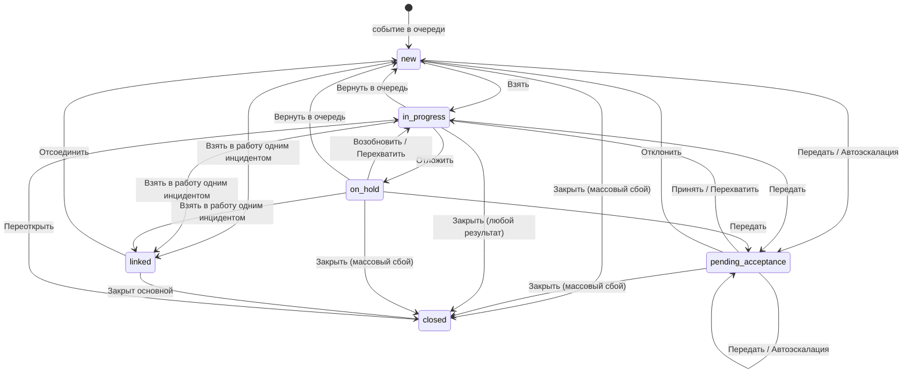

# Операторская часть МИ — контракт «фронтенд → бэкенд»

Предложение фронтенда по задаче **CLOUD-23465 «Разработка единой JSON-модели workflow»**. Документ отвечает на два вопроса: **какая модель workflow принимается за единую** и **какое API должен реализовать бэкенд**, чтобы операторское рабочее место заработало.

## Артефакты

| Файл | Что это | Кому |
|---|---|---|
| [`workflow_schema.v1.json`](./workflow_schema.v1.json) | **Единая JSON-модель workflow.** Состояния, переходы, guard'ы, эффекты, таймеры, права, лимиты, формы — как конфигурация, а не как код. `v1` в имени — версия формата машины, как у `scenario_schema.v1.json` машины сценариев: меняется при несовместимом изменении формата после выпуска. Смысл условий, эффектов и правил интерфейса — выражения CEL (ARCH-07, [CEL.md](./CEL.md)); версии самой схемы при публикации ведёт сервер (§14.6) | Бэкенд хранит и исполняет; фронтенд читает и рисует по ней интерфейс |
| [`openapi.json`](./openapi.json) | **OpenAPI 3.1** — 44 адреса, 48 операций, 94 схемы. Контракт REST-API операторской части | Бэкенд реализует; фронтенд генерирует типы |
| [`TRANSITIONS.md`](./TRANSITIONS.md) | Таблица переходов, собранная из машины: откуда, куда, условия и эффекты словами, матрица «состояние × переход». Руками не правится | Все, кто сверяет правила с машиной |
| [`SETTINGS.md`](./SETTINGS.md) | Настройки администратора по вкладкам будущей админки с текущими значениями — собраны из раздела `adminSettings` машины (RULE-44). Руками не правится | Бэкенд (вкладка администрирования), продукт |
| `README.md` | Этот документ: как устроен workflow и какое API за что отвечает | Обе стороны |
| [`CEL.md`](./CEL.md) | Язык выражений машины: смысл условий и эффектов записывается в машине на CEL, по нему работают прототип, бэкенд и модель Quint (ARCH-07, переезд идёт по шагам) | Бэкенд, все, кто правит машину |
| [`BACKEND.md`](./BACKEND.md) | Памятка для команды бэкенда: порядок работы, тестовый стенд, когда готово, что не решено | Бэкенд |
| [`FRONTEND.md`](./FRONTEND.md) | Памятка для команды фронтенда: клиент без своей модели, что из прототипа — требование, что только демо, когда готово | Фронтенд |

### Кто исполняет

Прототип устроен как продукт: встроенный сервер (`prototype/server.js`) отвечает по `openapi.json` и исполняет эту модель исполнителем `prototype/engine.js`, а интерфейс разговаривает с ним только запросами API. Кнопки, переходы, формы, бейджи, нормативы и автоматические переходы берутся отсюда. Поэтому каждая правка модели сразу видна в прототипе и проверяется его самопроверкой, а ответы встроенного сервера самопроверка сверяет со схемами `openapi.json` — контракт проверен исполнением, а не только чтением. После правки модели или контракта — `python3 tools/build_workflow.py`.

### Источники требований

- **[`States rules IM.md`](../State_rules/States%20rules%20IM.md)** — действующие правила, нормативный документ. Модель собрана по правилам v4 и приведена к v10 ([журнал изменений](../State_rules/CHANGELOG.md), §16). Все ссылки вида «§6.1» ведут туда.
- **[`prototype/`](../../prototype/README.md)** оттуда же — работающая реализация: из неё взяты конкретные значения — причины, нормативы, тексты журнала, наборы кнопок.
- **[`Axxon Incident Manager Vision.md`](../Axxon%20Incident%20Manager%20Vision.md)** — требования к панелям, видео, карте, отчётности.
- **[Машина сценариев](../Scenario_machine/README.md)** — формат сценария (формат редактора продукта, спецификация формата сценария v1), его исполнитель и профиль МИ. Стык двух машин — §14.5.

---

## Главный принцип

**Workflow живёт в конфигурации на сервере. Клиент не содержит собственной таблицы переходов.**

Без этого принципа любое изменение правил (новая причина удержания, другой лимит, новый уровень эскалации) превращается в релиз фронтенда. С ним — в запись в схеме.

Практически это значит три вещи:

1. Сервер отдаёт схему (`GET /operator/workflow/active`) — по ней клиент строит формы переходов, справочники, бейджи, фильтры очереди.
2. Сервер для **каждого инцидента** возвращает готовый список действий (`actions`) с флагами `visible` / `enabled` и текстом причины недоступности. Клиент не вычисляет права, владение и лимиты — он рисует то, что пришло.
3. Любое изменение состояния — один вызов `POST /operator/incidents/{guid}/transitions/{transitionId}`, выполняемый сервером атомарно (§10.1).

Аналогия с Jira: `states` ≈ statuses, `transitions` ≈ transitions, `guards` ≈ conditions + validators, `effects` ≈ post functions, `forms` ≈ transition screens, `schema.appliesTo` ≈ workflow scheme.

---

## Модель workflow

### Состояния (§2.1)

Состояние **объективно** — одно для всех, кто смотрит. `mine` / `foreign` состояниями не являются: это результат сравнения `owner` со смотрящим, он же определяет бейдж (§2.4) и вычисляется сервером.

| Код | Название | Категория | Владелец | Активный таймер |
|---|---|---|---|---|
| `new` | Новое | pending | нет | `reaction` |
| `pending_acceptance` | Ожидает принятия | pending | адресат передачи | `reaction` |
| `in_progress` | В работе | active | оператор | `resolution` |
| `on_hold` | Отложен | active | оператор | `hold`; `resolution` на паузе |
| `closed` | Закрыто | done | кто закрыл | — |
| `linked` | Привязан | linked | нет — работу ведут по основному (§11.4) | `resolution`, если уже шёл: идёт дальше, у отложенного снимается с паузы |

Конечное состояние одно. Чем закончился инцидент, говорит результат закрытия `close_result` (§2.2): «Обработан», «Ложная тревога», «Дубликат», «Плановая проверка», «Прервано», «Массовый сбой». Отдельного «Отменено» нет (RULE-02).



### Переходы (§6.1)

12 ручных переходов. Каждый — запись в `workflow_schema.v1.json` формата §14.8: `from` / `to` / `guards` / `effects` / `form` / `ui`.

| id | Кнопка | Откуда → Куда | Право | Форма |
|---|---|---|---|---|
| `claim` | Взять | `new` → `in_progress` | `incident:claim` | — |
| `accept` | Принять | `pending_acceptance` → `in_progress` | `incident:accept` | — |
| `reject` | Отклонить | `pending_acceptance` → `new` | `incident:release` | причина |
| `hold` | Отложить | `in_progress` → `on_hold` | `incident:hold` | причина + комментарий |
| `resume` | Возобновить | `on_hold` → `in_progress` | `incident:claim` | — |
| `release` | Вернуть в очередь | `in_progress`, `on_hold` → `new` | `incident:release` | причина |
| `transfer` | Передать | `new`, `pending_acceptance`, `in_progress`, `on_hold` → `pending_acceptance` | `incident:transfer:own` / `:any` | адресат + причина |
| `takeover` | Перехватить | `pending_acceptance`, `in_progress`, `on_hold` → `in_progress` | `incident:reassign` + `incident:claim` | подтверждение |
| `close` | Закрыть | `in_progress` → `closed`; для «Массовый сбой» ещё `new`, `pending_acceptance`, `on_hold` | по результату: `incident:close` или `incident:close:unprocessed` | результат + комментарий (кроме «Обработан»); у массового сбоя — причина |
| `reopen` | Переоткрыть | `closed` → `in_progress` | `incident:reopen` + `incident:claim` | основание |
| `merge` | Взять в работу — на панели выборки (§11.3) | `new`, `in_progress`, `on_hold` → `linked` | `incident:bulk` | — |
| `detach` | Отсоединить — в карточке основного, вкладка привязанных | `linked` → `new` | — | — |

Право, исходные состояния, владение и набор обязательных шагов у `close` зависят от результата. Они записаны в строках справочника `reasonCatalogs.close_result`, а проверяет их одно условие `closeResultAllowed`. Кнопка видна, если доступен хотя бы один результат; список доступных результатов сервер отдаёт в `fieldOptions.resultId` действия. Результат с `finish: true` — полная обработка: им закрывает шаг «Итог» («Завершить инцидент»), а форма «Закрыть» его не предлагает; такой результат один, и у него есть набор обязательных шагов (ARCH-08 в7).

Плюс автоматические (`trigger: timer` / `system`), которые выполняет сервер без участия оператора, — перечень в [TRANSITIONS.md](TRANSITIONS.md). Порядок (§14.3, RULE-41): если готовы сразу несколько автоматических переходов, первым выполняется тот, чьё условие наступило раньше: таймер — по дедлайну, потеря связи — последний признак активности плюс порог, остальное — в момент проверки; при равенстве — по порядку в машине. Переход, который стал возможен после другого, наступает не раньше него, а переход без таймера — сразу после него (RULE-48). Эффекты считают время от этого момента, после каждого перехода выбор делается заново. Так результат не зависит от того, как часто работает планировщик, и догон после простоя даёт то же, что проверка каждую секунду.

### Таймеры (§4)

Два норматива вместо одного общего: старый одновременно означал время до реакции и продолжал тикать у оператора, который как раз реагирует.

| Таймер | Смысл | Приостанавливается |
|---|---|---|
| `reaction` | До взятия в работу. Истечение — триггер автоэскалации. Снимается при входе в `in_progress`, `closed`, `linked`. Ручная передача из `new` и `pending_acceptance` его продолжает (`continuesOn`), из `in_progress` и `on_hold` — запускает по нормативу уровня (`startTimer … ifStopped`, RULE-76); «Отклонить» — продолжает (RULE-82). Остановленную потолком или нарушением (`escalation_ceiling`, `reaction_overdue`) «Передать» запускает (`ifStopped`), «Отклонить» — нет (RULE-84) | нет |
| `resolution` | До закрытия. Значение зависит от приоритета. Запускается один раз, при первом взятии в работу | да, при любом выходе из `in_progress`: удержание, передача, возврат в очередь, закрытие, объединение (`linked`: у группы один срок — срок основного, §11.4). Взятие и принятие продолжают с остатка. Переоткрытие запускает заново (`limits.reopenResolutionSec` или обычный норматив); прежние нарушения остаются в `breaches` |
| `hold` | Предельный срок удержания по выбранной причине | нет |

Дедлайны передаются **метками времени** (`dueAt`), не убывающими счётчиками: обратный отсчёт рисует клиент, значение переживает перезапуск сервиса. В `TimerState` есть `serverTime` — чтобы расхождение часов клиента не искажало отсчёт.

Норматив — самая специфичная строка `overrides`, иначе `byPriority`, иначе `defaultSec`; строка учитывается, только если все её признаки — из `overridesBy` таймера (определение `overrideAllowed`, ARCH-11). Что происходит по истечению, задают переходы машины с условием `timerExpired` — у каждого таймера их несколько (эскалация, потолок, нарушение), отдельного поля «по истечению» нет.

**Поля-описания сверяются с исполняемым** (ARCH-11, `check_machine.py`): `reasonCatalogs.*.requiredOnTransition` — переходы, у формы которых обязательное поле из справочника; `concurrency.expectedVersion` — у ручного перехода через `POST …/transitions` версия записи обязательна (`If-Match` в контракте), у объединения и «Отсоединить» её пока нет (BUG-84), у автоматических — нет; `requiredStepSet` перехода — то, что проверяют его условия (`closeResultAllowed` или `requiredStepsFilled`).

### Guard'ы и эффекты (§14.8)

Условия и эффекты не пишутся скриптом — берутся из фиксированного реестра с параметрами. Тогда редактор схемы это выпадающие списки, схему можно статически проверить, а каталог прав, который МИ отдаёт внешней системе для настройки ролей, собирается из схемы автоматически.

```json
{
  "fn": "hasPermission", "args": ["incident:claim"]
}
```

Реестры лежат в `workflow_schema.v1.json` → `registries`. Позиции с `"extendsBaseRegistry": true` — то, что добавлено сверх списка из §14.8 и требует реализации: `hasScopedPermission`, `isNotOwner`, `withinHoldLimit`, `withinReopenWindow`, `setCursor`, `setLinkedTo` и др.; что делает каждая — `$comment` в реестре

Смысл условий и эффектов переезжает в саму машину — выражениями CEL в реестрах и разделе `definitions` ([CEL.md](./CEL.md), ARCH-07). У каждого из 33 условий — `expr`, у каждого из 25 эффектов — `do`: исполнитель прототипа своих правил не держит, бэкенд вычисляет те же выражения реализацией CEL своего языка. Выражения проверяет `node tools/check_cel.mjs`.

Эффекты делятся на два класса (§14.2), и это влияет на ответ API:

| Класс | Примеры | Поведение при отказе |
|---|---|---|
| `transactional` | смена состояния и владельца, флаги, таймеры, запись в журнал | в одной транзакции с переходом; при отказе переход не применяется |
| `external` | макросы ТСО, уведомления, выгрузка результата в AxxonData | через очередь исходящих с повторами и идемпотентными ключами; переход **не откатывается**, в журнал пишется неуспех |

Поэтому `TransitionResult.externalEffects` возвращает только `status: "queued"`, а фактический результат приходит записью журнала и событием в потоке.

### Язык значений

Аргументы условий и эффектов — не свободный текст. Смысл каждого слова записан в машине выражением CEL, а аргументы эффектов в переходах — тоже выражения: язык, имена, типы и операции — в [CEL.md](./CEL.md). Ниже — договорённости, которые нужно знать, читая машину.

**Адресат.** Адресат инцидента — `owner`, а если он пуст — `assignmentGroup` (определение `addressee`). `owner` — всегда человек; пока передачу группе никто не принял, `owner` пуст, а группа — в `assignmentGroup` (§8.1).

**Кто и что записывается** — аргументы `setOwner`, `setAssignmentGroup`, `setHoldReason`, второй аргумент `setFlag` — выражения CEL:

| Выражение | Смысл |
|---|---|
| `actor` | тот, кто выполняет переход. У переходов по таймеру и системных — `actor` перехода (`dispatcher`, `system`) |
| `''` | очистить поле |
| `now` | время сервера в момент перехода |
| `form.<поле>` | значение поля формы перехода; незаполненное — `''` |
| `personOf(…)`, `groupOf(…)` | значение, если это человек (группа), иначе `''`. Так в `owner` попадает только человек, а в `assignmentGroup` — только группа |
| `levelUpTarget(before)`, `levelUpNumber(before)` | адресат и номер уровня автоэскалации, на который переходит инцидент: ближайший следующий уровень не выше потолка, адресат которого может принять (определения `nextLevels`, `levelUp`; §8.1, §8.3). Адресат уровня — поля `targetKind` и `target` (ARCH-07 в7) |
| `dutyGroupOf(incident.owner)` | дежурная группа владельца — первая, в которую он входит |
| `'break'`, `'no_link'` | позиция справочника — системные причины удержания |

**Кому сообщить.** Аргумент `notify` — выражение (ARCH-08 в2):

| Выражение | Кому |
|---|---|
| `before.owner` | прежнему владельцу — до первого эффекта перехода |
| `addressee(incident)` | новому адресату — после перехода |
| `alerts.target` | получателю алертов из настроек (§9): пользователь или дежурная группа |

Второй аргумент `notify` — это алерт (`true`; по умолчанию `false`). Его задаёт переход: у нарушений нормативов, потолка эскалации, потери доступа — `notify(alerts.target, true)`. Совпадение получателя с `alerts.target` алертом не делает: передача или автоэскалация на получателя алертов — обычное уведомление.

Кто получит — определение `recipients`: человек или участники дежурной группы, кто на месте (`onDuty` — состояние оператора не «только просмотр») и с доступом к объекту инцидента. Алерт, который получить некому, — запись `alerts.noRecipientLog` в журнал; обычное уведомление такой записи не оставляет. Пусто или это тот, кто выполняет переход, — уведомления нет и в `externalEffects` его нет (BUG-30): так «Передать» свой инцидент не сообщает самому себе, а новый — некому. Всё это — в `do` эффекта `notify`; сервер только доставляет.

Аргумент `evictOpenCard`: `owner` — владелец после перехода, `previousOwner` — до перехода.

В прототипе `externalCommand` ничего не отправляет, а из уведомлений доставляются только алерты: если среди получателей оператор стенда, сервер шлёт ему `incident.alert`. Остальные уведомления — адресату, прежнему владельцу — интерфейс выводит из событий потока о переходах.

**Отношение смотрящего к инциденту** — определение `ownership(me, incident)` (`cel.definitions`): его читают `ownership` в `scopeRule` и выражения бейджей, фильтров очереди и пояснений форм:

| Значение | Когда |
|---|---|
| `owner` | `owner` — смотрящий |
| `target` | адресат — смотрящий или дежурная группа, в которую он входит. В `pending_acceptance` проверяется раньше `owner`: передача лично оператору — «вам на принятие», а не «ваш» |
| `other` | всё остальное, в том числе ничей инцидент в `new` |

**Бейджи, фильтры очереди, пояснения форм и карточки** — выражением CEL `expr` над `me` и `incident` (CEL.md, «Правила интерфейса»); у пояснений карточки (`cardNotes`) — ещё `actions`, доступные смотрящему действия: так «при необходимости перехватите» — только если «Перехватить» доступна. Бейдж и пояснение — первое правило по порядку, чьё выражение истинно; ни одного правила бейджа — подпись состояния. Фильтр очереди — инциденты, для которых истинно его выражение; в списках — инциденты хотя бы одного фильтра, поэтому привязанные (§11) в списках не видны.

«Себя» в `targetIsNotSelf` и в `optionExpr` поля «Кому передать» — определение `isSelf`: смотрящий и дежурные группы, в которые он входит (§10.1).

**Поля инцидента** — первый аргумент `setFlag`, `increment`: имя поля типа `Incident` (`cel.types` машины, CEL.md) — `escalationLevel`, `transferCount`, `closeResultId`, `closeCauseId`, `result`, `closedBy`, `closedAt`. `escalationLevel` — ступень автоэскалации (§8.3), ручная передача его не меняет, `transferCount` — число ручных передач, на автоэскалацию не влияет (RULE-76). В прототипе `closeResultId` — `closeResult`, `closeCauseId` — `massCause`, `result` — `closeComment`.

**Настройки** — аргументы `settingEnabled`, `settingIs`, `agentIdleFor` (тип `setting`): путь от корня машины, например `escalation.enabled`, `session.idleHoldSec`. `settingIs(путь, значение)` — настройка равна значению: так три перехода по истечению норматива закрытия выбирают между `escalation.onResolutionOverdue` = `"alert"` и `"escalate"`. Вычисляемых путей нет. Второй аргумент `restartTimer` — выражение: `limits.reopenResolutionSec`.

**Длительность таймеров** — эффекты таймеров машины и определение `timerSec`:

| Запись | Длительность |
|---|---|
| `startTimer(id)` | норматив таймера (`norm`): самая специфичная строка `overrides` (больше совпавших условий, при равных — первая), иначе `byPriority`, иначе `defaultSec` |
| `startTimer("reaction", "byEscalationLevel")` | `reactionSec` уровня, который у инцидента после `setFlag(escalationLevel, …)` (он стоит раньше в списке эффектов). Уровня нет в `levels` — последний уровень; `levels` пуст или уровень 0 — обычный норматив (`levelNorm`) |
| `startTimer(…, …, true)` | только если таймер не идёт: идущий продолжается (RULE-76) |
| `restartTimer(id, сек)` | заново, без остатка; `0` — обычный норматив |
| `secFrom` | срок из справочника по причине удержания (`holdSec`): `maxMinutes` — в минутах |
| `startsOnce: true` | таймер запускается один раз за жизнь инцидента: повторный `startTimer` продолжает с остатка, `stopTimer` — пауза |
| `pausable: true` | `pauseTimer` сохраняет остаток, `resumeTimer` продолжает с него. У таймера без `pausable` пауза — это остановка |

**Срабатывание.** `timerExpired` истинно один раз на каждый дедлайн: после перехода по таймеру тот же дедлайн больше не срабатывает, новый — срабатывает. `scope: "incidents_owned_by_agent"` у системного перехода — только инциденты, владелец которых — этот оператор.

**Лимиты.** Единица — инцидент. Привязанные инциденты (§11.3) владельца не имеют и в лимиты не входят: объединённый инцидент — одна единица. `withinActiveLimit` — по `maxActive`, `withinHoldLimit` — по `maxOnHold`, стоит только у ручного «Отложить» (§10.2). `null` у лимита — без ограничения.

**Что сервер решает сам, а не машина** (ARCH-08, решения в5 и в9). Подсказки окна «Выделить по фильтру» с «Одинаковым сценарием» — какой сценарий выбрать по умолчанию и какие варианты условий оставить; взять отобранное как одно всё равно проверяет переход `merge` машины. «Выделить все» не берёт закрытых. Запись основного «присоединены …» — первые пять номеров и «и ещё N» (`messages`). Число приоритета от источника — уровень справочника: есть — как есть, нет — ближайший не выше, ниже самого низкого или без числа — самый низкий (§2.5). Код ошибки, когда не выполнено условие, — `errorCode` условия в реестре (`errorCodes` — по ключу причины), а не таблица в сервере. Какой норматив показывать в строке и карточке (ARCH-08 в11): у закрытого и привязанного — никакого (у привязанного срок — у основного, §11.4), идёт реакция — реакция, иначе — закрытие; у отложенного — ещё срок удержания.

**Формы.** Правила поля — выражения CEL (CEL.md, «Правила интерфейса»): `requiredExpr` — поле обязательно, `visibleExpr` — видно (нет — видно всегда; невидимое не обязательно и не отправляется), у списка с `source` — `optionExpr` над вариантом `option` (предлагается ли), `enabledExpr` (можно ли выбрать; нет — заблокирован с причиной `disabledKey`), `defaultExpr` (значение по умолчанию; `''` — нет, ставится, только если это доступный вариант). `requiredExpr` и `visibleExpr` могут читать одно поле-список той же формы (`form.resultId`) — сервер отдаёт интерфейсу таблицу по его вариантам (`AvailableAction.fieldRules`), интерфейс выражений не вычисляет. `placeholderKey` у списка — поле пустое, пока оператор не выберет; значение ставится само, только если его задаёт `defaultExpr` или вариант один (§2.2). Список без `placeholderKey` выбирает первый доступный вариант. Правила полей — не только подсказка интерфейсу: при выполнении перехода сервер проверяет каждое поле-список по ним же (ARCH-09). Значение допустимо, только если поле видно (`visibleExpr`), значение есть среди вариантов — источник поля и `optionExpr` — и вариант доступен (`enabledExpr`); иначе `422 FORM_FIELD_INVALID`, переход не выполняется. Так через API не отложить с системной или неизвестной причиной, не передать тому, у кого инцидент уже есть, и не записать причину сбоя к ложной тревоге.

**Тексты — ключами каталога строк (§14.9).** Аргумент `appendLog` — ключ записи журнала `workflow.journal.<переход>`, `alerts.noRecipientLog` — тоже ключ; записи, которые сервер пишет вне переходов (объединение, макрос, текст источника), — раздел `messages` с подстановками каждого ключа. Подписи — тоже ключами, в полях `labelKey`, `hintKey`, `titleKey`, `confirmKey`, `placeholderKey`, `textKey`, `readOnlyReasonKey`, `reasonKey`: состояния, переходы, кнопки, формы, бейджи, фильтры, справочники, таймеры, состояния оператора, права, вкладки и настройки администратора (`values` и `valueLabels` — тоже ключи). Не переводятся только пояснения для разработчика — `$comment`, `adminSettings.notSettings[].why`, `timers[].meaning`: это документация, а не текст интерфейса. Названия и описания приоритетов — не ключи, а данные справочника, по языкам (§2.5). Сами строки на всех языках — `strings/<язык>.json`, их отдаёт `GET /operator/strings`; готовые тексты в ответах сервер отдаёт на языке `preferences.locale`.

**Подстановки в тексты:**

| Где | Переменные |
|---|---|
| `appendLog` | `{comment}`, `{stepNumber}`, `{holdReasonLabel}`, `{targetName}` — адресат после перехода, `{escalationLevel}` — после перехода, `{closeResultLabel}`, `{filledSteps}`, `{totalSteps}`, `{previousOwnerName}` — адресат до перехода, `{escalationReason}` — текст по ключу `escalation.reasonKey` |
| `forms[].notes` | `{ownerName}` — адресат, `{filledSteps}`, `{totalSteps}` |
| `badges` | `{ownerName}` — адресат, `{holdReasonLabel}`, `{closeResultLabel}` — подпись причины сбоя, если она выбрана, иначе результата |

`setCursor("firstOpenStep")` — курсор сценария на первый незаполненный шаг: текущий шаг прохождения, у пройденного сценария — последний шаг пути. Считает машина сценариев (§14.5).

Эффекты объединения (§11.3) — у перехода `merge`, на каждого привязываемого; приоритет основного объединение не меняет, а срок у группы один: `tightenPrimaryDeadline` — срок закрытия основного становится самым ранним из своего и остатка привязываемого, затем свой норматив привязываемого — на паузу; `copyAnswersToPrimary` — ответы привязанного в неотвеченные шаги основного, что переносится — решает машина сценариев (`shareAnswers`, §14.5); `relinkToPrimary` — открытые привязанные привязываемого переходят к основному; `setLinkedTo` — ссылка на основной (`linked_to`). `detach` снимает её (`clearLink`), отсоединённому — остаток срока основного на паузе (`copyPrimaryDeadline`, и у `linked_lost_access`). Кто в группе в момент срока, сервер знает по `linked_at` и `left_group` (§11.4, BUG-73). Нарушение основного `recordBreach` записывает и каждому открытому привязанному. `close_linked` закрывает привязанный результатом основного (`copyCloseFromPrimary`).

---

## Карта API: что за что отвечает

### 1. Конфигурация workflow

| Эндпоинт | Отвечает за |
|---|---|
| `GET /operator/workflow/active` | **Отдаёт клиенту всю схему.** Запрашивается один раз при старте, кэшируется по `ETag`. Из неё строятся формы переходов, справочники причин, бейджи, фильтры очереди, лимиты. Параметры контекста (тип события, группа устройств, приоритет) разрешают, какая схема применима (§14.4) |
| `GET/POST/PUT /operator/workflow/schemas...` | CRUD схем под правом `incident:schema:admin`. Опубликованная схема не редактируется — создаётся новая версия |
| `POST .../validate` | §14.7. Недостижимые состояния, нетерминальные без исходящих переходов, комбинации «набор прав + состояние» без единого доступного перехода. Что разрешают роли, МИ не знает: наборы прав для проверки — типовые, из `validation.typicalPermissionSets` |
| `POST .../publish` | §14.6. Публикация с сопоставлением старых состояний новым, аудит, откат. Открытые инциденты доигрывают на своей версии (`schemaVersion`) |
| `POST .../simulate` | §14.7. «Набор прав, состояние и флаги — какие кнопки видны и что произойдёт». Нужен редактору схемы и автотестам фронтенда |

### 2. Сессия оператора

| Эндпоинт | Отвечает за |
|---|---|
| `GET /operator/session` | **Кто я и что мне можно.** Плоский список прав: роли и их состав ведутся во внешней системе (§5). Проблемы набора прав, найденные при входе, — в `permissionIssues` (§10.3). Лимиты и текущее потребление лимитов, состояние агента, персональные настройки |
| `PUT /operator/session/agent-state` | §12.1, §12.2. Перерыв, возврат с перерыва и выход из МИ (`offline`). При выходе сервер сам возвращает в очередь инциденты оператора в работе и отложенные, а адресованные лично и не принятые отдаёт его дежурной группе или в очередь (§8.1); после выхода, как и на перерыве, доступен только просмотр — переходы отклоняются с `403 AGENT_NOT_READY`. При уходе на перерыв **сервер сам** переводит активные инциденты в `on_hold` с причиной «перерыв оператора» — право `incident:hold` не требуется, иначе оператор без этого права не смог бы уйти на перерыв. Изменённые инциденты возвращаются в ответе Смены — только переходами `session.transitions` машины; право и причина (`permission`, `requiresReason`) — у состояния, куда переходит: нельзя — `409 TRANSITION_NOT_ALLOWED_FROM_STATE`, нет причины — `422` (ARCH-08 в4). «Занят» — производное состояние (`derived` у состояния машины): не хранится, сервер отдаёт его вместо «Готов», когда истинно `derived.expr` — у оператора есть свои инциденты в работе; смены занятого оператора идут как из «Готов» (RULE-99). Начальное состояние оператора — «Вышел» (`initial`): ещё не вошёл |
| `POST /operator/session/heartbeat` | §12.3. Признак активности; любой другой запрос оператора, кроме чтения, — тоже. Без него через `idleHoldSec` инциденты оператора в работе уходят в `on_hold` («нет связи с оператором»), через `idleReleaseSec` — возвращается в `new`. Передаёт, какая карточка открыта, — чтобы сервер знал, чью карточку выселять |
| `PATCH /operator/session/preferences` | Vision §1.4. Раскладка панелей, тема, язык, меню вспомогательных ссылок. Прав не требует — данные инцидента не меняются |

### 3. Очередь

| Эндпоинт | Отвечает за |
|---|---|
| `GET /operator/incidents` | **Панель событий.** Фильтры, поиск, пагинация. Группа устройств (`sourceGroupGuid`, с вложенными) и поверх неё фильтры по типу события и типу устройства-источника (§19). Видимость записей — фильтр выборки по группам устройств оператора, а не право (§5). Каждая запись приходит с вычисленным `badge` и готовым списком `actions`. Привязанных инцидентов в списке нет; поиск находит их строкой основного с `matchedLinked` (§11.4) |
| `GET /operator/incidents/counters` | Числа на фильтрах и в мобильной навигации. Отдельный лёгкий запрос, чтобы не тянуть страницу ради счётчиков |
| `POST /operator/incidents/selection` | §11.1. «Выбрать все» считается **на сервере**: клиент видит только текущую страницу. Выборка — до `maxBulk` (`null` — без ограничения). Для каждого действия — доступно ли всей выборке, а если нет — причина с номером инцидента, которому оно недоступно |

### 4. Карточка инцидента

| Эндпоинт | Отвечает за |
|---|---|
| `GET /operator/incidents/{guid}` | Полные данные карточки. `include` позволяет вложить сценарий, журнал, медиа и действия одним запросом. `readOnly: true` — карточка открыта на просмотр. Отдаёт `ETag` для оптимистичной блокировки |
| `GET /operator/incidents/{guid}/actions` | **§7. Единственный источник правды о кнопках.** Guard с `onFail: hide` прячет кнопку (действие не относится к ситуации), с `onFail: disable` — оставляет видимой и заблокированной с подсказкой (лимит активных, незаполненные шаги, перерыв). Отдельный эндпоинт нужен, чтобы пересчитать кнопки после изменения ответов сценария, не перезагружая карточку |
| `GET /operator/incidents/{guid}/media` | Vision §3. Камеры для видеомонитора (архив и online) и план площадки с маркером места сработки. Первая камера — источник события; ссылки на поток приходят готовыми, с временем начала архива |
| `GET /operator/incidents/{guid}/journal` | Хронология |

### 5. Переходы — ядро

| Эндпоинт | Отвечает за |
|---|---|
| `POST /operator/incidents/{guid}/transitions/{transitionId}` | **Единственный способ изменить состояние инцидента.** Сервер проверяет guard'ы, применяет транзакционные эффекты в одной транзакции, внешние ставит в очередь. Обязателен `If-Match` с версией записи |
| `POST /operator/incidents/transitions/{transitionId}/bulk` | §11. Действие на выборку: одна форма причины на всех, отдельная запись в журнал каждого. Выполняется **частично успешно** — недоступные элементы попадают в `failed` с причиной, остальные обрабатываются. Отмеченных — не меньше `bulk.minItems` перехода (одно — как одиночное действие), меньше — `422 BULK_SELECTION_INVALID` |

Идентификаторы переходов в URL — те же, что в схеме: `claim`, `accept`, `reject`, `hold`, `resume`, `release`, `transfer`, `takeover`, `close`, `reopen`. Отдельных эндпоинтов вида `/claim`, `/hold`, `/close` **намеренно нет**: добавление перехода в схему не должно требовать нового эндпоинта.

### 6. Групповая обработка

| Эндпоинт | Отвечает за |
|---|---|
| `POST /operator/incidents/filter` | §11.2. «Выделить по фильтру»: узел дерева и условия через «ИЛИ» в пределах фильтра очереди. Возвращает подходящих со всех страниц и варианты условий каскадом с числами. «Одинаковый сценарий» — только события одного сценария, которые можно взять одним инцидентом |
| `POST /operator/incidents/merge` | §11.3. «Взять в работу» на выборке: основной — `primaryGuid` или, если его нет, определение машины `mergePrimary` (свой в работе, иначе самый срочный новый, у равных — появившийся раньше, у совсем равных — меньший номер: сервер передаёт выборку по возрастанию номера), остальные — переходом `merge` машины, основной новый — `grouping.takeWith`. Всё или ничего. Ответ — карточка основного |
| `GET /operator/incidents/{guid}/linked` | §11.4. Привязанные инциденты основного постранично; `focusGuid` — на какой странице найденное поиском |
| `DELETE /operator/incidents/{guid}/linked` | §11.4. «Отсоединить все» — переход `detach` ко всем привязанным, всё или ничего |
| `DELETE /operator/incidents/{guid}/linked/{linkedGuid}` | §11.4. «Отсоединить» одно — переход `detach` |

### 7. Сценарий обработки

| Эндпоинт | Отвечает за |
|---|---|
| `GET /operator/incidents/{guid}/scenario` | Сценарий и прохождение (`IncidentScenario`). §14.5: инцидент доигрывает на версии сценария, с которой появился, — поэтому сценарий (`script`, формат машины сценариев) приходит с сервера вместе с прохождением (`result`, `scenarioResult` машины сценариев), а не подтягивается клиентом по текущей версии. Кроме них — путь, курсор показа, прогресс «N из M» и `requiredStepsFilled` |
| `POST .../scenario/answer` | Ответ на один шаг: текущий или пройденный с `revisitable`; необязательный можно пропустить (`skip`). Что дальше — решает машина сценариев на сервере: переход шага, его макрос, путь; ответ на финальный шаг завершает прохождение. Ответ сохраняется сразу — прогресс не теряется при перехвате, передаче и перезагрузке вкладки. Макрос исхода (`macro`) запускается по условиям `run_macro`, результат — записью журнала и событием `macro.completed`. В ответе — пересчитанный `requiredStepsFilled`, по которому клиент включает «Обработан». Ошибки: не на пути — `409 STEP_NOT_ON_PATH`, шаг не меняется — `409 STEP_NOT_EDITABLE`, ответ не подходит — `422 INVALID_ANSWER` |
| `PUT .../scenario/cursor` | Курсор показа хранится на сервере: после перехвата, возобновления и перезагрузки вкладки карточка открывается там же. Только шаг пути; переходы «Взять», «Принять», «Возобновить», «Перехватить», «Переоткрыть» ставят его на текущий шаг (`setCursor`) |

### 8. Справочники

| Эндпоинт | Отвечает за |
|---|---|
| `GET /operator/transfer-targets` | §8.1. Люди и дежурные группы. Сервер **сам исключает** текущего оператора (иначе передачей можно обойти `incident:claim`) и, при передаче чужого, текущего владельца. Показывает доступность адресата, но передачу не запрещает |
| `GET /operator/reference/reasons/{catalogId}` | Причины удержания (`hold`), результаты закрытия (`close_result`), причины массового сбоя (`mass_fault`). Системные причины (`setBy: system`) оператору не показываются |
| `GET /operator/reference/event-types` | Фильтры очереди и привязка схем |
| `GET /operator/reference/priorities` | §2.5. Справочник приоритетов, общий для всех схем: число 0–100 (больше — срочнее), название и описание по языкам, цвет; по убыванию числа. Меняется на ходу — тогда всем `reference.priorities_changed`, клиент перечитывает |
| `GET /operator/strings` | §14.9. Каталог строк на языке оператора: ключи машины и ответов → строки ICU MessageFormat |
| `GET /operator/reference/source-groups` | §19. Дерево групп устройств для панели групп: вложенные группы, устройства, по желанию счётчики открытых инцидентов. Только видимые оператору группы. Выбранная группа уходит в очередь как `sourceGroupGuid` |
| `GET /operator/reference/help-links` | §7. Меню справки: общие ссылки и ссылки площадки. С `site` — общие и ссылки этой площадки: их показывает меню при открытом инциденте площадки; без — весь справочник. Право не нужно |

Группы устройств ведёт МИ: создаёт и правит их администратор схемы с правом `incident:schema:admin` (§19, RULE-10). Оператору дерево отдаёт `GET /operator/reference/source-groups`. Запросов для редактирования групп в контракте пока нет.

### Настройки администратора: данные МИ

| Эндпоинт | Отвечает за |
|---|---|
| `GET /operator/admin/access-groups` | §5. Группы доступа: роли основной системы и доступные им группы устройств и устройства (с именами). Право `incident:schema:admin`, без него — `403 PERMISSION_DENIED` |
| `GET /operator/admin/duty-groups` | §8.1. Дежурные группы в порядке приоритета: название, роли, отдельные люди и вычисленный состав `memberIds`. То же право |
| `GET /operator/admin/camera-links` | §19.1. Связи многие-ко-многим: название, устройства, камеры по порядку показа. Камеры инцидента — из всех связей его источника, без повторов, первая — главная (RULE-70). Право `incident:schema:admin` |
| `POST`, `PUT`, `DELETE /operator/admin/priorities` | §2.5. Правка справочника приоритетов: добавить (занятое число — `409 PRIORITY_EXISTS`); изменить название, описание и цвет (число не меняется); удалить (`409 PRIORITY_IN_USE`, если на уровень ссылается норматив или его носят открытые инциденты). Право `incident:schema:admin`. Встроенный сервер эти операции не выполняет |

Это только чтение — для экрана настроек прототипа и как образец данных. Правку ведёт вкладка администрирования бэкенда; полный перечень настроек — [SETTINGS.md](SETTINGS.md) (§20).

### 9. Поток событий

| Эндпоинт | Отвечает за |
|---|---|
| `GET /operator/stream` (SSE) | **Обязателен, не «желателен».** Автоэскалация, срабатывание таймеров, перехват и передача чужими операторами меняют очередь и карточку помимо действий текущего клиента. Polling не годится: §9 (порядок срабатывания, пункт 3) требует **немедленно** перевести открытую карточку в режим просмотра, когда инцидент увели — для этого есть событие `incident.card_evicted`. Сообщение — без строки `event:` (тип — в `data.type`), в `data` — `IncidentStreamEvent`, в `id:` — его `id`: браузерный `EventSource` отдаёт в `onmessage` только сообщения без имени. Переподключение по `Last-Event-ID`, сервер досылает пропущенное. WebSocket допустим как альтернатива |

---

## Типовые последовательности

**Старт рабочего места**

```
GET /operator/session                → права, лимиты, настройки
GET /operator/workflow/active        → схема (кэш по ETag)
GET /operator/incidents?filter=open  → очередь
GET /operator/stream                 → подписка на изменения
```

**Взять и закрыть инцидент**

```
POST /operator/incidents/{g}/transitions/claim     If-Match: "12"
GET  /operator/incidents/{g}?include=scenario,media,journal,actions
POST /operator/incidents/{g}/scenario/answer       If-Match: "13"  (на каждый шаг; новая версия — в ETag ответа)
   → requiredStepsFilled.closing: true  → в форме «Закрыть» доступен «Обработан»
POST /operator/incidents/{g}/transitions/close     formValues: { comment }
```

**Передача**

```
GET  /operator/transfer-targets?incidentGuid={g}   → список без себя, своих групп и владельца
POST /operator/incidents/{g}/transitions/transfer  formValues: { targetId, comment }
   → человеку: owner = адресат; группе: owner = null, assignment_group = группа (§8.1)
   → escalationLevel +1, reaction перезапущен, resolution приостановлен
   → прежнему владельцу приходит incident.card_evicted в поток
```

**Автоэскалация** — клиент ничего не вызывает:

```
поток: incident.auto_escalated { incident }   → обновить строку очереди
поток: incident.card_evicted                  → если карточка открыта, перевести в просмотр; увёл не я — уведомление с подписью перехода
```

**Потеря доступа** — изменились роли или группы доступа (§5):

```
поток: incident.access_lost { payload.number } → уведомление «INC-N вам больше не доступен»; карточку закрыть, строку убрать
```

**Групповая обработка**

```
POST /operator/incidents/selection    { mode: "same_type_new", anchorIncidentGuid }
POST /operator/incident-groups        { incidentGuids }
   → все взяты в работу, общие ответы, свои таймеры
POST /operator/incidents/transitions/close/bulk   { incidentGuids, formValues }
```

---

## Договорённости, на которых держится контракт

1. **Переход атомарен и выполняется сервером** (§10.1). Клиент присылает идентификатор перехода, ожидаемое состояние и версию записи. Версия — `ETag` карточки, то есть поле `version` в кавычках (`"12"`); она же — в `version` строки очереди. Переход и ответы сценария идут с ней в `If-Match` и возвращают новую в `ETag`. Нет заголовка — `428 PRECONDITION_REQUIRED`; версия или состояние не совпали — `412` с актуальным инцидентом в теле, чтобы клиент показал, что изменилось, и не ретраил молча.
2. **Ручное действие выигрывает у таймера** (§10.1, правило 5; RULE-63). Переход по таймеру выполняется через `invariants.manualWinsOverTimer.graceSec` после дедлайна. Ручное действие в это окно применяется, а срабатывание отменяется: идентификатор отменённого перехода — в `TransitionResult.canceledTimerTrigger`, в журнале — `workflow.journal.timer_overridden`, нарушение, которое записал бы отменённый переход, — на момент дедлайна. Если таймер после ручного действия продолжается (переход в `continuesOn` таймера — «Передать», «Отклонить» у реакции), срабатывание не отменяется: переход по таймеру выполняется по окончании окна, из нового состояния (RULE-83). Окно ждёт только действия человека: перед системным переходом (вышел, перерыв, нет связи, потеря доступа) планировщик выполняет переход по таймеру, ждущий в окне, — как без окна, иначе нарушение пропадёт (RULE-67).
3. **Бейдж и список кнопок считает сервер.** Клиент не реализует §2.4 и §7 у себя. Иначе правила начнут расходиться между очередью, карточкой и мобильной раскладкой.
4. **Записи журнала хранятся ключом каталога строк и подстановками** (`templateKey` + `vars`, §14.9), а не готовой строкой: иначе запись навсегда осталась бы на языке, включённом в момент записи. Поле `text` — отрендеренный вариант на языке оператора (`preferences.locale`).
5. **Дедлайны — метки времени**, часы клиента на срабатывание не влияют. При старте сервиса выполняется догон срабатываний, пропущенных во время простоя (§14.3). Автоматические переходы и запрос оператора (§14.3, ARCH-10): перед запросом оператора, который что-то меняет, сервер выполняет все наступившие переходы по таймеру и системные — иначе действие между тактами планировщика стёрло бы нарушение (BUG-82); окно после дедлайна по-прежнему ждёт человека. После ручного перехода сервер в том же запросе выполняет системные переходы, которые стали возможны: передали вышедшему — инцидент сразу у его группы. Их события уходят в поток, ответ показывает инцидент уже после них.
6. **Внешние эффекты не откатывают переход** (§14.2). Инцидент получает признак «команда не доставлена», а не остаётся в прежнем состоянии.
7. **На перерыве доступен только просмотр** (§10.1) — это одно правило `agentReady` на все переходы, а не пометка у каждого.
8. **Действует только тот, кто видит инцидент** (§5, `invariants.actorSeesIncident`). Видимость — по доступу к объекту: инцидента без доступа нет в очереди, поиске, карточке и потоке событий, запрос к нему — 404. Это не условие перехода: недоступного действия не показывают серым — нет самого инцидента.
8. **Идентификаторы состояний и переходов стабильны**, названия — отдельные переводимые лейблы (`labelKey`): переименование состояния не должно быть миграцией данных (§14.6).

---

## Коды ошибок перехода

Ошибка — `application/problem+json`: машинный `code`, текст `message` и шаблон `messageKey` с `messageVars` для перевода. Если не выполнено условие модели, в поле `guard` — его имя из `registries.guards`.

| Ответ | `code` | Когда |
|---|---|---|
| `404` | `NOT_FOUND` | нет инцидента, справочника или перехода с таким идентификатором |
| `409` | `TRANSITION_NOT_ALLOWED_FROM_STATE` | переход не из этого состояния (`from` модели) |
| `403` | `PERMISSION_DENIED` | нет права: условия `hasPermission`, `hasScopedPermission`; править сценарий может только тот, кому позволяет `scenarioEdit` |
| `403` | `LIMIT_EXCEEDED` | исчерпан лимит активных или отложенных: `withinActiveLimit`, `withinHoldLimit` |
| `403` | `AGENT_NOT_READY` | оператор на перерыве или вышел: `agentReady` |
| `403` | `TRANSFER_TO_SELF_FORBIDDEN` | передача себе или своей дежурной группе: `targetIsNotSelf` |
| `403` | `TARGET_NO_ACCESS` | у адресата нет доступа к объекту инцидента (§8.1): `targetHasAccess`, или к объектам его привязанных (§11): `targetHasAccessToLinked` |
| `403` | `TARGET_CANNOT_ACCEPT` | адресат не может принять: нет права `incident:accept` или доступа к объекту, у группы — ни у одного участника (§8.1): `targetCanAccept` |
| `403` | `REQUIRED_STEPS_NOT_FILLED` | набор обязательных шагов не выполнен — сценарий не пройден до конца (§14.5): `requiredStepsFilled`, у «Закрыть» с «Обработан» — `closeResultAllowed` |
| `403` | `REOPEN_WINDOW_EXPIRED` | истёк срок переоткрытия: `withinReopenWindow` |
| `403` | `GUARD_FAILED` | не выполнено любое другое условие модели |
| `409` | `STEP_NOT_ON_PATH` | ответ или курсор — на шаг не на пути прохождения сценария (`POST …/scenario/answer`, `PUT …/scenario/cursor`) |
| `409` | `STEP_NOT_EDITABLE` | переответ на пройденный шаг с `revisitable: false` (`POST …/scenario/answer`) |
| `412` | `VERSION_CONFLICT` | `If-Match` или `expectedState` не совпали с записью; в теле `current` — актуальная карточка |
| `428` | `PRECONDITION_REQUIRED` | нет `If-Match` у перехода или ответа на шаг сценария |
| `422` | `FORM_FIELD_REQUIRED` | не заполнено обязательное поле формы перехода |
| `422` | `FORM_FIELD_INVALID` | значение поля-списка вне вариантов формы: поле не видно, значения нет среди вариантов (источник, `optionExpr`) или вариант недоступен (`enabledExpr`) — «Формы» (ARCH-09) |
| `422` | `BULK_SELECTION_INVALID` | группа или выборка не подходит под правила §11 |
| `422` | `INVALID_ANSWER` | ответ не подходит к шагу сценария; что не так — `details.reason`: `option`, `count`, `required`, `length`, `format`, `range`, `readonly`, `attachments`, `type` |

## Границы и открытые вопросы

Не входит в этот контракт и требует отдельных задач:

- **Отчётность и AxxonData** (Vision §4) — здесь только исходящий эффект `axxondata.export_incident` и статус доставки в карточке.
- **Плагины источников событий** (Vision §1.1, §2.1) — как события приходят от источников, вне контракта. Что делает МИ, когда событие пришло, — переход машины `create` (RULE-61), на стенде — `POST /test/incidents`.
- **Редактор схемы workflow** как UI. API под него (`validate`, `publish`, `simulate`) в контракте есть, экран — нет.
- **Сценарии обработки** — отдельная машина состояний (§14.5 правил), [`Specification/Scenario_machine/`](../Scenario_machine/README.md). Здесь только стык: наборы обязательных шагов, прогресс, курсор, перенос ответов, право отвечать на шаги. Редактор сценариев и публикация версий — вне контракта.
- **Справочник вспомогательных ссылок** (§7 правил) — общие ссылки и ссылки площадки. Чтение — в контракте: `GET /operator/reference/help-links`, с площадкой — общие и этой площадки. Запросов правки для администратора в контракте нет, их бэкенд описывает сам, как для групп доступа и связей камер.
- **Свободная заметка оператора в журнал** — вне первой версии (RULE-64): всё нужное оператор пишет в шагах сценария и в причинах переходов.
- **Журнал действий оператора** (§12.4 правил) — сервер пишет его с первой версии, запросы на чтение и экран — позже.
- **Схема входа** — выбирает бэкенд вместе со входом в систему компании. Учесть: поток событий клиент открывает браузерным `EventSource`, а он не передаёт заголовок `Authorization`. Подходит сессия в cookie (переживает перезагрузку страницы; со страницы на другом адресе — `SameSite=None; Secure`, то есть HTTPS) или токен в адресе потока. Тестовому стенду нужно то же: тесты становятся оператором `me` после `/test/reset`.

Продуктовые вопросы §15 и как их решения отражены в контракте:

| Вопрос | Решение и контракт |
|---|---|
| Норматив в календарных минутах или по расписанию смен | решено: в календарных минутах (§4). Сервер отдаёт готовый `dueAt` |
| Нужно ли разделять «выполнено» и «закрыто» | решено: нет, закрытие одним действием (§2.1) |
| Срок переоткрытия | решено: `limits.reopenWindowMin`, по умолчанию 1440 минут — 24 часа; guard `withinReopenWindow` |
| Канал уведомлений адресату и подтверждение прочтения | решено: в МИ, без отдельного подтверждения (§8.1). Эффект `notify`; внешний канал — возможное расширение вне контракта |
| Как МИ получает права и роли пользователя из внешней системы | открыт (§15). Права проверяет сервер на каждом переходе, роли нужны для групп доступа (§5); способ их получения контракт не меняет |

---

## Тестовый стенд

Чтобы бэкенд проверялся теми же тестами, что встроенный сервер прототипа, контракт описывает четыре служебные операции тестового стенда (тег `test-support`). В боевой системе их нет.

| Операция | Что делает |
|---|---|
| `POST /test/reset` | Загружает эталонный набор — [`fixtures/demo.json`](fixtures/demo.json) со сценариями [`fixtures/scenarios/`](fixtures/scenarios/), сбрасывает сессию и настройки оператора (оператор стенда после сброса уже вошёл — «Готов», хотя начальное состояние машины оператора — «Вышел»), по умолчанию останавливает часы. `operatorPermissions` — права оператора стенда на этот прогон: так проверяются `:own` и `:any` (§5); `operatorRoles` — его роли: по ним применяются группы доступа, так проверяется видимость (§5); `workflowPatch` и `fixturePatch` — изменения схемы и набора на этот прогон в формате JSON Merge Patch (RFC 7396: объекты сливаются, `null` удаляет поле, массивы заменяются целиком), например `{"escalation": {"enabled": false}}`. Так проверяются правила, которым нужна другая настройка или другое состояние людей; следующий сброс без них возвращает исходные. Если в наборе другой справочник приоритетов — уходит `reference.priorities_changed` |
| `POST /test/clock` | Сдвигает часы на `advanceSec` секунд и сразу выполняет всё, что за это время должно было сработать: автоэскалацию, нарушения нормативов (§6.2), потерю связи (§12.3). В ответе — выполненные переходы. Признак активности за время сдвига сам не появляется, поэтому тесты двигают часы шагами короче `idleHoldSec` и перед каждым шлют `heartbeat`: оператор стенда на месте. С `runScheduler: false` планировщик не запускается — такт ещё не наступил: так проверяется догон перед запросом оператора (BUG-82) |
| `PUT /test/operators/{operatorId}/roles` | Меняет роли человека посреди прогона — как в продукте смена ролей или групп доступа — и сразу выполняет то, что от этого сработало: у кого пропал доступ к объекту, тот инцидент возвращается в очередь (§5). В ответе — выполненные переходы |
| `POST /test/incidents` | Появился инцидент — как будто источник прислал событие (RULE-61): сервер выполняет переход машины `create`. В теле — тип события, приоритет (число 0–100, приводится к уровню справочника по §2.5), устройства (первое — источник), площадка, место, время события у источника. Ответ — карточка нового инцидента; тем, кому он виден, — `incident.created` |

**Эталонный набор** — один для прототипа и бэкенда: 27 инцидентов во всех состояниях, справочник приоритетов, люди и дежурная группа, устройства и их типы, дерево групп устройств, сценарии в формате машины сценариев (§14.5). Оператор стенда — `me` (поле `operator` набора), его настройки после сброса — `operatorPreferences` в формате `OperatorPreferences` контракта.

- Это выгрузка в том же виде, что инциденты в API: время абсолютное, в UTC (`occurredAt`, `closedAt`, `journal[].at`). `capturedAt` — момент снимка. При загрузке все времена сдвигаются на «сейчас − `capturedAt`»: событие, случившееся за минуту до снимка, на стенде случилось минуту назад, в какой бы день ни шёл прогон. Так же можно загрузить снимок из настоящей системы — например, ситуацию, на которой нашли ошибку.
- Таймеры заданы моментом запуска, а не дедлайном: `reaction: {"startedAt": …}` — с какого момента идёт реакция, `hold: {"startedAt": …}` — с какого момента отложен; норматив закрытия — `resolution: {"startedAt": …}`, если идёт («В работе»), или `resolution: {"leftSec": 900}`, если стоит с остатком («Отложен»). Длительность бэкенд берёт из машины (§4): норматив реакции по типу события и приоритету, а на уровне эскалации выше нуля — норматив уровня (`escalation.levels[].reactionSec`); срок удержания — по причине. Так нормативы остаются только в машине, и правка норматива сразу меняет поведение на стенде. Упрощение демо-набора: у новых и ожидающих принятия инцидентов реакция запущена в момент снимка, хотя события случились раньше — иначе при загрузке половина очереди сразу ушла бы автоэскалацией. По §4 реакция идёт с входа в «Новый», поэтому в снимке настоящей системы `reaction.startedAt` — настоящий момент этого входа.
- Идентификаторы — как в контракте: у инцидентов, устройств, групп устройств, типов событий, планов и сценариев — UUID, номер инцидента для показа — `number` (`INC-1847`). Тип события несёт и `guid`, и машинный `id` (`fire`), по которому машина выбирает нормативы и сценарий. Люди и дежурные группы (`me`, `petrova`, `noc`) — строки внешней системы (§5), их формат МИ не задаёт.
- Остальные поля инцидента — в терминах модели: `state`, `owner`, `assignmentGroup`, `escalationLevel`, `transferCount` — число ручных передач, по журналу, `holdReason`, `closeResult`, `closeCause`, `result`, `closedBy`; сценарий — `scenarioGuid` и `scenarioVersion`, на которой инцидент доигрывает, прохождение — `scenarioResult` (раздел 9 спецификации машины сценариев), как у инцидента на сервере; `devices` — устройства события, первое — источник; `media` — какие панели показать (`mediaKinds` в API, §19.1): `video`, `map` или `both`. Своих камер у инцидента нет: они из связей его источника в `cameraLinks` (§19.1). Если камеры есть, видео не скрывается — `map` только у инцидента без камер; `map` и `both` — только если есть план. Сверяет `tools/check_machine.py`.
- Доступ (§5): `people.operators[].roles` — роли основной системы (`role` рядом — только подпись для людей), `accessGroups` — группы доступа: роли, группы устройств и отдельные устройства. Оператору видны инциденты, устройство-источник которых доступно хотя бы одной его роли. В наборе роль «Оператор» видит всё, «Оператор ТЦ» — только «Торговый центр».
- Роли и права (§5): `roles[]` — `name` и `permissions`, как их настроила бы основная система. По ним МИ знает права коллег: передать можно только тому, кто может принять — право `incident:accept` и доступ к объекту (§8.1). В наборе у «Наблюдателя» прав нет: он только видит очередь и карточки, передать ему нельзя. Права оператора стенда задаёт `POST /test/reset`.
- Справочник и связи (RULE-49): `helpLinks[]` — ссылки меню справки (§7): `title`, `kind` (`file` или `web`), `url`, `site` (площадка как у инцидента; `null` — общая), `icon`; адреса `demo:doc/…` открывают окна прототипа. `cameraLinks[]` — связи камер (§19.1, RULE-70): `id`, `name`, `devices` и `cameras` по порядку показа; устройство и камера могут входить в несколько связей, пустых связей нет.
- Дежурные группы (§8.1): `people.dutyGroups[]` — `name` (его видит оператор, не переводится), `roles` (участники — все, у кого есть одна из ролей) и `members` (отдельные люди сверх ролей). У людей — `agentState`, их хранимое состояние из `session.states` машины (§12.1): на месте — «Готов»; «Занят» — производное, в наборе его нет (RULE-99). На перерыве — ещё `reasonId` из `session.breakReasons`: форма «Передать» показывает таких в разделе «Нет на месте» с причиной («перерыв: Обед»). В наборе Орлова — на обеде, Кузнецов — вне МИ. Группа на месте, если на месте хотя бы один участник. Порядок групп — порядок в списке: если человек в нескольких группах, при его выходе адресованный ему инцидент уходит в первую.
- Камеры и план (`GET …/media`) — из устройств и планов набора: у устройства `position: {plan, x, y}` — где оно на плане, у камеры `thumbnailUrl`; у плана `name`, площадка `site` и `imageUrl`. План инцидента — тот, где стоит источник или первое устройство с положением, иначе план площадки. Ссылки `demo:scene/<имя>` и `demo:plan/<имя>` — рисунки-заглушки прототипа; бэкенд отдаёт настоящие ссылки видео- и картоподсистемы.
- Сценарии — файлами рядом: [`fixtures/scenarios/<тип события>.v<версия>.json`](fixtures/scenarios/), по файлу на версию сценария в формате машины сценариев (DATA-09). Набор собирается с ними в один объект: `scenarios.rows` — строки как на сервере (`guid`, `version`, `name` — из `scenario.id`, `version`, `name`; `script` — файл), так его читают прототип, тесты, патчи стенда и бэкенд; собирает `tools/fixture.py`. В `demo.json` — `scenarios.byEventType`: сценарий типа события, как правило инцидента на сервере. Новый инцидент получает последнюю версию.
- Целостность набора проверяет `python3 tools/check_machine.py`: время в UTC и не позже снимка, люди, устройства, состояния и причины существуют, таймеры соответствуют состоянию. Сценарии и прохождения — `python3 tools/check_scenarios.py`; что прохождения такие, какие даёт исполнитель, — `tests/scenario.html`.

**Как проверить бэкенд:** открыть `tests/api.html?api=https://адрес-стенда`. Нужны четыре операции выше и разрешение на запросы со страницы (CORS; страница с диска приходит с `Origin: null`): разрешить методы `GET`, `POST`, `PUT`, `PATCH`, `DELETE`, заголовки `Content-Type` и `If-Match`, открыть странице `ETag` (`Access-Control-Expose-Headers`), разрешить `credentials`. Тесты проходят сценарии по правилам и случайные прогоны с инвариантами, сверяют каждый ответ со схемами этого контракта и проверяют, что каждая операция вызвана. Если стенд недоступен, отчёт говорит об этом одной строкой.
Тот же набор тестов проходит и по сети без бэкенда: `python3 tools/check_loopback.py` открывает `tests/api.html?api=loopback`, где Service Worker отвечает встроенным сервером по HTTP. Так проверен сетевой путь клиента; CORS и вход проверит только настоящий бэкенд.

Встроенный сервер прототипа поддерживает эти операции только на странице тестов: в самом прототипе их нет.

## Проверка артефактов

```bash
npx @redocly/cli lint Specification/Workflow_machine/openapi.json
```

Текущее состояние: спецификация валидна по OpenAPI 3.1 — 48 операций, 94 схемы, все `$ref` разрешаются. Проверено исполнением: ответы встроенного сервера сверяют со схемами самопроверка прототипа и тесты API. Остаётся одно предупреждение `info-license-strict`: правило требует SPDX-идентификатор или URL лицензии, чего у внутреннего контракта нет.

Выражения CEL машины (CEL.md): `node tools/check_cel.mjs` — разбор, типы, разрешённая часть CEL, аргументы условий в переходах против `argTypes`.

В модели workflow 6 состояний, 30 переходов (12 ручных + 17 автоматических + появление), 7 форм; перекрёстные ссылки переходов на состояния, формы, guard'ы, эффекты, права и таймеры проверены и сходятся.
