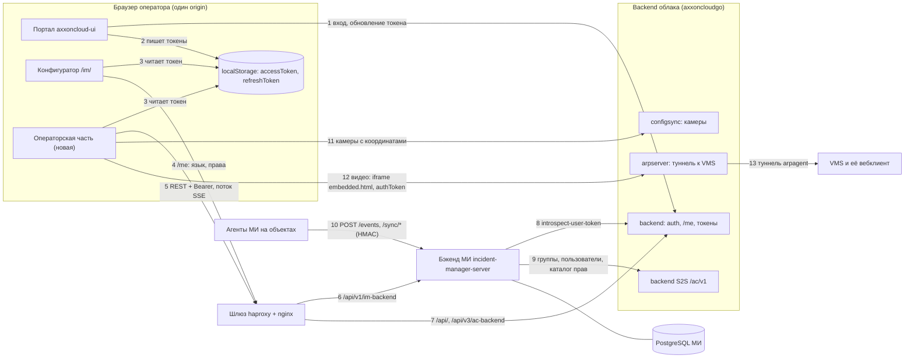

# Итог: как встроить операторскую часть МИ в облако

Дата: 2026-10-28. Репозитории и коммиты — в [README.md](README.md#что-изучено). Сведено по файлам [01](01-prototype.md)–[04](04-axxoncloudgo.md) и [06](06-axxoncloud-ui.md); спорные места перепроверены чтением кода на тех же коммитах (ссылки ниже).

Обозначения: без пометки — факт со ссылкой; **Вывод:** — следует из фактов; **Предположение:** — не проверено.

## Коротко

- **Второй круг (2026-10-28):** блокер старта сервера МИ снят на ветке облака `epic/CLOUD-23284-perms-i18n` (с `develop` по-прежнему не стартует); найден боевой деплой `IT/axxoncloud-deploy`, где у Bezeq уже есть `/im` и `/api/v1/im-backend`; найдены исходники меню `NEW/axxon-web` (`cloud-menu`) и вебклиент `PROJ/axxonnext.webclient` с протоколом `embedded.html`.
- Новые главные риски: introspect принимает refresh- и share-токены без проверки сессии, а служебный маршрут выдаёт share-токен на любого пользователя; фоновая вкладка портала выбивает оператора по тайм-ауту бездействия. Ответы на вопросы, решения и вопросы людям — [20-decisions.md](20-decisions.md); ниже — итог первого круга с поправками.
- Операторской части в облаке нет нигде: ни экрана, ни API, ни исполнителя машины. Есть конфигуратор МИ `/im/` ([02](02-im-configurator.md#коротко)) и бэкенд МИ с API настройки ([03](03-im-server.md#коротко)).

> Поправка (второй круг, 2026-10-28): операторской части нет, но МИ (сервер и конфигуратор) уже развёрнут в бою у Bezeq через `IT/axxoncloud-deploy`. См. [15, п. 1](15-deploy-configurator.md#1-боевой-конфиг-шлюза-где-apiv1monitoring-есть-ли-im-и-apiv1im-backend).

- Бэкенд МИ закрывает контракт оператора на 0 из 48 операций полностью, 12 — частично, 36 — нет. Машины состояний, исполнителя сценариев, таймеров, сессии оператора, журнала и потока событий нет ([03, Сверка](03-im-server.md#сверка-с-контрактом-операторской-части)).
- Вход общий: JWT облака (HS256, проверка только через introspect в `backend` облака), права — глобальные права облака в пространстве `incident_manager` ([04, Авторизация](04-axxoncloudgo.md#авторизация)).
- Каталог прав сервер МИ регистрирует запросом `PUT /ac/v1/global-permissions/catalog`, а в облаке на `0228c7a` есть только `POST /ac/v1/global-permissions` с плоским списком. **Вывод:** вне демо-режима сервер МИ с этим облаком не стартует (см. «Права»).

> Поправка (второй круг, 2026-10-28): вывод «не стартует» верен только для `develop` облака (`0228c7a`). На ветке `epic/CLOUD-23284-perms-i18n` (`e51bd55`) маршрут `PUT …/catalog` есть, тело совпадает с сервером МИ поле в поле — сервер МИ стартует. См. [10, п. 1](10-permissions.md#1-маршрут-put-acv1global-permissionscatalog-и-сверка-с-сервером-ми), [10, поправки](10-permissions.md#поправки-к-первому-кругу).

- Реального времени нет ни в облаке, ни в бэкенде МИ; поток `GET /operator/stream` делает бэкенд МИ ([03](03-im-server.md#реальное-время), [04](04-axxoncloudgo.md#реальное-время)).

> Поправка (второй круг, 2026-10-28): в nginx Bezeq есть WebSocket `/api/v1/notifier/connect` → `backend`; кода в `axxoncloudgo` не нашли, что это — вопрос облаку. Поток оператора всё равно делает бэкенд МИ. См. [13, поправки](13-cloud-ui-menu-video.md#поправки-к-первому-кругу).

- Токен вне страницы портала никто не обновляет: оператор на `/im/` без открытой вкладки портала теряет доступ через 7–15 минут (см. раздел 3).

> Поправка (второй круг, 2026-10-28): срок access задаёт установка: по умолчанию сутки (`axxoncloud/prod` — сутки), 15 минут — только на установках с `PT15M`. У `/im/` без портала — от 7 минут до суток. Главный риск другой: фоновая вкладка портала выходит по тайм-ауту бездействия и выбивает `/im/`. См. [11, поправки](11-auth-session.md#поправки-к-первому-кругу), [11, п. 3](11-auth-session.md#3-тайм-аут-бездействия-inactivelogoutttlmin).

- Источник инцидентов — агенты МИ, они шлют события в `POST /events` бэкенда МИ ([03](03-im-server.md#авторизация-арендность-связь-с-облаком)). Код агента в изученных репозиториях не найден.
- Видео — вебклиент VMS через туннель `arpserver` (iframe `embedded.html`); планов объектов в облаке нет ([04](04-axxoncloudgo.md#устройства-видео-события), [06](06-axxoncloud-ui.md#видео-карты-события-уведомления)).
- Арендность не решена: в облаке нет сущности «организация», в бэкенде МИ арендатор зашит в код ([03](03-im-server.md#авторизация-арендность-связь-с-облаком), [04](04-axxoncloudgo.md#арендность-пользователи-группы)).
- **Рекомендуемый путь:** фронт — отдельный бандл в том же origin под `/im/` (вариант А), на стеке и в репозитории конфигуратора; бэкенд — операторский API `/operator/…` внутри `incident-manager-server`; поток событий и обновление токена — свои.

## Карта связей

1. Портал входит через `/api/v3/ac-backend/auth-flow/…` и раз в 20 с обновляет пару токенов через `POST /api/v3/ac-backend/auth/tokens` ([06, Авторизация](06-axxoncloud-ui.md#авторизация)).
2. Портал хранит `accessToken`/`refreshToken` в `localStorage`, при входе DomaAI OIDC — в `sessionStorage` ([06](06-axxoncloud-ui.md#авторизация)).
3. Конфигуратор читает `localStorage.accessToken` перед каждым запросом ([02](02-im-configurator.md#авторизация-и-пользователь)); операторская часть должна делать так же, плюс обновление (раздел 3).
4. `GET /api/v3/ac-backend/me` — язык и дерево `capabilities` ([02](02-im-configurator.md#авторизация-и-пользователь), [06](06-axxoncloud-ui.md#права-в-интерфейсе)).
5. Операторская часть ходит в контракт `openapi.json` под `/api/v1/im-backend/operator/…` с Bearer и держит поток событий ([01, Контракт](01-prototype.md#контракт-api)).
6. Маршрута `/api/v1/im-backend/` в nginx облака нет: сейчас `/api/` целиком уходит в `backend:8000` ([nginx#168][ngx-api]). Нужен свой `location`.

> Поправка (второй круг, 2026-10-28): нет только в репозитории облака. В боевом деплое `IT/axxoncloud-deploy` у Bezeq есть `location /api/v1/im-backend` и `/im` с fallback ([15, п. 1](15-deploy-configurator.md#1-боевой-конфиг-шлюза-где-apiv1monitoring-есть-ли-im-и-apiv1im-backend), [12, поправки](12-tenancy-users.md#поправки-к-первому-кругу)). Номера строк на `0228c7a`: `location /api/` — 172, `location /` — 276, а не 168 и 269 ([15, поправки](15-deploy-configurator.md#поправки-к-первому-кругу)).

7. Остальные `/api/…` — в `backend` облака ([04, Сервисы и шлюз](04-axxoncloudgo.md#сервисы-и-шлюз)).
8. Бэкенд МИ проверяет каждый токен в облаке, кэш 30 с ([03](03-im-server.md#авторизация-арендность-связь-с-облаком), [client.go#90][im-introspect]).
9. Сервисные вызовы без авторизации: `/ac/v1/user-groups`, `/ac/v1/users/{id}`, регистрация прав при старте ([03](03-im-server.md#авторизация-арендность-связь-с-облаком)).
10. Агенты регистрируются по одноразовому токену и шлют события с подписью HMAC; инциденты создаёт фоновый обработчик правил ([03](03-im-server.md#авторизация-арендность-связь-с-облаком)).
11. `GET /api/v1/configsync/cameras` — камеры с `coords` и `previewUrl` ([04](04-axxoncloudgo.md#устройства-видео-события), [06](06-axxoncloud-ui.md#видео-карты-события-уведомления)).
12. Видео — `<webClientURL>/embedded.html` в iframe с сообщением `init {mode: live|archive, origin: accessPoint}`, токен — в адресе ([06](06-axxoncloud-ui.md#видео-карты-события-уведомления)).
13. `arpserver` проверяет доменные права и подставляет учётные данные VMS ([04](04-axxoncloudgo.md#устройства-видео-события)).

## Что операторской части нужно и где это взять

| Потребность | Есть в облаке? (где) | Есть в бэкенде МИ? | Чего не хватает | Кто делает |
|---|---|---|---|---|
| Вход и обновление токена | да: вход и `POST /api/v3/ac-backend/auth/tokens` с refresh-токеном ([04](04-axxoncloudgo.md#авторизация)); обновляет только страница портала ([06](06-axxoncloud-ui.md#авторизация)) | только проверка через introspect | обновление вне портала, обработка 401, учёт `sessionStorage` | фронт МИ; облако — ответить про ротацию refresh |
| Пользователь и арендатор | `userId`, имя, группы, права — из `introspect-user-token`; «организация» = id пользователя ([04](04-axxoncloudgo.md#арендность-пользователи-группы)) | `customer_guid` есть, но один тестовый, из заглушки ([03](03-im-server.md#авторизация-арендность-связь-с-облаком)) | что считать арендатором | облако + бэкенд МИ |
| Права оператора | глобальные права, глаголы `take/close/track/assign/suspend/process` ([04](04-axxoncloudgo.md#права-и-acl)) | каталог из 9 прав, проверяется 2 ([03, Права](03-im-server.md#права)) | 14 прав машины, рабочая регистрация (раздел 4) | бэкенд МИ + облако |
| Люди и группы для передачи | S2S: группы, один пользователь по id ([04](04-axxoncloudgo.md#арендность-пользователи-группы)) | только `GET /user-groups` ([03](03-im-server.md#авторизация-арендность-связь-с-облаком)) | состав группы, права любого пользователя, присутствие, дежурные группы | облако (API) + бэкенд МИ |
| Объекты оператора (группы доступа) | доступ только с точностью до домена ([04](04-axxoncloudgo.md#права-и-acl)) | правила доступа: группа пользователей → устройство, тип, тип события, группа устройств ([03](03-im-server.md#права)) | ключ — группы облака, а не роли (§5) | бэкенд МИ; решение нашей команды |
| Устройства и камеры | камеры VMS — копия в `configsync` ([04](04-axxoncloudgo.md#устройства-видео-события)) | `sources` от агентов (`uid`, `agent`) ([03](03-im-server.md#модель-данных)) | связь «устройство агента ↔ камера облака», связи камер | не ясно |
| Видео живое и архив | вебклиент VMS через `arpserver`, `embedded.html` в iframe ([04](04-axxoncloudgo.md#устройства-видео-события), [06](06-axxoncloud-ui.md#видео-карты-события-уведомления)) | нет | `webClientURL` и `accessPoint` камеры в `IncidentMedia`; протокол `embedded.html` | фронт МИ + бэкенд МИ |
| Карта и планы | координаты домена и камер, mapbox в портале; планов нет ([04, Карты](04-axxoncloudgo.md#карты)) | нет | планы объектов и маркеры | не ясно (ветка `map-layers` облака или МИ) |
| Источник тревог | — | агенты → `POST /events` → правила ([03](03-im-server.md#авторизация-арендность-связь-с-облаком)) | код агента; один инцидент на событие вместо одного на сценарий | бэкенд МИ |
| Реальное время | нет ([04](04-axxoncloudgo.md#реальное-время)) | нет ([03](03-im-server.md#реальное-время)) | SSE с `Last-Event-ID`, лента событий, вход для потока | бэкенд МИ (+ шлюз облака) |
| Машина состояний и сценарии | нет | сценарии с версиями, `scenario_result`; исполнителя нет ([03](03-im-server.md#модель-данных)) | CEL, исполнитель сценариев как в конфигураторе ([02](02-im-configurator.md#данные-которые-нужны-оператору)), таймеры | бэкенд МИ |
| Журнал инцидента | общий аудит облака `/audit` ([04](04-axxoncloudgo.md#похожие-функции)) | таблица `incident_activities`, код не пишет ([03](03-im-server.md#модель-данных)) | запись `templateKey + vars`, журнал оператора (§12.4) | бэкенд МИ |
| Вложения шагов | `uploader` `/api/v1/uploader` ([04](04-axxoncloudgo.md#сервисы-и-шлюз)) | нет | хранилище и кадр с камеры | не ясно |
| Локализация | `user.locale` из `/me` ([02](02-im-configurator.md#встраивание-в-портал), [06](06-axxoncloud-ui.md#стек)) | нет каталога строк ([03](03-im-server.md#сверка-с-контрактом-операторской-части)) | `GET /operator/strings` (§14.9) | бэкенд МИ + фронт МИ |
| Тема | светлая и тёмная, `localStorage['theme-mode']` ([06](06-axxoncloud-ui.md#стек)) | — | у конфигуратора тёмной темы нет ([02](02-im-configurator.md#стек-и-выкладка)) | фронт МИ |

> Поправка (второй круг, 2026-10-28): видео — протокол `embedded.html` найден ([13, п. 3](13-cloud-ui-menu-video.md#3-протокол-embeddedhtml-вебклиента-vms)); ключ mapbox — из `GET /api/v3/ac-backend/settings`, `map-layers` планов не даст ([13, п. 4](13-cloud-ui-menu-video.md#4-карта-ключ-mapbox-и-слои)); служебных API для состава групп и прав любого пользователя в облаке нет ([12, п. 2](12-tenancy-users.md#2-служебные-api-для-адресатов-передачи-и-дежурных-групп)); связи «устройство агента ↔ камера» нет нигде ([14, п. 3](14-im-backend-operator.md#3-связь-устройства-агента-с-камерой-облака-и-доменом)).

**Токен через 15 минут.** Факты: access-токен живёт «сейчас 15 минут» (комментарий в [auth.go#64][ac-ttl], значение — из настроек), refresh — 2 недели ([04](04-axxoncloudgo.md#авторизация)). Портал обновляет токен, если до конца меньше ~7 минут, и только пока открыта его страница ([06](06-axxoncloud-ui.md#авторизация)). Пункт меню МИ — внешний маршрут, страница портала закрывается ([06](06-axxoncloud-ui.md#как-подключаются-приложения-и-im)). Конфигуратор токен не обновляет и 401 не обрабатывает ([02](02-im-configurator.md#авторизация-и-пользователь)). Бэкенд МИ кэширует ответ introspect 30 с ([03](03-im-server.md#авторизация-арендность-связь-с-облаком)).
**Вывод:** у оператора, ушедшего из портала на `/im/`, остаётся 7–15 минут; затем (плюс до 30 с кэша) все запросы получают 401, поток рвётся, введённое в форме теряется. Если в том же браузере открыта вкладка портала, он перепишет `localStorage`, и `/im/` возьмёт новый токен со следующим запросом. При входе через DomaAI OIDC токен лежит в `sessionStorage`, и `/im/` его не найдёт вовсе. Операторской части нужно своё обновление тем же `POST /api/v3/ac-backend/auth/tokens`; можно ли двум окнам обновлять одну пару — вопрос облаку.

> Поправка (второй круг, 2026-10-28): комментарий «15 минут / 2 недели» устарел: умолчание `P1D`/`P1M`, сроки по установке. Refresh одноразовый; при общем `localStorage` гонка окон самовосстанавливается; при DomaAI пара в `sessionStorage` сохранится, если `/im/` открыт в той же вкладке. См. [11, п. 1](11-auth-session.md#1-refresh-токен-одноразовый-или-нет-где-хранится-гонка-сроки), [11, п. 2](11-auth-session.md#2-обновление-пары-из-внешнего-spa-как-это-делает-портал-domaai), [11, поправки](11-auth-session.md#поправки-к-первому-кругу).

**Реальное время.** Делает бэкенд МИ — больше некому. Факты по шлюзу (локальный стек): в nginx `proxy_buffering off` для всего `http` ([nginx#31][ngx-buf]), у haproxy `timeout client 50000`, `timeout server 1m` ([haproxy#14][hap]). Облако держит токены в хранилище браузера, куки сессии нет ([06](06-axxoncloud-ui.md#авторизация)); прототип открывает `EventSource` с `withCredentials` и без `Authorization` ([api.js#32](../../prototype/api.js#L32)). Образец токена в адресе в облаке уже есть: `?authToken=` у `arpserver` ([04](04-axxoncloudgo.md#устройства-видео-события)).
**Вывод:** (1) сервер шлёт пустой комментарий в поток чаще 30 с, иначе шлюз оборвёт соединение; (2) вход — либо чтение потока через `fetch` с заголовком `Authorization` (без `EventSource`, `Last-Event-ID` клиент шлёт сам), либо одноразовый билет: `POST` с Bearer → короткий код в адресе потока; токен доступа в адресе нежелателен — он попадёт в логи шлюза; (3) поток живёт дольше токена — сервер закрывает его по `exp` токена, клиент переподключается с новым. Контракт ([README машины](../../Specification/Workflow_machine/README.md)) предлагает куку или токен в адресе — облако куку не даёт.

> Поправка (второй круг, 2026-10-28): факты выше — локальный стек. В бою nginx буферизует ответ, `proxy_read_timeout` 120–300 с в зависимости от шаблона, haproxy `client 50s`; нужен `X-Accel-Buffering: no` и комментарий не реже раза в 15 с. Выбран вход `fetch` + `Authorization`. См. [11, шлюз](11-auth-session.md#шлюз-тайм-ауты-и-что-нужно-для-sse), [15, п. 3](15-deploy-configurator.md#3-тайм-ауты-шлюза-для-долгих-соединений-боевые-конфиги), [20, п. 3.2](20-decisions.md#32-вход-в-поток-событий).

## Права

Что сверено в коде. Сервер МИ шлёт дерево каталога `PUT /ac/v1/global-permissions/catalog` ([client.go#144][im-catalog]) и при ошибке не стартует ([appservice.go#530][im-start]). В облаке на `0228c7a` сервисный маршрут один — `POST /ac/v1/global-permissions` ([s2s/init.go#63][ac-s2s], [urls.go#502][ac-urls]) с плоским списком `[{uuid, name, description}]` ([auth.go#773][ac-reg]); маршрута `…/catalog` нет. Облако принимает имя, если пространство известно и последний сегмент — известное действие или `own/any` после действия ([methods.go#27][ac-valid]); список действий — 21, включая `take, close, track, assign, suspend, process` ([permissions.go#57][ac-actions]). Все 9 имён каталога МИ этому формату отвечают. `/me` превращает права в дерево `пространство → ресурс → действия` ([capabilities.go#66][ac-caps]). Фронт портала разбирает строку права только с 15 действиями (`create … block`) и для остальных возвращает `false` ([capabilities.ts#7][ui-caps]); проверка одного пространства `incident_manager` работает. Конфигуратор свою проверку делает по дереву из `/me` и действия не сверяет ([02, Права](02-im-configurator.md#права)).

> Поправка (второй круг, 2026-10-28): всё сказанное верно для `develop` облака. На ветке `epic/CLOUD-23284-perms-i18n` маршрут `PUT …/catalog` есть, формат совпадает, повторная регистрация безопасна. См. [10, п. 1](10-permissions.md#1-маршрут-put-acv1global-permissionscatalog-и-сверка-с-сервером-ми).

| Право машины ([01](01-prototype.md#что-нужно-от-окружения), §5) | Право каталога сервера МИ ([03](03-im-server.md#права)) | Действие в облаке | Видно во фронте портала (`hasCapability`) |
|---|---|---|---|
| `incident:claim` | `incident_manager.incidents.take.own` | `take` есть | нет |
| `incident:reassign` | `incident_manager.incidents.take.any` (сервер проверяет его в `GET /incidents`) | `take` есть | нет |
| `incident:accept` | `incident_manager.incidents.process` | `process` есть | нет |
| `incident:hold` | `incident_manager.incidents.suspend` | `suspend` есть | нет |
| `incident:close` | `incident_manager.incidents.close` | `close` есть | нет |
| `incident:close:unprocessed` | нет | `close` есть — нужен отдельный ресурс | нет |
| `incident:transfer:own`, `incident:transfer:any` | одно `incident_manager.incidents.assign` | `assign` есть, области `own/any` есть | нет |
| `incident:release` | нет | глагола нет | — |
| `incident:reopen` | нет | глагола нет | — |
| `incident:bulk` | нет | глагола нет | — |
| `incident:run_action` | нет | `run` есть | да, если завести с `run` |
| `agent:set_not_ready` | нет | пространства `agent` нет; глагола нет | — |
| `incident:schema:admin` | `incident_manager.manage` (сервер считает его надмножеством всех) | `manage` есть | да |
| — | `incident_manager.incidents.filter.edit` | `edit` есть | да |
| — | `incident_manager.incidents.track` | `track` есть | нет |

> Поправка (второй круг, 2026-10-28): колонку «Видно во фронте портала» надо разделить: редактор глобальных ролей на ветке фронта показывает и даёт назначить любое право каталога; `hasCapability` по-прежнему не видит `take/close/assign/suspend/process/track`. Для `release`, `reopen`, `bulk`, `set_not_ready` выход — схема «ресурс + `use`». Итоговая таблица — [20, п. 3.6](20-decisions.md#36-права-14-прав-машины--каталог-облака). См. [10, поправки](10-permissions.md#поправки-к-первому-кругу).

**Вывод:** (1) права машины придётся переложить в имена облака `incident_manager.<ресурс>.<действие>[.own|.any]`; для `release`, `reopen`, `bulk`, `set_not_ready` нужно либо подобрать ресурс с имеющимся глаголом, либо просить облако добавить глаголы. (2) Видимость во фронте портала важна только если портал сам будет проверять права МИ (например, для пункта меню); операторская часть может проверять их по дереву `/me` или брать `session.permissions` с сервера, как задумано в контракте ([01](01-prototype.md#что-нужно-от-окружения)). (3) Права с областью (`take.own`/`take.any`) облако хранит как одно действие с двумя областями — разбирать их надо с учётом `scopes`.

> Поправка (второй круг, 2026-10-28): пункт (3) верен для дерева `capabilities`; в каталоге и в ролях `take.own` и `take.any` — два отдельных права с разными UUID. См. [10, поправки](10-permissions.md#поправки-к-первому-кругу).

## Варианты встраивания фронта

| | А. Отдельное SPA в том же origin (`/im/…`) | Б. iframe в портале | В. Модуль в бандле портала |
|---|---|---|---|
| Плюсы | Полный экран без шапки, свои окна и мониторы, свой релиз; портал почти не меняется — пункт меню и `location` на шлюзе; тот же путь, что у конфигуратора ([06](06-axxoncloud-ui.md#варианты-встраивания-операторской-части), [02](02-im-configurator.md#что-повторить-для-операторской-части)) | Шапка, меню и обновление токена — портальные; токен приходит через `?authToken` и `postMessage` | Общие store, тема, язык, права и таймер |
| Минусы | Обновление токена, 401, тайм-аут бездействия — свои; меню облака — только через пакет `@axxon-web/cloud-menu` | Таймер бездействия портала не видит работу в iframe и разлогинит оператора; токен в адресе; нет `allow="autoplay"` для звука; правка и релиз портала на 62 OEM | Переписать под React 18 + redux-saga портала; релиз МИ привязан к релизу облака и 62 OEM; тяжёлое рабочее место в общем бандле |

**Рекомендация — А.** Обоснование: смена оператора 8–12 часов несовместима с тайм-аутом портала (Б); связка с релизом облака (В) тормозит МИ; конфигуратор уже живёт по схеме А и доказал её ([02](02-im-configurator.md#встраивание-в-портал)). Б оставить запасным путём для редкого просмотра.

**Раздел конфигуратора или отдельный бандл.** Факты: у конфигуратора — React 19 + MUI 9 + TanStack, OEM-тема при сборке, 13 языков, нет тёмной темы, нет обработки 401; проигрыватель сценария закрыт границами модулей ESLint; переопределения JSONLogic глобальны ([02](02-im-configurator.md#что-повторить-для-операторской-части)). Права у администратора и оператора разные ([02](02-im-configurator.md#права)).
**Вывод:** один репозиторий `incident-manager`, но отдельная точка входа (отдельный бандл) под общим `/im/`, например `/im/operator/`. Общими пакетами вынести формат сценария, JSONLogic, проигрыватели шагов, HTTP-клиент с обновлением токена, тему. Тогда шлюзу хватит одного `location /im/`, а оператор не тянет редактор диаграмм и наоборот. Решение — за нашей командой и командой конфигуратора.

> Поправка (второй круг, 2026-10-28): «шлюзу хватит одного `location /im/`» неверно для глубоких ссылок: нужен ещё `location /im/operator`, иначе `/im/operator/<путь>` получит `index.html` конфигуратора. Отдельный zip в `/im/operator/` стирается деплоем конфигуратора. См. [15, п. 2](15-deploy-configurator.md#2-кто-раздаёт-ui-вендорzip-под-im-где-fallback-как-добавить-imoperator), [15, поправки](15-deploy-configurator.md#поправки-к-первому-кругу).

## Бэкенд: где исполнять машину и сценарии

**Варианты.**
- **В `incident-manager-server`** (рекомендуем). Пути `/operator/…` не пересекаются с текущими, оба контракта живут под `/api/v1/im-backend` ([03, API](03-im-server.md#api)). Уже есть вход через облако, правила доступа, сценарии с версиями, привязка инцидента к версии сценария, `scenario_result`, создание инцидентов из событий агентов ([03](03-im-server.md#модель-данных)).
- **Отдельный сервис.** Свой цикл и стек, но инциденты, сценарии и правила доступа лежат в БД сервера МИ — их придётся дублировать или читать по сети. **Вывод:** смысла нет, пока сервер МИ не делится на части.

**Что надо сделать в сервере** ([03](03-im-server.md#модель-данных), [BACKEND.md](../../Specification/Workflow_machine/BACKEND.md)): исполнитель машины на CEL (`cel-go` в зависимостях нет); исполнитель сценариев, считающий JSONLogic так же, как конфигуратор (переопределённые `in`, `==`, `!=` — [02](02-im-configurator.md#данные-которые-нужны-оператору)); планировщик таймеров; сессии, heartbeat, присутствие; журнал `templateKey + vars`; номер, `version` и `ETag` инцидента, ключи идемпотентности; лента событий в БД для SSE и нескольких экземпляров (шина сейчас в памяти, ADR-001 обещает NATS «позже»); каталог строк; адресаты передачи; один инцидент на событие вместо одного на каждый сценарий правила; `/test/*` для приёмки тестами `tests/api.html` ([01](01-prototype.md#технология-и-что-переносится)).

**Разрыв по контракту** — проверено: в `openapi.json` 48 операций, версия `3.1.0`; по таблице [03](03-im-server.md#сверка-с-контрактом-операторской-части) полностью — 0, частично — 12, нет — 36, сумма сходится.

**Сквозные расхождения** ([03](03-im-server.md#сверка-с-контрактом-операторской-части)):
- OpenAPI 3.1 (77 раз `"type": [..., "null"]`) против 3.0.1 и форка `oapi-codegen` — нужен перевод контракта на 3.0 или другой генератор.

> Поправка (второй круг, 2026-10-28): что форк `oapi-codegen` 3.1 не понимает, подтверждено (`kin-openapi v0.117.0`); мест только из 3.1 — 109, а не 77. См. [14, п. 5](14-im-backend-operator.md#5-openapi-31-против-30-ошибки-cors).

- Ошибки `{key, description}` против `application/problem+json` с `code`.
- Версия записи: у сценариев `If-Match: <число>`, в контракте `ETag` в кавычках и `428/412`.
- CORS сервера — `*`, без `If-Match` и `Expose-Headers: ETag` ([main.go#86][im-cors]); у шлюза облака свой набор заголовков, тоже без `If-Match` ([common-api-header-directives.conf][ngx-cors]). **Вывод:** в том же origin это неважно, важно только для тестового стенда с другого адреса.
- Идентификаторы людей: `int64` в сервере, строки в контракте — совместимо, если отдавать строкой.
- Права: `incident_manager.*` против `incident:*` (раздел 4).
- `GET /incidents/{guid}` требует `manage`, ветка с доступом для оператора недостижима ([incident.go#69][im-getinc]) — подтверждено.

## Риски и находки

**Безопасность.**
- Сервисные `/ac/v1/*` облака — без авторизации и без арендатора; защищены только тем, что nginx не пускает `/ac/` наружу ([04](04-axxoncloudgo.md#арендность-пользователи-группы)). Сервер МИ ходит туда по `http` ([03](03-im-server.md#авторизация-арендность-связь-с-облаком)).

> Поправка (второй круг, 2026-10-28): в on-prem установщиках (`nginx.ssl.conf`, `windows/nginx.conf`) и k8s-конфиге `/ac/` проксируется наружу; порты `:8000`/`:9006` в бою открыты на хосте. Среди маршрутов — `GET /ac/v1/shared/token/:userId`, выдающий share-токен на любого пользователя. См. [12, п. 5](12-tenancy-users.md#5-безопасность-служебных-api).

- `configsync /internal/*` без `security` в спецификации, а nginx проксирует весь `/api/v1/configsync/` наружу ([04](04-axxoncloudgo.md#устройства-видео-события), [nginx#183][ngx-cs]). Закрыто ли это на боевом шлюзе — неизвестно.

> Поправка (второй круг, 2026-10-28): в боевой ansible-выкладке закрыт ответом 403, кроме конфига `stage4`; открыт в on-prem, локальном стеке и helm 2023 г. См. [12, п. 5](12-tenancy-users.md#5-безопасность-служебных-api), [13, поправки](13-cloud-ui-menu-video.md#поправки-к-первому-кругу).

- Оба introspect-адреса открыты снаружи без ключа сервиса ([04](04-axxoncloudgo.md#авторизация)); подтверждено: маршруты в общей группе `/api/v1` ([init.go#107][ac-introspect]).
- Арендатор в бэкенде МИ зашит в код (`fakedata`), запросы к инцидентам и сценариям по `customer_guid` не фильтруются; ключ шифрования секретов агентов по умолчанию зашит в код ([03](03-im-server.md#устройство-и-запуск)).
- В `.npmrc` axxoncloud-ui учётные данные реестра лежат открытым текстом ([06](06-axxoncloud-ui.md#ограничения-для-операторского-места)).
- Отозванный токен работает в МИ до 30 с (кэш introspect); доступ к домену в `arpserver` кэшируется до 4 часов ([03](03-im-server.md#авторизация-арендность-связь-с-облаком), [04](04-axxoncloudgo.md#устройства-видео-события)).

> Поправка (второй круг, 2026-10-28): introspect не проверяет сессию и блокировку: отозванный access работает до своего `exp` (по умолчанию сутки) плюс 30 с кэша; к тому же introspect принимает refresh- и share-токены, а МИ тип не проверяет. См. [12, поправки](12-tenancy-users.md#поправки-к-первому-кругу), [11, п. 1](11-auth-session.md#1-refresh-токен-одноразовый-или-нет-где-хранится-гонка-сроки).

**Работа оператора.**
- Тайм-аут бездействия портала `inactiveLogoutTTLMin` разлогинит оператора в iframe ([06](06-axxoncloud-ui.md#авторизация)); в отдельном SPA тайм-аута нет вовсе — нужно решение.

> Поправка (второй круг, 2026-10-28): в отдельном SPA своего таймера нет, но фоновая вкладка портала сама выйдет по таймеру и завершит общую сессию у `/im/`; отключить тайм-аут для роли нельзя. См. [11, п. 3](11-auth-session.md#3-тайм-аут-бездействия-inactivelogoutttlmin), [11, поправки](11-auth-session.md#поправки-к-первому-кругу).

- Две вкладки или два монитора обновляют токен каждая сама; если refresh одноразовый, они выбьют друг друга ([06](06-axxoncloud-ui.md#ограничения-для-операторского-места)).

> Поправка (второй круг, 2026-10-28): refresh одноразовый, но при общем `localStorage` проигравшая вкладка восстанавливается на следующем цикле; выбивают друг друга только разные копии пары (`sessionStorage`, токен в памяти) или вызов выхода на 401. См. [11, п. 1](11-auth-session.md#1-refresh-токен-одноразовый-или-нет-где-хранится-гонка-сроки).

- Звук тревоги в iframe без `allow="autoplay"` браузер может заблокировать ([06](06-axxoncloud-ui.md#ограничения-для-операторского-места)).
- Шрифты с Google Fonts у прототипа и конфигуратора — в закрытой сети не загрузятся ([01](01-prototype.md#что-нужно-от-окружения), [02](02-im-configurator.md#что-повторить-для-операторской-части)).

**Зависимости и сроки.**
- Регистрация прав не совпадает с облаком (раздел 4) — без исправления сервер МИ вне демо-режима не стартует.

> Поправка (второй круг, 2026-10-28): верно только для `develop`; с облаком ветки прав сервер МИ стартует. Риск теперь — срок слияния ветки, которого нет. См. [10, п. 2](10-permissions.md#2-ветка-против-develop-сроки-слияния).

- Keycloak, object ACL, карты, webhook — в ветках облака, не в `develop`; могут поменять вход и доступ к камерам ([04](04-axxoncloudgo.md#открытые-вопросы)).

> Поправка (второй круг, 2026-10-28): Keycloak вход для `/im/` и introspect не меняет ([11, п. 5](11-auth-session.md#5-keycloak)); `map-layers` планов объектов не даст ([13, п. 4](13-cloud-ui-menu-video.md#4-карта-ключ-mapbox-и-слои)); webhook без типов событий и отправителей ([12, п. 3](12-tenancy-users.md#3-события-об-изменениях)).

- В облаке доступ к камерам известен только до домена, точнее — только VMS ([04](04-axxoncloudgo.md#права-и-acl)); группы доступа МИ — по устройствам агентов ([03](03-im-server.md#права)). Два разных справочника объектов.
- Документация конфигуратора расходится с кодом ([02](02-im-configurator.md#коротко)).

## Локальный стенд

Порядок — в [04, Локальный запуск](04-axxoncloudgo.md#локальный-запуск) и в документе облака [run_cloud_on_local_machine.md][ac-local]: Ubuntu, Docker Swarm, VPN к `npm.itvgroup.ru:3000`, записи в `/etc/hosts`, `make dep`, `make gen-bp`, `make gen`, артефакт `ui-AxxonNet.zip` из Bamboo, `make build-all`, `make deploy`; пользователь — `make create-db-users`.
Что добавить для МИ (**Вывод**, в репозиториях этого нет):
1. Сервис `incident-manager-server` и его PostgreSQL в сети `ac`; `IM_DB_URL`, `IM_S2S_CLOUD_URL=backend:8000`, `IM_CLOUD_URL=axxonnet.test` (сервер ходит на него по `https` — нужен доверенный сертификат стенда).
2. В `nginx.anticonsul.conf` — `location /api/v1/im-backend/` на сервер МИ и `location /im/` с `try_files … /im/index.html`: сейчас `location /` отдаёт `index.html` портала на любой путь ([nginx#269][ngx-root]).

> Поправка (второй круг, 2026-10-28): для второй точки входа нужен ещё `location /im/operator`; zip конфигуратора не распаковывать в `tools/compose` — корень `ui/` смешается с порталом. См. [15, п. 6](15-deploy-configurator.md#6-локальный-стенд-план-добавления-ми-в-стек-ac-без-запуска).

3. Сборки конфигуратора и операторской части — в папку статики nginx под `im/`.
4. Права: пока облако не принимает `PUT …/catalog`, сервер МИ вне демо-режима не стартует; на стенде нужна ветка облака с этим маршрутом или правка сервера МИ на `POST /ac/v1/global-permissions`.

> Поправка (второй круг, 2026-10-28): ветка с маршрутом найдена — `epic/CLOUD-23284-perms-i18n`; чтобы работать и с `develop`, серверу МИ нужен запасной `POST` при `404`. См. [10, поправки](10-permissions.md#поправки-к-первому-кругу), [15, п. 6](15-deploy-configurator.md#6-локальный-стенд-план-добавления-ми-в-стек-ac-без-запуска).

5. События — тестовый агент или прямые `POST /events` с подписью HMAC ([03](03-im-server.md#api)).
6. Поток событий проверить через haproxy: тайм-ауты 50 с / 1 мин ([haproxy#14][hap]).

> Поправка (второй круг, 2026-10-28): на локальном стенде буферизация выключена на весь `http` и проблему не покажет — включить её в `location` МИ, как в бою. См. [15, п. 3](15-deploy-configurator.md#3-тайм-ауты-шлюза-для-долгих-соединений-боевые-конфиги).

## Вопросы

**Команда облака (backend)**

Ответы — [20-decisions.md, раздел «Ответы на вопросы»](20-decisions.md#команда-облака-backend); новые вопросы людям — [раздел 5](20-decisions.md#5-вопросы-людям).

- [блокирует] Где маршрут `PUT /ac/v1/global-permissions/catalog` (дерево с `view_group` и i18n), в какой ветке и когда в `develop`? Сейчас только `POST` с плоским списком ([03](03-im-server.md#права), раздел 4).
- [блокирует] Refresh-токен одноразовый? Может ли внешнее SPA само обновлять пару и что будет при двух окнах? Точный `AccessTokenTTL` в бою ([06](06-axxoncloud-ui.md#открытые-вопросы)).
- [блокирует] Что считать арендатором МИ: владельца домена, узел дерева доменов, группу пользователей? Как это получить из introspect ([03](03-im-server.md#открытые-вопросы), [04](04-axxoncloudgo.md#открытые-вопросы)).
- [блокирует] Будет ли S2S API: состав группы пользователей, права и группы любого пользователя, событие «права/группы изменились» — для адресатов передачи и дежурных групп (§8.1) ([03](03-im-server.md#открытые-вопросы)).
- [важно] Можно ли добавить глаголы `release`, `reopen`, `bulk` (или каким ресурсом их выразить) и пространство для состояния оператора ([04](04-axxoncloudgo.md#права-и-acl)).
- [важно] Где боевой конфиг шлюза; как добавить `/im/` и `/api/v1/im-backend/`; какие тайм-ауты для долгих соединений (SSE) ([04](04-axxoncloudgo.md#открытые-вопросы)).
- [важно] Допустим ли для потока событий одноразовый билет в адресе или токен в адресе, как у `arpserver` ([04](04-axxoncloudgo.md#устройства-видео-события)).
- [важно] `configsync /internal/*` наружу и `/ac/v1/*` без авторизации — закрыто ли в бою ([04](04-axxoncloudgo.md#открытые-вопросы)).
- [позже] Когда Keycloak войдёт в `develop` и останется ли introspect ([04](04-axxoncloudgo.md#открытые-вопросы)).
- [позже] Права на отдельные камеры (object ACL) и планы объектов (`map-layers`) — сроки ([04](04-axxoncloudgo.md#открытые-вопросы)).

**Команда фронта облака**

Ответы — [20-decisions.md, раздел «Ответы на вопросы»](20-decisions.md#команда-фронта-облака); новые вопросы людям — [раздел 5](20-decisions.md#5-вопросы-людям).

- [блокирует] Где исходники `@axxon-web/cloud-menu`, какой адрес у пункта `incidentManager`, по какому праву он виден; можно ли добавить пункт «Оператор» ([06](06-axxoncloud-ui.md#открытые-вопросы)).
- [важно] Можно ли подключить `@axxon-web/cloud-menu` во внешнее SPA ([06](06-axxoncloud-ui.md#открытые-вопросы)).
- [важно] Протокол `embedded.html`: список сообщений, переход к времени архива, несколько камер ([06](06-axxoncloud-ui.md#открытые-вопросы)).
- [важно] Отключать ли `inactiveLogoutTTLMin` для операторов ([06](06-axxoncloud-ui.md#открытые-вопросы)).
- [позже] Добавить ли `take, close, assign…` в `utils/capabilities.ts` портала ([06](06-axxoncloud-ui.md#открытые-вопросы)).
- [позже] Кто ставит CSP и разрешён ли `frame-src` на вебклиенты доменов для `/im/` ([06](06-axxoncloud-ui.md#открытые-вопросы)).
- [позже] Ключ и тайлы mapbox для операторской части ([06](06-axxoncloud-ui.md#открытые-вопросы)).

**Команда бэкенда МИ**

Ответы — [20-decisions.md, раздел «Ответы на вопросы»](20-decisions.md#команда-бэкенда-ми); новые вопросы людям — [раздел 5](20-decisions.md#5-вопросы-людям).

- [блокирует] Кто и где делает операторский API, машину (CEL), сценарии и поток событий — в этом сервисе под `/operator/…`? ([03](03-im-server.md#открытые-вопросы))
- [блокирует] Как получить 14 прав машины: расширить каталог или таблица соответствия; что с `filter.edit` и `track` ([03](03-im-server.md#открытые-вопросы)).
- [важно] Один инцидент на событие и выбор одного сценария (§14.5) ([03](03-im-server.md#открытые-вопросы)).
- [важно] Где код агентов, какие поля события дают устройство, тип, площадку, приоритет ([03](03-im-server.md#открытые-вопросы), [01](01-prototype.md#открытые-вопросы)).
- [важно] Как связать устройство агента (`uid`, `agent`) с камерой облака и доменом для видео ([02](02-im-configurator.md#данные-которые-нужны-оператору)).
- [важно] OpenAPI 3.1 или 3.0, ошибки `problem+json` ([03](03-im-server.md#открытые-вопросы)).
- [важно] `GET /incidents/{guid}` только для `manage` — ошибка? ([03](03-im-server.md#права))
- [позже] Статусы `open/in_progress/closed` и `incident_actions` — убрать в пользу состояний машины? ([03](03-im-server.md#открытые-вопросы))
- [позже] Тестовый стенд `/test/*` с управляемыми часами ([03](03-im-server.md#открытые-вопросы)).

**Команда конфигуратора**

Ответы — [20-decisions.md, раздел «Ответы на вопросы»](20-decisions.md#команда-конфигуратора); новые вопросы людям — [раздел 5](20-decisions.md#5-вопросы-людям).

- [важно] Готовы ли вынести формат сценария, JSONLogic и проигрыватели шагов в общий пакет и снять запрет ESLint на `preview` ([02](02-im-configurator.md#есть-ли-что-то-операторское)).
- [важно] Кто раздаёт `ui-<вендор>.zip` под `/im/` и где fallback на `index.html` ([02](02-im-configurator.md#открытые-вопросы)).
- [позже] Что значат для оператора `multitasking`, `report` и `macro`; кто исполняет макросы ([02](02-im-configurator.md#открытые-вопросы)).
- [позже] Нужна ли тёмная тема и общий HTTP-клиент с обработкой 401 ([02](02-im-configurator.md#что-повторить-для-операторской-части)).

**Решения нашей команды**

Ответы — [20-decisions.md, раздел «Ответы на вопросы»](20-decisions.md#нашей-команде); новые вопросы людям — [раздел 5](20-decisions.md#5-вопросы-людям).

- [блокирует] Вариант встраивания (рекомендуем А) и «раздел конфигуратора или отдельный бандл» (рекомендуем отдельную точку входа в том же репозитории).
- [блокирует] Схема входа для потока событий: чтение через `fetch` с заголовком или одноразовый билет; поправить контракт (`bearerAuth`) и `api.js` ([01](01-prototype.md#открытые-вопросы)).
- [важно] «Роли» в группах доступа и дежурных группах (§5) — это группы пользователей облака? ([03](03-im-server.md#открытые-вопросы))
- [важно] Карта и планы: ждать облако или хранить планы в МИ ([04](04-axxoncloudgo.md#открытые-вопросы)).
- [позже] Тема: ONE PSIM или OEM-тема MUI, как у конфигуратора и портала ([01](01-prototype.md#что-нужно-от-окружения), [06](06-axxoncloud-ui.md#стек)).

## Поправки к файлам 01–06

- **03, «Права» и «Авторизация…»**: «при старте сервер отправляет каталог в облако; облако назначает права» — на коммите облака `0228c7a` маршрута `PUT /ac/v1/global-permissions/catalog` нет, есть только `POST /ac/v1/global-permissions` со списком `[{uuid, name, description}]` ([s2s/init.go#63][ac-s2s], [auth.go#773][ac-reg]). Связка не работает; стоит пометить.

> Поправка (второй круг, 2026-10-28): связка работает с облаком ветки `epic/CLOUD-23284-perms-i18n`; не работает только с `develop`. См. [10, поправки](10-permissions.md#поправки-к-первому-кругу).

- **04, «Как подключается внешний сервис», п. 3**: «при старте — `POST /ac/v1/global-permissions` с правами `incident_manager.*`» — сервер МИ делает иначе: `PUT …/catalog` с деревом ([client.go#144][im-catalog]). Там же «Предположение: [`introspect-user-token`] использует бэкенд МИ» — подтверждено ([client.go#90][im-introspect]).
- **06, «Права в интерфейсе»**: «`take, close…` (их облако заводит для МИ)» — облако заводит только глаголы ([permissions.go#57][ac-actions]); сами права регистрирует сервер МИ ([03](03-im-server.md#права)). Стоит добавить, что `incident_manager.manage` и `…filter.edit` фронт распознаёт.
- **02, «Права»**: «это права облака из ac-backend, а не отдельный каталог прав МИ» — неточно: пространство `incident_manager` наполняется каталогом сервера МИ ([03](03-im-server.md#права)), облако только хранит и выдаёт его в `/me`.

## Что дальше

1. Отправить команде облака блокирующие вопросы о регистрации прав, обновлении токена, арендаторе и списке пользователей; без ответа на первый не поднять сервер МИ рядом с облаком.
2. С командой бэкенда МИ договориться: операторский API в `incident-manager-server` под `/operator/…`, переложить 14 прав машины в имена облака (таблица раздела 4), выбрать OpenAPI 3.0 или 3.1.
3. Решить вход для потока событий и записать его в контракт `openapi.json` и `api.js` прототипа.
4. С командой конфигуратора — общий пакет сценария и HTTP-клиента с обновлением токена; отдельная точка входа `/im/operator/`.
5. Поднять локальный стенд облака с сервером МИ и маршрутами `/im/`, `/api/v1/im-backend/` (раздел 8) и прогнать на нём `tests/api.html` по мере готовности операций.

> Поправка (второй круг, 2026-10-28): после второго круга порядок работ уточнён — [20-decisions.md, «План работ»](20-decisions.md#7-план-работ); шаг 1 по правам частично снят: маршрут каталога есть на ветке облака, вопрос теперь — срок слияния ([10, п. 2](10-permissions.md#2-ветка-против-develop-сроки-слияния)).

[ngx-api]: https://src.axxonsoft.dev/bitbucket/projects/PROJ/repos/axxoncloudgo/browse/tools/docker/nginx.anticonsul.conf?at=0228c7a9b1acf8faa62aa1097d6ec085882e8cf3#168
[ngx-cs]: https://src.axxonsoft.dev/bitbucket/projects/PROJ/repos/axxoncloudgo/browse/tools/docker/nginx.anticonsul.conf?at=0228c7a9b1acf8faa62aa1097d6ec085882e8cf3#183
[ngx-root]: https://src.axxonsoft.dev/bitbucket/projects/PROJ/repos/axxoncloudgo/browse/tools/docker/nginx.anticonsul.conf?at=0228c7a9b1acf8faa62aa1097d6ec085882e8cf3#269
[ngx-buf]: https://src.axxonsoft.dev/bitbucket/projects/PROJ/repos/axxoncloudgo/browse/tools/docker/nginx.anticonsul.conf?at=0228c7a9b1acf8faa62aa1097d6ec085882e8cf3#31
[ngx-cors]: https://src.axxonsoft.dev/bitbucket/projects/PROJ/repos/axxoncloudgo/browse/tools/docker/common-api-header-directives.conf?at=0228c7a9b1acf8faa62aa1097d6ec085882e8cf3#4
[hap]: https://src.axxonsoft.dev/bitbucket/projects/PROJ/repos/axxoncloudgo/browse/tools/docker/haproxy.anticonsul.cfg?at=0228c7a9b1acf8faa62aa1097d6ec085882e8cf3#14
[ac-ttl]: https://src.axxonsoft.dev/bitbucket/projects/PROJ/repos/axxoncloudgo/browse/model/auth/auth.go?at=0228c7a9b1acf8faa62aa1097d6ec085882e8cf3#64
[ac-s2s]: https://src.axxonsoft.dev/bitbucket/projects/PROJ/repos/axxoncloudgo/browse/handler/s2s/init.go?at=0228c7a9b1acf8faa62aa1097d6ec085882e8cf3#63
[ac-urls]: https://src.axxonsoft.dev/bitbucket/projects/PROJ/repos/axxoncloudgo/browse/model/urls.go?at=0228c7a9b1acf8faa62aa1097d6ec085882e8cf3#502
[ac-reg]: https://src.axxonsoft.dev/bitbucket/projects/PROJ/repos/axxoncloudgo/browse/handler/rest/auth.go?at=0228c7a9b1acf8faa62aa1097d6ec085882e8cf3#773
[ac-introspect]: https://src.axxonsoft.dev/bitbucket/projects/PROJ/repos/axxoncloudgo/browse/handler/rest/init.go?at=0228c7a9b1acf8faa62aa1097d6ec085882e8cf3#107
[ac-valid]: https://src.axxonsoft.dev/bitbucket/projects/PROJ/repos/axxoncloudgo/browse/model/permissions/methods.go?at=0228c7a9b1acf8faa62aa1097d6ec085882e8cf3#27
[ac-actions]: https://src.axxonsoft.dev/bitbucket/projects/PROJ/repos/axxoncloudgo/browse/model/permissions/permissions.go?at=0228c7a9b1acf8faa62aa1097d6ec085882e8cf3#57
[ac-caps]: https://src.axxonsoft.dev/bitbucket/projects/PROJ/repos/axxoncloudgo/browse/model/permissions/capabilities.go?at=0228c7a9b1acf8faa62aa1097d6ec085882e8cf3#66
[ac-local]: https://src.axxonsoft.dev/bitbucket/projects/PROJ/repos/axxoncloudgo/browse/docs/run_cloud_on_local_machine.md?at=0228c7a9b1acf8faa62aa1097d6ec085882e8cf3
[ui-caps]: https://src.axxonsoft.dev/bitbucket/projects/PROJ/repos/axxoncloud-ui/browse/app/utils/capabilities.ts?at=d436dd1c24cde57170db56143b8b17e7fc820b23#7
[im-introspect]: https://src.axxonsoft.dev/bitbucket/projects/NEW/repos/incident-manager-server/browse/internal/externalclient/cloud/client.go?at=b743797a38daeb3beaa44ef901b26c3ce924290f#90
[im-catalog]: https://src.axxonsoft.dev/bitbucket/projects/NEW/repos/incident-manager-server/browse/internal/externalclient/cloud/client.go?at=b743797a38daeb3beaa44ef901b26c3ce924290f#144
[im-start]: https://src.axxonsoft.dev/bitbucket/projects/NEW/repos/incident-manager-server/browse/internal/im/appservice/appservice.go?at=b743797a38daeb3beaa44ef901b26c3ce924290f#530
[im-cors]: https://src.axxonsoft.dev/bitbucket/projects/NEW/repos/incident-manager-server/browse/cmd/im/main.go?at=b743797a38daeb3beaa44ef901b26c3ce924290f#86
[im-getinc]: https://src.axxonsoft.dev/bitbucket/projects/NEW/repos/incident-manager-server/browse/internal/im/appservice/incident/incident.go?at=b743797a38daeb3beaa44ef901b26c3ce924290f#69
