# 87. Оповещения оператора, звук, источник и адрес — единая схема

Статус: **принят** (2026-11-15) — раскладка (вариант Б) и звук делаются вместе; предложения по звуку приняты целиком, звуки только встроенные, без файлов; лавина — направление, детали решаются отдельно. Источник и адрес в строке и карточке — решения приняты, раздел ниже. К работе не приступали. Пункт в [TECH-DEBT.md](TECH-DEBT.md).

## На что опираемся

Управление тревогами на пультах и в диспетчерских описано в двух признанных документах:

- **ANSI/ISA-18.2-2016** «Management of Alarm Systems for the Process Industries» — стандарт жизненного цикла системы тревог; международный вариант — IEC 62682. Страница стандарта: [isa.org](https://www.isa.org/products/ansi-isa-18-2-2016-management-of-alarm-systems-for), [ANSI webstore](https://webstore.ansi.org/standards/isa/ansiisa182016), обзор — [блог ANSI](https://blog.ansi.org/ansi/ansi-isa-18-2-alarm-systems-process-industries/).
- **EEMUA 191** «Alarm Systems — a guide to design, management and procurement», издание 4 (ноябрь 2024) — руководство по хорошей практике, с ним согласованы ISA-18.2 и IEC 62682. Страница: [eemua.org](https://eemua.org/products/publications/print/eemua-publication-191), [оглавление 4-го издания (PDF)](https://eemua.org/getattachment/9d3f8071-55c3-49bf-a74a-3bf6ad4a2e0f/Contents-EEMUA-Publication-191-Edition4-November-2024.pdf), бесплатный [контрольный список](https://eemua.org/products/publications/checklists/eemua-alarms-checklist).

Оба документа платные; ниже — общепринятые принципы из них, без цитат. Что берём:

1. **Каждая тревога требует действия оператора.** То, что действия не требует (фон, итог), — не тревога и не должно звучать и мигать как тревога.
2. **Ничего не исчезает само, пока не обработано.** Всплывающее окно, которое уходит через несколько секунд, — плохая практика: оператор его не увидел — тревоги для него не было.
3. **Приоритет виден сразу,** верхний уровень — редкий; звук — только у высших уровней.
4. **Лавина тревог** (много тревог за короткое время) — главная причина ошибок оператора. Её гасят уменьшением числа тревог (группировка, временное отключение шумного датчика, подавление по состоянию), а не тем, как их показывать.
5. **Отключённое на время — видно и записано:** кто, на сколько, почему; включается само.

## Что сейчас

| Механизм | Где | Что показывает |
|---|---|---|
| Колокольчик со счётчиком | шапка очереди справа | тихие уведомления: адресовано мне, эскалации, служебные |
| Всплывающие сообщения | поверх экрана, уходят сами | уведомление адресату (без звука, правила §8.1), чужие переходы с моими инцидентами, итоги и ошибки моих действий — в прототипе около 40 мест |
| Полоса над очередью | над списком очереди | идущие окна плановых работ (ТЗ-21) |
| Фильтры очереди | над списком | дерево групп, поиск, состояние (выпадающий список `queueFilters`), тип устройства, тип события, сценарий, порядок |
| Звук | — | нет |

Минусы: важное приходит в колокольчик, который надо открыть; всплывающее сообщение перекрывает экран и уходит само (против принципа 2); при лавине у оператора нет средств, кроме прокрутки; нового инцидента не слышно.

## Решение

**Правило раскладки:** ничего не перекрывает очередь и карточку; ничего не сдвигает то, во что оператор целится: пока курсор над очередью, ничто выше него не меняет высоту — ни блок «Мне на принятие», ни новые строки (решение 2026-11-15, уточнено после разбора глазами оператора). Пока что-то требует действия или длится — оно на экране; когда закончилось — остаётся записью в колокольчике.

| Класс | Пример | Где |
|---|---|---|
| **Нужно действие** | передано мне или моей группе, эскалация на меня, новый инцидент | очередь: блок «Мне на принятие» сверху, кнопки состояний и приоритетов с числами; звук |
| **Состояние поста** | нет связи с агентом, идут работы, мало места, отключённые датчики, звук не включён, «только важное» | одна строка в середине верхней шапки |
| **Итог моего действия** | «Передано», «Обработано: 5», «Не сохранено» | короткое сообщение внизу слева; ошибка — пока не закрыли |
| **Прошлое и сведения** | закончившиеся состояния, чужие переходы с моими инцидентами, всё за смену | колокольчик — журнал оповещений |

### Как это выглядит

Макет, не код продукта: [87-notifications/mock.html](87-notifications/mock.html) (`?v=1`…`?v=17`; ширину окна можно менять — шапка перестраивается).

1. Обычно: в шапке очереди — состояния (выбрано одно) и приоритеты (можно несколько), с числами; «Мне на принятие» всегда на месте — пустой одной строкой

   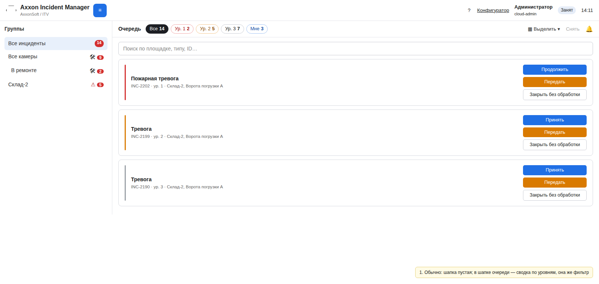

2. Состояние поста — одна строка в верхней шапке; в дереве значки 🛠 и ⚠

   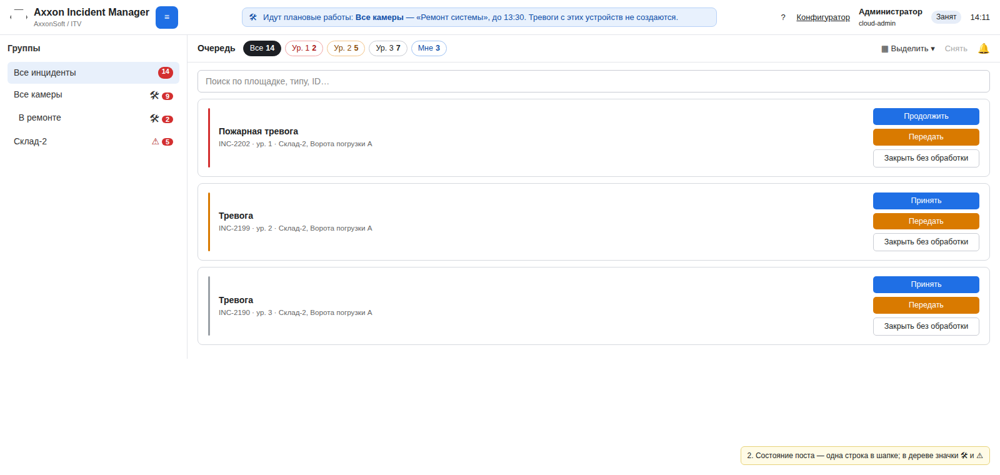

3. Несколько состояний — видно самое серьёзное и «и ещё 2», без карусели; щелчок — колокольчик

   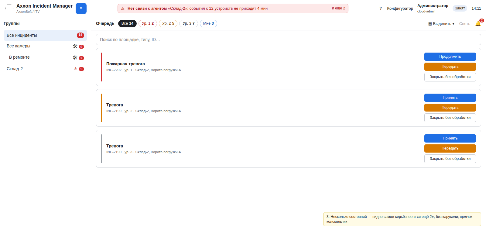

4. «Мне на принятие» — сверху очереди, не больше 3 строк; причина и сколько осталось; в общем списке не повторяются

   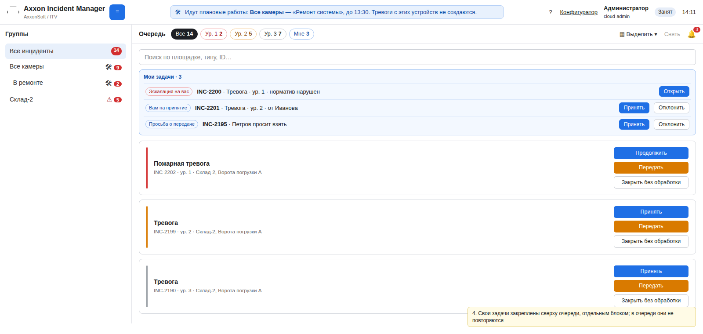

5. Выбраны «Критический» и «Высокий» — рамка их цвета и галочка; блок «Мне на принятие» фильтр не прячет

   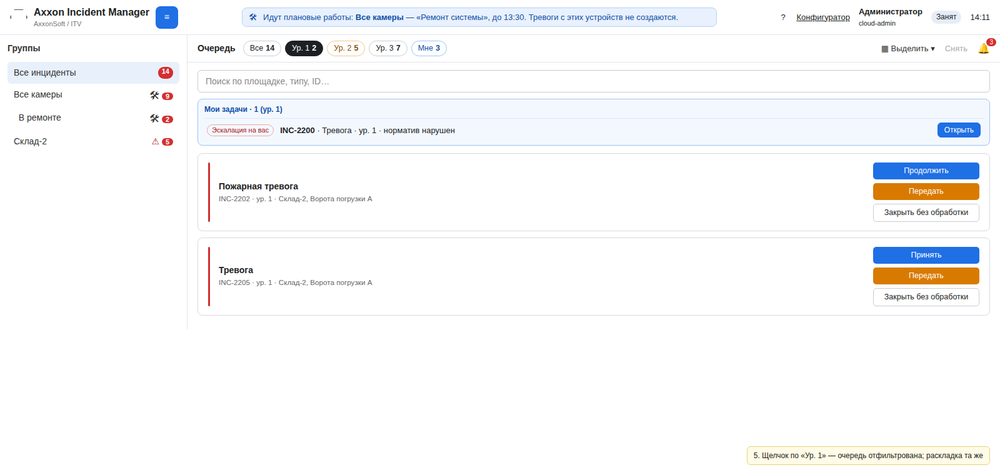

6. Лавина: одинаковые срабатывания — одна строка «×40»; «Средний» свёрнут, это видно на его кнопке; «Показать» — на свёрнутой строке

   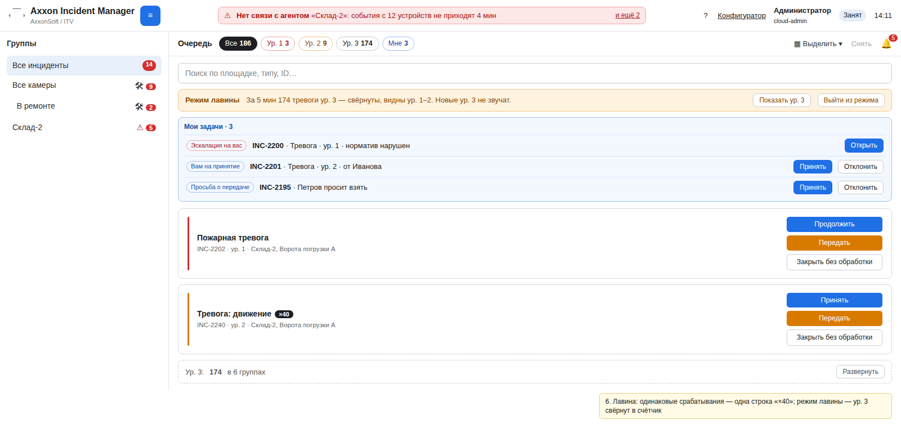

7. Шумный датчик можно отключить на время — с причиной и записью в журнал

   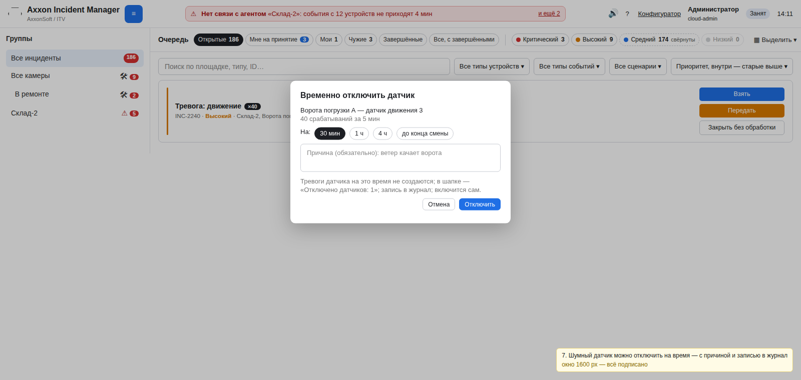

8. Колокольчик — журнал; открыли — прочитано; итог действия — короткое сообщение внизу

   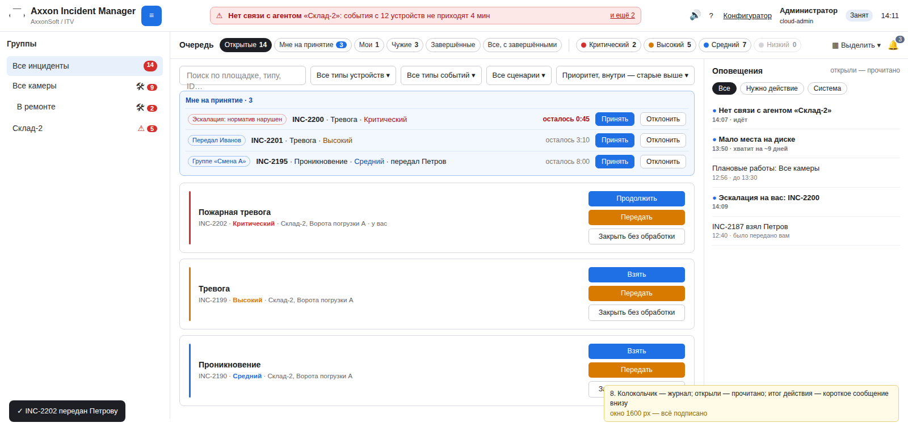

9. Выбрано «Мне на принятие» — список и есть эти инциденты, отдельного блока нет

   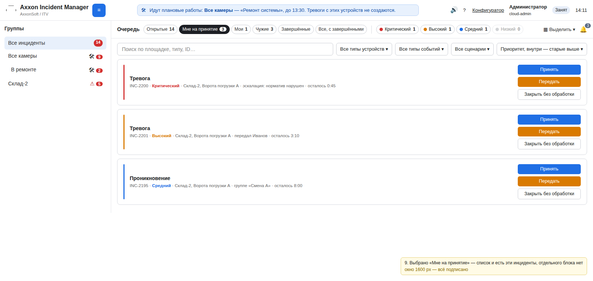

10. Узкий экран: состояния — выпадающим списком, приоритеты — прокручиваемой строкой

    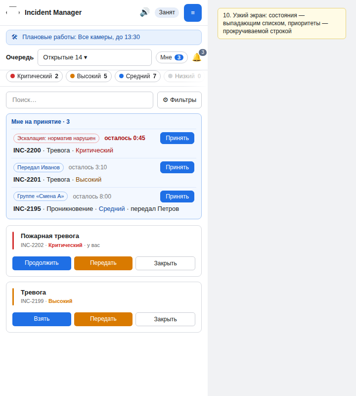

16. Курсор над списком — новые строки не сдвигают очередь; поверх — «↑ 1 новый — показать»

    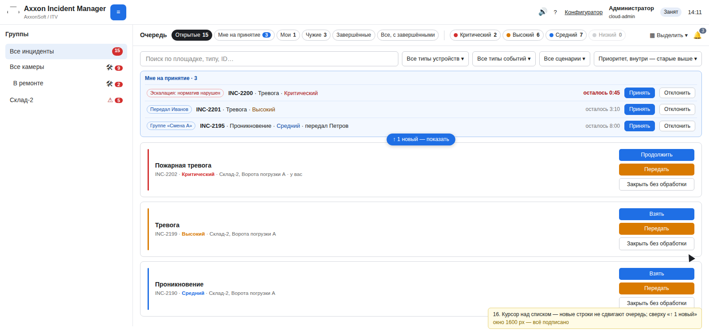

17. Выбрано «Мои», а звучит новый «Критический»: «скрыт фильтром · Показать», на «Открытые» метка «+1»

    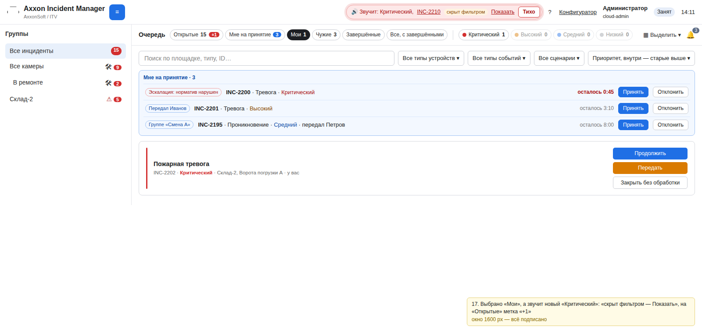

Звук — картинки 11–15 в разделе «Звук».

### Очередь — шапка (вариант Б)

- **Кнопки состояний** — фильтры машины `queueFilters`, как сейчас, только кнопками вместо выпадающего списка: «Открытые 14 · Мне на принятие 3 · Мои 1 · Чужие 3 · Завершённые · Все, с завершёнными». Это переключатель: выбрано всегда одно, по умолчанию «Открытые». У «Завершённых» и «Все, с завершёнными» числа нет (`counted: false`). Число на «Мне на принятие» выделено, когда оно больше нуля. «Все, с завершёнными» — чтобы не путать с узлом дерева «Все инциденты».
- **Кнопки приоритетов** — уровни справочника приоритетов (правила §2.5): названия и цвета оттуда, в поставке «Критический · Высокий · Средний · Низкий». Задавать ничего не надо — инцидент уже несёт приоритет. Кнопок столько, сколько уровней в справочнике; уровень с нулём — бледный, но на месте, чтобы шапка не прыгала. **Можно выбрать несколько** (решение 2026-11-15): выбранная — рамка своего цвета и галочка, повторный щелчок снимает; ни одна не выбрана — все приоритеты. Так они и на вид, и по поведению отличаются от переключателя состояний.
- Под шапкой — как сейчас: поиск, тип устройства, тип события, сценарий, порядок.
- На карточке и в блоке вместо «ур. N» — название приоритета его цветом. Слово «уровень» для приоритета не используем: уровни — у эскалации (§8.3).
- «Снять» (отметки) не показывается, пока ничего не отмечено.

### Как сочетается с нынешними фильтрами

Все условия складываются: узел дерева, состояние, приоритеты, типы, сценарий, поиск.

1. **Числа на кнопках** считаются с учётом всех остальных фильтров, но без учёта своей группы кнопок: числа состояний — без учёта выбранного состояния, числа приоритетов — без учёта выбранных приоритетов. Так после выбора «Критический» у остальных приоритетов не стоит 0. Числа включают и строки блока «Мне на принятие»: «Открытые 14» — это блок плюс список.
2. **Блок «Мне на принятие» фильтры по типам и приоритету не прячут** — то, что оператор обязан сделать, не скрывается фильтром. Блок не показывается при «Мне на принятие» (список и есть эти инциденты), «Завершённые» и «Все, с завершёнными».
3. **Фильтр скрыл то, что звучит** (картинка 17): в строке «Звучит» — «скрыт фильтром · Показать» (сбрасывает фильтры, которые его прячут, и прокручивает к строке); на кнопке состояния или приоритета, где он есть, — метка «+1», пока его не увидели. Забытый фильтр не должен прятать звенящий инцидент.
4. **Пусто после фильтров** — в списке «По фильтрам ничего нет · Сбросить фильтры», а не пустое место.
5. **Режим лавины сам сворачивает приоритеты** — это видно на их кнопках («Средний 174 свёрнуты», рамка пунктиром), чтобы оператор не решил, что инцидентов нет.

### Ширина окна

Шапка во всю строку помещается от ~1560 px. Уже — убирается то, что нужно реже; «Мне на принятие» с числом и числа приоритетов видны всегда.

| Окно | Что меняется |
|---|---|
| ≥ 1560 px | всё подписано (картинки 1–9) |
| 1280–1559 | «Чужие», «Завершённые», «Все, с завершёнными» — в «Ещё ▾»; приоритеты — с полными названиями; «Выделить» — только значок; дерево групп уже |
| 1024–1279 | состояние — список «Открытые 14 ▾», «Мне на принятие 3» — отдельной кнопкой рядом; приоритеты — первая буква и число («К 2 · В 5 · С 7 · Н 0»; если первые буквы совпали — столько букв, сколько нужно, чтобы различить); типы, сценарий и порядок — под «⚙ Фильтры» |
| < 1024 | как телефон (картинка 10) |

Приоритеты нигде не различаются только цветом: всегда название или буква — цвета красный и янтарный путают люди с нарушением цветового зрения, а подсказка при наведении на сенсорном экране не появляется.

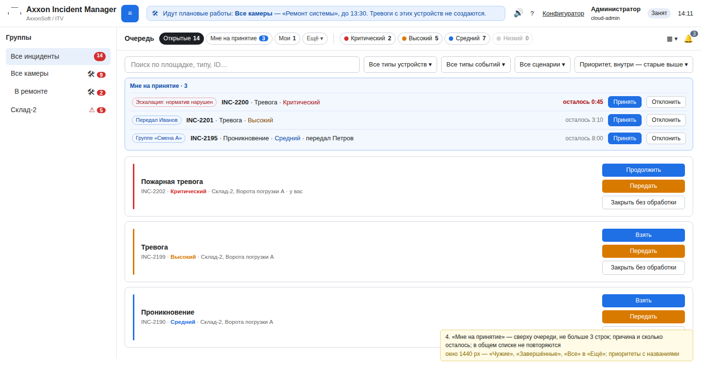
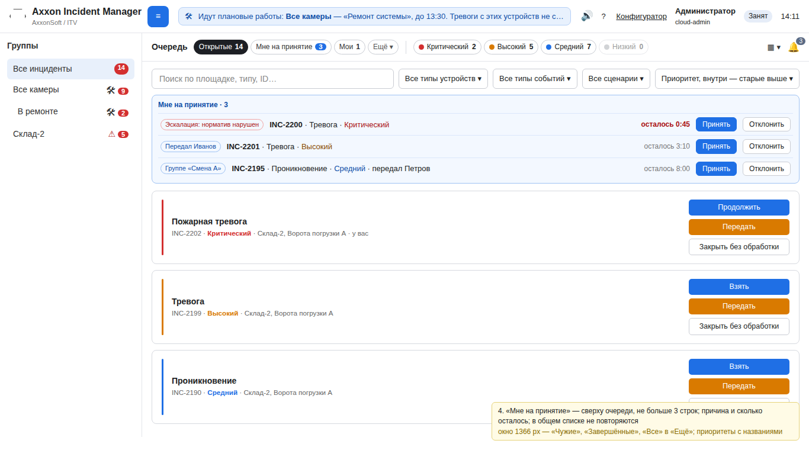
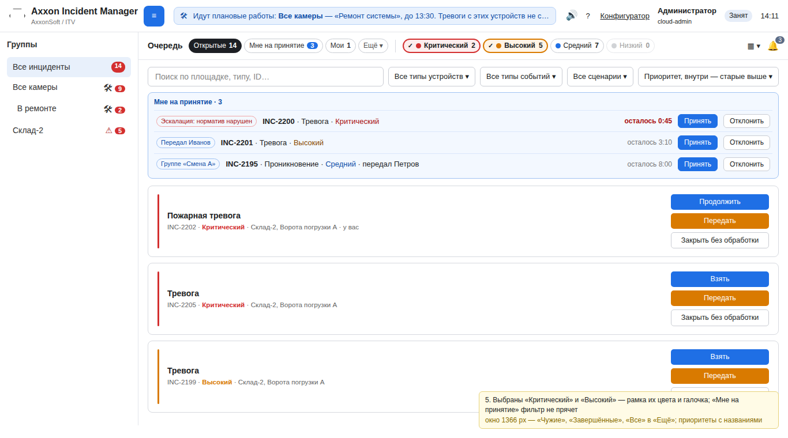
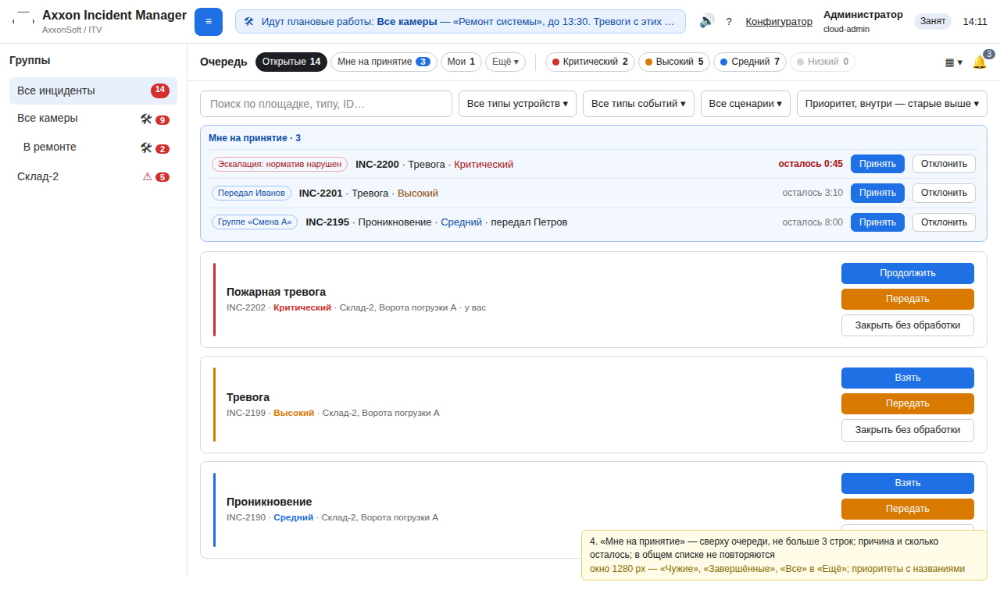
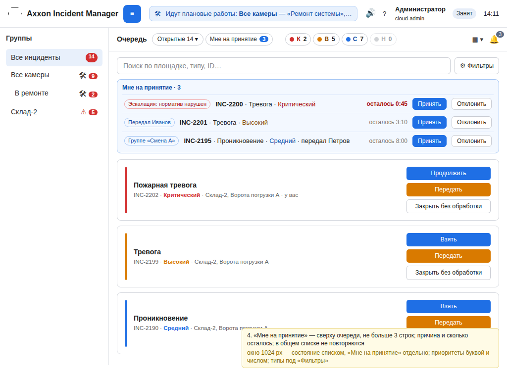

### Блок «Мне на принятие»

- Сверху очереди — всё, что ждёт моего «Принять»: передано мне, передано моей группе, эскалация на меня. По машине это одно — «Ожидает принятия», адресат я или моя группа, — поэтому и название одно с кнопкой состояния. Отдельного понятия «просьба о передаче» нет.
- **Всегда на месте:** пусто — одна строка «Мне на принятие: ничего нет». Не больше 3 строк; дальше — «ещё N → показать все в «Мне на принятие»» (переключает состояние).
- **Строка:** ярлык-причина («Эскалация: норматив нарушен», «Передал Иванов», «Группе «Смена А»»), номер, тип, приоритет, сколько осталось до конца норматива (меньше минуты — красным), «Принять» и «Отклонить».
- **Порядок:** по приоритету, внутри — у кого раньше кончится норматив.
- В общем списке эти инциденты не повторяются. Строка уходит, когда кто-то ответил; остаётся запись в колокольчике.
- **Не сдвигает список под курсором:** пока курсор над очередью, новая строка блока ждёт; звук «лично вам» и число на кнопке — сразу. Курсор ушёл со списка — блок перестраивается.
- Передано группе, двое нажали «Принять» одновременно — второму короткое «Уже принял Петров», уходит само (это не ошибка оператора).
- Заменяет всплывающее «уведомление адресату» (правила §8.1 — править).

### Новые строки в очереди

- Пока курсор над списком, новые строки не вставляются выше него: поверх списка — «↑ N новых — показать» (картинка 16). Щелчок или курсор ушёл — строки встают на место. Звук и числа на кнопках — сразу.
- Новая строка подсвечена несколько секунд после того, как появилась в видимой части списка.

### Шапка — состояние поста

- Одна строка в середине верхней шапки. Видно **самое серьёзное** (нет связи → мало места — только у администратора → звук не включён → работы → «только важное») и «и ещё N». Без карусели: она прячет всё, кроме первого.
- Щелчок — панель колокольчика с фильтром «Система».
- Закрыть нельзя, пока состояние длится; уходит само.
- Сюда переезжает полоса плановых работ, которая сейчас над очередью.

### Колокольчик — журнал оповещений

Колокольчик — **журнал**, а не место, куда приходит важное. Если его не открыть, оператор не пропустит срочного — только историю.

- Что в нём: закончившиеся состояния («связь восстановлена», «работы закончились»), разрешившиеся задачи («INC-2187 взял Петров — было передано вам»), сведения без действия («ваш инцидент перехватил Петров», «того же события закрыт: ложная тревога», «вам больше не доступен»), оповещения получателю (§9).
- Счётчик — непрочитанные; кружок серо-синий, не красный: красный — только для того, что требует действия.
- **Прочитано** — открыл панель: всё, что в ней видно, становится прочитанным. Отдельной кнопки «отметить всё прочитанным» нет. Непрочитанные до открытия выделены, пока панель открыта.
- Панель справа, вкладки «Все / Нужно действие / Система».

### Всплывающие сообщения — куда переходят

| Что всплывает сейчас | Куда |
|---|---|
| Чужие и автоматические переходы с моими инцидентами (`observerNotice`, `incident.alert`, `incident.sibling_closed`, `incident.access_lost`) | **убирается**: нужно действие — строка в блоке «Мне на принятие»; нет — запись в колокольчике |
| Мою открытую карточку увели (`incident.card_evicted`) | **убирается**: полоса в самой карточке «Перехватил Петров — только просмотр» |
| Итог моего действия («Обработано: 5», «Взято как одно», «Передано») | **остаётся**: короткое сообщение внизу слева, не закрывает очередь, уходит само — оператор сам нажал и ждёт ответа. Кнопки «Отменить» нет: отмены действий в машине нет |
| Ошибка, отказ («действие недоступно», ошибка сервера) | **остаётся**: сообщение внизу, пока не закрыли |
| Опоздал: инцидент уже взял или принял другой | **мягкое** сообщение «Уже принял Петров», уходит само |
| «Заполните поле …» | **убирается**: подсказка у самого поля |

Остаются и не считаются оповещениями: окна действий (передать, закрыть с причиной, отключить датчик) — их открывает сам оператор; уведомление браузера при свёрнутой вкладке — раздел «Звук».

### Лавина тревог (направление)

- **Группировка.** Повторные срабатывания одного датчика или одного типа на одном объекте за короткое время — одна строка с «×N». Повтор события уже идёт в открытый инцидент — на этом и строится; нужен показ счётчика повторов в строке очереди.
- **Режим лавины.** Если за N минут пришло больше M тревог (настройка схемы), над очередью — полоса «Режим лавины» (только текст, без кнопок): низшие приоритеты свёрнуты в строку внизу «Средний: 174 в 6 группах» и не звучат; видны высшие. Одна кнопка — «Показать» на свёрнутой строке. Вход и выход — в журнал. Открыто: «Показать» — только у себя или для всего зала.
- **Временное отключение датчика** (shelving). Из строки тревоги: «Отключить датчик» на 30 мин, 1 ч, 4 ч, до конца смены; причина обязательна; право — отдельное. Тревоги датчика на это время не создаются; в шапке — «Отключено датчиков: N»; запись в журнал; включается само. По смыслу близко к окну плановых работ (ТЗ-21) на одно устройство — можно строить на нём.

## Звук

### Что берём за основу

- Принцип 3: звук — только у того, что требует действия, и у высших приоритетов. Звук, который звучит по любому поводу, оператор перестаёт слышать.
- Приоритет различается **ритмом**, а не только высотой тона: так делают в стандарте медицинских тревог IEC 60601-1-8 (высший — серия из многих коротких сигналов, средний — из трёх, низший — один-два). Ритм различим в шумном зале и людьми с плохим слухом на высоких частотах.
- «Заглушить» (silence) и «обработать» — разные действия, как на пультах: «Тихо» убирает звук, но инцидент остаётся непринятым, его ведут норматив и эскалация.

### Картинки

11. Звук после входа не включён — это видно в шапке; одна кнопка включает и сразу даёт проверочный сигнал

    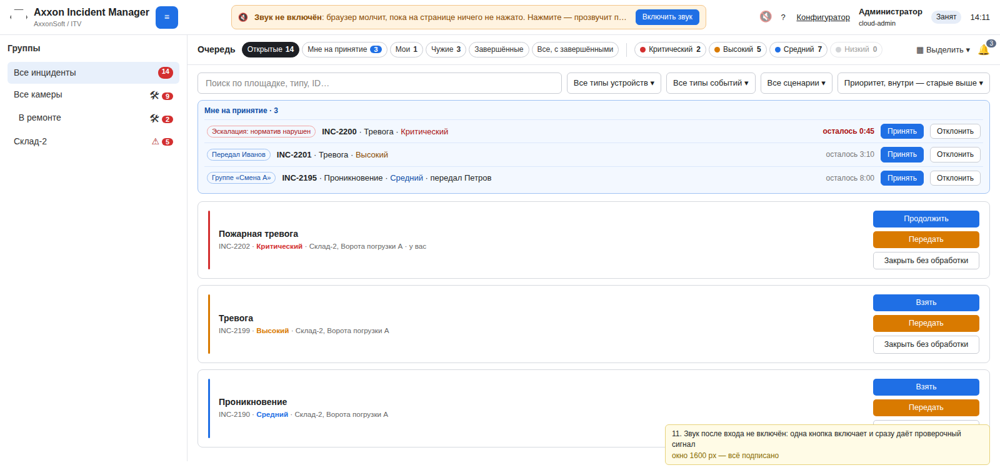

12. Звучит «Критический»: щелчок по номеру — к строке; «Тихо» глушит то, что звучит сейчас

    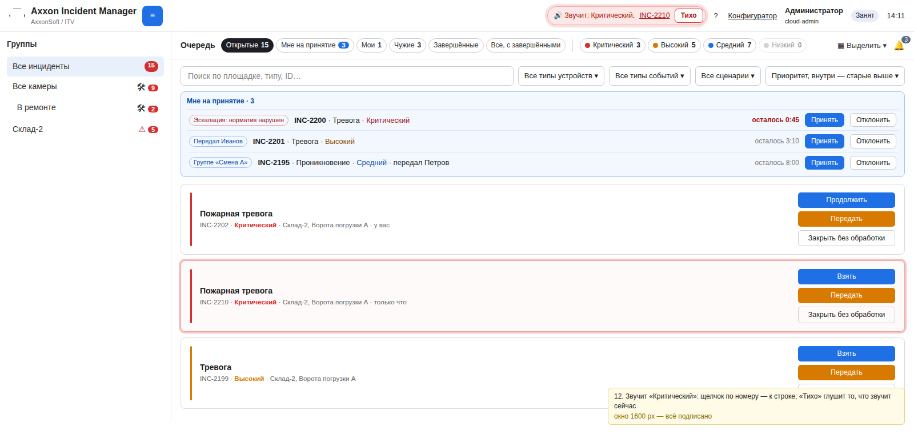

13. Меню звука: громкость, «Проверить звук», «Только важное — 5 мин»

    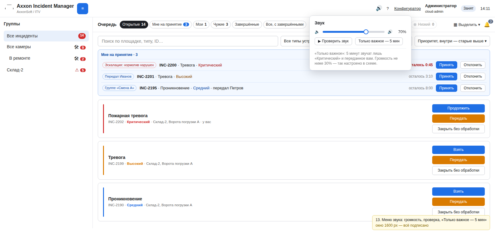

14. «Только важное»: видно в шапке, само вернётся; «Критический» и переданное вам звучат

    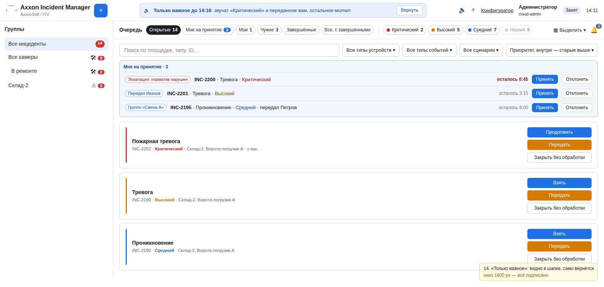

15. Конфигуратор, настройки схемы, вкладка «Звук»: строки — уровни справочника приоритетов

    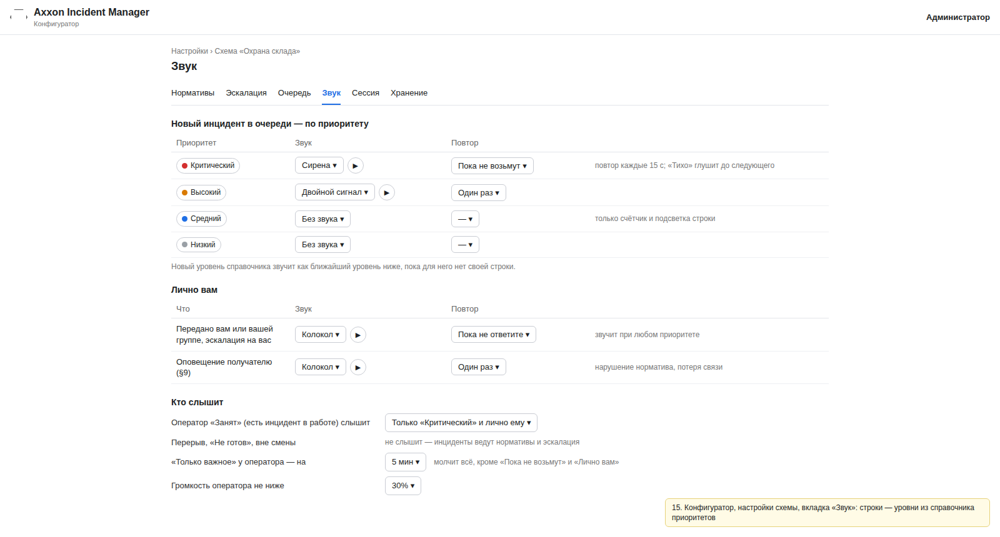

### 1. Когда звучит

| Событие | Звук | Источник в потоке |
|---|---|---|
| Новый инцидент, который я могу взять (виден мне, «Новый») | по приоритету — таблица ниже | `incident.created` |
| Инцидент снова в очереди: отклонён, адресат вышел, переоткрыт | как новый, по приоритету | `incident.transitioned` в `new` |
| Передано мне или моей группе, эскалация на меня | «лично вам» — при любом приоритете | `incident.transitioned`, `addressedToMe` |
| Оповещение получателю оповещений (§9): нарушение норматива, потолок эскалации, потеря связи | «оповещение», один раз | `incident.alert` |

Не звучит: повтор события в открытый инцидент («×N»), чужие переходы, итоги моих действий, состояние поста (кроме потери связи — она приходит оповещением §9), свёрнутое в режиме лавины, всё в окне плановых работ (там инциденты и не создаются).

**По приоритету — по умолчанию на новой схеме:**

| Приоритет | Звук | Повтор |
|---|---|---|
| Критический | «Сирена» | каждые 15 с, пока инцидент не взят, не передан, не закрыт — кем угодно — или оператор не нажал «Тихо» |
| Высокий | «Двойной сигнал» | один раз |
| Средний, Низкий | без звука | — (счётчик и подсветка строки) |
| Лично вам | «Колокол» | каждые 30 с, пока не ответите (принять, отклонить) |
| Оповещение (§9) | «Колокол» | один раз |

Справочник приоритетов правится без публикации схемы, поэтому настройка — по числу уровня, как нормативы (`byPriority`): уровень без своей строки звучит как ближайший уровень ниже (новый 90 — как Высокий 75); ниже самого низкого — без звука.

### 2. Кто слышит

| Состояние оператора (§12) | Слышит |
|---|---|
| «Готов» | всё по таблице |
| «Занят» (есть инцидент в работе) | по умолчанию — только «Критический» и «лично вам» (настройка схемы): не отвлекать от текущего инцидента |
| «Не готов» (перерыв), «Не в сети» | ничего — инциденты ведут нормативы и эскалация |

Новый инцидент в общей очереди слышат все, кто его видит, — в зале может прозвучать на нескольких местах сразу. Это допустимо: кто первый взял — у остальных повтор прекращается сам.

### 3. «Звучит», «Тихо», громкость, «только важное»

- **Строка «Звучит»** в верхней шапке, видна только пока что-то звучит: «🔊 Звучит: Критический, INC-2210 · Тихо». Номер — ссылка: прокручивает к строке инцидента (скрыт фильтром — «скрыт фильтром · Показать», раздел о фильтрах). Звучат несколько — «Звучит: 3 (Критический) · Тихо», ссылка ведёт к самому важному.
- **«Тихо»** глушит всё, что звучит сейчас; новый инцидент зазвучит снова. Отдельной кнопки «Слышу» в каждой строке нет — одной на всё достаточно, а принятие и так прекращает повтор.
- **Значок звука** в верхней шапке: 🔊 — включён, 🔉 — «только важное», 🔇 — не включён. Щелчок — меню: громкость, «Проверить звук», «Только важное — 5 мин».
- **Включить звук** после входа — кнопка в строке состояния поста; нажатие сразу играет короткий проверочный сигнал: оператор каждую смену слышит, что колонки работают. Любое другое нажатие на странице тоже включает звук, но без проверки.
- **Громкость** — у оператора, не ниже порога схемы (по умолчанию 30%). Громкость системы и колонок МИ не видит — поэтому проверочный сигнал и «Проверить звук».
- **«Только важное»** — на время из настройки схемы (5 мин): молчит всё, кроме повторяющихся приоритетов и «лично вам». Название честное: не «приглушить», чтобы оператор не удивлялся, что Критический всё равно звучит. Пока включено — строка в шапке «Только важное до 14:16» с кнопкой «Вернуть»; возвращается само (принцип 5).
- Выключить звук совсем оператор не может — правило схемы сильнее.

### 4. Видимые сигналы рядом со звуком

- Новая строка в очереди подсвечена несколько секунд после появления в видимой части; выше курсора не вставляется — раздел «Новые строки в очереди».
- Заголовок вкладки: «(3) Очередь — МИ» — число непринятых «Критический» и «лично вам»; значок вкладки мигает, пока они есть.
- Уведомление браузера, когда вкладка не в фокусе: «Пожарная тревога — Склад-2, Критический»; щелчок открывает инцидент. Разрешение — кнопкой в меню звука, не при входе.

### 5. Откуда берётся звук

**Делаем — встроенный набор, синтез в браузере (решение 2026-11-15).** Файлы не указываются и не загружаются ни администратором, ни оператором: администратор выбирает звук из списка. Звуки строятся Web Audio из тонов: нет вопроса лицензий, нет загрузки, одинаково на всех машинах. Набор: «Сирена» (качание тона, серия), «Тревога» (серия коротких высоких), «Двойной сигнал», «Колокол» (затухающий), «Мягкий» (один низкий). Различаются ритмом. В конфигураторе у каждого — ▶ «Прослушать».

**Отложено — свой звук.** Не входит в этот план; когда понадобится — «Загрузить свой…»: mp3, ogg или wav, до 1 МБ и 10 с; хранится в базе, как вложения комментариев (с организацией, проверкой размера и типа); клиент скачивает один раз при входе. Недоступен или испорчен — играет встроенный того же приоритета, не тишина.

### 6. Как устроено

- **Машина** — новый раздел `sound` (отдельно от `alerts`: там получатель оповещений §9):
  - `sound.patterns` — каталог встроенных звуков (имя, ключ подписи);
  - `sound.byPriority` — `{ "<число уровня>": { pattern, repeat: none | once | until_taken, repeatSec } }`, уровень без строки — как ближайший ниже;
  - `sound.personal`, `sound.alert` — то же для «лично вам» и оповещения;
  - `sound.busyHears` — что слышит «Занят» (выражение CEL или порог приоритета);
  - `sound.muteMinutes`, `sound.volumeFloor`.
  Вкладка «Звук» в настройках схемы — из `adminSettings`, как остальные.
- **Решение «звучать или нет»** — чистая функция клиента от события потока, настроек, состояния оператора и «только важного»: её покрывают векторы, как CEL. Сам звук проверяется на слух на стенде.
- **Сервер** про звук не решает: события потока уже есть (`incident.created`, `incident.transitioned` с `addressedToMe`, `incident.alert`). Новое — проверка раздела `sound` при публикации схемы.
- **Разблокировка.** Браузер не играет звук, пока на странице ничего не нажато. После входа — строка «Звук не включён» в шапке; первое же нажатие где угодно включает звук, строка уходит.
- **Несколько вкладок** одного оператора — звучит одна (выбор ведущей вкладки через Web Locks или `BroadcastChannel`), без эха.
- **Свёрнутая вкладка.** Chrome замедляет таймеры скрытых вкладок (после 5 мин — раз в минуту), но не у вкладок, которые недавно играли звук. Повтор через 15 с строить на расписании Web Audio, а не на `setTimeout`; проверить на стенде со свёрнутым окном 10+ мин.
- **Телефон** — звук только при открытой вкладке; фоновый звук на телефоне не обещаем.

### 7. Что меняется в правилах

- §8.1 «Уведомление адресату»: вместо «всплывающее уведомление без звука» — строка в «Моих задачах» и звук «лично вам».
- Новый раздел о звуке: когда звучит, кто слышит, «Тихо», «только важное», настройки схемы.
- Раскладка очереди: блок «Мне на принятие», новые строки не сдвигают список под курсором, колокольчик — журнал.
- Руководство оператора: шапка очереди, выбор нескольких приоритетов, блок «Мне на принятие», значок звука, «Тихо», «только важное».

## Источник и адрес в строке и карточке

Сигнал о тревоге без «что и где» наполовину бесполезен: оператор услышал звук, а в строке только тип события. Пункт взят из сравнения с SecurOS Dispatcher ([research/competitors/securos-dispatcher-2026-11-15.md](../competitors/securos-dispatcher-2026-11-15.md), «Датчик и место в карточке»). У SecurOS в карточке есть номер Локации, номер Строения, адрес Локации, тип, ID и название датчика (РП 6.1.2).

**Что сейчас.**
- Сервер отдаёт в карточке `source` — название и тип устройства (`handler/operator/view_card.go`, `deviceRefs`). Экран его не выводит.
- Заголовок строки и карточки — только тип события.
- Поля `site` и `location` сервер не заполняет. В контракте агента нет ни места, ни адреса.
- В прототипе место видно только потому, что оно записано в демонстрационные данные.

**Решения приняты (2026-11-15), вопросов по ним не задавать:**

- **Адрес — у устройства.** Одна строка текста до 500 символов, только для показа. Частей адреса и координат нет.
- **Хранятся два значения:** адрес из источника (пришёл при сверке устройств) и адрес, введённый в МИ. Действует введённый в МИ, если он задан, иначе — из источника. Нет ни того, ни другого — адреса нет.
- **Сверка никогда не затирает адрес, введённый в МИ.** Адрес из источника при этом обновляется как обычно.
- **Кнопка «Вернуть адрес из источника»** стирает адрес, введённый в МИ, — снова действует адрес источника.
- **Конфигуратор у устройства показывает оба значения.** Если введённый в МИ отличается от адреса источника, стоит пометка «отличается от источника».
- **Адрес у группы — заготовка, без наследования:** устройство может входить в несколько групп. Действие «Подставить адрес устройствам группы» (с вложенными) записывает адрес группы как введённый в МИ. По умолчанию — только устройствам без действующего адреса. Флажок «и тем, у кого адрес уже есть» — с подтверждением, где показано число устройств.
- **Право** — то же, что у правки устройств и групп в конфигураторе. Если отдельного нет — `incident:schema:admin`.
- **Журнал изменений настроек:** правка адреса устройства и группы, возврат к источнику, подстановка по группе. Подстановка — одной записью со сводкой: группа, адрес, число устройств.
- **Контракт агента.** У устройства при сверке (`/sync/sources`) появляется необязательное поле `address`. Нет поля — адрес источника не меняется, пустая строка — стирается. Версия контракта — следующая минорная, запись в `docs/agent-api/CHANGELOG.md`, пример запроса в `docs/agent-api/examples`. Эмулятор агента умеет присылать адрес.
- **Операторский контракт.** В сводке инцидента (строка очереди) и в карточке — устройство-источник (название и тип) и действующий адрес устройства на момент чтения, а не снимок на момент события. Поля `site` и `location` заменить на `address`. Прототип и эталонный набор (`fixtures/demo.json`) перевести на адреса устройств.
- **Ссылки площадки в меню справки** сейчас отбираются по полю `site` инцидента (`GET /operator/reference/help-links?site=…`, правила §7), а `site` сервер не заполняет — на реальном сервере ссылки площадки не показываются. Вместе с заменой `site` на адрес ссылка площадки привязывается к **группе устройств**: поле `site` у ссылки заменяется на группу (`groupGuid`), ссылка показывается при открытом инциденте, если устройство-источник входит в эту группу или во вложенную в неё. Нет группы — ссылка общая, как сейчас. Существующие ссылки с заполненным `site` миграция не делает общими — иначе контакты одной площадки увидят все: они остаются без группы и скрытыми (не показываются никому, как и сейчас), а конфигуратор помечает их «выберите группу». Форма ссылки в конфигураторе — выбор группы из дерева вместо текстового поля площадки.
- **Экран.**
  - Строка очереди: под типом события — «название устройства · адрес». Адрес обрезается многоточием, полный — во всплывающей подсказке. То же в блоке «Мне на принятие».
  - Карточка: блок «Источник» — устройство, тип устройства, адрес. Нет адреса — только устройство. Удалённое устройство — «устройство удалено».
  - Если в очереди есть текстовый поиск — он находит и по названию устройства, и по адресу.
- **Доступ.** Адрес виден только тем, кому виден инцидент (группы доступа, правила §5). В журнал инцидента адрес не пишется.

**Путь** — как у раскладки и звука: правила (§1 словарь, §14.5, §19.1, раздел настроек администратора) → машина и контракт → прототип и шаг самопроверки → сервер (миграция: два поля адреса у устройства и поле у группы, фильтр по `customer_guid`) и конфигуратор (форма устройства, форма группы, экран оператора) → стенд. Коммиты — с префиксом `Адрес:`.

## Работы

| Часть | Раскладка (вариант Б) | Звук (встроенный) |
|---|---|---|
| IM: правила, машина, прототип, самопроверка, руководство | кнопки состояний и приоритетов (несколько приоритетов), ширины, блок «Мне на принятие», новые строки без сдвига, «скрыт фильтром», строка поста, колокольчик-журнал, разбор всплывающих — 1,5–2 ч | раздел `sound`, вкладка, функция решения и векторы, синтез встроенных звуков, значок и «Тихо» — 1–1,5 ч |
| Сервер и контракт | `GET /operator/incidents`: `priority` — список, а не одно значение (выбор нескольких); счётчики `/operator/incidents/counters` с теми же фильтрами, что очередь (узел дерева, типы, поиск), и разбивкой по приоритетам — ~1–1,5 ч | проверка `sound` при публикации — 15–20 мин |
| Конфигуратор | то же, что прототип — 1,5–2 ч | звук, повтор, одна вкладка, заголовок, уведомление браузера, меню звука — 1–1,5 ч |
| Стенд | выкатка, проверка | проверка на слух, свёрнутая вкладка 10+ мин |

Источник и адрес — отдельная часть плана, от раскладки и звука не зависит, можно делать первой. Оценка: IM (правила, машина, контракты, прототип, самопроверка) ~1–1,5 ч, сервер (миграция, сверка, сводка и карточка, подстановка по группе) ~1–1,5 ч, конфигуратор (формы устройства и группы, строка и карточка) ~1–1,5 ч, плюс стенд.

Дальше: лавина (группировка «×N», режим лавины, отключение датчика) — по ~1 ч на IM, сервер и конфигуратор, после решения открытых вопросов; состояние связи с агентами и места на диске в строке поста — сервер ~1 ч. Свой звук из файла отложен (~1 ч, когда понадобится).

## Решения по звуку (2026-11-15)

Предложения раздела «Звук» приняты целиком, в том числе:
- Звуки — только встроенные, синтез в браузере; файлов нет, свой звук отложен.
- Значения по умолчанию — как в таблице «По приоритету»; кто слышит — как в таблице «Кто слышит».
- «Занят» слышит только «Критический» и «лично вам» (настройка схемы, можно поменять).
- Нажатие «Тихо» в журнал не пишется: инцидент от него не меняется, реакцию меряет норматив.
- Старший смены при эскалации слышит тот же «лично вам» — эскалация на него и есть «лично вам».

## Открытые вопросы

Решено 2026-11-15 (раскладка):
- Картинки операторам до разработки не показываем — раскладку принимает владелец продукта, на стенде.
- Журнал колокольчика хранится 12 часов (примерно смена), а не до конца сессии: после перезагрузки страницы оператор видит, что было.
- «Мало места на диске» видит только администратор; в строке состояния поста у оператора этого нет.

Лавина:
- Пороги по умолчанию (например, 50 тревог за 5 мин) и какие приоритеты сворачивать.
- Кто может отключать датчик: старший смены или любой оператор с причиной.
- «Показать» свёрнутое в режиме лавины — только у себя или для всего зала.
