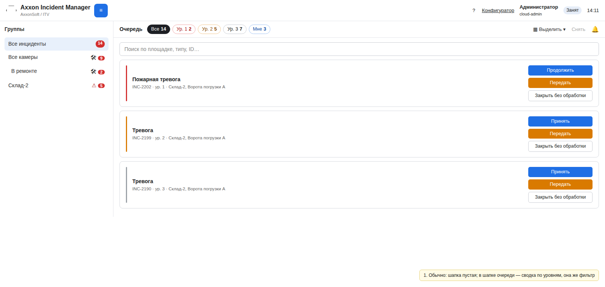
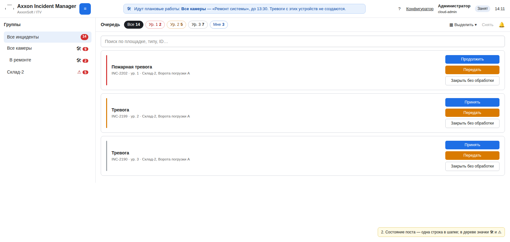
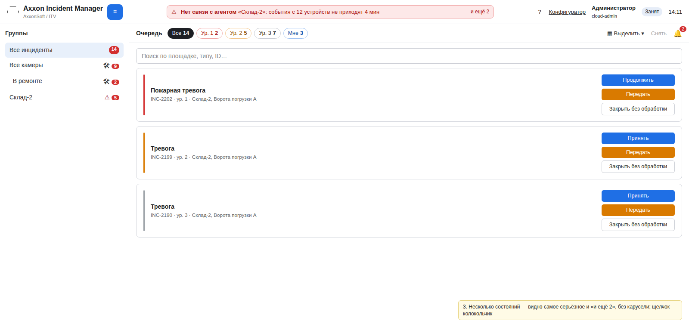
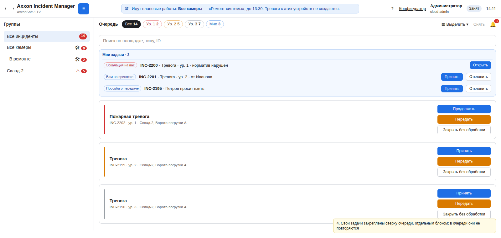
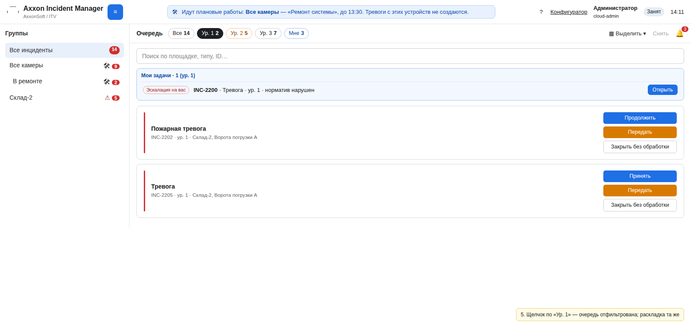
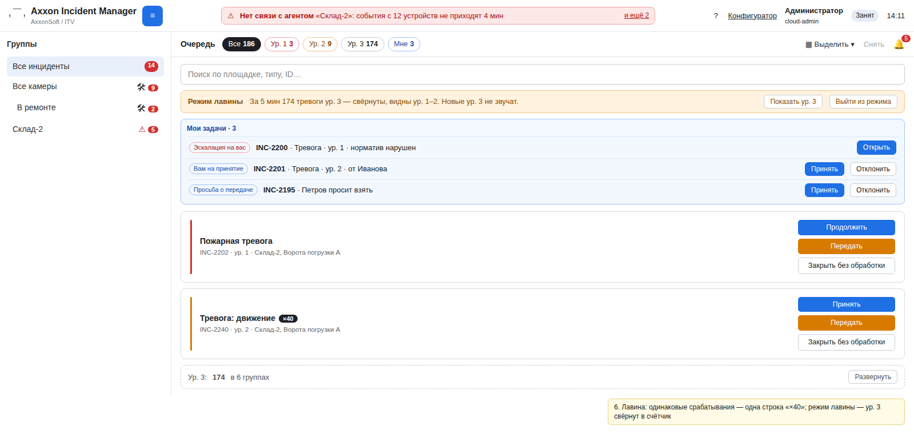
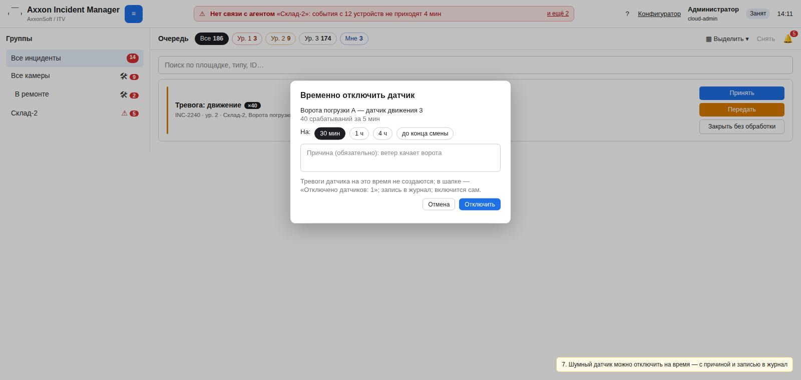
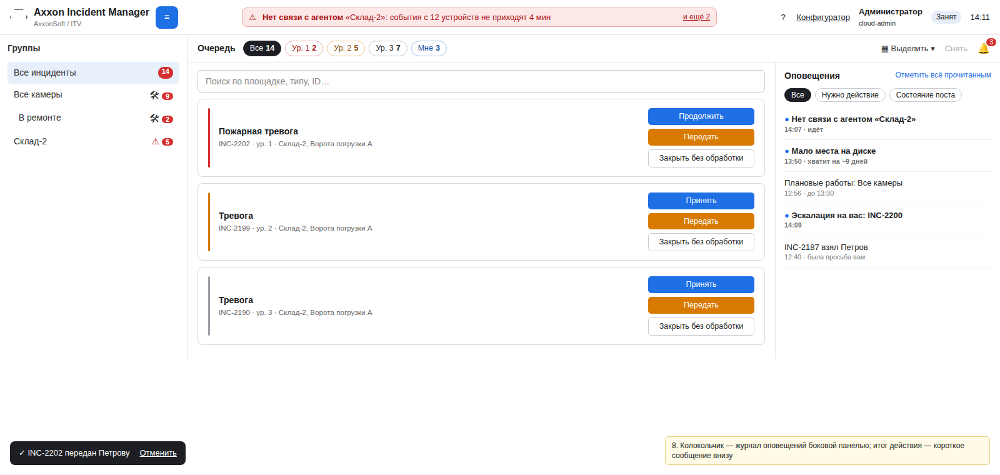

# 88. Оповещения оператора — единая схема

Статус: **предложение**, не делается (2026-11-15). Пункт в [TECH-DEBT.md](TECH-DEBT.md). Звук рассматривается здесь же — раздел «Звук» (прежний отдельный план 87 объединён с этим документом 2026-11-15).

## На что опираемся

Управление тревогами на пультах и в диспетчерских описано в двух признанных документах:

- **ANSI/ISA-18.2-2016** «Management of Alarm Systems for the Process Industries» — стандарт жизненного цикла системы тревог; международный вариант — IEC 62682. Страница стандарта: [isa.org](https://www.isa.org/products/ansi-isa-18-2-2016-management-of-alarm-systems-for), [ANSI webstore](https://webstore.ansi.org/standards/isa/ansiisa182016), обзор — [блог ANSI](https://blog.ansi.org/ansi/ansi-isa-18-2-alarm-systems-process-industries/).
- **EEMUA 191** «Alarm Systems — a guide to design, management and procurement», издание 4 (ноябрь 2024) — руководство по хорошей практике, с ним согласованы ISA-18.2 и IEC 62682. Страница: [eemua.org](https://eemua.org/products/publications/print/eemua-publication-191), [оглавление 4-го издания (PDF)](https://eemua.org/getattachment/9d3f8071-55c3-49bf-a74a-3bf6ad4a2e0f/Contents-EEMUA-Publication-191-Edition4-November-2024.pdf), бесплатный [контрольный список](https://eemua.org/products/publications/checklists/eemua-alarms-checklist).

Оба документа платные; ниже — общепринятые принципы из них, без цитат. Что берём:

1. **Каждая тревога требует действия оператора.** То, что действия не требует (фон, итог), — не тревога и не должно звучать и мигать как тревога.
2. **Ничего не исчезает само, пока не обработано.** Всплывающее окно, которое уходит через несколько секунд, — плохая практика: оператор его не увидел — тревоги для него не было.
3. **Приоритет виден сразу,** верхний уровень — редкий; звук — только у высших уровней.
4. **Лавина тревог** (много тревог за короткое время) — главная причина ошибок оператора. Её гасят уменьшением числа тревог (группировка, временное отключение шумного датчика, подавление по состоянию), а не тем, как их показывать.
5. **Отключённое на время — видно и записано:** кто, на сколько, почему; включается само.

## Что сейчас

| Механизм | Где | Что показывает |
|---|---|---|
| Колокольчик с счётчиком | шапка очереди справа | тихие уведомления: адресовано мне, эскалации, служебные |
| Всплывающие окна | поверх экрана | уведомление адресату (без звука), результаты действий |
| Полоса над очередью | над списком очереди | идущие окна плановых работ (ТЗ-21, 2026-11-15) |
| Звук | — | нет; план — раздел «Звук» ниже |

Минусы: важное приходит в колокольчик, который надо открыть; всплывающее окно перекрывает экран и уходит само (против принципа 2); при лавине у оператора нет средств, кроме прокрутки.

## Предложение

**Правило раскладки:** ничего не перекрывает очередь и карточку, раскладка не меняется — ничего не раскрывается и не сдвигает экран (решение пользователя 2026-11-15). Полный список чего угодно — в панели колокольчика.

| Класс | Пример | Где |
|---|---|---|
| **Нужно действие** | вам на принятие, эскалация на вас, просьба о передаче | сама очередь: блок «Мои задачи» сверху и сводка по уровням |
| **Состояние поста** | нет связи с агентом, идут работы, мало места, отключённые датчики | одна строка в середине верхней шапки |
| **Итог моего действия** | «Передано», «Не сохранено» | короткое сообщение внизу, ошибка — пока не закрыли |
| **Прошлое** | всё, что было | колокольчик — журнал оповещений |

### Как это выглядит

Макет, не код продукта: [88-notifications/mock.html](88-notifications/mock.html) (`?v=1`…`?v=8`).

1. Обычно: шапка пустая; в шапке очереди — сводка по уровням, она же фильтр

   

2. Состояние поста — одна строка в шапке; в дереве значки 🛠 и ⚠

   

3. Несколько состояний — видно самое серьёзное и «и ещё 2», без карусели; щелчок — колокольчик

   

4. Свои задачи закреплены сверху очереди отдельным блоком; в общем списке не повторяются

   

5. Щелчок по «Ур. 1» — очередь отфильтрована, раскладка та же

   

6. Лавина: одинаковые срабатывания — одна строка «×40»; режим лавины — ур. 3 свёрнут в счётчик

   

7. Шумный датчик можно отключить на время — с причиной и записью в журнал

   

8. Колокольчик — журнал боковой панелью; итог действия — короткое сообщение внизу

   

### Шапка — состояние поста

- Одна строка в середине верхней шапки. Видно **самое серьёзное** (нет связи → мало места → работы) и «и ещё N». Без карусели: она прячет всё, кроме первого.
- Щелчок — панель колокольчика с фильтром «Состояние поста».
- Закрыть нельзя, пока состояние длится; уходит само.
- Сюда переезжает полоса плановых работ, которая сейчас над очередью.

### Очередь — нужно действие

- **Сводка по уровням** в шапке очереди: «Все 14 · Ур. 1 2 · Ур. 2 5 · Ур. 3 7 · Мне 3». Щелчок по числу — фильтр очереди; повторный — снять.
- **«Мои задачи»** — блок сверху очереди: эскалации на меня, «вам на принятие», просьбы о передаче, с кнопками прямо в строке. В общем списке эти инциденты не повторяются. Строка уходит, когда действие сделано (кем угодно).
- Новая строка коротко подсвечивается; звук — по разделу «Звук», только для «нужно действие» и высших уровней.
- Это заменяет всплывающее «уведомление адресату».

### Лавина тревог

- **Группировка.** Повторные срабатывания одного датчика или одного типа на одном объекте за короткое время — одна строка с «×N». Повтор события уже идёт в открытый инцидент — на этом и строится; нужен показ счётчика повторов в строке очереди.
- **Режим лавины.** Если за N минут пришло больше M тревог (настройка поста), над очередью — полоса «Режим лавины»: низшие уровни свёрнуты в счётчик «Ур. 3: 174 в 6 группах» и не звучат; видны высшие. Кнопки «Показать ур. 3» и «Выйти из режима». Вход и выход — в журнал.
- **Временное отключение датчика** (shelving). Из строки тревоги: «Отключить датчик» на 30 мин, 1 ч, 4 ч, до конца смены; причина обязательна; право — отдельное (старший смены). Тревоги датчика на это время не создаются; в шапке — «Отключено датчиков: N»; запись в журнал; включается само. По смыслу близко к окну плановых работ (ТЗ-21) на одно устройство — можно строить на нём.

### Колокольчик — журнал оповещений

Счётчик — непрочитанные. Панель справа, фильтры «Все / Нужно действие / Состояние поста», «отметить всё прочитанным».

### Узкий экран

Строка состояния поста — под шапкой, сводка по уровням прокручивается по горизонтали, «Мои задачи» — сверху очереди, как на широком.

## Звук

Звук — способ оповещения класса «Нужно действие»: звучит только оно и только высшие уровни (принцип 3).

### 1. Когда звучит

- Только то, что требует действия **этого** оператора: новый инцидент, который он может взять (его очередь или адресован ему). Чужие и подавленные окном работ — молча.
- Тон зависит от уровня приоритета:
  - высший — громкий, с повтором, пока инцидент не взят или оператор не нажал «Слышу»;
  - средний — один сигнал;
  - низкий — без звука, только счётчик.
- Повтор прекращается сам, как только инцидент взят, передан или закрыт любым оператором.
- Оператор на перерыве или «не готов» — звука нет; его инциденты ведут нормативы и эскалация.

### 2. Видимые сигналы рядом со звуком

- Счётчик в заголовке вкладки: «(3) Очередь — МИ»; значок вкладки мигает, пока есть непринятые инциденты высшего уровня.
- Уведомление браузера, когда вкладка не в фокусе: «Пожарная тревога — Склад 2, ур. 1»; щелчок открывает инцидент. Разрешение — по кнопке, не при входе.
- Новая строка в очереди коротко подсвечивается.

### 3. Откуда берётся звук

Путь к файлу не указывается: звук играет браузер оператора, файлов сервера он не видит.

**Шаг 1 — встроенный набор.** В конфигураторе 5–6 коротких звуков: «сирена», «тревога», «двойной сигнал», «колокол», «мягкий». Администратор поста на вкладке «Оповещения» выбирает звук для каждого уровня приоритета, рядом кнопка ▶ «Прослушать».

**Шаг 2 — свой звук (позже).** Пункт «Загрузить свой…»:
- mp3, ogg или wav, до 1 МБ и 10 с; хранится в базе, как вложения комментариев (с организацией, проверкой размера и типа);
- в настройках поста — ссылка на звук; клиент скачивает его один раз при входе и держит в памяти;
- файл недоступен или испорчен — играет встроенный звук того же уровня, не тишина.

### 4. Настройки

- **Пост** (машина): `alerts.sound` по уровням справочника приоритетов — `sound` (встроенное имя, `custom:<id>` или `none`) и `repeat` (`none`, `once`, `repeat`).
- **Оператор** (меню профиля): громкость и «приглушить на 5 минут». Выбрать звук или выключить звук высшего уровня нельзя — правило поста сильнее.

### 5. Как устроено

- Сервер про звук не решает: сигнал запускает уже существующее событие потока о новом инциденте, клиент решает по правилу машины и уровню.
- Браузер не играет звук до первого нажатия на страницу — после входа показать «Включить звук», иначе первый сигнал смены может не прозвучать.
- Несколько вкладок одного оператора — звучит одна (`BroadcastChannel`), без эха.
- Звуки — короткие, разные по тону, не похожие на системные.

### Не входит

Голосовое чтение и внешние каналы (почта, мессенджер, SMS) — отдельное расширение, уже записано в правилах.

**Работы по звуку и оценка:**
| Часть | Что | Время |
|---|---|---|
| IM | правило (раздел уведомлений), машина `alerts.sound`, вкладка «Оповещения», прототип, самопроверка, руководство оператора | 30–40 мин |
| Конфигуратор | звуки, повтор, одна вкладка из нескольких, заголовок, уведомление браузера, громкость, «Включить звук» | 30–40 мин |
| Сервер | проверка `alerts.sound` при публикации настроек | 15–20 мин |
| Стенд | выкатка, проверка вживую (звук слушать) | ~20 мин |
| Шаг 2 | загрузка своего звука: маршрут, хранение, очистка, проверки | ~1 ч |

## Как устроено

- **Машина** — каталог видов оповещений `notices.<вид>`: `class` (`action` | `state` | `result`), `severity`, `sound` (ссылка на `alerts.sound` из раздела «Звук» или `none`), `dismissible`, ключ текста. Настройки поста: порог режима лавины (`flood.windowSec`, `flood.threshold`, `flood.foldLevels`), сроки отключения датчика.
- **Сервер** про раскладку не решает: шлёт события потока (адресат, эскалация, окна работ — уже есть); новое — счётчик повторов в строке очереди, вход и выход режима лавины, отключение датчика (как окно работ на одно устройство), состояние связи с агентами.
- **Доступность** — строка шапки `role="status"`, критичное — `role="alert"`; сводка и «Мои задачи» — с клавиатуры.

## Порядок работ

1. Сводка по уровням и «Мои задачи» в очереди; строка состояния поста в шапке (перенос полосы работ); колокольчик — панель; убрать всплывающее уведомление адресату. IM, затем конфигуратор.
2. Звук — раздел «Звук», шаг 1 (встроенный набор); шаг 2 (свой звук) — позже.
3. Лавина: счётчик повторов в строке, режим лавины, временное отключение датчика. IM, сервер, конфигуратор.
4. Состояние связи с агентами и места на диске в строке шапки.

Оценка: шаг 1 — IM 40–60 мин, конфигуратор 60–90 мин; шаг 3 — по ~1 ч на IM, сервер и конфигуратор; шаг 4 — сервер ~1 ч.

## Открытые вопросы

- Какие уровни звучат по умолчанию на новом посту (предложение: высший — повтор, следующий — один раз, остальные — нет).
- Нужна ли кнопка «Слышу» или достаточно взять инцидент.
- Звук для старшего смены при эскалации — тот же или отдельный.
- Пороги режима лавины по умолчанию (например, 50 тревог за 5 мин) и какие уровни сворачивать.
- Кто может отключать датчик: старший смены или любой оператор с причиной.
- Сколько хранить журнал колокольчика: до конца сессии или фиксированно (например, 12 ч).
- Видит ли оператор (а не только администратор) «мало места на диске».
