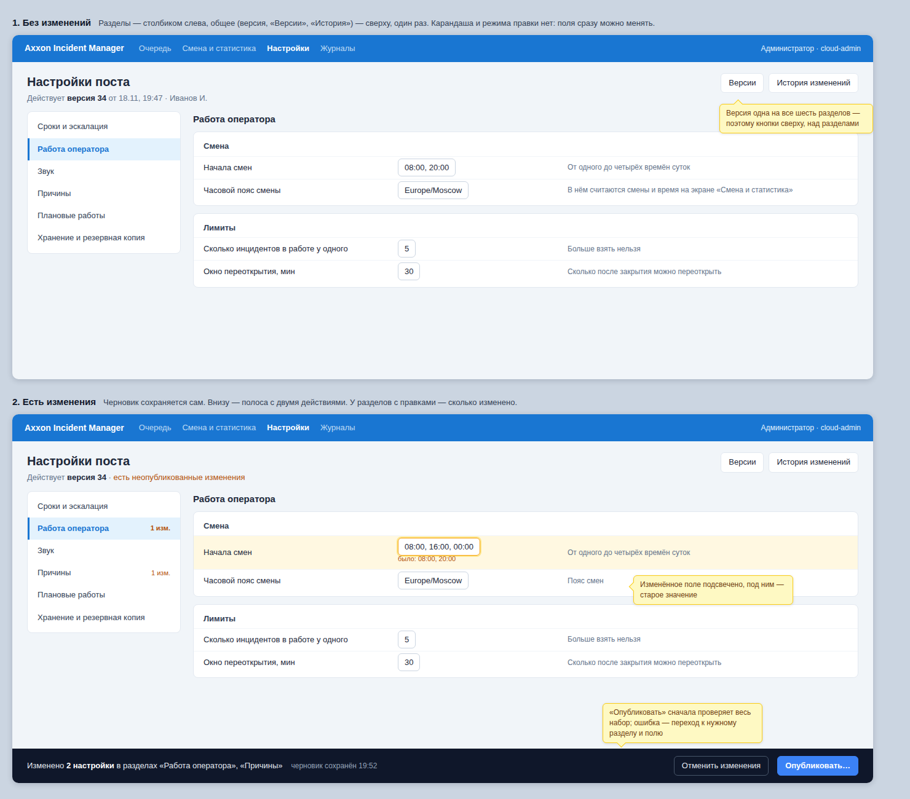

# План 91. Экран настроек поста: правка без отдельного режима

Заготовка плана (2026-11-18). В работу — после плана 90. Задачи и проверки расписать перед началом.

Макет: [91-post-settings-ux/post-settings.png](91-post-settings-ux/post-settings.png), страница — [post-settings.html](91-post-settings-ux/post-settings.html). Значения в макете выдуманы.

## Что неудобно сейчас

- Кнопки «Версии», «История изменений» и карандаш «Изменить» стоят под вкладками, внутри содержимого. Кажется, что у каждой из шести вкладок свои версии и своя правка. На деле версия одна на все настройки поста, и карандаш открывает правку сразу всех вкладок.
- В режиме правки там же пять кнопок: «Проверить», «Сохранить», «Опубликовать», «Удалить черновик», «Закрыть».

## Что сделать

1. **Разделы — столбиком слева** (решение 2026-11-18): шесть разделов настроек поста — вертикальным списком слева, а не вкладками сверху. Видно все разделы сразу и у каких есть правки («1 изм.»); новый раздел не теснит строку; на узком экране список сворачивается в выпадающий.
2. **Общее — сверху, один раз.** Заголовок «Настройки поста», строка состояния («Действует версия 34» или «есть неопубликованные изменения»), кнопки «Версии» и «История» — над разделами.
3. **Без отдельного режима правки.** Поля можно менять сразу, без карандаша. Есть изменения — внизу закреплённая полоса: «Есть изменения на 2 вкладках · Опубликовать · Отменить». У разделов с изменениями — сколько изменено.
   - Черновик сохраняется сам — кнопки «Сохранить» нет.
   - Проверка — у полей на лету и всего набора при публикации — кнопки «Проверить» нет.
   - «Удалить черновик» и «Закрыть» заменяет «Отменить».
4. **Черновик остаётся** как механизм: связанные правки публикуются разом, сервер проверяет весь набор, одна публикация — одна версия и одна запись в журнале изменений настроек. Ушли со страницы — правки ждут, полоса при возврате на месте.
5. Без права публиковать — только просмотр, как сейчас.

## Где править

- Конфигуратор: `src/features/post-settings/` (страница, редактор, диалоги версий).
- Правила IM: описание экрана настроек поста (§20) — кнопки и порядок правки.
- Прототип IM — если в нём есть этот экран.
- Сервер, скорее всего, не меняется: черновик, проверка и публикация уже есть. Проверить, хватает ли автосохранения черновика без лишних версий.

## Открытые вопросы

- Как часто сохранять черновик сам (по каждой правке с задержкой или при уходе с вкладки).
- Что делать, если черновик правит другой администратор одновременно.
- Тот же подход — для других экранов с версиями (схема, сценарии, правила)? Решить при расписывании плана.
- Разделы слева — только здесь или на всех страницах конфигуратора с вкладками.
