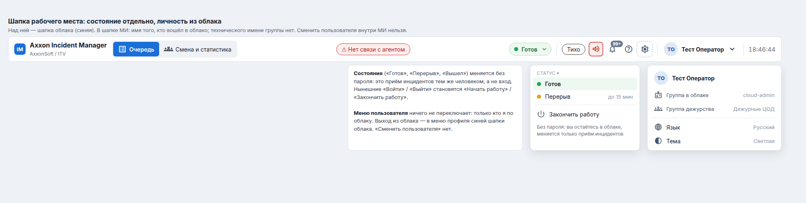

# План 95. Шапка рабочего места: кто вошёл и в каком он состоянии

> **Для агентов-исполнителей:** обязательный навык — superpowers:subagent-driven-development (рекомендуется) или superpowers:executing-plans. Шаги — чекбоксы `- [ ]`. IM — по скиллу `/im-fix` (порядок «понять причину → тест → правка → проверки»), сервер и конфигуратор — по superpowers:test-driven-development: сначала тест, он падает, потом код. Решения ниже приняты, их не пересматривать; чего в плане нет — не придумывать, а остановиться и спросить.

Статус: **выполнен** (2026-11-20). Решение 6 уточнено пользователем по ходу работы — см. журнал.

**Цель:** в шапке рабочего места видно имя того, кто вошёл в облако, и нет ничего похожего на вход под другим пользователем. Состояние оператора («Готов», «Перерыв», «Вышел») — отдельный заметный переключатель, он меняется без пароля. Сменить пользователя можно только выходом из облака — в шапке облака.

Макет: [95-header-identity/header.png](95-header-identity/header.png), страница — [header.html](95-header-identity/header.html). Значения в макете выдуманы.

**Где:**
- IM — `/mnt/hgfs/VmWareShared/soul2home/IM`: правила, контракт, прототип;
- сервер — `~/Work/incident-manager-server`;
- конфигуратор (рабочее место) — `~/Work/incident-manager`;
- облако — `~/Work/axxoncloud-ui`, `~/Work/axxoncloudgo` — только смотреть.

Ветка везде `feature/im_operator`.

## Что сбивает с толку сейчас

Проверено на стенде 2026-11-19 под `test@axxonnet.test`.

- **В шапке нет того, под кем вошли.** Показаны имя и `role` из `GET /operator/session`. Имя — это `name` пользователя облака: у test@ оно было «Администратор» (2026-11-19 вернули «Тест Оператор»). `role` — сырое имя первой группы пользователей облака (`cloud-admin`, сервер: `appservice/operator/references.go:431-447`). Получается «Администратор / cloud-admin»: читается как роль и чужой логин, хотя это тот же человек. Почты и логина в шапке нет и не будет (решение 1): достаточно имени, если оно в облаке задано по-человечески.
- **«Войти» и «Выйти» звучат как вход в систему, а значат другое.** На деле это состояние оператора: `PUT /operator/session/agent-state` `ready` / `offline` (`useSessionActions.ts:47-101`, прототип — `app.js:4304`). Сессия облака и токены не трогаются. Человек видит «Выйти» и ждёт выхода из системы, а остаётся в облаке тем же пользователем.
- **Состояние спрятано в кнопку пользователя.** «Готов» стоит между ролью и стрелкой, похож на подпись к роли.
- **Выхода из облака на рабочем месте нет.** Он есть только в шапке облака (значок профиля справа). [68](68-auth-to-production.md), вопрос 5, остался открытым.

Подмены пользователя нет. Переключателя пользователя, выбора роли или группы при входе в рабочем коде нет. Есть только тестовые маршруты `/test/operators/…` в сборке `imtest` и автовход стенда `dev-login.html`, который потом удалят.

## Решения (2026-11-19)

1. **Личность — только из облака, показываем имя.** В шапке МИ — только имя пользователя облака (`operator.name` сессии), без почты и логина (пользователь, 2026-11-19). Технического имени группы в шапке нет: оно уходит в меню пользователя строкой «Группа в облаке». Сменить пользователя внутри МИ нельзя. Пунктов «сменить пользователя», «войти как» нет.
2. **Состояние — отдельная таблетка слева от значков:** «● Готов ▾». Цвет точки: зелёный — «Готов», синий — «Занят», жёлтый — «Перерыв» (красный, когда предел пройден), серый — «Вышел». Время — только на перерыве (вопрос 3). Меню: «Готов», «Перерыв» (с причиной, как сейчас), «Закончить работу». Пароля не спрашивает: это приём инцидентов тем же человеком.
3. **«Войти» / «Выйти» переименовать в «Начать работу» / «Закончить работу».** Названия состояний («Готов», «Перерыв», «Вышел») и машина не меняются, меняются только подписи действий и текст правил §12.1. Подтверждение «Закончить работу» прежнее: сколько инцидентов вернётся в очередь. «Смена» в названии не годится: по §12.1 вход смену не начинает и выход её не кончает.
4. **Меню пользователя ничего не переключает.** В нём имя, группа в облаке, группы дежурства, ниже язык и тема (только в прототипе; на рабочем месте под облаком язык берётся у облака). Своего выхода из облака в МИ нет (пересмотр вопроса 4, пользователь, 2026-11-19): выход — в меню профиля шапки облака. Перестать принимать инциденты — «Закончить работу»; кто вышел из облака, не закончив работу, — как при закрытой вкладке (§12.3).
5. **Порядок справа:** состояние │ «Тихо» звук оповещения справка ⚙ │ пользователь │ часы. Шестерёнка — как в плане 94 (только при `manage`).

6. **Не принимаю инциденты — рабочая область притушена** (пользователь, 2026-11-19). Макет — [95-header-identity/dim.png](95-header-identity/dim.png). В «Перерыве» и «Вышел» (по машине оба `readOnly`) очередь и карточка серые и бледные, шапка яркая и работает (звук, оповещения, таблетка, меню). Посередине рабочей области карточка: на перерыве — «Вы на перерыве · 12 мин из 15», сколько ждёт в «Мне на принятие», кнопка «Вернуться с перерыва»; в «Вышел» — «Вы не принимаете инциденты», кнопка «Начать работу». Нынешние полосы `breakBanner` и `signedOutBanner` заменяются этой карточкой.
   - Затемнение не мешает читать: листать, искать, открывать карточку инцидента на просмотр можно. Карточку посередине можно свернуть (✕) в узкую полосу под шапкой — серость остаётся до «Начать работу» / «Вернуться».
   - Экран «Смена и статистика» не притушивается никогда — это рабочий экран старшего.
   - Сила разная: на перерыве сильнее (напоминание, перерыв ограничен), в «Вышел» слабее (старший или администратор может смотреть так долго и законно).
   - Тексты по решению 3: «Вы вышли из МИ…» → «Вы не принимаете инциденты…», «Войти» → «Начать работу» (`workflow.session.readonly.offline`, полосы и строки прототипа и конфигуратора).

## Открытые вопросы (до работы)

1. ~~Откуда брать логин~~ — **снят** (пользователь, 2026-11-19): показываем только имя, почта и логин не нужны, поле в контракт не добавляем.
2. ~~Имена групп дежурства~~ — **решено (а)** (пользователь, 2026-11-19): сессия отдаёт `operator.dutyGroups: [{id, name}]` — группы дежурства, в которых состоит оператор; `dutyGroupGuids` остаётся. В меню пользователя — строка «Группы дежурства» со списком названий; групп нет — строки нет.
3. ~~Время в состоянии~~ — **решено (б)** (пользователь, 2026-11-19): сессия отдаёт `agentStateSince` — начало текущего хранимого состояния (`ready`, `not_ready`, `offline`; производное `busy` своего начала не имеет). Таблетка показывает время только на перерыве, с пределом: «● Перерыв · 12 / 15 мин»; предел пройден — таблетка красная. «Готов», «Занят», «Вышел» — без времени.
4. ~~Нужен ли «Выйти из облака» в шапке МИ~~ — **нет** (пользователь, 2026-11-19; сначала был выбран вариант (а), пересмотрен): выход только в шапке облака. Причина: аккуратный уход без выхода из облака даёт «Закончить работу», а свой выход заставил бы МИ повторять код выхода портала.

## Общие ограничения

- `openapi.json` — в CRLF. После правки машины или контракта — `python3 tools/build_workflow.py`, проверки по CLAUDE.md.
- Строки — в локалях ru и en: прототип — `strings/`, конфигуратор — его локали.
- Новое в прототипе — вместе с шагом самопроверки в `prototype/selftest.js`.
- Язык документов и коммитов — русский; коммиты кончаются строкой `Co-Authored-By: Claude Opus 5.5 <noreply@anthropic.com>`; push — только по просьбе.
- Тяжёлое — через `systemd-run --user --scope -q -p MemoryMax=12G -p MemorySwapMax=0 …`. Стенд — бинарник без `-tags imtest`, под блокировкой `~/Work/stand/lock-server`; конфигуратор — сборка и `rsync` в `~/Work/stand/im-dist`.

## Что проверить особо

1. Под двумя разными пользователями облака (test@ и второй оператор) шапка показывает каждого своим именем; после выхода из облака и входа другим — нового, без следов прежнего (кэш сессии, `localStorage`).
2. «Закончить работу» и «Начать работу» не трогают токены облака: после них `GET /api/v3/ac-backend/me` тем же токеном → 200.
3. Выход через меню профиля шапки облака с рабочего места уводит всё окно на вход облака (как пункт 4 плана 94); состояние оператора при этом не меняется, дальше — §12.3.
4. Притушенная область (решение 6): текст очереди читается, листание и открытие карточки работают; карточка возврата сворачивается и не мешает. На стенде — под старшим в «Вышел».
5. Узкое окно 1240 px: таблетка состояния, значки и пользователь умещаются; на телефоне — по нынешнему правилу шапки (§22.1).

---

## Часть 0. Предполётная проверка

- [x] **95.0. По коду и на стенде, без правок.** Записать в «Журнал выполнения» ниже: — `b382c43`
  - в правилах и строках все «Войти», «Выйти», «вошёл», «вышел» в смысле состояния оператора: `States rules IM.md` (§12.1 и ссылки), `strings/`, руководство оператора, локали конфигуратора — список мест для решения 3;
  - где сервер хранит начало состояния (для `agentStateSince`) и откуда рабочему месту взять предел перерыва по причине (машина, настройки поста);
  - кэширует ли сервер МИ `name` пользователя (после переименования test@ сессия сразу отдала новое имя — значит, нет; подтвердить по коду).

## Часть 1. IM: правила и контракт (после закрытия вопросов)

- [x] **95.1. Правила.** §12.1 и ссылки на «Войти» / «Выйти» — «Начать работу» / «Закончить работу» (решение 3); §22 — шапка: состояние отдельно, личность из облака, сменить пользователя в МИ нельзя (решения 1, 4, 5); притушенная рабочая область вне приёма (решение 6). Строки машины `workflow.session.readonly.*` — по решению 6, сборка `python3 tools/build_workflow.py`. Запись в `State_rules/CHANGELOG.md`. Коммит: «План 95: правила — личность из облака, „Начать/Закончить работу“». — `17099f6`
- [x] **95.2. Контракт** — `operator.dutyGroups` (вопрос 2), `agentStateSince` (вопрос 3); предел перерыва — взять из уже имеющегося в сессии или машине (проверить в 95.0). Описание `role`: «имя группы пользователей облака, только для показа». Сборка `python3 tools/build_workflow.py`, быстрые проверки из CLAUDE.md, тесты API. Коммит: «План 95: контракт — группы дежурства и начало состояния в сессии». — `afd02b8`

## Часть 2. Сервер

- [x] **95.3. Сессия отдаёт новые поля** (после 95.2). `internal/im/handler/operator/session.go`: поля по ответам на вопросы 2–3. Тесты сначала. Коммит: «План 95: сервер — группы дежурства и начало состояния в сессии». — `сервер 4c52a39`

## Часть 3. Прототип

- [x] **95.4. Шапка по макету** (после 95.2). `prototype/index.html` (блок `topbar-actions`), `app.js` (`renderTopbar`: имя из `store.session.operator`, а не статичный текст; таблетка состояния с таймером; меню состояния и меню пользователя), `styles.css`, строки ru/en. Встроенный сервер прототипа отдаёт новые поля из набора. Притушенная рабочая область и карточка возврата вместо `breakBanner` и `signedOutBanner` (решение 6). Шаг самопроверки: имя в шапке — из сессии; на перерыве и в «Вышел» рабочая область притушена, карточка с нужной кнопкой, экран смены не притушен, карточка инцидента открывается на просмотр; «Закончить работу» → «Вышел», токены не тронуты; в меню пользователя нет пунктов смены пользователя. Проверки: самопроверка, тесты API, `check_ui.py`, `check_i18n.py`, `check_guide.py`. Коммит: «План 95: прототип — шапка: состояние отдельно, личность из облака». — `b9b43c6, 277bdb2, 503ccf9, b8be145, 553d199`

## Часть 4. Конфигуратор (рабочее место)

- [x] **95.5. Шапка рабочего места** (после 95.3). `src/operator/session/OperatorMenu.tsx`, `src/operator/shell/TopBar.tsx`, zod-схема сессии `src/operator/api/operatorApi.ts`, локали. Тесты сначала: имя из сессии; притушенная область и карточка возврата по решению 6 (экран смены не притушен); таблетка — цвет и подпись по `agentState`; «Закончить работу» зовёт `setAgentState('offline')`; в меню пользователя нет пунктов выхода и смены пользователя. Прогон: `npx vitest run src/operator`, `npx tsc --noEmit` (ошибок не больше, чем до задачи), `npx eslint src/operator`. Коммит: «План 95: рабочее место — шапка: состояние отдельно, личность из облака». — `рабочее место cc93deb, 07c0671, c84ee64, 314e909, 0004b42`

## Часть 5. Стенд

- [x] **95.6. Стенд** (после 95.5). Сервер и конфигуратор на стенд. Глазами, под test@ и вторым оператором: пункты «Что проверить особо» 1–4. Записать в план, что видно; коммит отметки `[x]` с хэшами. — `стенд: сервер im-p95 @4c52a39, рабочее место @0004b42`

## Журнал выполнения

**2026-11-19, до плана.** На стенде у пользователя облака `test@axxonnet.test` (id 2) было имя «Администратор». С согласия пользователя вернули «Тест Оператор» (`update users set name=… where id=2` в базе облака). `/me` и `/operator/session` сразу отдают новое имя.

**2026-11-19, 95.0 — предполётная проверка (без правок).**
- *Места «Войти/Выйти» в смысле состояния оператора.* Правила: §12.1 (`States rules IM.md:708-715`), ссылки :375, :646, :886, :1070, :1229, :1271, :1359, :1402, :1414-1449. Строки машины `Workflow_machine/strings/{ru,en}.json`: `workflow.card.note.signed_out` (:189), `workflow.session.readonly.offline` (:376). Руководство оператора: :141, :216, раздел 10 (:225-248). Прототип: `index.html:109-127` (`signOutBtn`, `signedOutBanner`, `signInBtn`), `app.js:2542, 4293-4297, 4947`, переводы в `i18n-html.js` и `i18n-ui.js`. Рабочее место: `locales/{ru,en}/operator.json:177-183` (signOut, signOutTitle, signedOut, signIn, signedIn, bannerSignedOut). Имя состояния «Вышел» и его формы («Вышли», «Показать вышедших») остаются. Вход в облако (`workflow.error.unauthenticated`, `sessionEnded`) не трогаем.
- *Начало состояния.* Общей колонки нет. Есть только `break_since_ms` (миграция 077). Экран старшего считает «с какого времени» из журнала `operator_actions` (`appservice/operator/supervisor_people.go:140-168`). В `GET /operator/session` такого поля нет.
- *Предел перерыва.* В сессии его нет. Рабочее место уже получает его из `GET /operator/workflow/active` → `session.breakReasons[].maxMinutes` по `agentStateReasonId` (`sessionForms.ts:43`, `useBreakOverdue.ts:55`). В прототипе — `boot.workflow.session.breakReasons`. Нового поля в контракте не нужно.
- *Группы дежурства.* Сессия отдаёт только `dutyGroupGuids` (`memberOf`, `handler/operator/session.go:102-121`). Названия групп есть в тех же фактах мира, но обычному оператору их не отдаёт ни один вызов.
- *Кэш имени.* Сервер берёт имя из ответа облака на проверку токена (`externalclient/cloud/client.go:73-96`) и держит его 30 с на токен (`authMemoize`). Копия в `operator_sessions.name` нужна только для имён коллег, своё имя сессия из неё не берёт. Новый вход — новый токен, так что имени прежнего пользователя не будет. Переименование в облаке видно не позже чем через 30 с.
- *Роль.* Это первая группа облака из названных (`references.go:431-447`), названия кэшируются на 60 с.
- *Ответы пользователя на два вопроса, которых не было в плане:* (1) `agentStateSince` сервер считает из журнала `operator_actions` так же, как экран старшего, записей нет — поля нет; (2) кроме подписей действий меняются тосты («Вы начали работу» / «Вы закончили работу») и пометка в карточке («Вы не принимаете инциденты — доступен только просмотр»). Переходы («Оператор вышел…»), записи журнала «Вход» / «Выход» и счётчики «Вышли» не трогаем.

**2026-11-19, 95.1 — правила.** Коммит `17099f6`. §12.1 и ссылки: действия «Начать работу» / «Закончить работу», состояния прежние. §22.1: состояние отдельно, личность из облака, сменить пользователя в МИ нельзя. Новые §22.8 (шапка: таблетка состояния, меню пользователя без выхода) и §22.9 (притушенная рабочая область вне приёма). Строки машины `readonly.offline` и `card.note.signed_out` — «Вы не принимаете инциденты…». Руководство оператора — новые подписи. Перерыв без срока: таблетка показывает только, сколько он идёт («● Перерыв · 12 мин»). `check_i18n` и `check_guide` красные до 95.4: прототип ещё со старыми подписями.

**2026-11-19, 95.2 — контракт.** Коммит `afd02b8`. В `OperatorSession`: `operator.dutyGroups` (массив `SupervisorDutyGroupRef` {id, name}, порядок как у `dutyGroupGuids`), `agentStateSince` (date-time, необязательное; считается из журнала действий как у экрана старшего; у «Занят» — начало «Готов»), новое описание `role`. Предел перерыва в контракт не добавлен: он есть в `workflow/active` → `session.breakReasons[].maxMinutes`.

**2026-11-19, 95.3 — сервер.** Коммит `4c52a39` (incident-manager-server). Контракт подтянут через `make vendor-operator-contract` и `make gen-api-operator`. `operator.dutyGroups` строится из `memberOf`: порядок как у `dutyGroupGuids`, названия из фактов мира, нет групп — `[]`. `agentStateSince` даёт общая функция `opapp.StoredSince`, её же теперь вызывает экран старшего. Запрос `SupervisorSince` идёт только по этому оператору, по индексу `idx_operator_actions_person_kind` (миграция 076); новой миграции нет. Цена сессии — один SELECT сверху (`TestSessionShape`: 5). Тесты с базой (Session, Supervisor, OperatorActions, CheckContract, StateSince, SessionShape) прошли. Полный `handler/test` (~75 мин) не прогонялся.

**2026-11-19, 95.4 — прототип.** Коммиты `b9b43c6` и `277bdb2` (исправления после ревью). Шапка: таблетка состояния с меню («Готов», «Перерыв», «Закончить работу»; в «Вышел» — «Начать работу»), ⚙ в шапке только с `incident:schema:admin` (пункт «Настройки администратора» ушёл из меню пользователя), пользователь — инициалы и имя из сессии, в меню «Группа в облаке», «Группы дежурства», язык, тема. Окно возврата модальное (итог после уточнения решения 6): пелена `rgba(0,0,0,.6)` на перерыве и `.45` в «Вышел»; свёрнуто — область серая, `opacity .4` / `.5`, как в рабочем месте. Карточка возврата стоит ниже строки поиска и фильтров, свёрнутость сбрасывается при смене состояния. `breakBanner` и `signedOutBanner` убраны. Встроенный сервер отдаёт `dutyGroups` и `agentStateSince`. Самопроверка (новые шаги), тесты API, `check_i18n`, `check_guide`, `check_ui` (полный прогон, 0 проблем) прошли; устаревших порч кода нет.

**2026-11-19, 95.5 — рабочее место.** Коммиты `cc93deb` и `07c0671` (исправления после ревью) в incident-manager. `StateMenu` — таблетка «● Перерыв · 12 / 15 мин» (предел из `workflow/active`, красная, когда срок вышел), `OperatorMenu` — только личность: имя, «Группа в облаке», «Группы дежурства», без пунктов выхода. `AwayCard` вместо `ModeBanner`: стоит ниже строки поиска и фильтров, сворачивается в полосу, свёрнутость сбрасывается при смене состояния. Пока окно открыто, пелена на перерыве `rgba(0,0,0,.6)`, в «Вышел» `.45`; окно свёрнуто — область полностью серая, `opacity .4` на перерыве и `.5` в «Вышел» (прототип — те же числа); экран смены не притушается. Тосты — «Вы начали работу» / «Вы закончили работу». `vitest src/operator`: 1576 зелёных, `eslint` чисто, `tsc` — 742 (до задачи 738; +4 — TS6305 на новые файлы).

**2026-11-19…20, решение 6 уточнено пользователем на стенде.**
1. Окно возврата — одно окно по центру всей рабочей области, а не над одной панелью.
2. Пока окно открыто, оно модальное: над всей рабочей областью тёмная пелена (на перерыве темнее), клики под неё не проходят, шапка работает. ✕ или Esc сворачивают окно в полосу: тогда область серая, но её можно читать, листать и открывать инциденты на просмотр.

Правила §22.1 и §22.9, руководство (раздел 10) и CHANGELOG поправлены (`503ccf9`, `b8be145`, `553d199`).

Ошибка, найденная на стенде: пока окно было видно, его слой занимал ячейку сетки страницы, и рабочая область уезжала во вторую колонку. Шапка сжималась вдвое, и имя пропадало. Исправлено (`c84ee64`, `314e909`); тест сравнивает место и ширину шапки и рабочей области в «Готов» и «Вышел». Инициалы для имени-почты теперь «U», а не «UC».

**2026-11-20, 95.6 — стенд.** Сервер `~/Work/stand/bin/im-p95` @`4c52a39` (без `imtest`, новых миграций нет: последняя 080), рабочее место @`0004b42` в `im-dist`. Что видно:
1. *Два пользователя.* `/operator/session` отдаёт у test@ и user@gmail.com своё имя, `role`, `dutyGroups` и `agentStateSince`. В шапке test@ — «ТО Тест Оператор», после выхода из облака и входа user@gmail.com — «U user@gmail.com», следов прежнего нет. Ключ колокольчика в `localStorage` у каждого оператора свой (§22.5).
2. *Токены.* После «Закончить работу», «Начать работу», «Перерыв» и «Вернуться» `GET /api/v3/ac-backend/me` тем же токеном → 200.
3. *Выход из облака.* Через профиль шапки облака всё окно уходит на вход облака; запросов `agent-state` нет, состояние не меняется.
4. *Модальное окно.* Пелена тёмная: «Вышел» — `rgba(0,0,0,.45)`, перерыв — `.6`. Под пеленой колесо и щелчок по очереди не работают. Шапка работает: таблетка, колокольчик, меню. ✕ сворачивает окно, щелчок по пелене — нет. Свёрнуто — область серая, листание и открытие инцидента на просмотр работают. Кнопка возврата переводит в «Готов». «Смена и статистика» не затемнена. Проверено под user@gmail.com (старший) полностью, под test@ — только «Вышел»: перерыв test@ не досмотрен, его в это время меняли из другого браузера.
5. *Ширина.* На 1240 и 1900 px, в светлой и тёмной теме таблетка, значки и имя умещаются, шапка во всю ширину.

Осталось мелкое:
- Esc сворачивает окно, только пока фокус внутри окна: после щелчка по пелене фокус уходит на `body`.
- В прототипе под пеленой Tab проходит в недоступную область: фокус-ловушки нет. В рабочем месте область под пеленой закрыта `inert`.
- Самопроверка прототипа идёт 121 с из бюджета 180 с.
