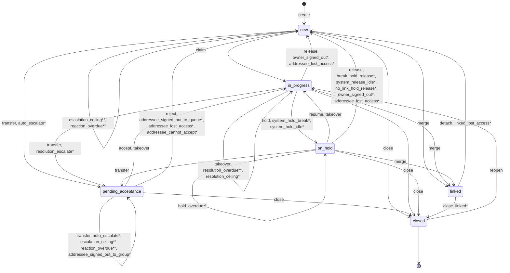

# Ревью IM 2026-10-28: формальная проверка машин после этапа 1б (ARCH-15)

Дата прохода: 2026-10-29. Проверяемый коммит: `afd30ea`, ветка `feature/im_operator` (ссылки ведут на этот коммит и заработают после push ветки). Роль: архитектор.

Номера и важность — по договорённостям в [reviews/README.md](../README.md). План этапа — [plan-1b.md](plan-1b.md), проект — [design-1b.md](design-1b.md).

# Проход: формальная проверка машины после ARCH-15

Формальная проверка обеих машин скиллом [im-fsm](../../.claude/skills/im-fsm/SKILL.md), пункт «После этапа» плана [plan-1b.md](plan-1b.md): «находки — проходом в `reviews/2026-10-28/`». Скилл кладёт проход в папку дня проверки (2026-10-29); по плану этапа проход лежит в папке этапа, `reviews/2026-10-28/`. `review.md` в этой папке раньше не было — этот файл первый.

Что смотрели — изменения этапа 1б, коммиты `d7129bf..afd30ea`:

- раздел `intake` машины (`uniqueKey`, `match`, `winner`, `create`, `ruleOrder`) и определения `conditionMatches`, `conditionRank`, `ruleRank`, `ruleMatches`, `ruleBeats`, `ruleFor`;
- `close` с `bulk.scope: "primaryScenario"`, `scopeNoteKey`, `skippedReasonKey` и определение `bulkPrimary`;
- эффект `notifySiblings` у `close` и `close_linked`;
- предупреждения `warnings` у поля `close.resultId` (два текста «Дубликата»);
- нормативы по сценарию (`overrideRank`, `scenario` в `overridesBy`);
- инвариант машины `oneIncidentPerEventScenario`;
- инварианты модели Quint `eventScenarioUnique` и `siblingsNotLinked`;
- машина сценариев: новый сценарий набора `medical.v1.json`.

## Главное

Машина инцидента корректна как автомат: 6 состояний, 32 перехода, начальное одно, все состояния достижимы, тупиков нет, перебор настроек даёт ровно один исход. Состояний и переходов этап не добавил: `notifySiblings` — новый эффект у двух старых переходов, `intake` — то, что стоит перед автоматом и решает, сколько раз выполнить `create`. Машина сценариев корректна: ошибок нет, новый сценарий проходит все проверки.

Находок 7: средняя 1, низких 6. Блокеров и высоких нет.

1. **RULE-137** [средний] — событие обрабатывается по принципу «всё или ничего». Одно правило со сценарием, который не создаётся, гасит все инциденты события у всех служб. Повтор события снова падает. Ни правила, ни контракт не говорят, кто об этом узнает.
2. **RULE-138** [низкий] — сосед, привязанный к чужому основному, при ложной тревоге получает только запись в журнал. Тот, кто ведёт его группу, уведомления не получает. Правила о таком соседе молчат.
3. **PROC-93** [низкий] — ключ «событие + сценарий» проверяется сам собой. `intake.uniqueKey` не читают ни исполнитель, ни модель. Инвариант Quint проверяет условие, которое модель сама себе пишет.

Остальные: **RULE-139** (описание `notifySiblings` в реестре), **RULE-140** (основной выборки для «Массового сбоя» может оказаться тем, кого закрыть нельзя), **DATA-14** (итог по пострадавшим в `medical.v1` необязателен), **DOC-79** (описание набора сценариев «по типу события» устарело).

## Автоматические проверки

- `check_machine.py`: 0 ошибок. `--mutations`: 37 порч, все пойманы, в том числе новые `bulk-scope-not-close`, `bulk-scope-note-key`, `intake-rule-order`. `build_workflow.py --check`: все собранные файлы совпадают с исходниками. `check_cel.mjs`: 0 ошибок — 35 условий, 26 эффектов, 73 правила интерфейса, включая `warnings`. `gen_quint.mjs --check`: модель совпадает с машиной. `test_openapi30.py`: 14 тестов OK. `check_links.py`: 0 нерабочих ссылок.
- `check_machine.py --fsm`: 17 сочетаний настроек, в каждом ровно один переход. В карте пересечений 44 пары, новых нет: этап не добавил автоматических переходов. Ручных переходов в окне, после которых таймер продолжается, три — те же.
- Тесты API (`tests/api.html`): итог `pass`, 22 сценария «im-fsm:», включая тест «покрытие». Ответы сверены с контрактом. Тесты стыка §14.5 (`api-junction.js`) входят сюда же.
- Модель Quint 0.33.0: `quint test im_test.qnt` — 52 из 52, включая `siblingsTwoScenariosTest`. `quint run --invariant inv`: широкий профиль (10 000 историй по 40 шагов) и профиль «смена» — нарушений нет. Свидетели: `premise_siblings` — в 1221 истории из 3000 (40,7 %), то есть соседи в модели бывают, и `eventScenarioUnique` с `siblingsNotLinked` проверяются не на пустом мире. `premise_twoLinked` — в 3 из 3000.
- Машина сценариев: `check_scenarios.py` — 0 ошибок, одно прежнее замечание к примеру `bad-5`. `--fsm` перебрал все шаги с правилами, включая `medical.v1`. `tests/scenario.html` — `pass`. `check_scenario_states.mjs`: 22 сценария, 7186 состояний прохождения, 0 нарушений; `--mutations` — 7 порч, все пойманы.
- Проверочные запуски для этого прохода — страница в scratchpad по образцу `tests/api-scenarios.js` (в репозиторий не вошла). На них стоит пометка ✅ у RULE-138 и PROC-93.

## Открытые пункты прошлых циклов

- В [plan-1b.md](plan-1b.md) шаги задач 15.1–15.9 стоят без `[x]`, хотя коммиты есть (`d46badc` … `9c0dfee`, `ab7e348`): исправлено, но не отмечено в плане. Пункт «После этапа → `/im-fsm`» закрывает этот проход.

## Таблица покрытия чек‑листа

| Пункт [checklist.md](../../.claude/skills/im-fsm/checklist.md) | Чем | Результат |
|---|---|---|
| 1. JSON и ссылки | скрипт | без замечаний |
| 1. Дубликаты id | скрипт | без замечаний |
| 1. Одинаковые условия у двух переходов из одного состояния | скрипт | без замечаний |
| 1. Поля по виду перехода (`bulk` только у ручных) | скрипт | без замечаний; `bulk.scope` проверяется (`bulk-scope-not-close`) |
| 1. Записи реестра используются | скрипт | без замечаний, `notifySiblings` используется в двух переходах |
| 1. Именование | чтение | без замечаний: `notifySiblings`, `bulkPrimary`, `siblingsOf`, `overrideRank`, `ruleFor` — camelCase; «сосед» (`sibling`) везде одним словом |
| 2. Начальное, `owner`, `activeTimer` | скрипт | без замечаний |
| 2. Таймеры: описание против эффектов | скрипт | без замечаний |
| 2. Владелец состояния против эффектов | чтение | без замечаний: `notifySiblings` владельца соседа не меняет |
| 2. Подписи и записи журнала против условий | чтение | без замечаний |
| 2. §4, §6.1–6.2, §8.1 против машины | чтение + скрипт | без замечаний: §4, правило 2 = `overrideRank`; §6.1 «Закрыть» и §6.2 `close_linked` = `notifySiblings`; о привязанном соседе — RULE-138 |
| 2. Функции реестра в других местах правил | чтение | находка RULE-139: `notifySiblings` нет в базовом реестре §14.8, а в машине он не помечен как расширение |
| 2. Запись журнала берёт нужное значение | чтение | без замечаний: `sibling_closed` берёт `closeResultId` и `closedBy`, их ставят `setFlag` (у `close`) и `copyCloseFromPrimary` (у `close_linked`) раньше |
| 2. Привязанные (§11.4) | чтение + запуск | связь `notifySiblings` не трогает. Соседи не бывают привязаны друг к другу: `sameScenarioAsPrimary` и ключ «событие + сценарий»; это же держит `siblingsNotLinked` в Quint. Сосед, привязанный к чужому основному, — RULE-138 ✅ |
| 2. Эффекты сверх §14.8 описаны и исполнены | чтение | `$comment` у `notifySiblings` есть, исполнитель делает запись, новую версию и уведомление (тесты API) — но см. RULE-139 |
| 3. Достижимость, выход из нетерминальных | скрипт | без замечаний |
| 3. Выходы из терминальных | чтение | только `reopen` — без изменений |
| 3. Тупики по условиям | чтение | новых нет |
| 4. Одна кнопка — один переход; эффекты верны из каждого исходного | чтение | `notifySiblings` срабатывает только на `false_alarm`, а он доступен только из `in_progress` — для остальных исходных состояний `close` эффект пустой, как и задумано |
| 4. В «В работе» — только по праву | скрипт | без замечаний |
| 4. Отказ — код `Problem` | чтение | пропуск по `bulk.scope` — не отказ, а `skipped` с `reasonKey`; выборка устарела — 412 целиком. Без замечаний |
| 5. Перебор настроек | скрипт + Quint | без замечаний |
| 5. Карта пересечений | скрипт | без замечаний, новых пар нет |
| 5. Прыжок часов, повторный вход, `to: null` один раз, системный в окне, ручной в окне с продолжением | сценарии | PASS |
| 5. Циклы без выхода | чтение | новых циклов нет |
| 6. Настройки ветвей в контракте | скрипт | без замечаний |
| 6. Ответы против контракта | сценарии | PASS |
| 7. Структура против аналогов | чтение | автомат тот же: те же виды полей и триггеров, нет вложенности и регионов. Новое — раздел `intake` перед автоматом: одно событие → несколько `create`. В SCXML и UML такого нет, ближе всего — `spawn` в XState или внешний диспетчер событий. В таблицу скилла стоит дописать строку — DOC-79 |
| 8. Схема, граф, перебор, финальный шаг без макроса, набор | скрипт | без ошибок; `medical.v1` проходит все проверки |
| 8. Прохождения и вычислитель; стык §14.5 | сценарии | PASS |
| 8. Шаги, которые не перебираются | чтение | в наборе таких нет |
| 8. Исход по смыслу | чтение | `medical.v1`: «Да» ведёт к «Вызвать скорую», «Нет» — сразу к итогу. Без замечаний |
| 8. Обязательность | чтение | находка DATA-14 |
| 8. Циклы | чтение | циклов нет |
| 8. Стык: правила, профиль, исполнитель | чтение | выбор сценария теперь по правилу, а не по типу события; описание набора сценариев отстало — DOC-79 |
| 9. Машина оператора | скрипт + сценарий | без изменений на этапе; PASS |

## Состояния

| id | Название | Вид |
|---|---|---|
| `new` | Новое | initial |
| `pending_acceptance` | Ожидает принятия | normal |
| `in_progress` | В работе | normal |
| `on_hold` | Отложен | normal |
| `closed` | Закрыто | terminal |
| `linked` | Привязан | normal |

## Переходы, которые изменил этап

Полный перечень — [TRANSITIONS.md](https://github.com/soulhome2/IM/blob/afd30ea/Specification/Workflow_machine/TRANSITIONS.md). Этап 1б поменял три перехода:

| from | Событие | Условия | Эффекты | to |
|---|---|---|---|---|
| — | `create` (появление) | — | `setOwner`, `setAssignmentGroup`, `setFlag`, `startTimer`, `appendLog`. Сколько раз выполнить на событие, решает `intake`: по разу на сценарий подошедших правил | `new` |
| `new`, `pending_acceptance`, `in_progress`, `on_hold` | `close` | `agentReady`, `closeResultAllowed` | … `appendLog`, **`notifySiblings`**, `returnToQueue`, `externalCommand`. На выборке — `bulk.scope: primaryScenario` | `closed` |
| `linked` | `close_linked`* | `primaryClosed` | `copyCloseFromPrimary`, `pauseTimer`, `setFlag`, `appendLog`, **`notifySiblings`**, `externalCommand` | `closed` |

## Граф

`*` — автоматический переход, `°` — без смены состояния.

## Таблица проблем

| Проблема | Место | Важность | Уверенность | Что предложено |
|---|---|---|---|---|
| RULE-137: одно несоздаваемое правило гасит всё событие, молча | `intake`, §14.5 п. 4, `server.js` `intakeEvent` | средний | высокая — тест API это закрепляет | решение: не давать правилу ссылаться на несуществующий сценарий и/или сообщать о сбое |
| RULE-138: привязанный сосед — запись без уведомления | `notifySiblings`, `addressee`, §6.1 | низкий | высокая — запуск | решение: уведомлять адресата основного или записать в правилах, что не уведомляется |
| RULE-139: `notifySiblings` в реестре — без `extendsBaseRegistry`, класс `transactional` при уведомлении | `registries.effects` | низкий | высокая — чтение | флаг, разделить эффект на два, проверка в `check_machine.py` |
| RULE-140: основной выборки по §11.3 не проверяется на «можно закрыть» | `bulkPrimary` | низкий | низкая — при справочнике по умолчанию примера нет | решение |
| PROC-93: `uniqueKey` и `oneIncidentPerEventScenario` никто не исполняет | `engine.js` `intake`, Quint `createOk` | низкий | высокая — запуск | исполнитель и модель — от `uniqueKey`; порча машины |
| DATA-14: итог по пострадавшим необязателен | `medical.v1.json`, шаг `summary` | низкий | средняя — смысл | решение |
| DOC-79: «сценарий по типу события» в описаниях набора | SKILL, чек‑лист, `check_scenarios.py`, README машины сценариев | низкий | высокая | поправить текст |

## 4. Противоречия и пробелы в правилах

- **RULE-137** [средний] *архитектор, продакт* ✅ **Событие «всё или ничего»: одно несоздаваемое правило молча гасит инциденты всех служб.**
  По §14.5, п. 4 все инциденты события создаются одной транзакцией: если не создался один, не создаётся ни один ([правила, §14.5](https://github.com/soulhome2/IM/blob/afd30ea/Specification/State_rules/States%20rules%20IM.md?plain=1#L693)). Так исполняет и сервер прототипа ([server.js:1849](https://github.com/soulhome2/IM/blob/afd30ea/prototype/server.js#L1849)). Тест API это закрепляет. Добавим к правилам пожара правило со сценарием, которого нет. Тогда ни пожарный инцидент, ни медпункт не создаются, событие не записывается, и повтор того же события снова падает ([api-scenarios.js:1811](https://github.com/soulhome2/IM/blob/afd30ea/tests/api-scenarios.js#L1811)).
  Принцип «всё или ничего» ввели ради повторов: повтор события не должен досоздавать инциденты (консилиум, Д6). Но у него есть обратная сторона: одна ошибка настройки у одной службы прячет тревогу от всех служб, и прячет навсегда. Например, правило медпункта ссылается на удалённый или неопубликованный сценарий — и пожарная тревога тоже не появляется. Правила, контракт и `BACKEND.md` не говорят, что происходит дальше: кто узнаёт о сбое, где его видно, сколько раз источник повторяет событие. Редактора правил в МИ нет: правила приходят из настройки облака. Поэтому от ссылки на сценарий без версии МИ сейчас ничего не защищает.
  Уверенность: высокая — поведение закреплено тестом. Почему не [высокий]: нужна ошибка настройки, при правильной настройке потери нет.

- **RULE-138** [низкий] *архитектор, UX* ✅ **Сосед, привязанный к чужому основному: ложная тревога — запись в журнал без уведомления.**
  `notifySiblings` уведомляет адресата соседа: `addressee(s)` — владелец, иначе дежурная группа ([workflow_schema.v1.json:1564](https://github.com/soulhome2/IM/blob/afd30ea/Specification/Workflow_machine/workflow_schema.v1.json#L1564), [:1435](https://github.com/soulhome2/IM/blob/afd30ea/Specification/Workflow_machine/workflow_schema.v1.json#L1435)). У привязанного `merge` очищает и владельца, и группу, поэтому уведомления нет никому. А ведёт привязанного владелец его основного.
  Проверено запуском. Создали второй инцидент медпункта INC-1854, взяли его в работу и объединили с INC-1853 — тот стал привязанным к INC-1854. Петрова закрыла пожар INC-1847 (сосед INC-1853) «Ложной тревогой». У INC-1853 появилась запись `sibling_closed`. Мне, владельцу основного INC-1854, пришло только `journal.appended`, без `incident.sibling_closed`.
  Правила об этом случае молчат. §6.1 говорит «каждому открытому соседу … уведомление его адресату», а `BACKEND.md` называет привязанные «не открытыми» — то ли такой сосед вообще не должен получать запись, то ли должен получать и уведомление ([правила, §6.1](https://github.com/soulhome2/IM/blob/afd30ea/Specification/State_rules/States%20rules%20IM.md?plain=1#L316)). Машина пишет запись (`!isDone`), но никого не уведомляет. Тесты API покрывают закрытие привязанного (`close_linked`), но не привязанного соседа ([api-scenarios.js:2207](https://github.com/soulhome2/IM/blob/afd30ea/tests/api-scenarios.js#L2207)).
  Уверенность: высокая — запуск. Важность низкая: ложная тревога одной службы не отменяет работу другой (§6.1), уведомление только информирует.

- **RULE-139** [низкий] *архитектор, разработчик* **`notifySiblings` в реестре: не помечен как расширение, и класс эффекта не тот.**
  В базовом реестре эффектов §14.8 `notifySiblings` нет ([правила, §14.8](https://github.com/soulhome2/IM/blob/afd30ea/Specification/State_rules/States%20rules%20IM.md?plain=1#L775)). Функции сверх базового списка машина помечает `extendsBaseRegistry: true` — «их нужно реализовать». У `notifySiblings` этой пометки нет ([workflow_schema.v1.json:1564](https://github.com/soulhome2/IM/blob/afd30ea/Specification/Workflow_machine/workflow_schema.v1.json#L1564)). Это единственная функция сверх базового списка без пометки. `check_machine.py` проверяет только, что у помеченных есть `$comment` ([check_machine.py:993](https://github.com/soulhome2/IM/blob/afd30ea/tools/check_machine.py#L993)), а непомеченную функцию не из базового списка пропускает.
  Второе. Эффект помечен `kind: transactional`, но кроме записи в журнал шлёт уведомление (`world: notify`). README машины делит эффекты на два класса: уведомления — `external`, через очередь исходящих, и при их отказе переход не откатывается ([README.md:148](https://github.com/soulhome2/IM/blob/afd30ea/Specification/Workflow_machine/README.md#L148)). Что уведомление уходит после транзакции, сказано только словами — в `$comment` и в `BACKEND.md`. Бэкенд, который смотрит на `kind`, отправит уведомление внутри транзакции: сбой доставки откатит закрытие. В остальной машине запись и уведомление — два эффекта: `appendLog` и `notify`.
  Уверенность: высокая — чтение машины и правил.

- **RULE-140** [низкий] *архитектор* **Основной выборки для «Закрыть без обработки»: основной по §11.3 не проверяется на «можно закрыть».**
  `bulkPrimary` сначала берёт основного по `mergePrimary`: свой «В работе», иначе новый. Только если такого нет, он выбирает из тех, кого оператор может закрыть ([workflow_schema.v1.json:1446](https://github.com/soulhome2/IM/blob/afd30ea/Specification/Workflow_machine/workflow_schema.v1.json#L1446)). Решение 2026-10-29 («основной — среди доступных») касается только второй ветки. Если основного по первой ветке закрыть нельзя, действие недоступно на всей выборке — хотя другие отмеченные закрыть можно. Ровно этот случай решение 2026-10-29 исправило для второй ветки.
  При справочнике результатов по умолчанию примера нет. С выборки закрывают только «Массовым сбоем» (`surfaces: queue`). Он доступен из `new` и из своего «В работе», то есть основной по §11.3 закрыть всегда можно — если у оператора есть право `incident:close:unprocessed`; без права нельзя закрыть ничего. Пример появится, если продуктовая команда сузит `fromStates` у «Массового сбоя». Например, уберёт «В работе»: тогда выборка «свой пожар в работе + три новых медпункта» не закроется вовсе.
  Уверенность: низкая — зависит от справочника, при справочнике по умолчанию не воспроизводится.

## 6. Демо-данные

- **DATA-14** [низкий] *продакт* **`medical.v1`: итог по пострадавшим необязателен.**
  Ветка «Есть пострадавшие? — Да» ведёт к шагу «Вызвать скорую», затем к финальному «Итог по пострадавшим» (`summary`). В описании шага сказано: «Сколько пострадавших, кому переданы». Шаг необязательный ([medical.v1.json:88](https://github.com/soulhome2/IM/blob/afd30ea/Specification/Workflow_machine/fixtures/scenarios/medical.v1.json#L88)). Его можно пропустить, прохождение завершится, и «Обработан» станет доступен. Тогда медицинский инцидент закроют без единой записи о пострадавших. У остальных сценариев набора финальный шаг тоже необязательный, но там это свободная заметка `note`. Здесь же в итоге то, ради чего сценарий и нужен. Пункт чек‑листа 8 «Обязательность».
  Уверенность: средняя — это вопрос смысла, а не формата.

## 5. Документы

- **DOC-79** [низкий] *разработчик* **Описание набора сценариев отстало от выбора по правилу.**
  После ARCH-15 сценарий инцидента берётся из правила, а файлы набора называются по ключу `scenarios.keys`: `medical.v1.json` — не тип события. Старые слова остались в четырёх местах:
  - в скилле: «`fixtures/scenarios/<тип события>.v<версия>.json`» ([SKILL.md:116](https://github.com/soulhome2/IM/blob/afd30ea/.claude/skills/im-fsm/SKILL.md?plain=1#L116));
  - в чек‑листе: «у типа события — существующий сценарий» ([checklist.md:77](https://github.com/soulhome2/IM/blob/afd30ea/.claude/skills/im-fsm/checklist.md?plain=1#L77)). Скрипт проверяет уже другое: сценарий инцидента — из сценариев его правила;
  - в описании `check_scenarios.py` ([:9](https://github.com/soulhome2/IM/blob/afd30ea/tools/check_scenarios.py#L9));
  - в README машины сценариев: «инструкция оператору под тип события» ([README.md:3](https://github.com/soulhome2/IM/blob/afd30ea/Specification/Scenario_machine/README.md?plain=1#L3)).

  В таблице сравнения с нотациями в SKILL.md нет строки про `intake`: одно событие — несколько `create`.

## 7. Процесс

- **PROC-93** [низкий] *архитектор, тестировщик* ✅ **Ключ «событие + сценарий» проверяется сам собой: `intake.uniqueKey` никто не исполняет.**
  Машина задаёт ключ уникальности `intake.uniqueKey: ["eventGuid", "scenario"]` и флаг `invariants.oneIncidentPerEventScenario` ([workflow_schema.v1.json:1492](https://github.com/soulhome2/IM/blob/afd30ea/Specification/Workflow_machine/workflow_schema.v1.json#L1492), [:1754](https://github.com/soulhome2/IM/blob/afd30ea/Specification/Workflow_machine/workflow_schema.v1.json#L1754)). Исполнитель их не читает: «один инцидент на сценарий» записан в коде — `new Set` по сценариям ([engine.js:485](https://github.com/soulhome2/IM/blob/afd30ea/prototype/engine.js#L485)). Проверено запуском: со стендом `workflowPatch` `uniqueKey: ["eventGuid"]` событие пожара всё так же даёт два инцидента — INC-1854 «Медпомощь при пожаре» и INC-1855 «Пожарная тревога».
  Модель Quint ключ из машины тоже не берёт. Условие `createOk` написано в ядре руками ([core.qnt:89](https://github.com/soulhome2/IM/blob/afd30ea/Specification/Workflow_machine/quint/src/core.qnt#L89)), а `eventScenarioUnique` проверяет то же самое ([invariants.qnt:459](https://github.com/soulhome2/IM/blob/afd30ea/Specification/Workflow_machine/quint/src/invariants.qnt#L459)). `eventGuid` и `scenario` после появления никакой переход не меняет. Поэтому инвариант не может упасть, пока `createOk` на месте, и порчу `uniqueKey` в машине не заметит ни модель, ни тесты. Правило записано в машине, а держится кодом — так, как договорённость «правило — в машине» (`CLAUDE.md`) запрещает.
  Выбор правила (`ruleFor`, `ruleBeats`, `conditionRank`) модель тоже не проверяет — «вне модели». Его держат тесты API и порчи кода `intake-*`, это нормально. Но об этом стоит написать в README модели, рядом с `eventScenarioUnique`.
  Уверенность: высокая — запуск и чтение.

## Предложения в план

План этапа — [plan-1b.md](plan-1b.md); поручение прохода — находки только в этот файл, поэтому предложения записаны здесь, а не в `plan.md`.

Без решений:

- [ ] **RULE-139** `registries.effects`: у `notifySiblings` — `"extendsBaseRegistry": true`. Эффект — на два, как `appendLog` + `notify`: `logSiblings(results, key)` `transactional` (запись и `touch`) и `notifySiblings(results)` `external` (уведомление). Было: `{ "kind": "transactional", "fn": "notifySiblings", "args": [["false_alarm"], "workflow.journal.sibling_closed"] }` → стало: `{ "kind": "transactional", "fn": "logSiblings", "args": [["false_alarm"], "workflow.journal.sibling_closed"] }, { "kind": "external", "fn": "notifySiblings", "args": [["false_alarm"]] }` — у `close` и `close_linked`. В `check_machine.py` — функция реестра не из базового списка §14.8 и без `extendsBaseRegistry` → ошибка; порча — снять флаг.
- [ ] **PROC-93** Исполнитель — уникальность по `W.intake.uniqueKey`: сценарии подошедших правил группируются по ключу из полей инцидента, а не `new Set` по сценарию. `gen_quint.mjs` — `createOk` из `intake.uniqueKey`. Порча машины `intake-unique-key` (`uniqueKey: ["eventGuid"]`) должна падать на тесте «пересекающиеся правила одного сценария» и на `eventScenarioUnique`. В README модели — что выбор правила вне модели и чем он проверяется.
- [ ] **DOC-79** SKILL.md:116, checklist.md:77, `check_scenarios.py:9` — «`<ключ>.v<версия>.json` по `scenarios.keys`», «сценарий инцидента — из сценариев его правила»; README машины сценариев, строка 3 — «инструкция оператору службы (сценарий правила, §14.5)». В таблицу нотаций SKILL.md — строка «Событие → инциденты: раздел `intake` — по `create` на сценарий подошедших правил; аналог — `spawn` XState, в SCXML и UML нет».

Решения:

| Номер | Вопрос | Варианты | Предложение | Решение | Кто, дата |
|---|---|---|---|---|---|
| RULE-137 | Что делать, если один инцидент события не создаётся (сценарий правила без версии) | а) не давать сохранить такое правило: МИ при получении правил из облака отбрасывает правило со сценарием без версии и пишет об этом администратору; транзакция события остаётся «всё или ничего» · б) создавать инциденты, которые создаются; сбойные сценарии — в журнал события и алерт получателю алертов · в) оставить «всё или ничего», но событие записать как «не обработано», алерт получателю алертов и строка в §14.5 · г) как есть | а) и в): ошибка настройки ловится до события, а если всё же случилась — тревога не теряется молча | г) как есть: событие «всё или ничего», без сообщения; в §15, решённые, — строка | joynickray, 2026-10-29 |
| RULE-138 | Сосед привязан к чужому основному — кому уведомление о ложной тревоге | а) адресату основного (`addressee` основного по `linkedTo`) · б) никому, только запись — и строка в §6.1 «привязанному соседу — только запись» · в) привязанному соседу ни записи, ни уведомления, раз он «не открытый» | а): группой занимается владелец основного | а) уведомлять адресата основного — по тем же правилам «не закрывшему» и видимости | joynickray, 2026-10-29 |
| RULE-140 | Основной выборки для «Закрыть без обработки», если основного по §11.3 закрыть нельзя | а) `bulkPrimary` — сначала основной по §11.3 среди тех, кого оператор может закрыть, иначе — как сейчас вторая ветка · б) как есть: при справочнике по умолчанию такого не бывает | а): одно правило для обеих веток, не зависит от справочника | а) одно правило: основной по §11.3 — только среди тех, кого оператор может закрыть; нет такого — вторая ветка | joynickray, 2026-10-29 |
| DATA-14 | Итог по пострадавшим в `medical.v1` | а) шаг `summary` обязательный · б) обязательный только на ветке «Да»: отдельный финальный шаг после «Вызвать скорую» · в) как есть | б): при «Нет» итог не нужен | в) как есть | joynickray, 2026-10-29 |

## Что не проверяется статически

- Права и роли из облака, время и связь оператора, доставка уведомлений и выгрузки (внешние эффекты), смысл значений справочников.
- Выбор правила по событию (`ruleFor`, `ruleBeats`, `conditionRank`) — вне модели Quint. Его держат тесты API (`/test/events`) и порчи кода `intake-*` (`check_code_mutations.py`). Полный прогон порч кода в этом проходе не запускался — его гоняет CI.
- Предупреждения `warnings` — правило интерфейса, вне модели Quint: проверены `check_cel.mjs` (типы) и тестами API (тексты и `n`).
- `bulk.scope` и выборка — вне модели Quint, выборки в ней нет: проверены тестами API и порчами машины `bulk-scope-*`.
- Самопроверка прототипа (`index.html?selftest`) и `check_ui.py` в этом проходе не запускались: проверка касается машин, а интерфейс этап проверял в своих задачах.

## Машина сценариев

| Сценарий набора | Шагов | Шагов с правилами | Что перебрано |
|---|---|---|---|
| `medical.v1` (новый, «Медпомощь при пожаре») | 3 | 1 (`injured`) | все 2 ответа: «Да» → `ambulance`, «Нет» → `summary` (default); оба исхода срабатывают, заслонённых нет |
| остальные 10 версий набора | без изменений | — | карта `--fsm` прежняя, все правила и `default` срабатывают |

- Ошибок 0. Замечание к примерам одно, прежнее: `bad-5` — `default` не срабатывает ни при каком ответе. Это отрицательный пример.
- Граф `medical.v1`: все шаги достижимы, финальный — `summary` (`finish: true`, без макроса и правил), циклов нет.
- Стык §14.5: сценарий инцидента теперь — из сценариев правила-победителя, последняя версия. `check_scenarios.py` сверяет это для инцидентов набора. Тесты стыка проходят. Находки — DATA-14 и DOC-79.
